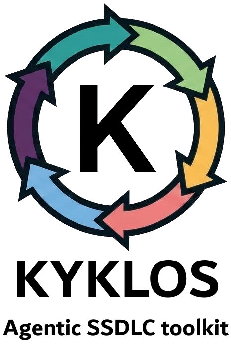
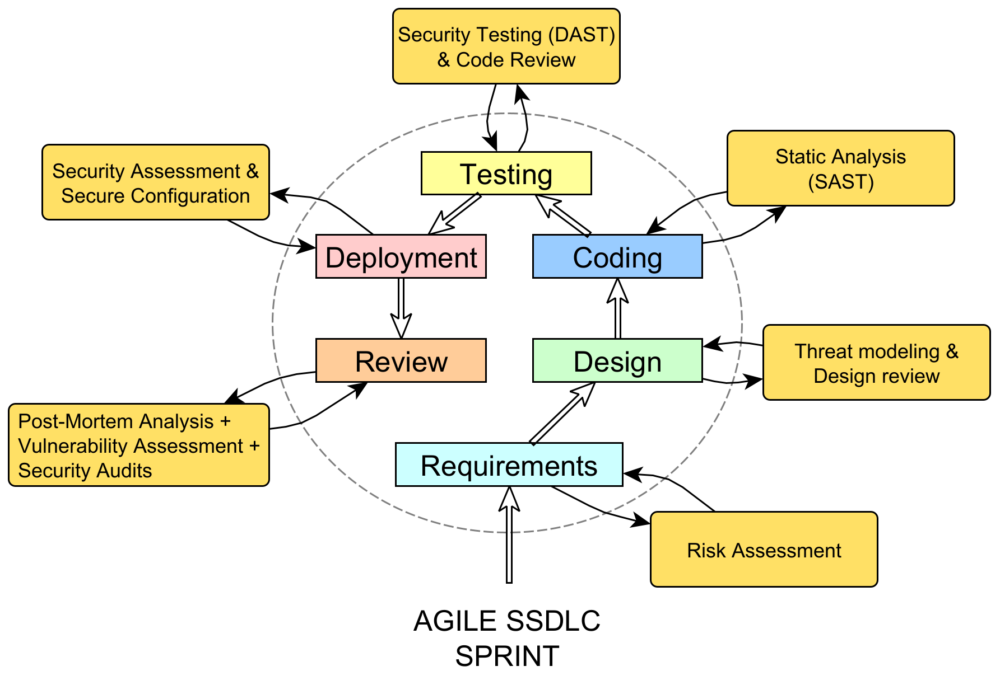
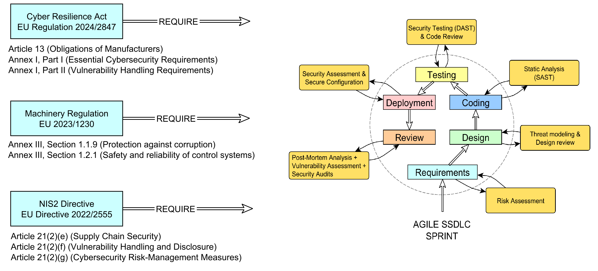

<p align="center">

</p>

AI coding agents are fast, and that is the problem. They write code faster than anyone can review it, they report "done" when it only compiles, and they forget the rule they were given an hour ago.
Writing better instructions does not fix this. Instructions are advice, and an agent under pressure treats advice as optional.

## A Quality Assurance-driven workflow that the AI agent cannot skip or cheat

> Kyklos focuses on Quality Assurance, Robustness, Correctness, Cybersecurity, and makes the engineering process something the agent cannot bypass.

- Every rule that can be checked by a machine is checked by a machine, at the moment the agent tries to break it.
- Every claim the agent makes about its own work ("tested", "reviewed", "documented") has to be backed by evidence that a tool produced, never by the agent's word.
- A story is closed only when that evidence is in place.

## Kyklos and the Agile SSDLC (Secure Software Development Lifecycle)

The name comes from the Greek _kyklos_, the cycle: plan, build, prove, review, close, and start again, with nothing left half-done in between.  
It's inspired by the intrinsic cyclic nature of the *Agile* SSDLC (Secure Software Development Lifecycle) workflow, a vital piece of modern cybersecurity-oriented software development.

<p align="center">

</p>

The Agile SSDLC is the result of a growing understanding within the security and software engineering communities about the necessity of proactive security measures. The concept evolved over time, driven by the increasing awareness of software vulnerabilities and the need to build more secure applications. The core structure of the SSDLC is not very different from the traditional SDLC, and in fact it can be considered an extension of SDLC with the distinctive feature of integrating security measures into every phase of the software development process. By embedding security from the initial design through to deployment, Agile SSDLC ensures that potential vulnerabilities are addressed proactively.

> The primary purpose of **Kyklos** is to make the agent stick to the steps and practices that allow the team to fully and easily adopt the Agile SSDLC workflow.

## ✅ The principles

1. [**Proven, not asserted.**](docs/PROOF.md) The agent never marks its own homework. Test coverage, duplication scans, documentation checks and reviews produce signed tokens and attached reports (see the [Proof Table](docs/PROOF.md)). A claim without its
   token is refused.
2. **Mistake-proof by design.** When a mistake is possible, Kyklos first tries to make it impossible, then to make it fail at once, then to block it at the point of action. A written rule is the last
   resort, never the first. Every defect that gets through earns a new guard before its fix is closed.
3. **On by default.** Every guard and check ships enabled. Turning one off takes an explicit, visible, auditable decision. A control that is off by default looks like it is there, and isn't.
4. **Fail closed.** A check that cannot run (no network, a missing tool, an unreadable answer) refuses. It never passes quietly.
5. **Proven where it runs.** A change is proven in the environment it will live in (the real operating system, the real CI, the real service), on the merged result rather than on an isolated branch,
   and under load when timing matters.
6. **One source of truth.** Stories, decisions, proofs and reviews live in one configured storage (the issue tracker, or plain files for standalone and offline projects; see [Storages](docs/STORAGES.md)), where people can see them. The agent's own memory is treated as disposable.
7. **The human decides what matters.** Kyklos keeps a short, explicit list of actions that always stop for a person: publishing outward, deleting shared things, introducing a new blocking gate.
   Everything else, the agent drives on its own, within the rules.

## 🎯 Who it is for

- **Tech leads and developers** who want AI agents in their teams without lowering the bar, and who need evidence they can audit rather than a promise.
- **Organisations under secure-development expectations** ([IEC 62443-4-1](https://www.isa.org/standards-and-publications/isa-standards/isa-iec-62443-series-of-standards) practice, [NIS2](https://eur-lex.europa.eu/eli/dir/2022/2555/oj)-style risk management), where "how do you know?" needs an answer on record (see the [Knowledge base](docs/KB.md) for the standards Kyklos refers to).
- **Teams running several agents at once**, where Kyklos keeps parallel work from colliding: one lane per change, shared resources locked, merges in order (see [How the agent uses Git](docs/GIT.md)).

>  Kyklos does not make the agent smarter. It makes the agent's work **verifiable**, **deterministic**, and it makes skipping the process harder than following it.


## 📜 Helping satisfy legal requirements, new-generation legal frameworks and standards

Many countries are introducing laws that require software makers to follow best practices in quality assurance, cybersecurity and cyber resilience.
A secure development lifecycle is the first step towards meeting them, and the foundation that keeps a team compliant over time.

For example, the EU requires the adoption of these practices, to varying degrees, through the [**Cyber
Resilience Act**](https://eur-lex.europa.eu/eli/reg/2024/2847/oj) (EU Regulation 2024/2847), the **[NIS2](docs/KB.md#standards-catalogues-and-references)** (EU Directive 2022/2555) and the [**Machinery Regulation**](https://eur-lex.europa.eu/eli/reg/2023/1230/oj) (EU 2023/1230). The [Knowledge base](docs/KB.md) links the original texts.

<p align="center">

</p>


Other jurisdictions are moving in the same direction:

- **USA:** Executive Order 14028 on improving the nation's cybersecurity (2021) led federal agencies to require secure development practices, based on the [NIST SSDF](https://csrc.nist.gov/pubs/sp/800/218/final), from their software suppliers.
- **Canada:** [Bill C-8](https://www.parl.ca/legisinfo/en/bill/45-1/c-8), which received royal assent in June 2026 and enacts the Critical Cyber Systems Protection Act. Check the in-force status of its core provisions before relying on it.
- **Australia:** the [Cyber Security Act 2024](https://www.homeaffairs.gov.au/cyber-security-subsite/Pages/cyber-security-act.aspx), which sets mandatory security standards for smart devices.
- **China:** the [Cybersecurity Law](https://www.gtlaw.com/en/insights/2026/2/chinas-amended-cybersecurity-law-takes-effect), amended with effect from 1 January 2026, which penalises providers that fail to fix security defects promptly.

This list is indicative and is not legal advice.

---

## 📃 Table of contents

The following sections illustrate how *Kyklos* works and how it helps to keep the behaviour of the AI agent "on track" with an *Agile SSDLC* workflow.

1. [Supported languages and tools: programming languages, test frameworks, measuring tools and human languages](docs/SUPPORT_MATRIX.md)  
2. [Stories, Epics, and how the agent works with them](docs/AGILE.md)
3. [The complete Kyklos (Agile SSDLC-based) workflow](docs/WORKFLOW.md)
4. [The three Kyklos components](docs/COMPONENTS.md)
5. [How the process is enforced: hooks and skills](docs/HOOKS_AND_SKILLS.md)
6. [Where stories and epics live: storages](docs/STORAGES.md)
7. [Project topologies](docs/TOPOLOGIES.md)
8. [Secrets: the agent uses them without knowing them](docs/SECRETS.md)
9. [How the agent uses CI](docs/CI.md)
10. [How the agent uses Git: branching and authorisation](docs/GIT.md)
11. [The Proof Table](docs/PROOF.md)
12. [Adversarial reviews](docs/ADVERSARIAL_REVIEW.md)
13. [The Infrastructure session: one privileged agent across projects](docs/INFRASTRUCTURE_SESSION.md)
14. [Similar projects, and how Kyklos compares](docs/SIMILAR_PROJECTS.md)
15. [Manually install and configure Kyklos on Windows](docs/INSTALL_AND_CONFIG.md)
16. [Installing Kyklos with an agent: step-by-step instructions an agent can follow](docs/AGENT_INSTALL.md)
17. [Knowledge base](docs/KB.md)

---  


## 🚀 Get Started

To get started, follow [Installing and configuring Kyklos on Windows](docs/INSTALL_AND_CONFIG.md): a roadmap from zero to a working agent on a "Hello World" .NET project in GitLab.

To let an agent do the installation for you, point it (running on the host, not in a container) at [Agent Install](docs/AGENT_INSTALL.md): numbered steps with a check after each one, which stop and ask you wherever only a person can act (tokens, secrets, logins, approvals).

To run without the [Launcher](docs/COMPONENTS.md#kyklos-launcher) (you start the [Bridge](docs/COMPONENTS.md#kyklos-bridge), install the [Plugin](docs/COMPONENTS.md#kyklos-plugin) in Claude Code and connect the two yourself), see [Wiring a project by hand](docs/INSTALL_AND_CONFIG.md#wiring-a-project-by-hand-without-the-launcher); the Plugin itself installs with:

```bash
claude plugin marketplace add https://github.com/DogmaSolutions/Kyklos.git
claude plugin install kyklos@dogmasolutions
```
