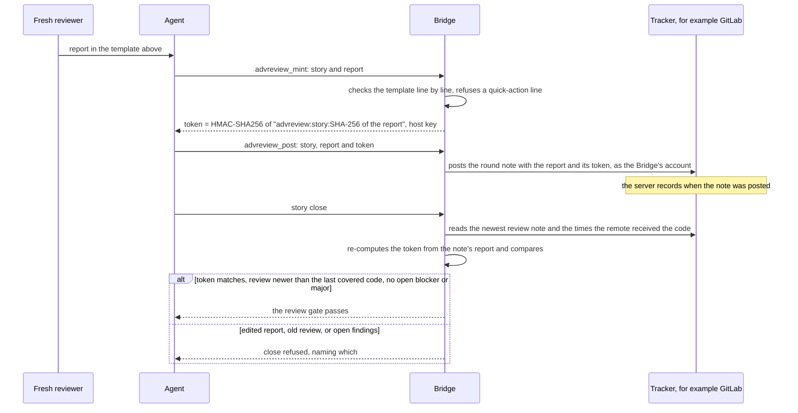

# Adversarial reviews

[← Back to the README](../README.md)

Before a story closes, a **fresh reviewer** attacks the change: a new agent, preferably running on **a different model** than the one that wrote the code, given the specification and the system, not
the author's notes. It looks for correctness errors, mismatches with the requirements, conflicts with neighbouring features, tests that cannot fail, duplication, bad practices, documentation drift,
performance defects and security holes. It also looks beyond the changed lines: every caller of what changed, other stories that touched the same files, the real behaviour of external systems (not
what a fake assumes), and behaviour under load. It writes at least one new test meant to break the change.

**Where it sits:** in phases *(5) Deployment* and *(6) Review* of the [workflow diagram](WORKFLOW.md): after the tests, the coverage receipt, the documentation pass and the risk assessment. A review that is not a *clean bill* sends the work back to development (the red path in the diagram). The review is posted on the story with its token,
and the close verifies that token (see the [Proof Table](PROOF.md)): a story cannot close on a review that never ran, or on a report edited after it was signed.

**It must see the finished code:** for a development story whose change touches code that coverage measures, the review on record must be **newer than the moment the remote received the last
change to that code** (the time the merge request carrying it received it, recorded by the server). In practice the review runs on the change once it is pushed with its merge request, and a fix
pushed after the review needs a new review before the close (see [The Kyklos Workflow](WORKFLOW.md)). Documentation, analysis and ops stories are not held to this timing, but still need their review.

**Loops:** each finding is classified *blocker*, *major*, *minor* or *hygiene*. Blockers and majors must be fixed, and the fix is reviewed again. The loop ends when a review finds nothing relevant to
fix, or after **3 rounds**; whatever is left is listed for the people to decide, never silently dropped. If blockers or majors remain after the last round, the story cannot close on its own: a person can allow more review rounds, or accept the residual risks and let the workflow continue, and that decision is recorded. Each round is posted on the story as its own numbered note.

A realistic review report (the format the [Bridge](COMPONENTS.md) accepts and signs):

```markdown
### Summary

2 findings (0 blocker, 1 major, 1 minor), 1 hygiene items, 2 new adversarial tests. The retry is
correct for the documented failures, but a shutdown during a wait leaves the export running for up
to 4 seconds. Verdict: findings

### Findings

- **F1** · major · `src/Export/UploadRetry.cs:31` — the wait between attempts ignores the
  cancellation token, so stopping the service during a wait does not stop the export. Fix: pass the
  token to the delay and treat cancellation as a final, non-retried outcome.
- **F2** · minor · `src/Export/RetryOptions.cs:12` — `MaxAttempts = 0` is accepted but means "never
  upload"; the documentation says it means "no retry". Fix: define 0 as one attempt, or reject it.

### Hygiene

- **H1** · `tests/Export/UploadRetryTests.cs:88` — the test sleeps 2 s; a fake clock would make it
  fast and deterministic.

### New adversarial tests

- **T1** · expected to FAIL · `A_shutdown_during_a_wait_ends_the_export_at_once` — locks F1.
- **T2** · expected to PASS · `A_server_error_after_the_last_attempt_is_reported_once`.
```

*Expected to FAIL* means the test reproduces a finding: it fails until the fix is made, and then keeps the fix from regressing (T1 above). *Expected to PASS* means it checks behaviour that must already work.

## How the review token is made and checked

A review only counts when the close can tell that it really ran, on this story, and that its report was not edited afterwards. That is the job of the **review token**, and the
[Adversarial Review](PROOF_DIMENSION_ADVERSARIAL_REVIEW.md) row of the [Proof Table](PROOF.md) presents it.



- **Where things are.** The report is posted as a numbered note on the story (`Adversarial review (round N)`), by the Bridge's own account: the verb `advreview_mint` signs the report, and `advreview_post` posts it with its token; the skill
  `kyklos:ssdlc-adversarial-review` drives it. A note that only quotes the marker of a review note does not count.
- **The secret.** The token is a keyed hash (HMAC-SHA256) under the proof signing key `KYKLOS_PROOF_HMAC_KEY`. The `Kyklos Launcher` creates that key on first use, keeps it in the operating
  system's credential store and hands it only to the Bridge process; the agent's container and the builds the Bridge runs never receive it (see [Secrets](SECRETS.md)). Without the key no token is
  made and none verifies.
- **How the signature is computed.** The Bridge hashes the report text with SHA-256 and signs the text `advreview:<story>:<that hash>`. Changing one character of the report, or presenting the
  token on another story, gives a different value. The computation lives in `bridge/src/DogmaSolutions.ProjectManagement.Agile.Ssdlc/ProofTokenBinding.cs`.
- **When it is checked.** When the proof is written (`proof_set` and the proof check), at the close, and by the Stop rule that re-grades a story closed in the session. The close also checks the
  timing of rule 4 of [the workflow](WORKFLOW.md#rule-4-the-review-saw-the-finished-code): for a development story, the review must be newer than the moment the remote received the last change of
  the code coverage measures.
- **Free text is checked before it is posted.** A line of the report that would run a tracker command (on GitLab a *quick action*: a line starting with `/` and a letter, such as `/close`,
  outside a fenced code block) is refused, naming the line, because posting it would change the issue. Text the Bridge composes itself never starts a line that way.
- **What a failed check causes.** The close is refused and names the cause: no review on record, a report that no longer matches its token, a review older than the last pushed code, or open
  blocker or major findings. The fix is a new review round (or the fix, then a review), not an edit of the note.
- **Impact on the user.** None while the loop converges. After the third round with blockers or majors still open, the story cannot close on its own: a person decides, either allowing more rounds
  or accepting the residual risk, and only the owner's [`proof-override` label](WORKFLOW.md#the-owners-proof-override-label), with a named cause, waives the row.

## Related pages

[The Proof Table](PROOF.md), [The Kyklos workflow](WORKFLOW.md), [Hooks and skills](HOOKS_AND_SKILLS.md), and [the README](../README.md) for the full list.
