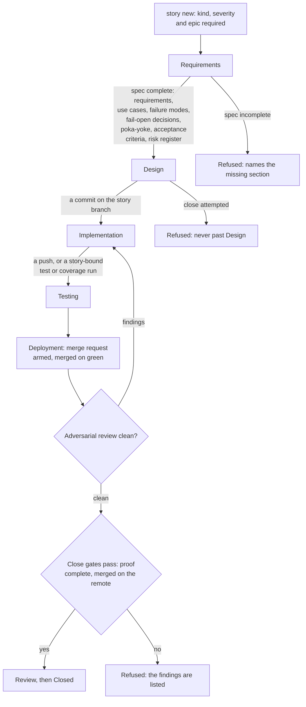

# Stories, Epics, and how the agent works with them

[← Back to the README](../README.md)

Like the traditional *Agile SDLC* workflow, the *Agile SSDLC* is based on **"stories"** and **"epics"**.
Many *stories* are contained inside an *epic*.
A Kyklos unit of work is a *story*, an issue in the tracker (see [Storages](STORAGES.md)) with:

- a short, memorable name
- a kind (`development`, `ops`, `analysis` or `documentation`)
- a severity (`critical`, `high`, `medium` or `low`)
- a specification composed of:
    - Requirements
    - Use cases
    - Failure modes
    - Acceptance criteria
- a [risk register](PROOF_DIMENSION_RISK_ASSESSMENT.md)

The agent works through it in **phases** that it cannot skip (see the [complete workflow](WORKFLOW.md)):

```
Requirements → Design → Implementation → Testing → Deployment → Review → Close
```

## General criteria

- **Choosing work.** The agent does not pick what it likes. Started work comes first, then new work by severity, oldest first; blocked work is listed with what it waits on. The [`Kyklos Bridge`](COMPONENTS.md)
  computes this order (see [How the process is enforced](HOOKS_AND_SKILLS.md#forced-productivity)).
- **Branching.** Every task starts on its own branch ([GitFlow](https://nvie.com/posts/a-successful-git-branching-model/)); trunks are never edited directly. Commits follow [Conventional Commits](https://www.conventionalcommits.org/) and carry a reference to their story (see [Git](GIT.md)).
- **Building and testing.** Builds, tests and coverage run on the real host through the `Kyklos Bridge`, not in the agent's imagination. A failure the agent introduced is the agent's to fix; a failure
  that existed before is traced to its cause and reported, never suppressed.
- **Reviewing.** Before a change merges, a fresh reviewer, ideally another model, attacks it: blast radius, real external behaviour, behaviour under load, and at least one new test meant to break it.
  The review is posted to the story with a content-bound token, so it cannot be faked or reused (see [Adversarial reviews](ADVERSARIAL_REVIEW.md)).
- **Merging.** A change merges only on a green pipeline over the merged result (see [CI](CI.md)). When two stories touch the same files, they merge one after the other, and both test suites run on the combined result.
- **Closing.** The story closes only when its [Proof Table](PROOF.md) is complete and every gate agrees, and only once its change is **merged into the trunk on the remote**: the close certifies
  the merged result, never a local or merely pushed branch (see [The Kyklos Workflow](WORKFLOW.md)).
- **Grouping.** Stories are aggregated into **Epics**: an epic is a theme with a goal and, optionally, start and due dates; progress is read per epic, and an epic closes only when all its stories are
  closed. On [GitLab](https://about.gitlab.com/) every story must belong to an epic; with the [file storage](STORAGES.md#file-system-storage-for-standalone-and-offline-use), leaving a story ungrouped must be an explicit choice, never an accident.

For more details, see the [complete workflow](WORKFLOW.md).

## How the phases are enforced

A story's phase is a label ([`ssdlc:phase::`](STORAGES.md#gitlab-storage-the-ssot-for-team-projects), see [Storages](STORAGES.md)) that only the story tool, through the [`Kyklos Bridge`](COMPONENTS.md#kyklos-bridge), may change. The phase moves forward by itself when the evidence of
the work appears, and the gates read it.



- **Where it is decided.** The story tool (`story`, from the [`kyklos:ssdlc-story`](HOOKS_AND_SKILLS.md#how-the-agent-knows-what-to-do-skills) skill) calls the Bridge's story verbs, which write the labels with the story token the Bridge holds on the host. A
  hand edit of a status or phase label in the tracker, or a raw API call that sets one, is refused or undone; the agent's container has no token that could do it. A new issue is created only
  with `story new` (work) or `agent-msg new` (a message to another agent): a raw API call that creates an issue is refused, with no [override](WORKFLOW.md#overrides).
- **When.** At `story new` (kind, severity and epic are required), before code (a build or test through the Bridge, an edit, or a commit is refused while no ready story is in progress), after a
  commit or a push (the phase advances), and at the close.
- **Moving back.** A phase moves backwards only with a recorded reason, and a reopened story needs a note explaining why its earlier proof passed.
- **What a refusal causes.** The agent completes the story first (fills the missing section, starts the story) and repeats the step. A jumped phase history is repaired at the close from the
  evidence of the work when every other gate passed.
- **Impact on the user.** None, unless the agent needs a decision only the user can make, which it asks on the story itself. The [one-shot markers](WORKFLOW.md#one-shot-override-markers) that lift a story-start refusal are listed in
  [Overrides](WORKFLOW.md#one-shot-override-markers).

## Related pages

[The Kyklos workflow](WORKFLOW.md), [Storages](STORAGES.md), [The Proof Table](PROOF.md), and [the README](../README.md) for the full list.
