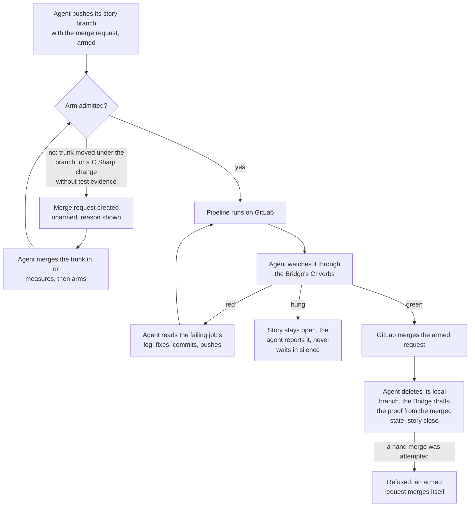

# How the agent uses CI

[← Back to the README](../README.md)

The agent does not watch CI dashboards. It talks to CI through the [`Kyklos Bridge`](COMPONENTS.md):

- it reads pipelines, jobs, logs and test reports, and retries a job only for a known transient cause;
- it creates merge requests (see [Git](GIT.md)) and **arms** them (that is, marks them to merge automatically as soon as the pipeline is green); a red pipeline sends the work back, and a hung one is reported rather than waited on in silence;
- where the project lets it push, it pushes its own story branch and **watches the pipeline that push started**, closing the story only after the merge request has merged on green (the *closed
  loop*); where it may not push, a person pushes, and the story waits for that push;
- in a repository **without a pipeline**, the merge request is created unarmed and merged through the Bridge once it is mergeable; the story then carries no pipeline evidence, only the host
  test runs;
- when the agent's change would lower coverage or raise complexity beyond the project's ceilings, the pipeline refuses it, using the same rules the agent's local proof already applied (see the [Proof Table](PROOF.md) and its [Test Discipline](PROOF_DIMENSION_TEST_DISCIPLINE.md) row);
- a CI capability that would affect every project is proven first in a dedicated test project, never directly on a real one.

How the push, the pipeline and the merge decide when a story can close, in each kind of project, is described in [The Kyklos Workflow](WORKFLOW.md).

**Supported languages and tools.** CI works only with GitLab. The Bridge reads the test reports a pipeline publishes as JUnit XML, from any language (a .NET test project writes them with the `JUnitXml.TestLogger` package), and the coverage reports of the jobs named in its host-side setting `KYKLOS_BRIDGE_CI_COVERAGE_REPORTS`, in the Cobertura format (coverlet for C#). The coverage and complexity rules judge C# lines; the arm rule asks for test evidence when C# files changed. A pipeline's own jobs may build any language, but Kyklos does not measure code in other languages. The full list is in [Supported languages and tools](SUPPORT_MATRIX.md).

## How the closed loop is checked

- **Resources and secrets.** The [Bridge](COMPONENTS.md#kyklos-bridge) reads pipelines, jobs, logs and test reports with the CI token it holds on the host (`read_api`, or `api` where it also creates and arms merge requests);
  the agent's container never holds it (see [Secrets](SECRETS.md)). A CI write (retry, cancel, trigger) is limited to work branches and merge-request refs for a project session, and every CI
  write is logged by the Bridge as a `[ci-audit]` line.
- **When it is checked.** At the push (the arm rule), at every look at the pipeline, at any attempt to merge by hand, and at the close, which wants the cited deliverable merged and, where it has a
  pipeline, that pipeline green (see [The Kyklos workflow](WORKFLOW.md)).
- **What a failure causes.** A red pipeline sends the work back to the agent; an unarmed request waits for its arm; a merge by hand is refused. The story cannot close until GitLab has merged the
  request on green.
- **Impact on the user.** None while the loop runs. A pipeline that hangs, or a runner that is missing, needs a person; the agent says so on the story. The [`merge-override`](WORKFLOW.md#the-push-override-and-merge-override-labels) label (see
  [Overrides](WORKFLOW.md#the-push-override-and-merge-override-labels)) is the person's way to accept a merge without a green pipeline.

## Related pages

[Git: branching and authorisation](GIT.md), [Secrets](SECRETS.md), [The Kyklos workflow](WORKFLOW.md), [The three components](COMPONENTS.md), and [the README](../README.md) for the full list.
