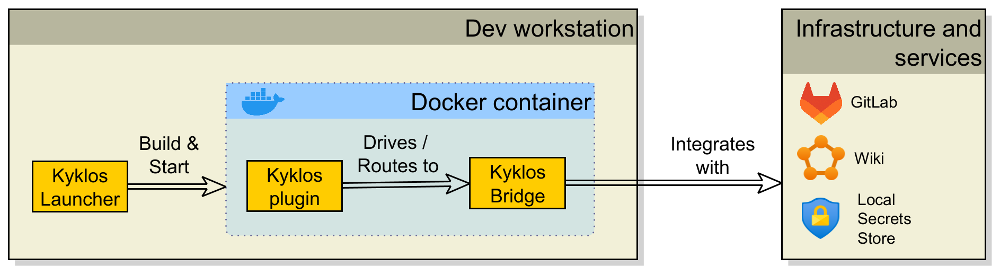
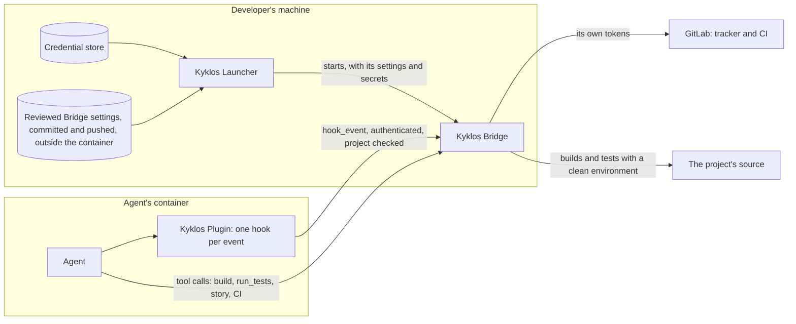
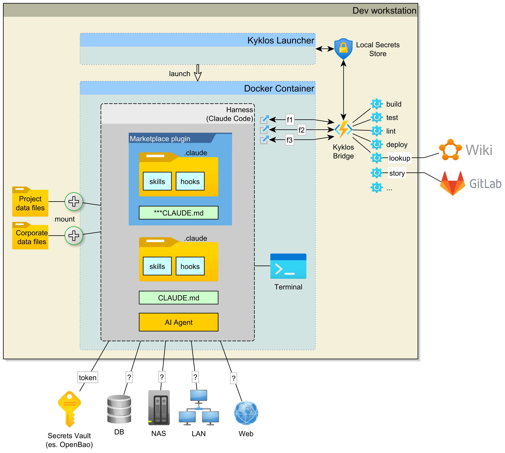

# The three Kyklos components

[← Back to the README](../README.md)

Kyklos has three parts that work together:

- 🚀 Kyklos Launcher
- 🔀 Kyklos Bridge
- 🔌 Kyklos Plugin

Each one has a single responsibility.

Specifically, the actions and roles of the three components are these:

| Component              | Where it runs                               | What it does                                                                                                                                                                                                                                                    |
|------------------------|---------------------------------------------|-----------------------------------------------------------------------------------------------------------------------------------------------------------------------------------------------------------------------------------------------------------------|
| **🚀 Kyklos Launcher** | the developer's workstation (Windows first, see [Current scope](INSTALL_AND_CONFIG.md#current-scope)) | Builds and starts one isolated development container per project, with the right mounts and tools. On Windows, first unlocks the BitLocker-encrypted drives the launch needs (you type the password in Windows' own elevated prompt) and mounts them into Docker Desktop (see [Encrypted and extra drives](INSTALL_AND_CONFIG.md#encrypted-and-extra-drives-windows-only)). Keeps credentials in the operating system's own credential store and hands the container only what it needs. Starts and supervises the `Kyklos Bridge`.      |
| **🔀 Kyklos Bridge**   | the host, next to the Launcher              | An [MCP](https://modelcontextprotocol.io/) Server. It's the agent's eyes and hands outside its sandbox: real builds, test runs, coverage, CI and issue-tracker actions. It holds the credentials and the business logic, issues the proof tokens, and is the one place where the rules are decided. |
| **🔌 Kyklos Plugin**   | inside the agent's session                  | Hooks and [skills](HOOKS_AND_SKILLS.md#how-the-agent-knows-what-to-do-skills) that steer the agent: they block a forbidden action at the moment it is attempted, remind the agent of the right tool, and send it to the `Kyklos Bridge` for anything that needs judgement or credentials.                                    |

**Why three parts:** the agent works in a sealed container and never holds a token that could act on the issue tracker or CI directly. Anything with consequences goes through the `Kyklos Bridge`,
where it is checked, logged and attributed. Logic lives once, in the `Kyklos Bridge`. The Plugin only guides the agent there and makes sure the `Kyklos Bridge` is used.

### How a request crosses the three parts

- **The settings the [Bridge](#kyklos-bridge) runs with are reviewed.** Before it starts a project's Bridge, the [Launcher](#kyklos-launcher) checks that the project's settings file (`projects/<project>/bridge.appsettings.json` under
  the settings root) lies outside every folder the container can write, is tracked in git, is unchanged since its commit and is identical to its remote branch. Otherwise the launch is refused,
  so an agent can never widen its own Bridge. The check lives in `launcher/src/KyklosLauncher/Bridge/BridgeSettingsGate.cs`.
- **The Bridge binary is verified.** The Launcher downloads the Bridge release, hashes it while it streams, and keeps it only when the SHA-256 equals the checksum published with the release; a
  cached copy is re-checked before every start (see [Installing and configuring](INSTALL_AND_CONFIG.md)).
- **The session talks only to its own Bridge.** Every answer carries the Bridge's project name and solution root, and the [Plugin](#kyklos-plugin) refuses an answer from another project's Bridge.
- **When a part is missing.** Without the Bridge, every tool call is refused (see [Hooks and skills](HOOKS_AND_SKILLS.md)); without a reviewed settings file, no launch.

All components are available in the Kyklos marketplace, published in the [Kyklos GitHub repository](https://github.com/DogmaSolutions/Kyklos).  
Through [Docker Desktop](https://www.docker.com/products/docker-desktop/), the `Kyklos Launcher` builds a container and injects into it, from the marketplace, the `Kyklos Plugin` and the `Kyklos Bridge`. Without the Launcher, the same three steps are done by hand: see [Wiring a project by hand](INSTALL_AND_CONFIG.md#wiring-a-project-by-hand-without-the-launcher) (the Plugin installs with `claude plugin marketplace add https://github.com/DogmaSolutions/Kyklos.git`, then `claude plugin install kyklos@dogmasolutions`).

See also: [how the Plugin's hooks and skills enforce the workflow](HOOKS_AND_SKILLS.md), [how secrets are handled](SECRETS.md) and [how the Bridge talks to CI](CI.md).

## What about OpenShell?

[NVIDIA OpenShell](https://github.com/NVIDIA/OpenShell) is an open-source runtime for autonomous AI agents. It runs the agent in a sandbox and lets it reach files, networks and credentials only as a declared policy allows. People who look at Kyklos often ask whether Kyklos should run on top of it, so this section explains how the two relate and why Kyklos does not use OpenShell today. The facts about OpenShell come from its own [repository](https://github.com/NVIDIA/OpenShell) and [documentation](https://docs.nvidia.com/openshell/latest) ([architecture](https://docs.nvidia.com/openshell/latest/about/architecture), [support matrix](https://docs.nvidia.com/openshell/latest/about/support-matrix), [policies](https://docs.nvidia.com/openshell/latest/how-it-works/policies/overview), [providers](https://docs.nvidia.com/openshell/latest/how-it-works/providers/overview), [telemetry](https://docs.nvidia.com/openshell/latest/observability/telemetry)). Check them again before you rely on them: the project moves fast.

### Two different jobs

The two projects answer different questions.

- **OpenShell asks: what can the agent reach?** A gateway manages sandboxes. Inside each sandbox, a trusted supervisor process decides every outbound connection, and the agent's workload runs with its network turned off, so its only way out is through the supervisor. Linux kernel controls (Landlock for files, seccomp for system calls) confine it further. Outbound traffic is denied unless a rule in a YAML policy allows that destination for that program. The network part of the policy can be changed while the sandbox runs.
- **Kyklos asks: is the agent's work proven, and did it follow the process?** Most of Kyklos's work happens outside the agent's environment. The [`Kyklos Bridge`](#kyklos-bridge) runs real builds, tests and coverage on the developer's own machine and talks to the issue tracker and CI. The [`Kyklos Plugin`](#kyklos-plugin) blocks forbidden actions at the moment the agent tries them. Stories, Proof Tables, [adversarial reviews](ADVERSARIAL_REVIEW.md) and close gates (see [the workflow](WORKFLOW.md)) decide when a piece of work is done. The [`Kyklos Launcher`](#kyklos-launcher)'s container is the agent's workplace. It is a means to that end, not the product's centre.

So OpenShell would not replace any of the three Kyklos components. At most it could replace the plain development container that the Launcher starts today.

### Why Kyklos does not use it today

1. **Windows first.** Windows is Kyklos's primary platform (see [Current scope](INSTALL_AND_CONFIG.md#current-scope)). OpenShell's support matrix lists Linux and macOS on Apple silicon as supported. It lists Windows (WSL 2 with Docker Desktop) as *experimental*, a status it says "may change or be removed in a patch release". Its support matrix also lists native Windows (through Microsoft MXC), built from the project's `windows` branch.
2. **The heavy work is on the host.** The [`Kyklos Bridge`](#kyklos-bridge) builds and tests on the developer's machine, with the developer's SDKs, so that results match the environment the code will really run in (for example Windows file paths and line endings). An agent sandbox does not change that part, and a sandbox that blocks the agent's outbound traffic would also have to allow the agent to reach the Bridge.
3. **Maturity.** OpenShell is young and changes quickly: when this page was written its latest release was in the 0.1 series, with releases about every week. Kyklos is young too (0.x releases). Placing one fast-moving project under another would make every problem harder to track down, so Kyklos keeps its container layer plain: Docker plus the standard Dev Containers tooling.
4. **No need has forced it yet.** Kyklos already keeps the most powerful credentials out of the agent's reach (see below). The gaps that OpenShell would close are real, but they were not the first ones Kyklos had to solve.

### What Kyklos already does in that space

- **One isolated development container per project.** The agent works inside it, not on the host. Only the folders the project's configuration names are mounted.
- **API tokens stay on the host.** A token that can call the GitLab API is never forwarded into the container. The [Bridge](#kyklos-bridge) holds it and uses it for story, CI and merge actions, checking each action against the rules first (see [Secrets](SECRETS.md)).
- **Split, minimal credentials.** The push credential that does enter the container may only write to the repository. The [Launcher](#kyklos-launcher) asks GitLab what each token can do, and refuses to launch a project whose push token could also call the API.
- **Reviewed settings.** The Bridge settings that decide what the agent may reach are used only in a committed, pushed version. They are kept in a folder the container cannot write.

### Where OpenShell is stronger

OpenShell does two things Kyklos does not.

- **Network policy per destination.** OpenShell denies outbound traffic by default and allows it per destination and per program, under a policy that can change while the sandbox runs. Kyklos's container has ordinary network access. Kyklos controls *what the agent does* (through [hooks](HOOKS_AND_SKILLS.md#how-a-hook-decides-one-hook-per-event-every-rule-in-the-bridge) and the [Bridge](#kyklos-bridge)), not *where its traffic may go*.
- **Credentials the agent never sees.** In OpenShell the agent holds only a placeholder. The proxy puts the real credential into the request just before forwarding it, and only when the request's destination matches the credential's binding. In Kyklos, the push credential is present in the container, and a secret the agent asks the Bridge for (for a third-party service its work needs) is handed to the agent as a value.

For these two advantages, Kyklos could adopt OpenShell in the future as an optional sandbox backend for the [Launcher](#kyklos-launcher), alongside the plain development container. That is not planned today. It becomes more attractive as OpenShell's Windows support matures.

### Side by side

| | Kyklos | OpenShell |
|---|---|---|
| **Purpose** | Makes the agent follow a secure development lifecycle and prove its work, with evidence produced by tools | Lets the agent run with only the access a policy allows |
| **Where the agent runs** | In a development container, one per project, started by the [`Kyklos Launcher`](#kyklos-launcher) | In a sandbox managed by the OpenShell gateway, on Docker, Podman, Kubernetes or a microVM |
| **Isolation mechanism** | A Docker container built with the Dev Containers tooling; only the configured folders are mounted | A supervisor-mediated sandbox: the workload's network is turned off, Landlock limits file access, seccomp sends network operations to the supervisor, and the workload runs as a non-root user without Linux capabilities |
| **Network policy** | None per destination: the container has ordinary network access | Denied by default, allowed per destination and per program in a YAML policy; the network part can change while the sandbox runs |
| **Credential handling** | API-capable tokens stay on the host, in the OS credential store, and are used by the [Bridge](#kyklos-bridge); a write-only push token and on-demand secrets reach the agent as values | The agent holds placeholders; the proxy puts in the real credential at the egress, only for a matching destination |
| **Host build and test access** | Yes: the `Kyklos Bridge` runs real builds, tests, coverage and CI queries on the developer's machine | Not its purpose: builds run inside the sandbox |
| **SSDLC process** (stories, proofs, reviews, gates) | Yes: stories with specifications, a [Proof Table](PROOF.md#the-proof-table-1) per quality dimension, independent [adversarial review](ADVERSARIAL_REVIEW.md), gates on commit, push, merge and close | Not covered |
| **Windows** | Primary platform | Experimental (WSL 2 with Docker Desktop); native Windows (through Microsoft MXC) built from the project's `windows` branch |
| **Linux** | In development (a Linux build is released, best effort) | Supported (Debian and Ubuntu, x86-64 and arm64; Linux 6.2 or later for Landlock) |
| **macOS** | Not supported (only a Bridge build is published, not tested) | Supported (Apple silicon, with Docker Desktop) |
| **Maturity** | Young: 0.x releases | Young: 0.1 releases, about every week; moving to the CNCF |
| **License** | MIT, with an end-user licence agreement | Apache-2.0 |
| **Telemetry** | None: the code collects no usage data (the Launcher's update check only reads the public release page) | Anonymous operational counts, built in by default, with a documented way to turn them off |

For other tools that sit near Kyklos (spec-driven workflows, guardrail plugins, quality scanners, agent sandboxes), see [Similar projects](SIMILAR_PROJECTS.md).
