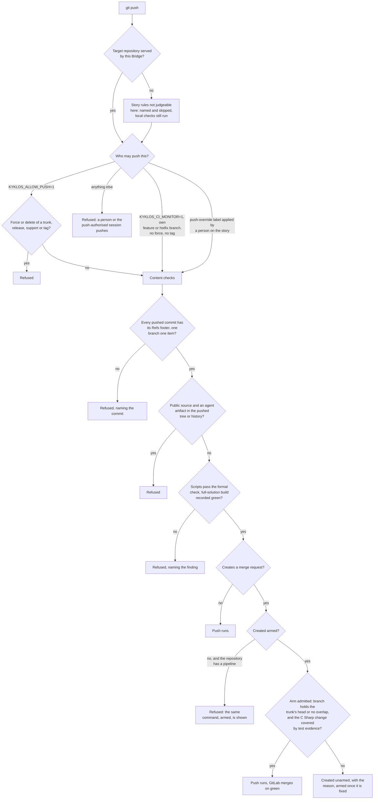

# How the agent uses Git: branching and authorisation

[← Back to the README](../README.md)

The agent commits and pushes with the **push credential** described in [Secrets](SECRETS.md), supplied by the [Launcher](COMPONENTS.md) from the credential store. What it may push is decided by the repository's declared workflow, not by
the agent:

- [**GitFlow**](https://nvie.com/posts/a-successful-git-branching-model/) (the default): every task starts on its own `feature/` (or `hotfix/`) branch; `develop` is the integration trunk and `main` the production trunk; neither is ever edited directly.
- [**Trunk-based**](https://trunkbaseddevelopment.com/): for repositories declared that way (for example a tooling or bookkeeping repository), committing on the trunk is the intended workflow.

## Where the Git token comes from
Each project's launch configuration names its push credential; the value lives in the [Windows Credential Manager](https://support.microsoft.com/windows/accessing-credential-manager-1b5c916a-6a16-889f-8581-fc16e8165ac0). At every launch the [`Kyklos Launcher`](COMPONENTS.md#kyklos-launcher) reads it,
asks [GitLab](https://about.gitlab.com/) what the token is allowed to do, and only then hands it to the container: a token that could also call the GitLab API, or an expired one, stops the launch (see [Secrets](SECRETS.md)). Inside the container the push
credential is the only Git secret, and the guards decide what it may be used for: the agent pushes only its own `feature/` and `hotfix/` branches, plus the trunk of a repository declared
trunk-based (such as a companion), and only where the project lets the agent watch its own pipelines, through a dedicated token (see the [least-privilege tokens](SECRETS.md)); never a GitFlow trunk, a tag or a forced update. Where the agent may not push, a person,
or the organisation's push-authorised session (see [The Infrastructure session](INFRASTRUCTURE_SESSION.md)), pushes for it.

## Rules
Trunks, release and support branches, tags and force pushes are never pushed by the agent.  
**Unless configured otherwise, a feature branch is merged into `develop` through a merge request that [CI](CI.md)
merges itself once the pipeline is green**: the agent creates it already *armed*, never merges it by hand, and deletes its local branch once the merge has happened.  
Arming is refused unless the branch already contains the trunk's current head, or the trunk's new commits touch none of the branch's files and no build-wide file changed: a merge request pipeline
tests the branch, so this keeps what was tested equal to what lands.  
In a repository **without a CI pipeline** an armed request would never merge, so it is created unarmed and merged through the [Bridge](COMPONENTS.md#kyklos-bridge) as soon as the server reports it mergeable.

Each repository declares how a finished branch closes (its *close mode*):

| Close mode     | What happens                                                                                       |
|----------------|----------------------------------------------------------------------------------------------------|
| `mr`           | the branch is pushed with a merge request created armed; the server merges it on green             |
| `mr-automerge` | as `mr`, and the server also deletes the remote branch after the merge                             |
| `local`        | the branch is merged into its trunk locally and deleted                                            |
| `push`         | the branch is pushed, then the local branch is deleted                                             |

Whatever the mode, a story closes only once its change is **merged into the trunk on the remote**, and every commit naming the story is reachable from that trunk; a local merge counts only after
it has been pushed. Code that coverage measures must reach the trunk through a merge request. See [The Kyklos Workflow](WORKFLOW.md).  
Every commit follows [Conventional Commits](https://www.conventionalcommits.org/) and carries a reference to its [story](AGILE.md). Repository layouts are described in [Project topologies](TOPOLOGIES.md).

## How a push and an arm are checked

Every `git push`, every merge request the agent creates and every arm ("merge when the pipeline succeeds") passes through the rules of the [Kyklos hooks](HOOKS_AND_SKILLS.md#how-a-hook-decides-one-hook-per-event-every-rule-in-the-bridge)
before it runs. The rules read the command once (one command parser, so `git -C <dir> push`, a `cd` before the push, a refspec or a push option are all understood the same way) and judge the
repository the push goes to, not the folder the session started in.

- **Files and resources.** The rules read the repository's own [`.claude/standards.env`](WORKFLOW.md#greppable-opt-out-switches) (its [topology](TOPOLOGIES.md) and close mode), the git facts of the target repository (branch, commits, remote), and,
  for the arm, the merge request and the trunk's head on GitLab (read by the [Bridge](COMPONENTS.md#kyklos-bridge) with its own token) and the Bridge's record of passing test runs (the [content ledger](PROOF_DIMENSION_TEST_DISCIPLINE.md#the-content-ledger-what-the-bridge-records-after-every-passing-run)) or a [Test Discipline](PROOF_DIMENSION_TEST_DISCIPLINE.md) token.
- **Secrets.** The push itself uses the push credential the [launcher](COMPONENTS.md#kyklos-launcher) put in the container (write-only, see [Secrets](SECRETS.md)). Every GitLab read the rules need is made by the Bridge on the
  host; the container has no token that could call the API.
- **When.** Before the command runs. A refused push sends nothing to the remote.
- **What a failure causes.** The agent fixes what the reason names (a missing `Refs:` footer, an unmerged trunk head, a missing test run) and repeats the push. A merge request created unarmed
  waits until the agent arms it; the [story close](WORKFLOW.md#rule-5-a-merge-request-merges-itself-and-only-on-the-merged-result) needs it merged.
- **Impact on the user.** None in the normal flow. A person is needed when the session may not push at all (they push the story branch with its merge request), or for a one-time exception
  (the [`push-override`](WORKFLOW.md#the-push-override-and-merge-override-labels) label; see [Overrides](WORKFLOW.md#overrides)). The Git server's own protected-branch settings remain a second layer: protect the branches you care about there too.

## Related pages

[CI](CI.md), [Project topologies](TOPOLOGIES.md), [The Kyklos workflow](WORKFLOW.md), [Hooks and skills](HOOKS_AND_SKILLS.md), and [the README](../README.md) for the full list.
