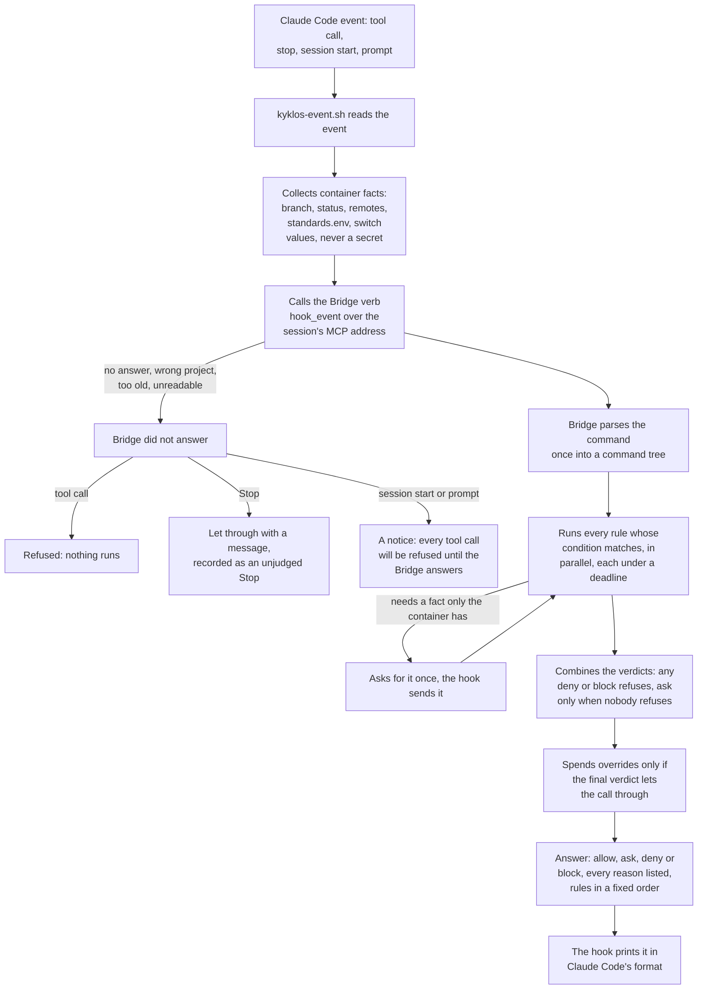
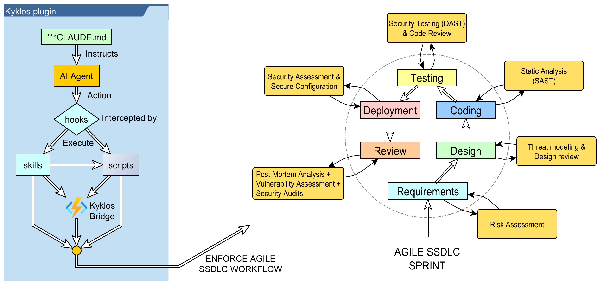
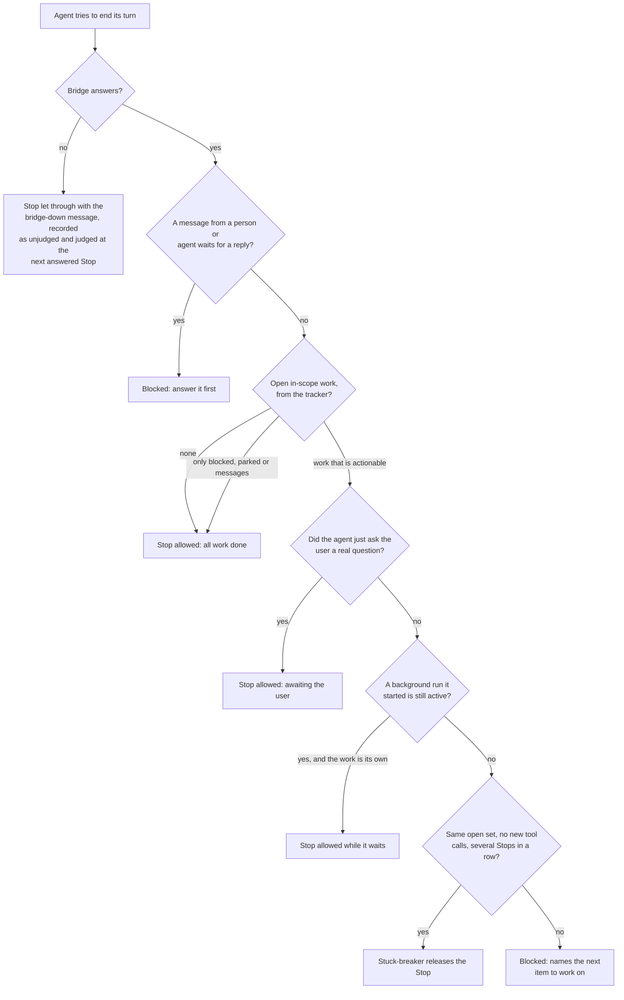

# How the process is enforced: hooks and skills

[← Back to the README](../README.md)

Through Skills and Hooks, the [`Kyklos Plugin`](COMPONENTS.md#kyklos-plugin) and the [`Kyklos Bridge`](COMPONENTS.md#kyklos-bridge) make the agent abide by the SSDLC workflow.

Hooks run on every action the agent takes, such as running a command, editing a file, or ending its turn. They are the mechanical half of Kyklos; the other half are the skills, described [below](#how-the-agent-knows-what-to-do-skills). Hooks are also called *guards* in these documents. They fall into a few families:

| Family               | What it prevents                                                                                                                                                                                                         |
|--------------------|------------------------------------------------------------------------------------------------------------------------------------------------------------------------------------------------------------------------|
| **Source control**   | committing on a trunk, pushing where the agent is not allowed to, non-conforming commit messages, branches left open after the work is done, merging by hand what should merge on green                                  |
| **Story discipline** | writing code before a story exists or is started, closing a story whose proof is incomplete, skipping a phase, editing the local mirror of the tracker (see [Storages](STORAGES.md)) by hand instead of through the story tool                                    |
| **Quality**          | reporting "done" with failing tests, tests that cannot fail, configuration hard-coded instead of being read in the standard way, scripts that fail a formal check, coverage regressions slipping into an automatic merge |
| **Safety**           | destructive file deletions, secrets written to disk or into a public repository, internal details leaking into public code                                                                                               |
| **Momentum**         | an agent that stops while unblocked work remains, or that ignores a message waiting for its reply from a person or another agent                                                                                         |

A [hook](#how-a-hook-decides-one-hook-per-event-every-rule-in-the-bridge) that blocks always says why, and what the agent should do instead.

**Human languages.** The hooks' messages and the skills are in English. Two rules read the agent's own words, and they match English phrasing only: the stop rule (it refuses a "which one next?" or "should I continue?" question, and counts a turn as waiting for you only when its text ends with `?`) and the rule on questions asked through Claude Code's question tool. Every other rule reads commands, files, branch names, commits and tool calls, so it works whatever language you and the agent use; commit messages keep their fixed English type words (`feat`, `fix`, ...) and `Refs:` footer.

**Programming languages.** The source-control, safety and momentum rules work for any language. Among the quality rules, the failed-test rule reads `dotnet test` and Bridge test runs, the test quality rule reads C# test files, the configuration rule reads C# code, the automatic-merge rule asks for test evidence when C# files changed, and the script formal check reads bash, PowerShell and batch files. The full list is in [Supported languages and tools](SUPPORT_MATRIX.md).

## How a hook decides: one hook per event, every rule in the Bridge

Claude Code runs hooks at fixed points of the agent's work, called *events*: before a tool call (PreToolUse), after it (PostToolUse, or PostToolUseFailure when it failed), when the agent
wants to end its turn (Stop), when a session starts (SessionStart) and when the person sends a prompt (UserPromptSubmit). The [`Kyklos Plugin`](COMPONENTS.md#kyklos-plugin) registers **one** hook for each of these events,
`plugins/kyklos/hooks/kyklos-event.sh`, and that hook holds no rule of its own. Every rule (the families in the table above) lives once, in the [`Kyklos Bridge`](COMPONENTS.md), and is judged
there.

- **Files and resources.** The hook is the plugin's `hooks/kyklos-event.sh`; the plugin's `hooks/hooks.json` holds exactly one entry per event, and that entry refuses by itself when the script is missing, so a broken install never runs a tool call unchecked. The facts are collected by `hooks/lib/repo-facts.sh`. The answer comes from the Bridge process on the host.
- **Secrets.** The hook sends no secret: the list of variables it may send is fixed, and a name ending in `TOKEN`, `SECRET`, `KEY` or `PASSWORD` is never on it. The Bridge reads the tracker and CI with the tokens it holds on the host (see [Secrets](SECRETS.md)). The call to the Bridge carries the session's local authentication value from the session's MCP settings, and the hook checks that the answer comes from **this** project's Bridge.
- **When it runs.** At every event. The time limits are fixed: 10 seconds for a tool event, 15 seconds for a prompt, 60 seconds at session start, 120 seconds at Stop. A rule that needs a build or a test run never waits for it: it says what to run first, or reads the finished result.
- **The order of rules.** The rules run in parallel, and only their messages are ordered: rules on the command text first, then rules on git facts, then rules on stored records, then rules that read the tracker. So the same command always gets the same message. A rule whose condition does not match does not run (a plain `ls` reads neither git nor the tracker). A rule that fails or runs out of time counts as a refusal ("rule failed"); the others still answer, so one answer lists every reason.
- **Which repository a rule judges.** The repository the command acts on (`git -C <dir>`, a `cd` in the command, a push of a nested source), not the folder the session started in. When the Bridge does not serve that repository, its story rules are reported as **not judgeable** and skipped by name; the local checks still run.
- **What a refusal causes.** A refused tool call does not run; the agent reads the reasons and changes its approach. A refused Stop sends the agent back to work. Most refusals need nothing from the user; the few that a person must settle are described in [Overrides](WORKFLOW.md#overrides).
- **When the Bridge is down.** Every tool call is refused until it is back; the person starts or updates it in the [`Kyklos Launcher`](COMPONENTS.md#kyklos-launcher). The Bridge is required: there is no switch that turns the hook off.

## Forced productivity

An agent left to itself tends to stop early: it reports progress and waits. Kyklos does not allow that. When the agent tries to end its turn, a guard checks the project's open work, and the turn may
end **only** when either:

- **all in-scope work is done** (every open story closed), or
- **the agent has asked the user a real question**: one only a person can answer (an irreversible or outward-facing action, or information only they hold), asked with its full context, the references
  involved and the effect of each option.

"Waiting for CI" is not a reason to stop: the agent works on another item, or arms a watch that wakes it when the pipeline finishes. A blocker stops only the steps that depend on it, never the whole
queue. Messages addressed to the agent (from a person or another agent) must be answered before the turn can end.

What counts as open work: every open issue is classified from its labels. A `story` issue and a plain, unlabeled issue both force work (an unlabeled issue must be triaged: adopted under a story kind, routed to another agent as a message, parked, or closed with a disposition label). Four states are excluded: messages to another agent (their reply is tracked separately), parked stories, blocked stories (a story that records what it waits on and why; the guard re-checks that record on every stop, so a block on an issue or merge request lifts by itself when it closes or merges, while a block on the user or on something external stays until it is changed by hand), and issues closed out by a `wontfix`, `duplicate` or `invalid` label. The only valid reasons to stop are *all work complete* (verified against the tracker, so it cannot be faked) or *awaiting the user* on a genuine question. There is no marker the agent can create to excuse a stop. If the agent is wedged, a stuck-breaker releases the stop after a few consecutive stops with no change and no new tool calls, so the guard can never spin forever. A guard that cannot judge a blocked story names it in a warning instead of counting it as work, so the stop gate is never impossible to pass.

One exception follows the "arm a watch" rule: while a background command or a background agent the agent started is still running, work it already owns is not counted as actionable, and the agent is blocked only once for work that is new. A worker counts as running only while its newest event is younger than `CONTINUE_GUARD_WATCH_TTL_MINUTES` (default 30); silence past that bound means it is not running. Set `CONTINUE_GUARD_WATCH_HOLD=off` to disable the exception, and `KYKLOS_BLOCKER_CHECK=off` to disable the re-check of blocked stories.

How the Stop is judged:

The open work is read from the tracker by the [Bridge](COMPONENTS.md#kyklos-bridge) with its own token, never from the agent's word or a local file it can edit; a blocked story's recorded blocker is re-checked at each Stop
(a block on an issue or merge request lifts by itself when that closes or merges). A blocked Stop only sends the agent back to work: the user sees nothing unless the agent then asks a real
question. The number of identical Stops before the stuck-breaker releases is `CONTINUE_GUARD_STUCK_TURNS` (default 3).
Before the guard calls the Bridge down, it keeps asking for a retry window, `KYKLOS_BRIDGE_PROBE_WINDOW_SECONDS` (default 10): on a loaded machine opening the connection
can take several seconds while the Bridge itself answers at once. An answer that took a second or more is reported as **slow**, apart from down, with the connect and answer times; the
work goes on. Only no answer within the whole window reads as down, and that message names the window and the attempts made. The switches above are opt-outs of the person (see
[Overrides](WORKFLOW.md#greppable-opt-out-switches)); no marker excuses the open-work check.

The next item is not the agent's choice. The [`Kyklos Bridge`](COMPONENTS.md) computes it, in this order (the same rule as in [Stories and Epics](AGILE.md)):

1. **Started work first**: a story already in progress or blocked comes before anything new; among those, the one where someone else (a person or another agent) acted most recently, with a new comment or a changed label, comes
   first.
2. **Then new work by severity**: critical, then high, then medium, then low.
3. **The oldest first** whenever two items are otherwise equal.

A story that waits on another open item is never taken before it: the item it waits on is offered instead. Items set aside or assigned to someone else are never taken, but are listed by name, so
nothing is hidden. A story issue created without a severity (for example by hand in the tracker, outside the story tool) is reported as a defect to fix first.

## How the agent knows what to do: skills

Skills are short, focused playbooks the agent loads when a task calls for them. Each one encodes one part of the method:

- **Story and proof:** planning a story, building its [Proof Table](PROOF.md), the [adversarial review](ADVERSARIAL_REVIEW.md), the risk assessment.
- **Engineering quality:** running and reading tests, measuring coverage as a floor (trust is the goal), mistake-proofing a design, removing duplication, internationalising user-facing text,
  annotating security controls with standard references ([CWE](https://cwe.mitre.org/), [OWASP](https://owasp.org/), [IEC 62443](https://www.isa.org/standards-and-publications/isa-standards/isa-iec-62443-series-of-standards)).
- **Collaboration:** messaging other agents through the tracker, monitoring for replies, using the [`Kyklos Bridge`](COMPONENTS.md#kyklos-bridge).
- **Documentation:** finding every document a change affects and keeping it accurate, with a lint that stops internal details from leaking into public documents.

The skills are shipped with the [`Kyklos Plugin`](COMPONENTS.md). **Invocable** says who can start a skill: *user and agent* (the user types it as a slash command, for example `/kyklos:ssdlc-story`, and the agent can
also load it on its own when a task calls for it), *agent only*, or *user only*.

| Skill                             | Invocable      | Purpose                                                                                                                                                                   |
|---------------------------------|--------------|-------------------------------------------------------------------------------------------------------------------------------------------------------------------------|
| `kyklos:ssdlc-story`              | user and agent | Plans and tracks work as stories (specification, tasks, [risk register](PROOF_DIMENSION_RISK_ASSESSMENT.md)) in the configured storage, through the story tool; the backlog is generated, never edited by hand. |
| `kyklos:ssdlc-story-proof`        | user and agent | The final gate of a story: judges every Quality Dimension of the story's kind and records the verdicts, evidence and metrics in its Proof Table.                          |
| `kyklos:ssdlc-adversarial-review` | user and agent | Runs the mandatory, tamper-proof adversarial review of a story's change, posts the report and has the Bridge sign its token; drives the bounded fix loop.                 |
| `kyklos:ssdlc-risk-assessment`    | user and agent | Produces and keeps current the story's numbered risk register, cited to the standards and laws the project applies (IEC 62443, NIS2, the CRA).                            |
| `kyklos:ssdlc-cysec`              | agent only     | The security-annotation convention ([`[CySec]`](PROOF_DIMENSION_SECURITY_POSTURE.md#how-it-is-checked)): format, verbs and formal references (CWE, OWASP, IEC 62443, CAPEC), applied while writing security code.                  |
| `kyklos:ssdlc-cysec-comments`     | user and agent | Sweeps existing code for security controls that lack a `[CySec]` annotation and adds them, building the control inventory.                                                |
| `kyklos:ssdlc-deduplicate`        | user and agent | The [Non-Duplication](PROOF_DIMENSION_NON_DUPLICATION.md) pass: finds duplicated constants and logic with a detector, triages them by meaning and centralises them.                                             |
| `kyklos:ssdlc-i18n`               | user and agent | The [i18n](PROOF_DIMENSION_I18N.md) pass: moves every user-facing text a story added or changed into the project's localisation resources, without duplicates.                                       |
| `kyklos:update-docs`              | user and agent | The [Documentation](PROOF_DIMENSION_DOCUMENTATION.md) pass: finds every document a change affects, updates it, and runs the audience lint that keeps internal details out of public documents.                |
| `kyklos:poka-yoke`                | user and agent | [Mistake-proofing](https://en.wikipedia.org/wiki/Poka-yoke) by design: chooses the highest guard that makes a mistake impossible or makes it fail at once.                |
| `kyklos:measuring-test-coverage`  | user and agent | Coverage as a floor and test trust as the goal: how coverage is collected, what to test next, which tests can really fail, what to exclude.                               |
| `kyklos:running-tests`            | user and agent | How tests are run, investigated and reported, and how a failure is traced to its cause instead of being called "pre-existing".                                            |
| `kyklos:using-the-bridge`         | user and agent | How the agent uses the `Kyklos Bridge` for builds, tests and host actions the sealed container cannot do.                                                                 |
| `kyklos:ssdlc-repo-model`         | user and agent | Declares the project's [topology](TOPOLOGIES.md) once; every guard derives its branching and push discipline from it.                                                                      |
| `kyklos:ssdlc-agent-msg`          | user and agent | Messages between agents through the issue tracker: create, read the inbox, reply, reopen and close, all through the Bridge.                                               |
| `kyklos:ssdlc-inbound-monitor`    | user and agent | Keeps the conversation with other agents alive: a periodic check that picks up a reply even while the agent is idle.                                                      |
| `kyklos:ssdlc-ai-fix-loop`        | user and agent | Works through the findings of an automated code review on a merge request, proposing a fix for each and applying it only on human approval, with a bound.                 |
| `kyklos:reorient`                 | user only      | Re-orients the agent after a container restart: it drops stale assumptions and rediscovers the tools, skills, instructions and backlog.                                   |

## Related pages

[The three components](COMPONENTS.md), [The Kyklos workflow](WORKFLOW.md), [The Proof Table](PROOF.md), [Git: branching and authorisation](GIT.md), and [the README](../README.md) for the full list.
