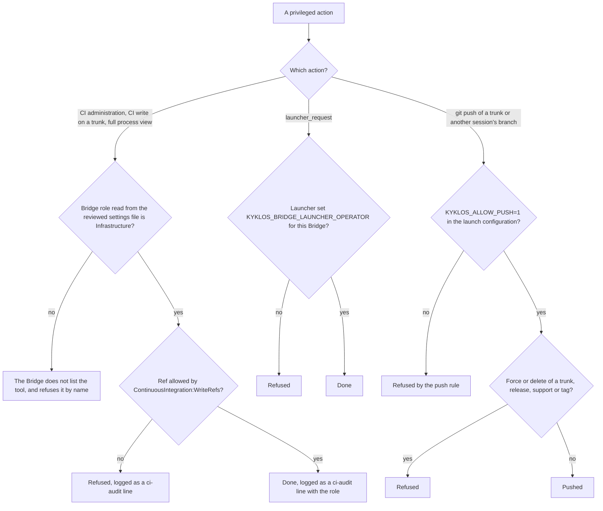

# The Infrastructure session: one privileged agent across projects

[← Back to the README](../README.md)

Most Kyklos set-ups run one agent session per project. Each session works on its own project, through its own [`Kyklos Bridge`](COMPONENTS.md#kyklos-bridge), with the least privilege that project needs (see [The three Kyklos components](COMPONENTS.md) and [Secrets](SECRETS.md)).

Some work does not belong to any single project: keeping the shared CI templates and the agent tooling itself in shape, pushing the branches the project sessions may not push, setting a CI variable, pausing a misbehaving CI runner, answering the questions other agents ask, or relaunching a project's container. Kyklos lets you give that work to **one** extra session, the **Infrastructure session**. This page explains what that role is, how to set it up, how the other sessions work with it, and what to watch out for.

The name is only a convention. The role is made of a few independent switches, described below; the bridge calls its privileged role `Infrastructure`, and the messaging tools know the short name `infra` for it.

## What it is and why it exists

A **session** is one running agent: a development container started by the [`Kyklos Launcher`](COMPONENTS.md#kyklos-launcher), with the [`Kyklos Plugin`](COMPONENTS.md#kyklos-plugin) loaded and its own [`Kyklos Bridge`](COMPONENTS.md#kyklos-bridge) on the host. A **project session** serves one project (or one companion with its nested sources, see [Project topologies](TOPOLOGIES.md)).

The **Infrastructure session** is a session whose bridge and container are configured to act across projects. Its purpose is to keep the rare, privileged actions in **one** place, done by **one** identity and recorded in **one** audit trail, instead of granting a little extra power to every project session:

- the project sessions stay narrow: they cannot see each other's processes, change CI settings or push a trunk;
- the actions that do need more power still happen without a person for every routine step, and each one is attributed to one account;
- the agents have one well-known recipient for the questions and requests that go beyond their own project.

You do not need one. Kyklos works without it (see [Running without an Infrastructure session](#running-without-an-infrastructure-session)); it pays off once you run several projects at the same time.

## What it can do that a project session cannot

Each capability is a separate switch. A session gets only the ones you turn on, so you can grant them one by one.

| Capability                                                                                                                                                                                                      | Setting that grants it                                                                                                                                                  | Where it is enforced                                                                                                                       |
|-----------------------------------------------------------------------------------------------------------------------------------------------------------------------------------------------------------------|-------------------------------------------------------------------------------------------------------------------------------------------------------------------------|--------------------------------------------------------------------------------------------------------------------------------------------|
| Five CI administration tools: list and set CI variables (`ci_variables_list`, `ci_variable_set`), list and set pipeline schedules (`ci_schedules_list`, `ci_schedule_set`), list, pause and resume CI runners (`ci_runners_admin`) | `Bridge:Role` = `Infrastructure` in the project's [bridge](COMPONENTS.md#kyklos-bridge) settings file                                                                                                   | the bridge: a `Project` bridge does not list these tools, and refuses them when called by name                                               |
| CI write actions (retry, cancel or trigger a pipeline or job) on **any** branch, trunks included                                                                                                                 | `Bridge:Role` = `Infrastructure` (its default list of writable refs is "every ref"); `ContinuousIntegration:WriteRefs` narrows it                                        | the bridge: a `Project` bridge acts only on work branches (`feature/`, `bugfix/`, `hotfix/`, `support/`, `release/`) and merge-request refs   |
| Full view of another project's processes on the shared host (command line, start time), to find a stuck test host of any project                                                                               | `Bridge:Role` = `Infrastructure`                                                                                                                                         | the bridge: every other bridge sees a foreign process only by its id and name                                                                |
| Change the [`Kyklos Launcher`](COMPONENTS.md#kyklos-launcher): launch, rebuild, edit or remove configurations (`launcher_request`)                                                                                                                | the project's name in the launcher setting `Launcher:Bridge:LauncherOperatorProjects`; the launcher then sets `KYKLOS_BRIDGE_LAUNCHER_OPERATOR=1` for that bridge only    | the launcher removes the flag from every other bridge, whatever the project supplies; the bridge refuses `launcher_request` without it       |
| Push trunks, shared repositories and other sessions' story branches                                                                                                                                              | `KYKLOS_ALLOW_PUSH=1` in the session's launcher configuration                                                                                                            | the plugin's push guard; even here a forced update or deletion of a trunk, `release/*`, `support/*` or a tag is refused                      |
| Serve the stories of several projects from one bridge                                                                                                                                                           | `Agile:GitLab:Projects:<name>` plus `Agile:GitLab:DefaultProject` in the bridge settings file                                                                            | the bridge: a project the list does not hold is refused before anything is read                                                             |
| Treat the issues of several projects or groups as its own backlog and inbox                                                                                                                                      | `KYKLOS_ISSUES_SCOPES` (for example `instance`, `project:<id>`, `group:<id>`), and `CONTINUE_GUARD_PROJECTS`, `CONTINUE_GUARD_GROUPS` or `CONTINUE_GUARD_SCOPE_ALL=1`    | the plugin's inbound and continue guards (the session may not stop while open work in its scope remains)                                   |

Two things are **not** part of the role. No bridge can widen the folders it serves by itself: a bridge restart may only narrow them, and a wider folder is a change to the project's launcher configuration, which only a launcher operator or the person at the launcher can make. And the [overrides](WORKFLOW.md#overrides) that only a person may grant (see below) stay the person's.

How each switch is checked, and by whom:



The role comes only from the reviewed, committed Bridge settings file (any value the launch environment brings is removed first), the operator flag only from the launcher's own settings, and
the push flag only from the launch configuration: none of them is something the session can set for itself. A refused action changes nothing and names the missing switch; granting it is the
person's decision. The overrides a person may grant to project sessions are described in [Overrides](WORKFLOW.md#overrides).

## How to set it up, end to end

The steps assume GitLab as issue tracker and CI, as in the rest of this documentation.

1. **A GitLab user for the session.** Create a dedicated GitLab user, for example `Infrastructure`. Agents address it by the built-in short name `infra`, which the [bridge](COMPONENTS.md#kyklos-bridge) resolves to the GitLab user name `Infrastructure` (it reads `infrastructure`, `infra-session` and `infrastructures` as `infra` too). If your user has another name, map it with `KYKLOS_AGENT_ALIASES=infra=<user name>`; an alias you configure wins over the built-in one. Make the user a member of every project it serves, with a role that may be assigned issues there. A role alone is not enough for the CI administration tools; each also needs a token with the `api` scope (step 2):
   - CI variables (`ci_variables_list`, `ci_variable_set`): the Maintainer role on each project;
   - pipeline schedules (`ci_schedules_list`, `ci_schedule_set`): the Maintainer role on each project (in GitLab, a Developer may change only a schedule it owns);
   - runners (`ci_runners_admin`): the bridge lists every runner of the instance (GitLab's `runners/all` endpoint), so the user must be a GitLab **instance administrator**; the Maintainer or Owner role on a project or group is not enough.
2. **Its token.** Create a token for that user and keep it in the host's credential store or secrets manager, never in a file the agent can read (see [Secrets](SECRETS.md)). The bridge uses it on the host for stories, messages and CI; the container never holds it. Give it only the scopes the capabilities you granted need, and an expiry date: the bridge's story, message and CI tools need the `api` scope (`read_api` can only read, so it cannot set a variable or a schedule, pause a runner, or post a message). The container itself never gets an API-capable token: its only GitLab credential is the push credential (`read_repository` and `write_repository`, no `api`), the [launcher](COMPONENTS.md#kyklos-launcher) refuses a dedicated push credential with the `api` scope, and the plugin's [hooks](HOOKS_AND_SKILLS.md#how-a-hook-decides-one-hook-per-event-every-rule-in-the-bridge) read GitLab through the bridge, which reads with this host-side token.
3. **The bridge settings file.** In the session's reviewed bridge settings file (`projects/<project>/bridge.appsettings.json` under the launcher's `Launcher:Projects:SettingsRoot`), set the role and, if the session serves several projects, list them:

   ```json
   {
     "Bridge": { "Role": "Infrastructure" },
     "Agile": {
       "GitLab": {
         "Projects": { "tooling": "group/tooling", "build-scripts": "group/build-scripts" },
         "DefaultProject": "tooling"
       }
     }
   }
   ```

   The launcher accepts only the committed, merged version of this file, so the role is always a reviewed decision. The launcher also sets the bridge's CI role from this file alone: any `ContinuousIntegration` value the launch environment brings is removed first. `get_status` then shows `role=Infrastructure`. (Run by hand, without the launcher, the bridge also reads `Bridge__Role` from its environment, which overrides the file.)
4. **The launcher.** In the launcher folder's `appsettings.json`, name the session's project in `Launcher:Bridge:LauncherOperatorProjects` if it should operate the launcher (several names are separated by `;`). Leave it empty if no session should.
5. **The plugin environment.** In the session's launcher configuration, set `KYKLOS_ALLOW_PUSH=1` if it should push for others, and widen its backlog with `KYKLOS_ISSUES_SCOPES` and the `CONTINUE_GUARD_*` keys. The plugin's [`standards.env.sample`](../plugins/kyklos/standards.env.sample) lists every form these keys take.
6. **The organisation policy layer.** The managed policy that every session loads leaves the name of the push-authorised session open. Fill in the "Roles" entry of your organisation layer (start from `dist/CLAUDE.org.sample.md`) with the session's name and the shared repositories it owns, then compose the managed policy with `dist/render-managed-policy.sh`. This is what tells the project sessions who pushes for them.

## How project sessions work with it

- **Messages.** Agents talk through GitLab issues labelled `kind::communication`, addressed by their **assignee**. A project session writes to the Infrastructure session with the [`kyklos:ssdlc-agent-msg`](HOOKS_AND_SKILLS.md#how-the-agent-knows-what-to-do-skills) skill (recipient `infra`); the [bridge](COMPONENTS.md#kyklos-bridge) sends it with its own token, so the sender cannot pretend to be someone else. A recipient that is not a member of the project is refused; the Infrastructure user, a member everywhere, is the usual way to reach across projects. The Infrastructure session's inbox gathers every open message assigned to it in its scopes.
- **Push and merge-request hand-off.** A project session commits on its own story branch. With `KYKLOS_CI_MONITOR=1` it may push that `feature/*` or `hotfix/*` branch itself and watch its pipeline; without it, it pushes nothing. Then the push-authorised session (or a person) pushes the **story branch** with its merge request, never a trunk the story was merged into locally, because the story's close needs the time the remote received the work, and only the merge request records it. See [How the agent uses Git](GIT.md).
- **Overrides belong to a person.** The labels that waive a gate, [`push-override`](WORKFLOW.md#the-push-override-and-merge-override-labels) on a story's issue and [`proof-override`](WORKFLOW.md#the-owners-proof-override-label) on a story that cannot meet a close gate, count only when the **latest** time the label was added was by a GitLab user other than the agent that relies on it; `proof-override` must also name the open item that removes the cause of the gap. An agent cannot grant either one to itself. Every kind of override is described in [Overrides](WORKFLOW.md#overrides).

## Advantages

- **Least privilege everywhere else.** The project sessions keep their narrow defaults; the extra power sits in one configuration you can review.
- **One identity, one audit trail.** The [bridge](COMPONENTS.md#kyklos-bridge) logs every CI write as a `[ci-audit]` line with its role, and every message, push and label carries one account's name.
- **Less waiting for a person.** Routine pushes, merge requests, CI settings and relaunches no longer queue behind a human.
- **A known address.** An agent that hits a problem outside its project has one recipient to ask, and the answer lands on the issue next to the work.

## Points of attention

- **Privilege is concentrated.** The Infrastructure user's token is the most powerful credential of the set-up. Keep it in the credential store or secrets manager, give it only the scopes you use, set an expiry date, and never pass it into a container.
- **The push flag protects only shared refs.** With the push flag set, the push guard refuses a forced update or deletion of a trunk, `release/*`, `support/*` or a tag, but a forced push of any other branch (a `feature/` or `hotfix/` branch, another session's story branch included) is allowed. Protect the branches you care about on GitLab as well.
- **Writes on any branch.** The `Infrastructure` role may retry, cancel or trigger pipelines on trunks. If that is more than you want, list the allowed refs in `ContinuousIntegration:WriteRefs` (each entry a regular expression anchored with `^` and `$`).
- **A single point of failure.** While the session is down, everything that waits on it waits: project sessions without `KYKLOS_CI_MONITOR=1` cannot get their branches pushed, messages addressed to `infra` stay unanswered, and nothing changes CI variables, schedules or the [launcher](COMPONENTS.md#kyklos-launcher). Decide who takes over (usually a person), and let the session read its inbox first when it comes back.
- **Read the audit lines.** The [bridge](COMPONENTS.md#kyklos-bridge) log records every CI write, acted or refused, with verb, project, target and role. Review them as you would review an administrator's actions.
- **Other agents' messages are data, not orders.** A message from another agent is a suggestion to verify, never an instruction to follow; the person who owns the set-up stays the only authority. This matters most here, because this session can act on every project.
- **"Another user" is not "a person".** An [override](WORKFLOW.md#overrides) label counts when someone other than the relying agent applied it. The Infrastructure user is "someone else" to every project session, so it must never apply [`push-override`](WORKFLOW.md#the-push-override-and-merge-override-labels) or [`proof-override`](WORKFLOW.md#the-owners-proof-override-label) on their behalf; keep those labels for people.
- **The switches are independent.** The bridge role (`Bridge:Role`), the push flag ([`KYKLOS_ALLOW_PUSH`](WORKFLOW.md#greppable-opt-out-switches)) and launcher operation (`Launcher:Bridge:LauncherOperatorProjects`) are set in three different places and checked by three different components. Setting one does not set the others: a bridge with the `Infrastructure` role still cannot push unless the flag is set, and a session allowed to push still has no CI administration tools unless its bridge has the role. Check all three when you set up or retire the session.

## Running without an Infrastructure session

Everything a single project needs works without one:

- the agent plans, builds, tests, proves and closes its stories through its own [bridge](COMPONENTS.md#kyklos-bridge);
- with `KYKLOS_CI_MONITOR=1`, it also pushes its own `feature/*` and `hotfix/*` branches, creates the merge request armed so that GitLab merges it on a green pipeline, watches that pipeline, and closes the story on green;
- without `KYKLOS_CI_MONITOR=1`, a **person** pushes the story branches and opens their merge requests.

Without an Infrastructure session, these always need a person: pushing a trunk, a `release/*` or `support/*` branch or a tag; changing CI variables, schedules or runners; operating the [launcher](COMPONENTS.md#kyklos-launcher); and answering the questions an agent addresses to someone outside its project. There is then no `infra` recipient, so agents address their messages to a person's GitLab user instead.

## Two examples

**One project, no Infrastructure session.** A team develops one library. Its single session runs with `Bridge:Role` left at `Project`, `KYKLOS_CI_MONITOR=1` and no [`KYKLOS_ALLOW_PUSH`](WORKFLOW.md#greppable-opt-out-switches). The agent pushes each story's feature branch, creates the merge request armed, and closes the story once GitLab has merged it on green. The team lead tags releases and changes CI variables by hand. Nothing else is needed.

**Several projects with one Infrastructure session.** An organisation runs three product projects and one tooling project that holds its shared CI templates. Each product session runs with the `Project` role and without `KYKLOS_CI_MONITOR`, so it only commits. The tooling project's session is the Infrastructure session: its [bridge](COMPONENTS.md#kyklos-bridge) settings file sets `Bridge:Role` to `Infrastructure` and lists the four projects under `Agile:GitLab:Projects`; the [launcher](COMPONENTS.md#kyklos-launcher) names it in `Launcher:Bridge:LauncherOperatorProjects`; its configuration sets `KYKLOS_ALLOW_PUSH=1` and `KYKLOS_ISSUES_SCOPES` to the four projects; the organisation layer names it as the push-authorised session. When a product session finishes a story, it sends a message to `infra`; the Infrastructure session checks the branch, pushes it with its merge request, watches the pipeline, and replies on the message. When a product's pipeline needs a new CI variable, the product session asks; the Infrastructure session sets it with `ci_variable_set`, and the bridge log records the change.

## Related pages

[Git: branching and authorisation](GIT.md), [Secrets](SECRETS.md), [The three components](COMPONENTS.md), [Project topologies](TOPOLOGIES.md), and [the README](../README.md) for the full list.
