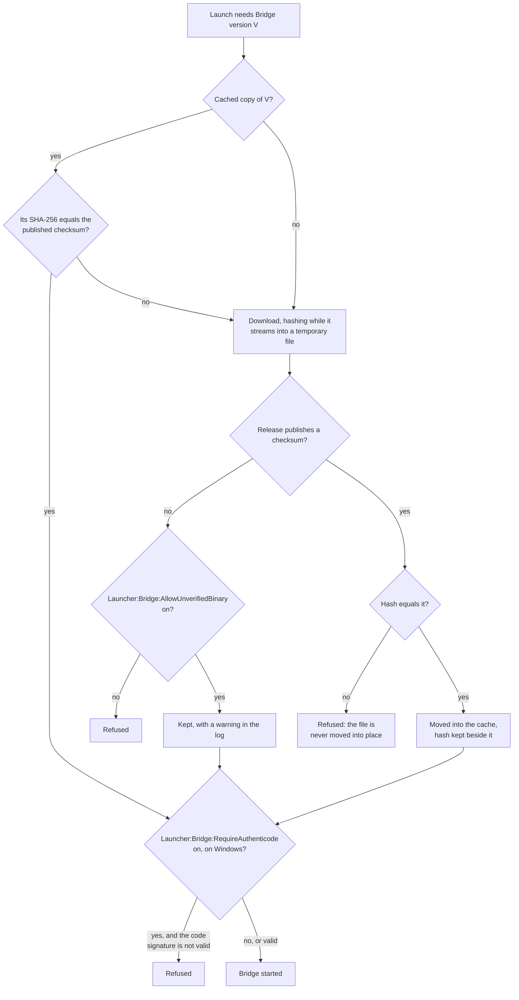
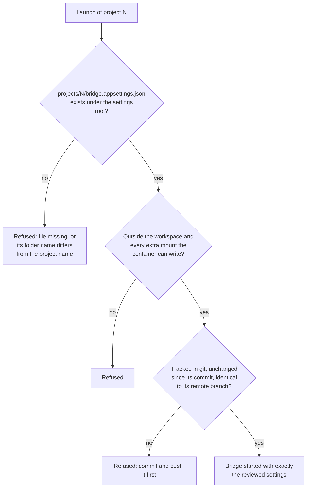

# Installing and configuring Kyklos

[← Back to the README](../README.md)

> **Want your agent to do it?** This page is written for people. [Installing Kyklos with an agent](AGENT_INSTALL.md) gives the same procedure, in the same order, as numbered steps with a check after each one, so that an agent running on the host can follow it and stop to ask you wherever only a person can act.

## Current scope

Kyklos is young. Today it works with one stack, and it is proven mainly on one platform:

- **AI agent:** [Claude Code](https://code.claude.com/docs).
- **Issue tracker and CI:** [GitLab](https://about.gitlab.com/) (GitLab.com or self-managed, Community Edition included). A standalone or offline project can keep its stories in plain files instead (see [Storages](STORAGES.md)); the CI features then stay off.
- **Projects the [Bridge](COMPONENTS.md#kyklos-bridge) builds and tests on the host:** .NET (the .NET SDK on the host).
- **Host operating system:** Windows is the primary platform. Linux support is in development. macOS is not supported.
- **Programming languages:** C# on .NET gets every check: builds and tests on the host (NUnit, xUnit or MSTest), line coverage (coverlet or Microsoft's code-coverage extension), the CRAP score and mutation testing (Stryker.NET). Bash scripts get line coverage (bashcov, in the agent's container) and the script formal check, which also covers PowerShell and batch files. Other languages, F# and Visual Basic included, get only the checks that do not depend on the language, and their code is not measured. The full list per check is in [Supported languages and tools](SUPPORT_MATRIX.md).
- **Human languages:** English. The engineering policy, the [skills](HOOKS_AND_SKILLS.md#how-the-agent-knows-what-to-do-skills) and the messages of the [hooks](HOOKS_AND_SKILLS.md#how-a-hook-decides-one-hook-per-event-every-rule-in-the-bridge), the Bridge and the Launcher are in English, and the two rules that read the agent's own words (the stop rule and the rule on questions the agent asks you) match English phrasing only. Stories and the [Proof Table](PROOF.md#the-proof-table-1) keep fixed English headings and words; what you write under them, and everything the other rules check (commands, files, branch names, commit messages beyond their fixed type words such as `feat` or `fix`), may be in any language. Details in [Supported languages and tools](SUPPORT_MATRIX.md#human-languages).

The table shows each component and its main features per host operating system. ✅ supported · 🚧 in development (it may already be in the release, but it is not yet proven to the same standard as Windows) · ❌ not supported. Where a feature works differently on a platform, the cell says how.

| Component | Feature | Windows | Linux (x86-64) | macOS |
|-----------|---------|---------|----------------|-------|
| **🚀 [Launcher](COMPONENTS.md#kyklos-launcher)** | Runs, with its control panel in the browser | ✅ (signed program) | 🚧 a bundle is released, best effort, not signed (check it against `SHA256SUMS.txt`) | ❌ no build |
| | Container engine | Docker Desktop (WSL 2 backend) | 🚧 Docker Engine 20.10 or later, no Docker Desktop needed | ❌ |
| | Credential store for tokens and for the control-panel login | Windows Credential Manager | 🚧 a self-hosted secrets server or an encrypted file vault, named in the Launcher's settings (see section 4.4 below); the process environment is read only when neither is configured, and then the login cannot be set up | ❌ |
| | One isolated development container per project, with the [`Kyklos Plugin`](COMPONENTS.md#kyklos-plugin) and the wiring to the `Kyklos Bridge` | ✅ | 🚧 (the container reaches the Bridge through Docker's host gateway) | ❌ |
| | Checks a configuration before launch (settings, folders, tokens' scopes, reviewed Bridge settings) | ✅ | 🚧 | ❌ |
| | Downloads the `Kyklos Bridge` and checks it | ✅ checksum; the code signature too when [`Launcher:Bridge:RequireAuthenticode`](WORKFLOW.md#launcher-opt-outs) is on (off by default) | 🚧 checksum only | ❌ |
| | Opens the agent's session | ✅ in a new console window | 🚧 in the configured terminal, else the first of `x-terminal-emulator`, `gnome-terminal`, `konsole`, `xterm`; without a desktop session, the page shows the command to attach | ❌ |
| | Unlocks BitLocker-encrypted drives a launch needs (workspace, extra mounts, drives you name) before the launch, then mounts them into Docker Desktop's virtual machine (see [Encrypted and extra drives](#encrypted-and-extra-drives-windows-only)) | ✅ you type the password in Windows' own elevated prompt | not applicable (skipped) | not applicable |
| | PowerShell script fallbacks for the launch steps | ✅ | ❌ native steps only | ❌ |
| **🔀 Bridge** | Real builds, tests and coverage on the host | ✅ | 🚧 runs, best effort | ❌ built, never run or tested |
| | Proof tokens, Proof Table checks, coverage facts, story and [epic](AGILE.md) actions | ✅ | 🚧 | ❌ built, never run or tested |
| | Issue-tracker, merge-request and CI actions | ✅ GitLab | 🚧 GitLab | ❌ |
| | Secret providers | Windows Credential Manager, a self-hosted secrets server, an encrypted file vault | 🚧 a self-hosted secrets server, an encrypted file vault | ❌ |
| | Stops the processes it started when it ends | ✅ bound to the Bridge's lifetime (Windows job object) | 🚧 each run leads its own process group; leftovers of a killed Bridge are ended at its next start | ❌ |
| | Builds documents and takes screenshots of a running app ([`doc_build`](PROOF_DIMENSION_DOCUMENTATION.md#manuals-built-by-the-bridge-the-doc_build-receipt), `host_app_screenshot`) | ✅ Microsoft Edge | 🚧 Microsoft Edge, Google Chrome or Chromium | ❌ |
| | Installed by the Launcher from the Kyklos releases page | ✅ | 🚧 | ❌ |
| | Installed as a .NET tool from NuGet.org (`DogmaSolutions.Kyklos.Bridge`, see [Getting the Bridge from NuGet.org](#getting-the-bridge-from-nugetorg)) | ✅ | ✅ (the Bridge itself is best effort on Linux) | ❌ the Bridge is not tested on macOS |
| **🔌 Plugin** | Hooks and skills inside the agent's session | ✅ | 🚧 (follows the Launcher) | ❌ no Launcher |

The Plugin always runs inside the development container, which is Linux on every host, so its own code does not depend on the host's operating system. Its platform support follows the Launcher and the Bridge.

Also in development or planned:

- **In development:** a layered agent policy (Kyklos, corporate and project levels, with the corporate level fetched by the Launcher from an optional Git repository); a two-tier CI model (a fast integration branch, a full release check); the document builder as a standalone .NET tool for developers and CI; a small local model that helps the Bridge read long logs (advisory only).
- **Planned:** support for other agents and other issue trackers and CI systems. No macOS work is scheduled today.

The components are distributed through the Kyklos marketplace, published in the [Kyklos GitHub repository](https://github.com/DogmaSolutions/Kyklos).

## About this guide

This guide takes you from nothing to a working agent on a small "Hello World" .NET project kept in GitLab, with its CI. It follows the order in which you make the decisions:

| Part | What you settle there |
|------|-----------------------|
| [1. Where Kyklos comes from](#part-1-where-kyklos-comes-from) | the machine's prerequisites, the [Launcher](COMPONENTS.md#kyklos-launcher), and where it takes the [Bridge](COMPONENTS.md#kyklos-bridge) and the [Plugin](COMPONENTS.md#kyklos-plugin) from |
| [2. The policies](#part-2-the-policies) | the rules every agent session loads: the Kyklos policy, your organisation's layer, the project's own file |
| [3. The project and its topology](#part-3-the-project-and-its-topology) | which repositories the project has, and how they sit on disk |
| [4. Where the work lives, and its credentials](#part-4-where-the-work-lives-and-its-credentials) | the backlog in GitLab, the access tokens, the agent's own name, and the credential store |
| [5. The agent](#part-5-the-agent) | the agent program, how it is started, and the identity it uses |
| [6. The container](#part-6-the-container) | the project's configuration in the Launcher and the reviewed Bridge settings |
| [7. Build and test](#part-7-build-and-test) | how builds and tests run on the host, and what coverage is measured |
| [8. CI, and how the agent pushes](#part-8-ci-and-how-the-agent-pushes) | the pipeline, the runner, and the push settings for each topology |
| [9. The first launch and the final check](#part-9-the-first-launch-and-the-final-check) | the launch, the checks that prove the whole set-up, and the first story |

Each setting is explained where you set it, with its purpose and its effect. The [appendix](#appendix-every-project-setting) lists every setting of a project configuration, as the Launcher's configuration page shows them.

The example project uses the **[Private Companion + Public Sources](TOPOLOGIES.md#private-companion--public-sources)** topology (see [Project topologies](TOPOLOGIES.md)): a private *companion* repository holds the agent's instructions and the backlog, and the public source repository is cloned inside it. It is the most complete set-up; the other topologies need a subset of the same steps, and each part says where they differ. Throughout the guide, `gitlab.example.com` stands for your GitLab address, `hello` for your GitLab group, `hello-world-sources` for the public source project and `hello-world-companion` for its private companion.

## What you will end up with

| Where | What |
|-------|------|
| **In GitLab** | a group with two projects (the companion, private, and the source, public), the labels and first milestone the backlog uses, a few purpose-built access tokens whose bot user carries the agent's name, and a runner for the CI |
| **On your machine** | Docker, Git, the .NET SDK, the Dev Containers CLI, the [`Kyklos Launcher`](COMPONENTS.md#kyklos-launcher) with your organisation's settings, a reviewed settings folder for the [`Kyklos Bridge`](COMPONENTS.md#kyklos-bridge), a local clone of the companion with the source nested inside it, and the tokens in the credential store |
| **Running** | a development container with the agent and the [`Kyklos Plugin`](COMPONENTS.md#kyklos-plugin), connected to the `Kyklos Bridge` on the host, ready to take its first story |

---

## Part 1: Where Kyklos comes from

<a id="part-2-your-windows-machine"></a>

### 1.1 Prerequisites on the machine

Install, in this order (on Linux, the [agent procedure's step 2](AGENT_INSTALL.md#step-2-check-the-prerequisites) lists the equivalents):

1. **WSL 2** (Windows Subsystem for Linux), which Docker Desktop uses: in an administrator PowerShell, `wsl --install`, then restart.
2. **[Docker Desktop](https://www.docker.com/products/docker-desktop/)**, with the WSL 2 backend. Start it once and wait until it reports that the engine is running.
3. **[Git for Windows](https://git-scm.com/download/win)**.
4. **The [.NET SDK](https://dotnet.microsoft.com/download)** your project targets. The [`Kyklos Bridge`](COMPONENTS.md#kyklos-bridge) builds and tests your code on the host, so the SDK must be here, not only in the container.
5. **[Node.js](https://nodejs.org/)** (the LTS version), then the **Dev Containers CLI**: `npm install -g @devcontainers/cli`. The [Launcher](COMPONENTS.md#kyklos-launcher) uses it to build and start the development container.
6. **[PowerShell 7](https://learn.microsoft.com/powershell/scripting/install/installing-powershell-on-windows)** (recommended; the Launcher falls back to Windows PowerShell for the few steps that need a script).

To check them all at once, run the commands of [step 2 of the agent procedure](AGENT_INSTALL.md#step-2-check-the-prerequisites), which also says what each one must print.

### 1.2 The Kyklos Launcher

1. Download `kyklos-launcher-win-x64.zip` from the [Kyklos releases page](https://github.com/DogmaSolutions/Kyklos/releases/latest). To check the download, compare `Get-FileHash kyklos-launcher-win-x64.zip` with its line in `SHA256SUMS.txt` on the same page; the programs inside are signed by Dogma Solutions.
2. The self-contained bundle needs nothing else installed (no .NET runtime): unzip it into an empty folder of its own, for example `C:\Tools\Kyklos`. Keep the folder intact: the program needs the files beside it.

Do not start it yet: it first reads the organisation settings below.

<a id="25-the-organisation-settings"></a>

### 1.3 Where the Plugin and the Bridge come from (the organisation settings)

The Launcher reads a few values from the `appsettings.json` next to its program (`DogmaSolutions.Kyklos.Launcher.exe` on Windows, `DogmaSolutions.Kyklos.Launcher` on Linux). The file ships with the Launcher; edit it, do not replace it. These values are not secrets: addresses, folders and the **names** under which tokens are stored (part 4), never the token values. The first two keys below are explained in [part 2](#part-2-the-policies); the marketplace is explained here.

```json
{
  "Launcher": {
    "Projects": {
      "PolicyOrganisationLayer": "C:\\KyklosSettings\\CLAUDE.org.md",
      "SettingsRoot": "C:\\KyklosSettings"
    },
    "Marketplace": {
      "RepositoryUrl": "https://github.com/DogmaSolutions/Kyklos.git"
    }
  }
}
```

| Setting | Purpose | Effect |
|---------|---------|--------|
| `Launcher:Marketplace:RepositoryUrl` | the clone address of the marketplace the `Kyklos Plugin` is installed from | at every launch, the container installs the Plugin from there; a project may name another one with `KYKLOS_MARKETPLACE_URL` |
| `Launcher:Marketplace:TokenName` | optional: the name of the token that clones a private marketplace (for example a preview marketplace on a GitLab server) | the Launcher reads that token from the credential store and gives it to the Plugin install only; leave it out for the public marketplace |
| `Launcher:Projects:PolicyOrganisationLayer` | your organisation layer (part 2) | composed into every container's policy |
| `Launcher:Projects:SettingsRoot` | the folder of reviewed Bridge settings (part 6) | the Launcher reads each project's Bridge settings only from there |

**Where the `Kyklos Bridge` comes from.** The Launcher downloads it from the [Kyklos releases page](https://github.com/DogmaSolutions/Kyklos/releases), checks it against the checksum published with the release, and needs no token and no setting for it (`Launcher:Bridge:ReleaseUrl` holds that address). To use a GitLab package registry instead (for early previews), set `Launcher:Bridge:GitLabUrl` (the GitLab address), `Launcher:Bridge:PackageProjectId` (the number of the project whose package registry publishes the Bridge) and `Launcher:Bridge:TokenName` (the name of the token that reads that registry).


The same releases page carries Bridge builds for Windows, Linux and macOS (Apple silicon). Of these, only the Windows Bridge program and the Windows Launcher program inside `kyklos-launcher-win-x64.zip` carry a code signature from Dogma Solutions; the other builds are not signed, so check them against `SHA256SUMS.txt` on the same page.

Write paths as **absolute** paths (in JSON, every `\` is written `\\`). A relative `Launcher:Projects:SettingsRoot` is read from the Launcher's own folder, and a relative `Launcher:Projects:PolicyOrganisationLayer` from the settings root (or from the Launcher's own folder when no settings root is set). A path written for Windows is taken as it is written on every operating system: on a Linux host it is reported as missing, naming the path exactly as you wrote it.

**How the Launcher checks the Bridge it starts.**



A launch that cannot reach the release page uses the cached copy only when its hash still equals the one recorded beside it. A truncated, changed or planted file is never run. The code signature check is an extra layer you switch on with [`Launcher:Bridge:RequireAuthenticode`](WORKFLOW.md#launcher-opt-outs) (off by default). A refused Bridge means no launch: download the release again, or report a checksum that does not match. The verification lives in `launcher/src/KyklosLauncher/Bridge/BridgeBinaryCache.cs`.

#### Getting the Bridge from NuGet.org

The [`Kyklos Bridge`](COMPONENTS.md#kyklos-bridge) is also published on NuGet.org as the .NET tool package `DogmaSolutions.Kyklos.Bridge` (command name `kyklos-bridge`), the same version as the public release. It needs the .NET 10 SDK, no feed and no token. NuGet.org signs every package it serves (check it with `dotnet nuget verify --all`), and the Bridge's own assemblies inside it carry Dogma Solutions' code signature.

```powershell
dotnet tool install --global DogmaSolutions.Kyklos.Bridge
```

Or run it without installing, with the .NET 10 `dnx` command:

```powershell
dnx DogmaSolutions.Kyklos.Bridge --port <port> --solution <solution>
```

`kyklos-bridge --help` lists the commands the tool understands, and `kyklos-bridge --version` prints its version. The Launcher does not need this package: it keeps taking the Bridge from the public release. Use the package to run the Bridge yourself, for example where you wire a project by hand ([below](#wiring-a-project-by-hand-without-the-launcher)).

#### Encrypted and extra drives (Windows only)

A launch needs every drive its container binds: the workspace drive, the drive of each extra mount, and any drive you list in `Launcher:Launch:AlwaysUnlockDrives`. On Windows, the [Launcher](COMPONENTS.md#kyklos-launcher) prepares them before it starts anything, in two phases:

1. **Unlock**, before Docker is checked, so that Docker Desktop's virtual machine starts with the drives open. A drive that is already open is left alone. A drive that is locked with BitLocker gets an unlock in Windows' own elevated prompt, where **you** type the BitLocker password: the Launcher never reads, stores or logs it. One drive at a time, up to `Launcher:Launch:BitLockerUnlockAttempts` tries. The drive Windows runs from is never unlocked, because it is always open.
2. **Mount**, after the Docker engine is up: each drive is mounted into Docker Desktop's virtual machine with writable file metadata, so that Git can change file modes. A failed mount is retried.

A drive that stays locked, is missing, or cannot be mounted **stops the launch** before any container starts, naming the drive and why the launch needs it. On Linux there is nothing to unlock or mount: both phases report "not applicable on this host" and the launch goes on.

| Setting (in `appsettings.json`) | What it is | Default |
|---------|------------|---------|
| `Launcher:Launch:AlwaysUnlockDrives` | Drive letters to unlock and mount on every launch even when no project path names them, for example `D` when Docker's data or your tools live on an encrypted drive | empty (none) |
| `Launcher:Launch:BitLockerUnlockAttempts` | How many times the elevated unlock is offered for one drive | `3` |
| `Launcher:Launch:DriveMountAttempts` | How many times a failed or empty mount is retried | `5` |
| `Launcher:Launch:DriveMountRetryDelaySeconds` | The wait between two mount attempts, in seconds | `3` |

If Docker Desktop never comes up and no drive was unlocked first, check whether Docker keeps its data on an encrypted drive that nothing names: add that letter to `Launcher:Launch:AlwaysUnlockDrives`.

---

## Part 2: The policies

Every agent session loads one managed policy: the rules it must follow, composed by the Launcher at every launch from up to three levels (see [Policy levels](POLICY_LEVELS.md)):

| Level | What it holds | Where you set it |
|-------|---------------|------------------|
| **0, Kyklos** | the generic engineering rules and the step-by-step operating manual ("How a story is worked, step by step") | ships with the Plugin; nothing to set |
| **1, Corporate** | your organisation's facts: who may push for the organisation, which repositories exist, which names must never be disclosed | `Launcher:Projects:PolicyOrganisationLayer` (a file), or a Git repository (`KYKLOS_CORPORATE_POLICY_URL`, with `KYKLOS_CORPORATE_POLICY_BRANCH`, `KYKLOS_CORPORATE_POLICY_PATH` and `KYKLOS_CORPORATE_POLICY_TOKEN_NAME`) |
| **2, Project** | what is specific to this project: its domain rules, its data, its tools | the project's own `CLAUDE.md`, at the root of the workspace |

1. **Create the settings root** (for example `C:\KyklosSettings`) as a Git repository with a remote, for example a private project in your GitLab group. Keep it outside every project's workspace folder: the agent's container must not be able to write it. It holds the organisation layer and, from part 6, each project's reviewed Bridge settings.
2. **Start the organisation layer** from the sample the marketplace ships, `dist/CLAUDE.org.sample.md`, saved as `CLAUDE.org.md` in the settings root, and fill in your organisation's facts. Commit and push it.
3. **Keep the project's `CLAUDE.md` to the project.** The Kyklos policy already says how a story is worked, how tests run through the Bridge, how the agent pushes and how it asks you questions. The project file adds only what is specific: domain rules, data sources, tools, the project's own vocabulary. It never repeats or softens a Kyklos rule; a project that needs a rule changed does it in the Corporate level, where every change is marked with its reason.

---

## Part 3: The project and its topology

### 3.1 Choose the topology

A project declares one [topology](TOPOLOGIES.md); it decides which repositories exist, which one holds the source, and which workflow each one follows:

| Topology | Repositories | Workflow |
|----------|--------------|----------|
| [Private Standalone](TOPOLOGIES.md#private-standalone) | one private repository | GitFlow |
| [Private Companion + Public Sources](TOPOLOGIES.md#private-companion--public-sources) | a private companion, with the public source nested in `Repo` | companion trunk-based, source GitFlow |
| [Private Companion + Private Sources](TOPOLOGIES.md#private-companion--private-sources) | a private companion, with one or more private sources nested in `Repo` | companion trunk-based, sources GitFlow |
| [Private Sources + Public Artifacts](TOPOLOGIES.md#private-sources--public-artifacts) | a private source, plus a public repository that only the pipeline writes | GitFlow |

The agent records the topology with the [`kyklos:ssdlc-repo-model`](HOOKS_AND_SKILLS.md#how-the-agent-knows-what-to-do-skills) skill in its first session (part 9); the Launcher's matching settings are `KYKLOS_PROJECT_TOPOLOGY`, `KYKLOS_REPO_SHAPE`, `KYKLOS_SOURCE_DIR` and `KYKLOS_SOURCE_WORKFLOW` (the topology alone is enough; the others are derived from it).

### 3.2 A group and the projects

1. Create a group, for example `hello`. Any GitLab works: GitLab.com or a self-managed instance, Community Edition included (Kyklos uses milestones for [epics](AGILE.md), so no paid feature is needed; see [Storages](STORAGES.md)). You need an account that can create a group, projects and access tokens.
2. In it, create the **companion** project `hello-world-companion`, visibility **Private**. It holds the agent's instructions, settings and the backlog (the stories are its issues). It is trunk-based: its default branch is `main`.
3. Create the **source** project `hello-world-sources`, visibility **Public** (or Private while you try things out). It holds only the product's code: no agent file of any kind ever goes in it. It follows GitFlow: create a `develop` branch next to `main` and make `develop` the default branch.
4. Protect `main` and `develop` in the source project so that nobody pushes to them directly: changes reach them through merge requests only.
5. In the source project, require a successful pipeline before a merge request can be merged (*Settings > Merge requests > Merge checks > Pipelines must succeed*). The agent arms its merge requests to merge themselves as soon as the pipeline is green (see [How the agent uses CI](CI.md)), and this setting makes sure nothing red can merge.

For [Private Standalone](TOPOLOGIES.md#private-standalone), create one private project on GitFlow and skip the companion.

### 3.3 The local clone

The companion is the working folder; the source is cloned inside it, as its own repository, in a folder named `Repo`:

```powershell
cd C:\work
git clone https://gitlab.example.com/hello/hello-world-companion.git
cd hello-world-companion
git clone https://gitlab.example.com/hello/hello-world-sources.git Repo
```

Add one line to the companion's `.gitignore`, so the source is never committed into the companion:

```
/Repo/
```

Commit and push that `.gitignore` to the companion's `main`. The two repositories now sit one inside the other, each with its own history, and nothing links them except that line.

### 3.4 The Hello World project

In `Repo`, on a branch off `develop`, create a minimal solution with one library and one test project, for example:

```powershell
cd C:\work\hello-world-companion\Repo
git switch -c feature/initial-project develop
dotnet new sln -n HelloWorld
dotnet new classlib -n HelloWorld -o src/HelloWorld
dotnet new nunit -n HelloWorld.Tests -o tests/HelloWorld.Tests
dotnet add tests/HelloWorld.Tests reference src/HelloWorld
dotnet sln add src/HelloWorld tests/HelloWorld.Tests
dotnet add tests/HelloWorld.Tests package coverlet.collector
dotnet add tests/HelloWorld.Tests package JUnitXml.TestLogger
```

The two packages added at the end matter: Kyklos proves test coverage with a coverage collector, and reads test results as JUnit reports in CI. A test project without them cannot earn its proof (see the [Proof Table](PROOF.md)). The pipeline file comes in part 8.

---

## Part 4: Where the work lives, and its credentials

### 4.1 The backlog: labels and the first epic

The stories live in the companion's issues. Kyklos drives them with a small set of labels (see [Storages](STORAGES.md) for what each one does). Create them in the group, so that both projects can use them; if you don't, the [Kyklos Bridge](COMPONENTS.md#kyklos-bridge) creates them when they are first needed.

| Label | Values to create |
|-------|------------------|
| `story` | (a single label) |
| [`kind::`](STORAGES.md#gitlab-storage-the-ssot-for-team-projects) | `kind::development`, `kind::analysis`, `kind::documentation`, `kind::ops` |
| `severity::` | `severity::critical`, `severity::high`, `severity::medium`, `severity::low` |
| `status::` | `status::todo`, `status::doing`, `status::blocked-on-issue`, `status::blocked-on-user`, `status::blocked-on-external`, `status::parked` |
| `ssdlc:phase::` | `ssdlc:phase::Requirements`, `ssdlc:phase::Design`, `ssdlc:phase::Implementation`, `ssdlc:phase::Testing`, `ssdlc:phase::Deployment`, `ssdlc:phase::Review` |
| `type::` | for example `type::feat`, `type::fix`, `type::docs`, `type::ci` |

Then create the first **[epic](AGILE.md)**: a milestone in the companion project whose title starts with the letter `E` and a two-digit number, then a short name (for example "First steps"). Every story belongs to an epic.

A project that keeps its stories in plain files instead (`STORY_BACKEND=filesystem`, see [Storages](STORAGES.md)) skips this section and the story token below.

### 4.2 The access tokens

Kyklos splits credentials by purpose (see [Secrets](SECRETS.md)): the agent can push code, but anything that acts on GitLab goes through the Bridge, which keeps those tokens on your machine and never hands them to the agent. Create these tokens, each with an expiry date you will remember to renew:

| Token | Created on | Scopes | What it is for |
|-------|-----------|--------|----------------|
| **Story token** | the companion project (or the group) | `api` | The Bridge reads and writes stories, notes, labels and milestones, and creates and arms merge requests. Stays on the host. |
| **CI token** | the source project (or the group) | `read_api` (`api` if the agent should create and arm merge requests there) | The Bridge reads pipelines, jobs, logs and test reports of the source project. Stays on the host. |
| **Push token** | the group that holds the companion and the source (a group access token), or the one project of a single-repository topology | `write_repository` only | The agent pushes its story branches, and in a companion topology the companion's trunk, with this one token: the Launcher wires it for the source repository (`KYKLOS_PUSH_REPO_URL`) and the companion repository (`KYKLOS_COMPANION_PUSH_REPO_URL`). The Launcher refuses to start a project whose push token could also call the API. |
| **Distribution read token** | wherever the Kyklos components are published for you | `read_api`, `read_repository` | Only for a preview marketplace or a Bridge from a GitLab package registry. Not needed for the public Kyklos repository. |

A project access token reaches only its own project, so a single push token for two projects is a **group** access token on the group that holds both (a group with only those two projects keeps its reach narrow). How the Launcher checks each token at every launch is shown in [Secrets](SECRETS.md#how-the-secrets-travel-and-where-they-are-checked).

Keep each value only until section 4.4, where it goes into the credential store; you will not see it again in GitLab. Never put a token value in a file, a repository or a chat.

### 4.3 Give the agent its name

Every project or group access token acts through a **bot user** that GitLab creates for it. Its display name is the token's name, and its username is generated, for example `group_42_bot_4ffca233d8298ea1`. That username is what people see on every commit, note and merge request the agent makes, and what other agents use to tell the agent's replies from yours. Give it the agent's name, for example `hello-agent`, in one of these ways:

- **When you create the token,** name the token after the agent (for example `hello-agent`): the bot user's display name follows it on every GitLab instance.
- **On a self-managed GitLab, rename the bot user (an administrator does it):**
  1. Sign in as an administrator and open **Admin area > Users** (on older versions **Admin Area > Overview > Users**).
  2. Search for the token's name, or for the generated username (`group_<number>_bot_` or `project_<number>_bot_`), and open the bot user.
  3. Select **Edit**, set **Name** and **Username** to the agent's name (for example `hello-agent`), and select **Save changes**.
  4. Or, with an administrator token, through the users API: `PUT /api/v4/users/<user id>` with `name=hello-agent` and `username=hello-agent`.
  The token keeps working: it belongs to the user, not to its name.
- **On GitLab.com there is no administrator area, and GitLab's documentation describes no way to rename a token's bot user;** its username stays the generated one. Two supported alternatives:
  - name the token after the agent, so that at least the display name is the agent's;
  - or use a **service account** instead of a group access token: a top-level group Owner creates it under the group's **Settings > Service accounts > Add service account**, choosing its name and username (both can be edited later with **Edit** on the same page), or through the API (`POST /groups/<group id>/service_accounts` with `name` and `username`, edited with `PATCH /groups/<group id>/service_accounts/<user id>`). Add the service account to the group with the role the tokens need, and create its tokens with `POST /groups/<group id>/service_accounts/<user id>/personal_access_tokens` (scopes as in the table above). See GitLab's [service accounts](https://docs.gitlab.com/user/profile/service_accounts/) page for the tiers and limits.

Then tell the Launcher the name, so the agent recognises its own replies: set `KYKLOS_AGENT_NAME` (and `KYKLOS_ISSUES_SELF`, used by the messages between agents) to the bot user's username, and list any other name it answers to in `KYKLOS_AGENT_ALIASES`.

### 4.4 Start the Launcher, set its login, and store the secrets

Start the Launcher. It opens its control panel in your browser (it listens on your machine only; the address is printed too). The first time, the page asks you to choose a username and a password of at least 12 characters. **Do this right after the first start, before anything else.** Until a login exists, the page offers the form to whoever reaches it first, and that person chooses the login. Once it is set, everyone must log in. The Launcher keeps the username and a salted hash of the password in the Windows Credential Manager (entries `Kyklos:Launcher:Username` and `Kyklos:Launcher:Password`), never the password itself. Forgot the password? Delete those two entries and reload the page to choose a new login. If an organisation setting is missing, the Launcher says which one.

On the control panel's home page, use the **Credentials and tokens** section to store each token in the credential store, under a name of your choice, for example:

| Name | Value |
|------|-------|
| `HELLO_STORY_TOKEN` | the story token |
| `HELLO_CI_TOKEN` | the CI token |
| `HELLO_PUSH_TOKEN` | the push token |
| `KYKLOS_DISTRIBUTION_TOKEN` | the distribution read token, if you need one |

The configuration you create in part 6, and the organisation settings of part 1, refer to these **names**, never to the values. The values stay in the credential store; the Launcher reads them at launch time and hands each one only to the component that needs it.

**On Linux** there is no Windows Credential Manager: the same names are stored in a secrets server (`Launcher:Secrets:OpenBaoUrl`) or in the encrypted file vault (`Launcher:Secrets:VaultPath`), and the control panel says which one took each value. Once either is configured, they are the only places a secret is read from: a token that exists only in the Launcher's environment is reported as missing, including the registry token the Launcher itself uses to download the Bridge. The environment is read only on a host that configures neither.

---

## Part 5: The agent

1. **The agent program.** Kyklos runs [Claude Code](https://code.claude.com/docs) inside the container. You need a Claude Code subscription or API account; the agent signs in to it the first time its session starts. The Launcher refreshes the agent program in the container before each session (`KYKLOS_CLAUDE_CODE_NPM_SPEC`, `@latest` by default, `off` to skip).
2. **How the agent is started** (`KYKLOS_AGENT_ARGUMENTS`). Left empty, which is the default, the agent starts with its normal permission prompts: it asks before it acts, and no remote-control session is opened. To run it unattended, set `--dangerously-skip-permissions`; the agent then acts with no prompts inside its container, so use it only on a project whose container and tokens you are content to leave to the agent. To follow the session from another device, add `--remote-control`. With `--dangerously-skip-permissions` the Launcher also records, inside the container, that the agent's one-time warning about that mode was accepted, so the session starts without waiting for you; without the flag it records nothing, and removes an earlier record. Only these two flags are handled that way: `--permission-mode bypassPermissions` and `--allow-dangerously-skip-permissions` are accepted but record nothing, so a session started with them waits at the agent's warning. The project's value replaces the Launcher's host-wide default (`Launcher:Launch:ClaudeSession:ClaudeArguments`, also empty); only letters, digits, spaces and `. _ = / : @ + -` are accepted.
3. **The agent's identity.** The agent's GitLab identity is the bot user named in part 4; its Git author is the one configured in the container. It never uses the name or address of the account its agent program is signed in to.
4. **The Kyklos Plugin** (`KYKLOS`, on by default). It loads the policy, the hooks and the skills into every session. A project can use another marketplace (`KYKLOS_MARKETPLACE_URL`, and `KYKLOS_MARKETPLACE_TOKEN_NAME` for one that needs a token); the marketplace token is not one of the project's secrets.

---

## Part 6: The container

### 6.1 The Bridge settings, reviewed

Each project's [`Kyklos Bridge`](COMPONENTS.md#kyklos-bridge) runs with its own settings file. Because those settings decide what the agent may reach, the [Launcher](COMPONENTS.md#kyklos-launcher) uses only a **reviewed** version: the file must be committed in the settings root, unchanged since that commit, and identical to the version on its remote branch.

1. For each project, add the file `projects/<project name>/bridge.appsettings.json` to the settings root, where `<project name>` is exactly the project name of section 6.2. The smallest file is:

   ```json
   { "Bridge": { "Role": "Project" } }
   ```

2. Commit it and push it. After any later change, commit and push again before the next launch.



The check needs `git` on the host; a missing `git` refuses too. The refusal names the file and what to do. The check lives in `launcher/src/KyklosLauncher/Bridge/BridgeSettingsGate.cs`.

### 6.2 The project configuration

On the configurations page, create a configuration named `hello-world-sources`. The **Essentials** card lists the settings most projects need; for this project, set:

| Setting | Value here | Purpose and effect |
|---------|-----------|--------------------|
| `PROJECT_NAME_OVERRIDE` | `hello-world-sources` | the project's stable name: it must match the folder of section 6.1, and it decides the Bridge's port, the container's name and the per-project folders. Two names can lead to the same port; the Launcher then refuses the second project and names the first. Empty, the project takes the configuration's name |
| `WORKSPACE_PATH` | `C:\work\hello-world-companion` | the folder mounted into the container as the workspace. It must already exist |
| `KYKLOS_GITLAB_URL` | `https://gitlab.example.com` | the GitLab the stories and CI verbs talk to; required while the stories are in GitLab |
| `STORY_BACKEND` | `gitlab` | where the stories live (`filesystem` keeps them in files) |
| `STORY_GITLAB_PROJECT` | the companion project's number | the project whose issues hold the stories |
| `STORY_GITLAB_TOKEN_ENV` | `HELLO_STORY_TOKEN` | the name of the story token |
| `KYKLOS_PROJECT_TOPOLOGY` | `PriComPubSou` | the topology of part 3 (`PriSta` for Private Standalone, `PriSouPubArt` for Private Sources + Public Artifacts); the shape, source folder and workflow are derived from it |
| `KYKLOS_PUSH_REPO_URL` | the source project's clone address | the repository the push credential is wired for |
| `KYKLOS_COMPANION_PUSH_REPO_URL` | the companion's clone address | the companion, wired with the same push credential (companion topologies only) |
| `KYKLOS_PUSH_TOKEN_ENV` | `HELLO_PUSH_TOKEN` | the name of the push token |
| `KYKLOS_SECRETS` | `HELLO_STORY_TOKEN;HELLO_CI_TOKEN;HELLO_PUSH_TOKEN` | the secret names the Launcher serves to this project; API tokens among them stay on the host for the Bridge |
| `KYKLOS_SECRETS_MODE` | `bridge` | the Bridge serves secrets on demand, so the values are not in the container's environment |
| `KYKLOS` | `1` | the Kyklos Plugin on (the default) |
| `KYKLOS_ENV` | `KYKLOS_GITLAB_URL;STORY_BACKEND;STORY_GITLAB_PROJECT;STORY_GITLAB_TOKEN_ENV;KYKLOS_REPO_SHAPE;KYKLOS_SOURCE_DIR;KYKLOS_SOURCE_WORKFLOW;KYKLOS_PUSH_REPO_URL;KYKLOS_COMPANION_PUSH_REPO_URL;KYKLOS_PUSH_TOKEN_ENV;KYKLOS_CI_API;KYKLOS_CI_PROJECT_ID;KYKLOS_CI_TOKEN_ENV;KYKLOS_CI_MONITOR` | **required:** the names of the settings the agent must see inside the container. The Launcher passes into the agent's session only the names listed here (and `BUILD_EXECUTION`); a setting saved in the configuration but not listed here never reaches the agent, which then works without its story store, topology or push settings. List every setting of this table and of part 8 that you set; a listed name with no value is skipped with a warning at launch |

The CI settings are set in part 8; add each one you set to `KYKLOS_ENV` too. Optionally, the project's **own names** ([`KYKLOS_OWN_NAMES`](WORKFLOW.md#launcher-opt-outs)): the product and customer names this project may write in its own source although they are on the organisation's disclosure list.

Press **Save**. The configuration check runs before anything is launched and reports **every** problem it finds in one answer, field by field: a missing setting, a workspace folder that does not exist, a Bridge settings file that is missing or not committed, a project name whose Bridge port another project already uses, a missing organisation setting. Fix them all, then save again until the check confirms the configuration. The configuration's secrets view then shows each declared secret as available or missing: all of them must be available before the first launch.

#### Wiring a project by hand, without the Launcher

At every launch the [Launcher](COMPONENTS.md#kyklos-launcher) starts the project's [`Kyklos Bridge`](COMPONENTS.md#kyklos-bridge), installs the [`Kyklos Plugin`](COMPONENTS.md#kyklos-plugin) in the agent's session and connects the two. Do these steps yourself only where you run the agent without the Launcher. `5180` below stands for the port you choose for the project's Bridge.

1. **Start the Bridge** for the project's solution (installed from NuGet.org, or with `dnx`):

   ```bash
   kyklos-bridge --port 5180 --solution <solution>
   ```

   To protect the verbs that act with your credentials, give the Bridge a shared secret in the variable `KYKLOS_BRIDGE_AUTH_TOKEN` of its environment, read from your credential store when you start it, never written into a file. Without it, the verbs that act with a host credential (secrets, CI, issue tracker, stories) are refused. When Docker is not running or cannot be read by your user, the Bridge listens on loopback only and says so in a warning; set `KYKLOS_BRIDGE_BIND` to choose the address yourself.

2. **Check that the Bridge answers.** The agent's session talks to the Bridge with [MCP](https://modelcontextprotocol.io/) requests posted to `/mcp`; a plain `GET` of `/` or `/mcp` is refused. Send it the MCP `initialize` request, which needs no secret:

   ```bash
   curl -s -X POST http://127.0.0.1:5180/mcp -H 'Content-Type: application/json' -d '{"jsonrpc":"2.0","id":1,"method":"initialize","params":{}}'
   ```

   On Windows, in PowerShell:

   ```powershell
   (Invoke-RestMethod -Method Post -Uri http://127.0.0.1:5180/mcp -ContentType 'application/json' -Body '{"jsonrpc":"2.0","id":1,"method":"initialize","params":{}}').result.serverInfo
   ```

   **Expected:** an answer whose `result.serverInfo` holds the name `KyklosBridge` and the version (`"serverInfo":{"name":"KyklosBridge","version":"<version>"}` in the `curl` output). A shorter check of the same Bridge is `curl -s http://127.0.0.1:5180/api/status`, which answers one line starting with `KyklosBridge on :5180 (v<version>)` and naming the solution. No answer at all means no Bridge listens on that port: read the Bridge's console output.

3. **Install the Plugin** in Claude Code, where the agent runs (inside its container, or on the machine itself):

   ```bash
   claude plugin marketplace add https://github.com/DogmaSolutions/Kyklos.git
   claude plugin install kyklos@dogmasolutions
   ```


4. **Connect the session to the Bridge.** Put this `.mcp.json` at the root of the workspace the agent opens (from inside a container, the host is `host.docker.internal`; on the machine itself, use `127.0.0.1`):

   ```json
   {
     "mcpServers": {
       "KyklosBridge": {
         "type": "http",
         "url": "http://host.docker.internal:5180/mcp",
         "headers": { "X-Bridge-Auth": "${KYKLOS_BRIDGE_AUTH_TOKEN}" }
       }
     }
   }
   ```

   The server name must be exactly `KyklosBridge`: the Plugin's [hooks](HOOKS_AND_SKILLS.md#how-a-hook-decides-one-hook-per-event-every-rule-in-the-bridge) and [skills](HOOKS_AND_SKILLS.md#how-the-agent-knows-what-to-do-skills) call its tools as `mcp__KyklosBridge__*`. Claude Code replaces `${KYKLOS_BRIDGE_AUTH_TOKEN}` with the value of that variable in the session's environment, so the secret is never written in the file. **Check:** in the session, `/mcp` lists `KyklosBridge` as connected.

---

## Part 7: Build and test

The [`Kyklos Bridge`](COMPONENTS.md#kyklos-bridge) builds and tests the project on the host, where the SDK, the devices and the real operating system are; the container only edits code. Three settings decide how:

| Setting | Purpose | Effect |
|---------|---------|--------|
| `BUILD_EXECUTION` | the build channel: `bridge` (builds and tests run on the host through the Bridge) or `local` (in the container) | with `bridge`, a bare `dotnet build` or `dotnet test` in the container is refused and the agent uses the Bridge's `build` and `run_tests` verbs. Set it to `bridge` here, and also add the line `BUILD_EXECUTION=bridge` to the workspace's `.claude/standards.env` and commit it before the first launch: the rule reads the value from that file |
| `KYKLOS_BRIDGE_SOLUTION_FILE` | the solution the Bridge builds and tests | without it, the Launcher looks for a single solution file in the workspace and does not guess between several |
| `COVERAGE_THRESHOLD` | the line-coverage floor the changed code must meet | a story whose changed lines are below it cannot earn its Test Discipline proof |

For long or special suites: `KYKLOS_BRIDGE_RUN_TIMEOUT_SECONDS` (the time limit of one run), `KYKLOS_BRIDGE_RUNSETTINGS` (a `.runsettings` file for every run), `KYKLOS_BRIDGE_SEQUENTIAL` (one test host at a time, for suites that share a device) and `KYKLOS_BRIDGE_RESOURCES` (a host resource, such as a shared database, held by one run at a time). The [appendix](#appendix-every-project-setting) lists the rest.

---

## Part 8: CI, and how the agent pushes

### 8.1 A runner and the pipeline

The pipeline of the source project needs a runner that can build and test .NET. A runner with the Docker executor and a .NET SDK image (for example `mcr.microsoft.com/dotnet/sdk`) is enough for the Hello World project. Register it for the source project or the group (*Settings > CI/CD > Runners*). On GitLab.com, the shared runners already work.

Add a `.gitlab-ci.yml` at the root of `Repo` that restores, builds and tests the solution with coverage, and publishes the test report, for example:

```yaml
stages: [test]

test:
  stage: test
  image: mcr.microsoft.com/dotnet/sdk:10.0
  script:
    - dotnet test HelloWorld.sln --collect "XPlat Code Coverage" --logger "junit;LogFilePath=test-results/{assembly}.xml"
  artifacts:
    when: always
    reports:
      junit: "**/test-results/*.xml"
```

Push the `feature/initial-project` branch of part 3, open a merge request into `develop`, check that the pipeline is green, and merge it. From now on the agent takes over this kind of work.

### 8.2 The CI settings

| Setting | Value here | Purpose and effect |
|---------|-----------|--------------------|
| `KYKLOS_CI_PROJECT_ID` | the source project's number | the project whose pipelines the agent watches after a push |
| `KYKLOS_CI_TOKEN_ENV` | `HELLO_CI_TOKEN` | the name of the CI token (add it to `KYKLOS_SECRETS`) |
| `KYKLOS_CI_MONITOR` | `1` | the closed loop: the agent may push its own branches and watches the pipeline each push triggers; see 8.3 |

The Bridge's own CI verbs take their project and token from the story settings; `KYKLOS_BRIDGE_CI_OFF_REASON` (set to the reason) turns them off for a project without CI.

### 8.3 How the agent pushes, per topology

Pushing is a privileged act, and the agent never pushes a trunk of a GitFlow repository, a `release/*` or `support/*` branch, a tag, or with force. What it may push depends on the topology and on one setting, `KYKLOS_CI_MONITOR`:

| Topology | `KYKLOS_CI_MONITOR` not `1` | `KYKLOS_CI_MONITOR=1` |
|----------|-----------------------------|------------------------|
| Private Standalone | the agent pushes nothing; it commits, and a person pushes the story branch with its merge request | the agent pushes its own `feature/*` and `hotfix/*` branches, each with a merge request armed to merge itself when the pipeline is green, and watches that pipeline |
| Private Companion + Public Sources, Private Companion + Private Sources | the agent pushes nothing: neither the source's story branches nor the companion's trunk. Its companion commits stay local until a person pushes them | the agent pushes the source's story branches as above, **and the companion's trunk** (`main`), which is trunk-based bookkeeping committed straight to its trunk |
| Private Sources + Public Artifacts | the agent pushes nothing | the agent pushes the private source's story branches as above; the public artifact repository is written only by the pipeline, never pushed by hand |

What else a push needs:

- **The credential.** `KYKLOS_PUSH_REPO_URL`, `KYKLOS_COMPANION_PUSH_REPO_URL` and `KYKLOS_PUSH_TOKEN_ENV` (section 6.2): the Launcher wires the push token for exactly those repositories, and the token can only write repositories.
- **How a branch closes** (`FEATURE_BRANCH_CLOSE_MODE`, and `HOTFIX_BRANCH_CLOSE_MODE` for hotfixes): `mr-automerge` (a merge request armed to merge itself on green, the usual choice with CI), `mr` (a merge request merged once mergeable), `push`, or `local` (merged locally and deleted, for a repository without a remote workflow).
- **The merge gate** (`KYKLOS_MERGE_GREEN`, on by default): a story branch is not merged into a trunk locally without a green pipeline.
- **A green full-solution build (.NET repositories).** In a repository with a `.slnx` solution, a `feature/*` or `hotfix/*` push is refused until a green build of the whole solution is recorded for the pushed commit, because only that build runs the solution's style rules. The refusal names the recorder to run and its route, read from `BUILD_EXECUTION` (part 7): with `bridge` the recorder builds on the host through the Bridge, never in the container, so it is the way to go where local builds are forbidden; with `local` it builds in the container; when `BUILD_EXECUTION` is not set, set it first.
- **A push-authorised session** (`KYKLOS_ALLOW_PUSH=1`) may push trunks and shared repositories. It is meant for the one session your organisation names for that in its Corporate policy; a project session leaves it unset.

When a push is refused, the refusal explains itself in three parts:

- **Why:** the kind of push, one of a trunk (`main`, `master` or `develop`), a `feature/*` or `hotfix/*` branch, a `release/*` or `support/*` branch, a tag, a force push, a detached HEAD, or another branch name.
- **What it read:** the topology (with the repository's role, such as companion, source or standalone, and its branch model, trunk-based or GitFlow), and the values of `KYKLOS_CI_MONITOR` and `KYKLOS_ALLOW_PUSH` as the session sees them (`not set` when they are absent).
- **What would allow it:** `KYKLOS_CI_MONITOR=1` for the session's own `feature/*` or `hotfix/*` branch, or for the trunk of a trunk-based repository such as the companion; only `KYKLOS_ALLOW_PUSH=1` (the push-authorised session) for any other trunk, a `release/*` or `support/*` branch or a tag; no setting for a force push by a project session, a detached HEAD or another branch name, where the refusal says what to do instead.

Compare what it read with the table above. The commonest case: in a companion topology, `KYKLOS_CI_MONITOR` is not set to `1` in the project's configuration, so the agent's `git push origin main` from the companion is refused and its bookkeeping commits stay local. Set `KYKLOS_CI_MONITOR=1`, save, and launch again; the next push of the companion's `main` goes through.

---

## Part 9: The first launch and the final check

### 9.1 The first launch

Press **Launch**. The [Launcher](COMPONENTS.md#kyklos-launcher) checks the configuration, checks what each token is allowed to do, makes sure Docker is running, starts the [`Kyklos Bridge`](COMPONENTS.md#kyklos-bridge) on the host, builds and starts the development container with the agent and the [`Kyklos Plugin`](COMPONENTS.md#kyklos-plugin), and opens the agent's session in a new terminal. The first launch takes a while, because it builds the container image; later launches reuse it. The launch page shows each of these steps; if the launch stops, the step that failed is marked with the reason.

### 9.2 The first session: declare the model

In the session, sign in to the agent when asked. Then ask the agent to declare the project's repository model: it runs the [`kyklos:ssdlc-repo-model`](HOOKS_AND_SKILLS.md#how-the-agent-knows-what-to-do-skills) skill, which asks you a few questions and records the answer ([Private Companion + Public Sources](TOPOLOGIES.md#private-companion--public-sources), the source in `Repo`, the companion trunk-based, the source on GitFlow) in the companion's `.claude/standards.env`, next to the `BUILD_EXECUTION=bridge` line of part 7. The agent commits it to the companion.

### 9.3 The final check

Run these checks once, in order; together they prove the whole set-up. Each failed check names the part to go back to.

1. **The configuration.** The Launcher's configuration check confirms the configuration and every secret is available (part 6).
2. **The launch.** The launch page marks every step as done, and `docker ps` lists a running container whose name contains the project name.
3. **The Plugin.** In the session, `/plugin` lists `kyklos` as installed (part 1, the marketplace).
4. **The Bridge.** In the session, `/mcp` lists `KyklosBridge` as connected, and the Bridge's `get_status` names the project's solution (parts 6 and 7).
5. **The model and the build channel.** `.claude/standards.env` in the workspace declares the topology (section 9.2) and `BUILD_EXECUTION=bridge` (part 7).
6. **The backlog.** The Bridge's `next_work` answers for the story project, without an error about the token or the project (part 4).
7. **The identity.** The agent's first note on a story shows the agent's name (section 4.3).
8. **A push.** With `KYKLOS_CI_MONITOR=1`, the agent's first companion commit reaches the companion's `main` on GitLab (part 8).

### 9.4 Ask for a change

Describe a small change in plain words, for example: "add a `Greeter` class that returns `Hello, <name>!`, with tests". The agent follows the policy's operating manual ("How a story is worked, step by step"; see [The Kyklos workflow](WORKFLOW.md)):

1. it creates a story in the companion's issues, with its severity, its [epic](AGILE.md) (`E01`) and a specification (requirements, use cases, failure modes, acceptance criteria and a risk assessment);
2. it works on a story branch of the source, builds and tests on the host through the Bridge, and earns the coverage proof for the lines it changed;
3. an [adversarial review](ADVERSARIAL_REVIEW.md) is run and recorded on the story;
4. it pushes the branch, opens a merge request into `develop` and arms it, so that it merges itself when the pipeline is green;
5. once merged, it fills the story's [Proof Table](PROOF.md) from the evidence the tools produced, and closes the story.

Anything the agent may not do on its own (publishing outward, deleting shared things, a new blocking gate) stops for you, with a question on the story itself.

## When something does not work

- **The [Launcher](COMPONENTS.md#kyklos-launcher) refuses to launch:** the configuration check names every missing setting, secret, folder or tool in one answer, and the configuration's secrets view shows which secrets are missing. A launch that stops later marks the step that failed and shows the reason on it.
- **An organisation setting is reported missing:** check that `appsettings.json` sits next to the Launcher program, that its keys are under `Launcher:Bridge`, `Launcher:Projects` and `Launcher:Marketplace` exactly as in section 1.3, and that its paths are absolute. A file written for an earlier Launcher, with the marketplace keys under `Launcher:Projects`, is moved to `Launcher:Marketplace` when the Launcher starts (a backup of the file is kept beside it).
- **The [Bridge](COMPONENTS.md#kyklos-bridge) settings file is refused:** it is missing, its folder name differs from the project name, or it is not exactly the committed and pushed version. Commit and push it in the settings root (section 6.1), and keep the settings root outside the workspace folder.
- **The project name is refused because of its Bridge port:** another project's name leads to the same port. Rename one of the two projects, and rename its Bridge settings folder to match.
- **The launch stops because a drive is unavailable (Windows):** the drive stayed locked, is not present, or could not be mounted. Unlock or connect it and press **Launch** again (see [Encrypted and extra drives](#encrypted-and-extra-drives-windows-only)).
- **The workspace folder is refused:** create the folder (or clone the companion into it) before launching.
- **The [`Kyklos Plugin`](COMPONENTS.md#kyklos-plugin) is not installed in the session:** the container could not clone the marketplace. For the public marketplace, no token is needed: leave `Launcher:Marketplace:TokenName` empty. For a private one, check that `Launcher:Marketplace:TokenName` names the token, that the token is stored under that name and that it can read the marketplace repository, and launch again.
- **A push token is refused:** it has more than `write_repository`. Create a new one with that scope only, and store it under the same name.
- **A push is refused in the session:** read the refusal; it says why (the kind of push, the topology and the two push settings as read) and which setting, if any, would allow it (section 8.3). Most often `KYKLOS_CI_MONITOR` is not `1` (section 8.3), or the branch is a trunk.
- **The agent runs `dotnet` in the container instead of the Bridge:** `.claude/standards.env` lacks `BUILD_EXECUTION=bridge` (part 7).
- **A Bridge started earlier cannot be replaced:** a Bridge that was started with an older credential refuses the Launcher's request to stop. When you launch that same project yourself, the Launcher ends that one Bridge process, and only if it is the very process it recorded starting (same process id and same start time) and that process is the one that answered. A test run in progress on that Bridge is lost when it is ended. Any other process, a reused process id, or a Bridge that refuses for another reason is left alone: end it yourself (in Task Manager, the `Kyklos Bridge` program that listens on the project's port) and press **Launch** again.
- **The container does not start:** check that Docker's engine is running, and that `devcontainer --version` works in a new terminal.
- **The agent cannot reach GitLab:** check the story and CI tokens' expiry dates and scopes, then store the new values under the same names in the credential store; the next request picks them up.

## Appendix: every project setting

Every setting a project configuration can hold, as the Launcher's configuration page shows them, grouped by area. The text is the one the page shows next to each field; the default applies when the setting is left empty. A test of the Kyklos sources keeps this list equal to the Launcher's own list, so a setting added to or removed from the Launcher fails the build until this page follows.

### Project identity and the Kyklos switch

| Setting | What it is for, and what it changes | Default |
|---|---|---|
| `KYKLOS_GITLAB_URL` | Base URL of the GitLab instance the Kyklos and story tooling talk to. |  |
| `PROJECT_NAME_OVERRIDE` | Stable project identity (bridge port, per-project state folder, container name, volumes and bridge settings path; see the Projects section of the launcher README), decoupled from the clone folder name. |  |
| `KYKLOS` | Bake the managed corporate CLAUDE.md and enable the kyklos plugin at container start. | `1` |

### Where the Kyklos Plugin comes from

| Setting | What it is for, and what it changes | Default |
|---|---|---|
| `KYKLOS_MARKETPLACE_URL` | The marketplace repository the Kyklos plugin is installed from. Set in a project's configuration, it is that project's marketplace; otherwise Launcher:Marketplace:RepositoryUrl, then this launcher host environment variable, give every project's. The public marketplace needs no token; a private (preview) one needs KYKLOS_MARKETPLACE_TOKEN_NAME. |  |
| `KYKLOS_MARKETPLACE_TOKEN_NAME` | Optional: the credential-store name of the token that reads a private marketplace (for example a preview marketplace on a GitLab server). A public marketplace needs none and is cloned without credentials. The launcher reads the token from the credential store and gives it to the container's plugin install only; it is not a GitLab API token and needs no entry in KYKLOS_SECRETS. A project that sets KYKLOS_MARKETPLACE_URL takes its token name from its own configuration only; otherwise Launcher:Marketplace:TokenName, then this launcher host environment variable. The name only, never the token. |  |

### The Corporate policy and the policy mode

| Setting | What it is for, and what it changes | Default |
|---|---|---|
| `KYKLOS_CORPORATE_POLICY_URL` | Optional: the Git repository (an http or https address) the launcher reads the Corporate policy (Level 1) from, on the host, at every launch, and composes onto the Kyklos policy (Level 0) into the container's managed policy. Set in a project's configuration, it is that project's; otherwise Launcher:Projects:CorporatePolicyRepositoryUrl, then this launcher host environment variable. Empty everywhere: no Corporate policy is read. When the repository cannot be read, the launch uses the last good copy and says so; with no copy yet, it refuses. |  |
| `KYKLOS_CORPORATE_POLICY_BRANCH` | Optional: the branch of the Corporate policy repository; empty means the repository's default branch. |  |
| `KYKLOS_CORPORATE_POLICY_PATH` | Optional: the Corporate policy file's path inside the repository (relative, forward slashes); empty means CLAUDE.md. The file is plain UTF-8 text of at most 256 KB; nothing in it is expanded or run. |  |
| `KYKLOS_CORPORATE_POLICY_TOKEN_NAME` | Optional: the credential-store name of the token that reads a private Corporate policy repository. When it is empty, the launcher uses the project's Git token (KYKLOS_PUSH_TOKEN_ENV). The launcher reads the repository on the host; the token is never given to the container for it and is never written to a log or a message. The name only, never the token. |  |
| `KYKLOS_ENV` | Semicolon-separated list of the environment-variable NAMES the launcher forwards into the container. |  |
| `KYKLOS_SSDLC_MODE` | Selects the mode of the story stack the project's bridge runs. Left unset it is on for a GitLab story project (a story project is named and the story backend is not filesystem) and off otherwise. Setting off is the only way to opt out: shadow runs the stack without writing and needs the same inputs as on (the GitLab address, the story project, the story token's name, bridge or both secrets mode and the token among the served secrets). |  |

### Pushing and the agent's identity

| Setting | What it is for, and what it changes | Default |
|---|---|---|
| `KYKLOS_ALLOW_PUSH` | Container-level push authorization; a project session leaves it unset. |  |
| `KYKLOS_PUSH_REPO_URL` | The repository URL the runtime git credential helper is wired for, per push identity. |  |
| `KYKLOS_PUSH_TOKEN_ENV` | NAME of the environment variable holding the push access token (value fetched in place at runtime). |  |
| `KYKLOS_COMPANION_PUSH_REPO_URL` | Push URL of the private companion workspace, for the companion / nested-source shape. |  |
| `KYKLOS_AGENT_ALIASES` | Additional identities this agent answers to, for coordination routing. |  |
| `KYKLOS_AGENT_NAME` | Explicit agent username override used to tell whether an issue's last reply is the agent's. |  |

### Topology and repository model

| Setting | What it is for, and what it changes | Default |
|---|---|---|
| `KYKLOS_REPO_SHAPE` | Repository shape driving which GitFlow / push / cleanup discipline the repository gets. | `internal` |
| `KYKLOS_SOURCE_DIR` | The nested product-source directory (relative to the workspace root) the CI loop pushes to. | `Repo` |
| `KYKLOS_SOURCE_WORKFLOW` | The product/source repository's branching discipline: gitflow or trunk-based. | `gitflow` |
| `KYKLOS_REPO_MODEL_REQUIRED` | On by default: refuse a branch-create / commit on a repository that declares no model, instead of defaulting to gitflow. Only 0 turns it off. | `1` |
| `KYKLOS_PROJECT_TOPOLOGY` | The declared project topology; derived by the repository-model interview, exported by the launcher. |  |
| `KYKLOS_ARTIFACT_PROJECT` | The public artifact project id the routing control protects, so a story is never created against it. |  |
| `KYKLOS_ARTIFACT_FACADE` | The public artifact facade the pipeline publishes (e.g. a package), derived by the repository-model interview. |  |

### Story gates

| Setting | What it is for, and what it changes | Default |
|---|---|---|
| `KYKLOS_STORY_FIRST` | When 1, a commit on a feature branch not linked to a story is blocked — every change is story-driven. | `1` |
| `KYKLOS_STORY_START_GUARD` | What happens on a feature-scale commit with no in-progress story: block, nudge, or off. | `block` |
| `KYKLOS_TOOL_GATE_TEST_DISCIPLINE` | Require a fresh Test-Discipline tool token behind a PROVEN proof verdict for that dimension. | `1` |
| `KYKLOS_TOOL_GATE_NON_DUPLICATION` | Require a fresh deduplication tool token behind a PROVEN Non-Duplication proof verdict. | `1` |
| `KYKLOS_TOOL_GATE_DOCUMENTATION` | Require a fresh update-docs tool token behind a PROVEN Documentation proof verdict. | `1` |
| `KYKLOS_STRUCTURE_GATE` | Block edits and commits while the in-progress story is structurally incomplete. | `1` |
| `KYKLOS_STORY_CLOSE_GUARD` | The final Done gate: refuse to close a story with an UNPROVEN proof row. | `1` |
| `KYKLOS_ASK_USER_GUARD` | Block a needless clarifying question while scope work is still open. | `1` |
| `KYKLOS_TOOL_CATALOG` | Inject the session-start capability catalog (the tool-first surface). | `on` |
| `KYKLOS_FETCH_LATEST` | Auto-sync the marketplace plugin clone at session start. | `on` |
| `KYKLOS_HARDEN_OVERRIDE` | On by default: outward push/merge overrides cannot be self-granted by a local marker — only a user-applied label authorizes them. Only 0 turns it off. | `1` |

### Commits and branch closing

| Setting | What it is for, and what it changes | Default |
|---|---|---|
| `KYKLOS_REQUIRE_REFS` | Require a Refs footer citing the pertinent issue on every commit message. | `1` |
| `FEATURE_BRANCH_CLOSE_MODE` | How a green feature branch is closed: local merge, push, merge request, or MR auto-merge. |  |
| `HOTFIX_BRANCH_CLOSE_MODE` | How a green hotfix branch is closed (independent of the feature-branch mode). |  |

### CI, the closed loop and the merge gate

| Setting | What it is for, and what it changes | Default |
|---|---|---|
| `KYKLOS_CI_MONITOR` | When 1, a project session may push its own feature/hotfix branch and monitor the triggered pipeline. | `0` |
| `KYKLOS_MUTATION_SUSPENDED` | When 1, mutation testing is suspended for this project only: no mutation run is due and the proof says so. Set the project's CI/CD variable MUTATION_SUSPENDED=true as well. 0, the default, applies the normal rule. | `0` |
| `KYKLOS_MERGE_GREEN` | Enforce the merge/close-on-green gate (decoupled from CI monitoring). | `1` |
| `KYKLOS_CI_SELF_DRIVE` | Whether this container's push yields a representative multi-job pipeline (so a green pipeline is compelled before close). | `true` |
| `KYKLOS_CI_API` | GitLab API base URL the close-on-green gate polls. |  |
| `KYKLOS_CI_PROJECT_ID` | Project id whose pipeline the closed-loop CI gate monitors. |  |
| `KYKLOS_CI_TOKEN_ENV` | NAME of the environment variable holding the CI read token (value dereferenced in place). | `GITLAB_CI_READ_TOKEN` |

### Messages between agents

| Setting | What it is for, and what it changes | Default |
|---|---|---|
| `KYKLOS_ISSUES_API` | GitLab API base URL the inbound-issues coordination guard polls. |  |
| `KYKLOS_ISSUES_PROJECT` | Project id scoping the inbound-issues search. |  |
| `KYKLOS_ISSUES_GROUP` | Group path/id scoping the inbound-issues search. |  |
| `KYKLOS_ISSUES_SCOPES` | The scope set a cross-project agent widens coordination to (e.g. instance plus group ids). |  |
| `KYKLOS_ISSUES_LABEL` | Retired routing label: the inbound-issues guard no longer filters on it. A value only makes the Kyklos count the inbound coordination as configured. |  |
| `KYKLOS_ISSUES_TOKEN_ENV` | NAME of the environment variable holding the issues read token (value dereferenced in place). |  |
| `KYKLOS_ISSUES_SELF` | The agent's own GitLab username, used to tell whether an issue's last reply is the agent's. |  |

### Keeping the session working, and disclosure lists

| Setting | What it is for, and what it changes | Default |
|---|---|---|
| `CONTINUE_GUARD_DIRECTIVE` | Persist the keep-rolling directive so the continue-guard forbids an unmotivated stop. |  |
| `CONTINUE_GUARD_PROJECT` | The single project id the continue-guard scopes to by default. |  |
| `CONTINUE_GUARD_PROJECTS` | Comma-list of project ids whose open stories keep the session rolling. |  |
| `CONTINUE_GUARD_GROUPS` | Comma-list of group ids whose every project's issues are in scope for the continue-guard. |  |
| `CONTINUE_GUARD_LABEL` | Only issues carrying this label count towards the continue-guard scope. |  |
| `CONTINUE_GUARD_SCOPE_ALL` | The label whose open issues are counted across every project the token can see, rather than only within the configured projects and groups - the widest continue-guard scope. Leave empty to count nothing instance-wide. |  |
| `KYKLOS_INTERNAL_REPOS` | Repositories, by their path inside the container, that the write guard treats as internal: they may carry the infrastructure details they need, while every other repository is held to the external-audience bar. Separate several with ';'. |  |
| `KYKLOS_OWN_NAMES` | The project's own product and customer names. The write guard lets these names into the project's own nested source although they are on the organisation's sealed list, and nowhere else; every other organisation name and every internal reference stays refused there. Leave empty to exempt nothing. When set, the launcher forwards it to the container together with KYKLOS_SOURCE_DIR. |  |
| `CONTINUE_GUARD_STUCK_TURNS` | Identical-open-set stops before the continue-guard stuck-breaker auto-releases. | `3` |
| `CONTINUE_GUARD_PARKED_STRICT` | 1 = a parked story is excused from the keep-rolling set only when someone other than the agent applied the park label. |  |

### Session tuning

| Setting | What it is for, and what it changes | Default |
|---|---|---|
| `KYKLOS_STATE_DIR` | Per-session hook state directory, kept off the repository tree so it never triggers file watchers. | `/tmp/kyklos-state` |
| `KYKLOS_CLAUDEMD_STALE_MINUTES` | Minutes before a recently-read CLAUDE.md marker goes stale and the re-read is re-required. | `45` |
| `KYKLOS_SESSION_WINDOW_SECONDS` | How long a CLAUDE.md read stays 'recent' for the session-continuation guard. | `64800` |
| `KYKLOS_SHOWN_TABLE_WINDOW_CHARS` | Look-back window for the proof-table-rendered check. | `24000` |
| `KYKLOS_PROOF_TOOL_GATE` | Toggles the proof tool-gate verification the hooks run (1 on, 0 off). The bridge reads the same name differently: when its value names an existing file, the bridge runs that proof tool instead of the one it carries, which the launcher never sets. |  |

### Build, test and coverage

| Setting | What it is for, and what it changes | Default |
|---|---|---|
| `BUILD_EXECUTION` | How this project builds/tests: via the Kyklos Bridge on the host, or locally in the container. |  |
| `COVERAGE_THRESHOLD` | The line-coverage floor the project must meet. |  |
| `CRAP_THRESHOLD` | The maximum C.R.A.P. score any method may score. |  |
| `MUTATION_TESTING` | Whether mutation testing (Stryker) is opted in for this project. |  |

### Where the stories live

| Setting | What it is for, and what it changes | Default |
|---|---|---|
| `STORY_BACKEND` | The story source of truth: GitLab issues or the local filesystem. |  |
| `STORY_GITLAB_PROJECT` | Project id whose issues hold this repository's stories. |  |
| `STORY_GITLAB_PROJECTS` | The other projects whose stories this project's bridge also serves, for a session that develops several projects. The story project is always served and stays the bridge's own project; unset, the bridge serves the story project alone. Each project must be readable with the story token. |  |
| `STORY_GITLAB_API` | GitLab API base URL the story tooling uses. |  |
| `STORY_GITLAB_TOKEN_ENV` | NAME of the environment variable holding the story GitLab token (value dereferenced in place). |  |
| `STORY_CANARY_PROJECT` | The throwaway GitLab project a story --canary run writes to. |  |

### Secrets and the agent session

| Setting | What it is for, and what it changes | Default |
|---|---|---|
| `KYKLOS_SECRETS` | Semicolon-separated list of the secret NAMES the launcher serves to the container (names only, never values). |  |
| `KYKLOS_SECRETS_MODE` | How secrets reach the container: forwarded as environment variables (env), served on demand by the project's bridge (bridge), or both during a time-boxed transition (both). | `env` |
| `KYKLOS_SECRETS_FALLBACK_DAYS` | How many days (1 to 30) the 'both' transition keeps forwarding secret values before behaving as 'bridge'; also how many observed days without a read the GitLab API tokens need before they can stay on the host. | `14` |
| `KYKLOS_API_TOKEN_IN_CONTAINER` | Keeps this configuration's GitLab API tokens inside the container. Without it, every served GitLab token that can call the API (or whose scopes GitLab does not confirm) stays on the host: the bridge uses it and the agent cannot read it. The value is allow\|`<reason>`; the launch shows it. |  |
| `KYKLOS_SECRETS_NOT_GITLAB` | The served secrets (KYKLOS_SECRETS) that are not GitLab tokens, separated by semicolons. They are never sent to GitLab and are forwarded as they are. A served secret that no token setting names, whose value has no GitLab token prefix and whose name does not contain GITLAB must be listed here, otherwise the launch is refused: it could be an API token the launcher cannot recognise. |  |
| `KYKLOS_ALLOW_UNPERSISTED_HMAC` | Explicit opt-out read by the bridge step (native or its script fallback): when the proof-token key cannot be stored in the credential store, the bridge runs with an EPHEMERAL key instead of refusing (proof tokens will not survive a restart); when the bridge auth token cannot be stored, the bridge starts without one. |  |
| `KYKLOS_CLAUDE_CODE_NPM_SPEC` | The npm version spec Claude Code is refreshed to inside the container before the session starts (e.g. @latest, @^2), or 'off' to skip the refresh. | `@latest` |
| `KYKLOS_AGENT_ARGUMENTS` | The arguments the agent is started with inside this project's container, replacing the launcher-wide default for this project. Empty (the default) starts the agent with its normal permission prompts. Add --dangerously-skip-permissions to run without prompts (the agent then acts with no confirmation inside its container) and --remote-control to follow the session from another device. |  |
| `DISCLOSURE_PATTERNS_FILE` | The organisation's disclosure pattern file: names, domains, paths and hosts that must never reach a public-bound file. The launcher reads it at every launch and hands the container's write guard a form that holds no name in clear text. |  |

### The Kyklos Bridge

| Setting | What it is for, and what it changes | Default |
|---|---|---|
| `KYKLOS_BRIDGE_AUTH_TOKEN` | The bridge's local auth token; every mutating verb requires it. A secret value — never displayed or returned. |  |
| `KYKLOS_BRIDGE_REQUIRE_AUTH` | On by default: fail closed on a missing bridge auth configuration instead of merely warning. Only 0 turns it off. | `1` |
| `KYKLOS_BRIDGE_BIND` | The interface the bridge HTTP listener binds; narrow it to a specific interface when needed. | `0.0.0.0` |
| `KYKLOS_BRIDGE_RUN_TIMEOUT_SECONDS` | Wall-clock timeout for a single bridge run before the child is killed. | `1800` |
| `KYKLOS_BRIDGE_IDLE_TIMEOUT_SECONDS` | Idle (no-output) timeout for a bridge run, in seconds; 0 disables it. 1800 when unset, for a bridge the launcher starts and for one started by hand. | `1800` |
| `KYKLOS_BRIDGE_CI_OFF_REASON` | Turns the bridge's CI verbs off for this project; the value is the reason, shown in the bridge status. Leave it empty to keep them on. |  |
| `KYKLOS_BRIDGE_PROOF_EMIT_TIMEOUT_SECONDS` | Time limit, in seconds (1 to 3600), for the bridge's Test Discipline token step after a coverage run; raise it for a change with many files. | `600` |
| `KYKLOS_BRIDGE_SHELL_COVERAGE_ROOTS` | The folders the project's shell coverage measures (the folders its coverage job runs bashcov from). A changed shell script inside them needs a shell coverage receipt; one outside them is named but not counted. Empty, the default, means the whole repository. |  |
| `KYKLOS_BRIDGE_ADVERSARIAL_AGENT_HARDENING` | Whether the bridge also guards against an agent that acts deliberately against the process: 'off', the default, changes nothing; 'on' makes the comment verbs refuse a note under a marker the bridge reserves for a story section, and makes a story's close refuse a proof row that cites a spec item the last proof draft found no evidence for. The launcher writes it into the bridge's story settings (Agile:Proof:AdversarialAgentHardening). Off by default: it guards against deliberate misuse, not against mistakes. | `off` |
| `KYKLOS_BRIDGE_CI_COVERAGE_REPORTS` | CI coverage reports a host coverage receipt folds in: for the same commit, each named job's report is read from the newest pipeline (only when the job succeeded), so a line only another platform runs counts as run. Empty, the default, merges nothing. |  |
| `KYKLOS_BRIDGE_COVERAGE_STORE_REPOSITORY` | The git repository (the project's private counterpart) whose store branch holds the stored test result and coverage reports shared by every workstation and session. Unset: no report store; every shard is then needed. |  |
| `KYKLOS_BRIDGE_COVERAGE_STORE_BRANCH` | The branch of the report store repository that holds the stored reports; never the default branch or a trunk. coverage-reports when unset. | `coverage-reports` |
| `KYKLOS_BRIDGE_COVERAGE_STORE_FOLDER` | The folder on the store branch that holds the stored reports. reports when unset. | `reports` |
| `KYKLOS_BRIDGE_COVERAGE_STORE_PUSH_ATTEMPTS` | How many times the bridge pushes a stored report when another writer moved the store branch first (fetch, rebase, push again). From 1 to 20; 5 when unset. | `5` |
| `KYKLOS_BRIDGE_COVERAGE_STORE_TOKEN_ENV` | The name of the environment variable that holds the token the bridge uses to read and push the store branch over HTTPS. Unset: git's own credentials. |  |
| `KYKLOS_BRIDGE_RUNSETTINGS` | A .runsettings file the bridge applies to test runs; when unset run_tests auto-detects one. |  |
| `KYKLOS_BRIDGE_SEQUENTIAL` | Run one test host at a time in run_tests and get_coverage, for suites that share a device or start many processes. | `0` |
| `KYKLOS_BRIDGE_GUI_AUTOLAUNCH` | Auto-open the bridge GUI in a browser when the listener binds; turn off on a headless host. | `1` |
| `KYKLOS_BRIDGE_MUTATION_LEVEL` | The mutation-testing level the bridge requests. |  |
| `KYKLOS_BRIDGE_RESOURCES` | Named host resources (e.g. a shared SQL database) each run holds through a host-wide lock. |  |
| `KYKLOS_BRIDGE_COVERAGE_EXCLUDED_FIXTURES` | Test fixtures left out of coverage runs only (they run their code in another process, so no coverage can be captured from them); the normal test run still runs them. |  |
| `KYKLOS_BRIDGE_NO_PARALLEL_LOCK` | A lock-file path that serialises bridge runs across sessions on one host. |  |
| `KYKLOS_BRIDGE_NO_PARALLEL_LOCK_STALENESS_SECONDS` | How long before a held no-parallel lock is treated as stale; 0 disables the cutoff. | `120` |
| `KYKLOS_BRIDGE_TREE_ROOTS` | Extra source-tree roots the bridge resolves solutions under (separated by semicolons). |  |
| `KYKLOS_BRIDGE_SOLUTION_FILE` | Explicitly pins the solution file the bridge builds/tests. |  |
| `KYKLOS_BRIDGE_SOLUTION_SOURCE` | An authoritative label for how the solution root was configured (returned verbatim in diagnostics). |  |
| `KYKLOS_BRIDGE_TRUNK_REPOSITORY_URL` | The address of the trunk repository a bridge without GitLab story tracking mirrors to check out base runs (https, ssh or file; no credential or user name in it). |  |
| `KYKLOS_BRIDGE_TOOL_WAIT_SECONDS` | How long a bridge MCP tool call waits for an in-flight job before returning. |  |
| `KYKLOS_BRIDGE_BASH` | Alternate override for the bash executable the bridge uses. |  |

### The workspace and the container

| Setting | What it is for, and what it changes | Default |
|---|---|---|
| `WORKSPACE_PATH` | The project's workspace: the absolute host folder bound at /workspace in the container. It can be on any drive, and can be a whole drive (then PROJECT_NAME_OVERRIDE is required). |  |
| `EXTRA_MOUNTS` | Extra host folders bound into the container beside the workspace; each appears at /mnt/`<folder name>`. |  |
| `CONTAINER_DNS_SEARCH` | DNS search domains the container's resolver appends to a bare host name (passed as --dns-search). The DNS server itself is not changed. |  |
| `DEVCONTAINER_SOURCE` | Where the project's dev-container definition comes from: rendered by the launcher outside the workspace (the default), or the workspace's own .devcontainer/devcontainer.json. | `rendered` |

### A pre-built container image

| Setting | What it is for, and what it changes | Default |
|---|---|---|
| `WARM_BOOT_PROBE` | When 1, probe the registry for a pre-baked dev-container image before building and pull it on a hit; fail-open to a local build on any miss, timeout, or missing credential. | `1` |
| `WARM_BOOT_REGISTRY_URL` | The registry image repository (host + path, no tag) holding the pre-baked dev-container image to probe and pull. |  |
| `WARM_BOOT_IMAGE_TAG` | The tag of the pre-baked dev-container image to probe and pull. | `latest` |
| `WARM_BOOT_PROBE_TIMEOUT_SECONDS` | Seconds the registry login and the manifest-inspect probe may each take before the probe is abandoned and the launch falls back to a local build (1-3600; other values use the default). | `10` |
| `WARM_BOOT_PULL_CREDENTIAL` | NAME of the read-registry credential in the OS credential store used to pull the pre-baked image (value resolved in place at launch, never stored here). |  |

See also: [the three Kyklos components](COMPONENTS.md), [secrets](SECRETS.md), [how the agent uses Git](GIT.md) and [CI](CI.md).
