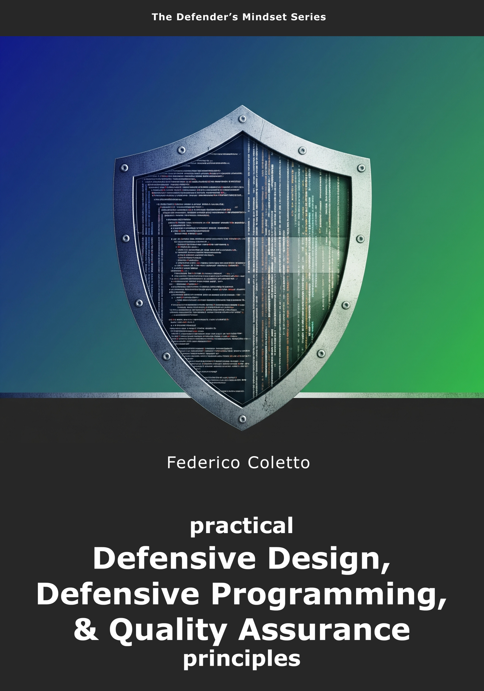
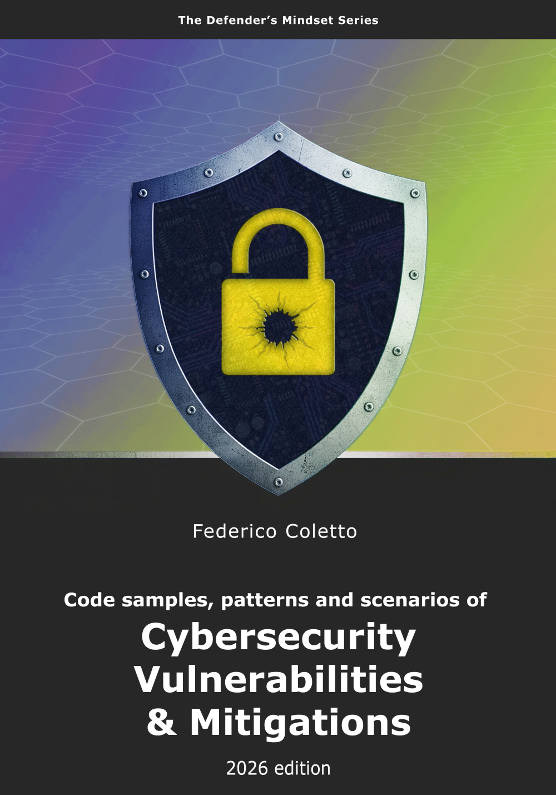
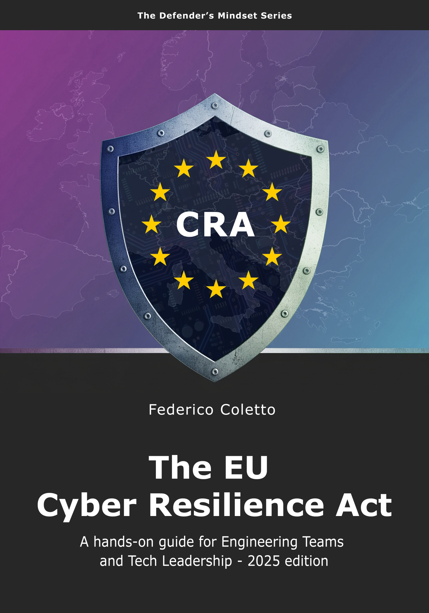

# Knowledge base

[← Back to the README](../README.md)

Kyklos is entirely based on **industry-standard** principles and knowledge bases.

## Standards, catalogues and references

The public knowledge bases behind the security annotations, risk registers and reviews of Kyklos, and the wider references around them.

**Weaknesses, vulnerabilities and attacks**

- [CWE – Common Weakness Enumeration](https://cwe.mitre.org/): the catalogue of software weakness types that `[CySec]` annotations cite.
- [CVE – Common Vulnerabilities and Exposures](https://www.cve.org/): identifiers for publicly known vulnerabilities.
- [NVD – National Vulnerability Database](https://nvd.nist.gov/): CVE records enriched with severity scores and affected products.
- [CAPEC – Common Attack Pattern Enumeration and Classification](https://capec.mitre.org/): how weaknesses are attacked.
- [MITRE ATT&CK](https://attack.mitre.org/): adversary tactics and techniques observed in real attacks.
- [CISA – Known Exploited Vulnerabilities catalog](https://www.cisa.gov/known-exploited-vulnerabilities-catalog): vulnerabilities known to be exploited in the wild.
- [FIRST – CVSS](https://www.first.org/cvss/) and [EPSS](https://www.first.org/epss/): how severe a vulnerability is, and how likely it is to be exploited.

**Secure development practice**

- [OWASP Top 10](https://owasp.org/www-project-top-ten/): the most critical web application security risks.
- [OWASP ASVS – Application Security Verification Standard](https://owasp.org/www-project-application-security-verification-standard/): verifiable security requirements.
- [OWASP SAMM – Software Assurance Maturity Model](https://owaspsamm.org/): measuring and improving a secure development programme.
- [OWASP Proactive Controls](https://owasp.org/www-project-proactive-controls/) and the [OWASP Cheat Sheet Series](https://cheatsheetseries.owasp.org/): practical defensive techniques.
- [NIST SP 800-218 – Secure Software Development Framework (SSDF)](https://csrc.nist.gov/pubs/sp/800/218/final): practices for a secure development lifecycle.
- [ISA/IEC 62443 series](https://www.isa.org/standards-and-publications/isa-standards/isa-iec-62443-series-of-standards): industrial cybersecurity; part 4-1 defines the secure product development
  lifecycle.

**Supply chain**

- [SLSA – Supply-chain Levels for Software Artifacts](https://slsa.dev/): build integrity and provenance.
- [OpenSSF Scorecard](https://scorecard.dev/): automated security health checks of open-source projects.
- [CycloneDX](https://cyclonedx.org/) and [SPDX](https://spdx.dev/): the two standard formats for software bills of materials (SBOM).

**European regulation**

- [Cyber Resilience Act – Regulation (EU) 2024/2847](https://eur-lex.europa.eu/eli/reg/2024/2847/oj): security requirements for products with digital elements.
- [NIS2 Directive – Directive (EU) 2022/2555](https://eur-lex.europa.eu/eli/dir/2022/2555/oj): cybersecurity risk management and incident reporting.
- [Machinery Regulation – Regulation (EU) 2023/1230](https://eur-lex.europa.eu/eli/reg/2023/1230/oj): safety requirements for machinery and related products.
- [ENISA – European Union Agency for Cybersecurity](https://www.enisa.europa.eu/): guidance, threat landscapes and good practices.

## Books and articles

Recommended reading on the engineering practices behind Kyklos.

- “Agile Software Development, Principles, Patterns, and Practices” by Robert C. Martin
- “Clean Code: A Handbook of Agile Software Craftsmanship” by Robert C. Martin
- “Clean Architecture: A Craftsman's Guide to Software Structure and Design” by Robert C. Martin
- “Adaptive Code: Agile Coding with Design Patterns and S.O.L.I.D. Principles” by Gary McLean Hall
- “Head First Design Patterns: A Brain-Friendly Guide” by Eric Freeman, Elisabeth Robson, Bert Bates, and Kathy Sierra
- “The S.O.L.I.D. Principles of Object-Oriented Design” by Bipin Joshi
- “The Pragmatic Programmer: From Journeyman to Master” by Andrew Hunt and David Thomas
- “97 Things Every Programmer Should Know” by Kevlin Henney
- “Refactoring: Improving the Design of Existing Code” by Martin Fowler
- “[Test Pyramid](https://martinfowler.com/bliki/TestPyramid.html)” by Martin Fowler
- “Code Simplicity: The Fundamentals of Software” by Max Kanat-Alexander
- “The Design of Everyday Things” by Don Norman
- “Grokking Simplicity: Taming Complex Software with Functional Thinking” by Eric Normand
- “Extreme Programming Explained: Embrace Change” by Kent Beck
- “Test-Driven Development: By Example” by Kent Beck
- “The Productive Programmer” by Neal Ford
- “The Art of Unit Testing: With Examples in C#” by Roy Osherove
- “Succeeding with Agile” by Mike Cohn
- “[The Practical Test Pyramid](https://martinfowler.com/articles/practical-test-pyramid.html)” by Ham Vocke
- “Code Complete: A Practical Handbook of Software Construction” by Steve McConnell
- “Aspect-Oriented Software Development with Use Cases” by Ivar Jacobson and Pan-Wei Ng
- “AOP in .NET: Practical Aspect-Oriented Programming” by Matthew D. Groves
- “AspectJ in Action: Enterprise AOP with Spring Applications” by Ramnivas Laddad
- “Design Patterns: Elements of Reusable Object-Oriented Software” by Erich Gamma, Richard Helm, Ralph Johnson, and John Vlissides
- “Applying UML and Patterns: An Introduction to Object-Oriented Analysis and Design and Iterative Development” by Craig Larman
- “Guideline Industrial Security – IEC 62443 is easy” by Pierre Kobes
- “Solutions Architect’s Handbook” by Saurabh Shrivastava, Neelanjali Srivastav
- “Domain-Driven Design: Tackling Complexity in the Heart of Software” by Eric Evans

## Deep-diving into the QA and SSDLC topics

If you are hungry for more practical know-how about Quality Assurance, Defensive Design, Defensive Programming, and Cybersecurity, these books are a good place to start.

**Practical Defensive Design, Defensive Programming and Quality Assurance principles**  
Defensive Design, Defensive Programming and Quality Assurance are vast, multi-faceted, complex topics with deep historical roots and significant ramifications across multiple aspects of IT.

**Code samples, patterns and scenarios of Cybersecurity Vulnerabilities & Mitigations**  
A hands-on guide for Engineering Teams and Security Specialists.

**The EU Cyber Resilience Act**  
A hands-on guide for Engineering Teams and Tech Leadership.

## Related pages

[The Proof Table](PROOF.md), [The Kyklos workflow](WORKFLOW.md), [Similar projects](SIMILAR_PROJECTS.md), and [the README](../README.md) for the full list.
