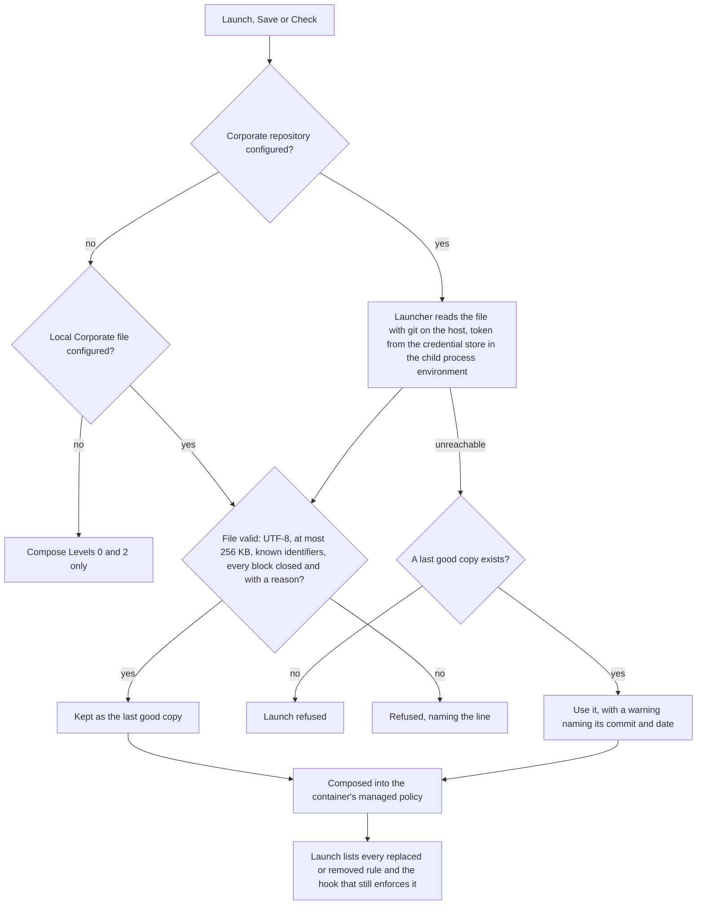

# The three policy levels

[← Back to the README](../README.md)

An agent's rules come in three named levels. Claude Code reads them as one managed policy plus the project's own file:

| Level | Name | Where it comes from | Who owns it |
|---|---|---|---|
| 0 | **Kyklos** | the policy shipped with the plugin through the marketplace (`dist/CLAUDE.kyklos.md`) | Kyklos |
| 1 | **Corporate** | optional: a file in an optional Git repository, read by KyklosLauncher on the host at every launch (or a local file) | your organisation |
| 2 | **Project** | the project's own `CLAUDE.md`, in its repository or its companion, according to the project's [topology](TOPOLOGIES.md) | the project |

Level 1 extends Level 0 and may replace or remove a named Level 0 rule. Level 2 stacks on top of both. KyklosLauncher
composes Levels 0 and 1 into the container's managed policy (`/etc/claude-code/CLAUDE.md`); the project's `CLAUDE.md`
is untouched.

## Settings

Each setting has a launcher-wide value (in the launcher's `appsettings.json`, or the environment variable of the same
name) and a per-project value (the configuration's **Policy** tab). A project that sets its own repository address takes
its branch, path and token name from its own configuration only, so the launcher's token never goes to a project's
address.

| Project setting | Launcher-wide setting | Meaning | Empty means |
|---|---|---|---|
| `KYKLOS_CORPORATE_POLICY_URL` | `Launcher:Projects:CorporatePolicyRepositoryUrl` | the Git repository (`https://<git-server>/<group>/<repository>.git`) | no repository: the local file below, or no Level 1 |
| `KYKLOS_CORPORATE_POLICY_BRANCH` | `Launcher:Projects:CorporatePolicyBranch` | its branch | the repository's default branch |
| `KYKLOS_CORPORATE_POLICY_PATH` | `Launcher:Projects:CorporatePolicyPath` | the file's path in the repository (relative, forward slashes) | `CLAUDE.md` |
| `KYKLOS_CORPORATE_POLICY_TOKEN_NAME` | `Launcher:Projects:CorporatePolicyTokenName` | the credential-store name of a token that reads a private repository | the project's own Git token (`KYKLOS_PUSH_TOKEN_ENV`), only when the repository is on the same server as the project's push address; otherwise no token |
| (none) | `Launcher:Projects:PolicyOrganisationLayer` (`KYKLOS_POLICY_ORG_LAYER`) | a local Corporate file, used when no repository is configured | no Level 1 |

With none of them set, a launch composes Levels 0 and 2 exactly as before.

The repository is read with git on the host, by the launcher. The token is handed to git through the child process's
environment only: never on its command line, never in a file, never in a log or a message, and never inside the
container for this purpose. An address with a user name or password in it is refused; name the token instead.

## Writing a Corporate policy

The Corporate file is plain UTF-8 text of at most 256 KB. Nothing in it is expanded (a `{{NAME}}` or `$(command)` stays
as written) and nothing is run; it is shown to the person who launches. Everything in it is added after the Kyklos
policy. To replace or remove a Kyklos rule or a whole section, name it by its identifier and give a reason; each block
starts at the beginning of a line, outside a fenced code block:

```
<!-- kyklos:replace tier1.commit-after-each-change reason="<why your organisation differs>" -->
- **<your rule's title>.** <your rule>
<!-- kyklos:end -->

<!-- kyklos:remove testing.repeat-under-load reason="<why it does not apply>" -->
```

In the composed policy, a replaced rule keeps its place under a visible line
`Corporate replacement of Kyklos rule <id>: <reason>`; a removed rule leaves the line
`Kyklos rule <id> removed by the Corporate policy: <reason>`; and an "Overrides in force" list opens the file. Only one
version of a rule ever reaches the agent.

**Hooks stay on.** Several rules are also enforced by a Kyklos hook. Replacing or removing the text does not switch the
hook off: hooks keep their own off-switches. The launch says, per rule, which hook still enforces the original and how
to switch it off (the table below lists them).

## What is refused

The file is refused, naming the line, at the **Check** button, when a configuration is **saved** with changed
Corporate settings, and at **launch**, when it:

- names an identifier that does not exist (the refusal names the closest valid ones);
- overrides one rule twice, or a section and a rule inside it, or a rule through both its identifier and an alias;
- has a block without a `reason`, an empty replacement, a block never closed, an `end` without a block, an indented
  block, or any other `kyklos:` comment;
- is larger than 256 KB, is not UTF-8 text, or holds a control character;
- is not a regular file in the repository (a symbolic link or a folder).

### How the check runs



The token that reads a private repository is named by `KYKLOS_CORPORATE_POLICY_TOKEN_NAME`, read from the credential store on the host, and handed to git through the child process's
environment only. A refused file starts nothing, and the message names the line, so the person fixes the file and pushes it again. Replacing a rule's text never switches off the rule a hook
enforces: that takes the hook's own switch, which the person sets (see [Overrides](WORKFLOW.md#greppable-opt-out-switches)).

## When the repository cannot be read

The launcher keeps the last copy that composed without error (per repository address, branch and path, in its own data
folder, with the commit and date). When the repository cannot be read, the launch uses that copy and says so as a
warning: `Corporate repository <address> unreachable; using the last good copy <commit> from <date>`. When there has
never been a good copy, the launch is refused: a configured Corporate policy never silently yields a session without it.
A file that is refused is never kept as the last good copy and is never replaced by an older one.

A change pushed to the repository reaches each project at its next launch. The composed policy is part of the
container definition's fingerprint, so the image is rebuilt when it changes.

## In the launcher

A configuration's **Policy** tab, beside **Settings**, holds the Corporate settings and two buttons:

- **Check** reads the repository on the host and shows where Level 1 came from (address, commit, date, size), the three
  levels, and the overrides table (identifier, title, replaced or removed, reason, hook still active), each row opening
  the Kyklos original beside its replacement; or the exact error.
- **Preview** shows the whole composed policy, with every override's line marked, from the values as entered, saved or
  not. It uses the same composer as the launch, so the preview and the container's file cannot differ.

The launch shows one line for Level 1 (`Corporate policy <commit> (<date>) from <address>: <n> Kyklos rules replaced,
<m> removed`), a warning instead on the last-good fallback, and one line per overridden rule whose hook still enforces
the original. The launch result of the API (`policy`) and `POST /api/configs/{name}/policy` carry the same overrides.

## Rule identifiers

Every rule and section of the Kyklos policy carries a permanent identifier, written as a comment just before it
(`<!-- kyklos:rule <id> -->`). Identifiers are never dropped or renamed: a renamed identifier keeps its former name as
an alias (`<!-- kyklos:alias <former> <current> -->`), and a Kyklos release that drops one without an alias fails its
own tests. A section's identifier names the whole section, its rules included.

| Identifier | Kind | Title | Hook still enforcing it |
|---|---|---|---|
| `intro.baseline` | rule | Baseline discipline every project inherits (Level 0, Kyklos). Project CLAUDE.md files (Level 2, Project) add |  |
| `tier0` | section | Tier 0 — Unrecoverable (a violation here is expensive or permanent) |  |
| `tier0.no-ai-attribution` | rule | No AI attribution. |  |
| `tier0.no-green-washing` | rule | No green-washing. | `kyklos-zero-failures-gate` (no off-switch) |
| `tier0.builds-is-not-passes` | rule | "It builds" ≠ "it passes". |  |
| `tier0.no-unexplained-failures` | rule | No unexplained failures. |  |
| `tier0.no-infra-disclosure` | rule | No infra disclosure in public-bound repos. |  |
| `tier0.no-plaintext-secret` | rule | No secret in a non-encrypted location. |  |
| `tier0.poka-yoke` | rule | Poka-Yoke — mistake-proof by design. |  |
| `tier0.default-on` | rule | DEFAULT-ON, never opt-in. |  |
| `tier0.fix-damage-and-root-cause` | rule | Fix the DAMAGE and the ROOT CAUSE — both, always. |  |
| `tier1` | section | Tier 1 — Core engineering |  |
| `tier1.verify` | rule | NEVER assume — verify. |  |
| `tier1.session-identity-not-alias` | rule | The session account's identity is never an alias. |  |
| `tier1.secret-in-one-command` | rule | Use a secret inside ONE command, never print it. |  |
| `tier1.no-reinvented-wheel` | rule | Don't re-invent the wheel. | `kyklos-standard-config-guard` (no off-switch) |
| `tier1.never-rm-critical-path` | rule | Never rm a critical path. | `kyklos-rm-critical-path-guard` (off-switch `KYKLOS_RM_CRITICAL_PATH_GUARD=off`) |
| `tier1.commit-after-each-change` | rule | Commit after every feature/fix. |  |
| `tier1.durable-knowledge-in-repo` | rule | Durable knowledge and rules live in the repository. | `kyklos-infra-persistence-guard` (no off-switch) |
| `tier2` | section | Tier 2 — GitFlow & Conventional Commits  (`kyklos-gitflow-branch-guard` + `kyklos-commit-message-guard` hooks) |  |
| `tier2.gitflow` | rule | GitFlow. | `kyklos-gitflow-branch-guard` (no off-switch) |
| `tier2.close-every-branch` | rule | Close every branch when the task is DONE (`kyklos-branch-cleanup-guard` hook). | `kyklos-branch-cleanup-guard` (no off-switch) |
| `tier2.push-policy` | rule | PUSH POLICY (`kyklos-no-push-guard` hook). | `kyklos-no-push-guard` (no off-switch); `kyklos-mr-hands-off-guard` (off-switch `KYKLOS_MR_AUTOMERGE=off`) |
| `tier2.conventional-commits` | rule | Conventional Commits. | `kyklos-commit-message-guard` (off-switch `KYKLOS_REQUIRE_REFS=0`) |
| `topologies` | section | Project structure — the four project topologies (companion / nested model) |  |
| `topologies.prista` | rule | Internal — `PriSta` |  |
| `topologies.pricompubsou` | rule | Non-Internal — `PriComPubSou` |  |
| `topologies.pricomprisou` | rule | Private companion, private source — `PriComPriSou` |  |
| `topologies.prisoupubart` | rule | Private-source, public-artifact — `PriSouPubArt` |  |
| `topologies.baked-into-image` | rule | This policy and the `kyklos` plugin are baked into the development container image, never the repos. |  |
| `coding` | section | Coding conventions (language-agnostic) |  |
| `coding.names` | rule | Names: |  |
| `coding.constants` | rule | Constants & literals: |  |
| `coding.reuse` | rule | Reuse & duplication: |  |
| `coding.layout` | rule | Layout: |  |
| `coding.cysec` | rule | Security annotations (`[CySec]`): |  |
| `coding.tooling-default` | rule | Tooling default: |  |
| `testing` | section | Testing |  |
| `testing.unit-test-ground-truth` | rule | isolated unit test is ground truth |  |
| `testing.no-pre-existing-failures` | rule | No pre-existing failures | `kyklos-zero-failures-gate` (no off-switch) |
| `testing.proven-where-it-runs` | rule | Proven where it runs, not only where it is built. |  |
| `testing.repeat-under-load` | rule | Repeat under load (only where timing can matter). |  |
| `testing.prove-merged-result` | rule | Prove the merged result. |  |
| `testing.tests-can-fail` | rule | FAIL | `kyklos-test-quality-guard` (no off-switch) |
| `testing.mutation-opt-out` | rule | Mutation testing runs by default; a project may opt out. |  |
| `testing.mutation-where-it-matters` | rule | Mutation testing only where it matters. |  |
| `testing.forks-share-one-bridge` | rule | Forks share one bridge. |  |
| `parallel` | section | Parallel work — forks and subagents never collide |  |
| `parallel.conflict-check` | rule | Check for conflicts before handing out work. |  |
| `parallel.no-self-assigned-work` | rule | A fork or subagent never takes new work on its own. |  |
| `parallel.no-nested-forks` | rule | A fork or subagent never starts its own forks or subagents for work that changes anything. |  |
| `parallel.merge-one-at-a-time` | rule | Overlapping changes merge one at a time. |  |
| `next-work` | section | Choosing the next work |  |
| `next-work.order` | rule | When you look for the next thing to work on, take it in this order, and never by any other: |  |
| `next-work.dependencies` | rule | Dependencies are respected. |  |
| `next-work.nothing-hidden` | rule | Nothing is hidden. |  |
| `next-work.severity` | rule | Every new issue gets a severity when it is created |  |
| `next-work.ask-the-bridge` | rule | Ask the bridge, do not sort by hand. |  |
| `response` | section | Response style |  |
| `response.concise` | rule | Concise. Minimal preamble, no filler, no flattery. Answer first; elaborate only if it earns its length. |  |
| `response.surface-deliverable` | rule | Surface the deliverable — never "it's in the file". |  |
| `response.proof-as-rendered` | rule | Show the proof as the tool renders it — never restructure the canonical artifact by hand. |  |
| `response.full-context-asks` | rule | Asking the user anything — give full context and the reason, always. |  |
| `response.ask-on-the-story` | rule | A story's question is asked on the story, and the terminal points to it. |  |
| `response.tickable-asks` | rule | Asking in GitLab text — a tickable option per item, always. |  |
| `response.no-bare-hash-numbers` | rule | Numbering your own items in GitLab text — never a bare `#N`. |  |
