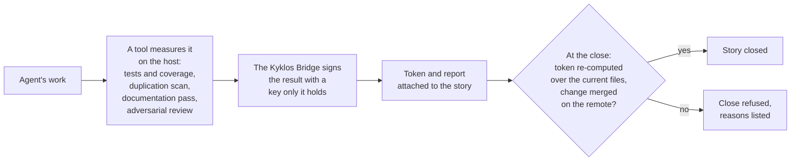
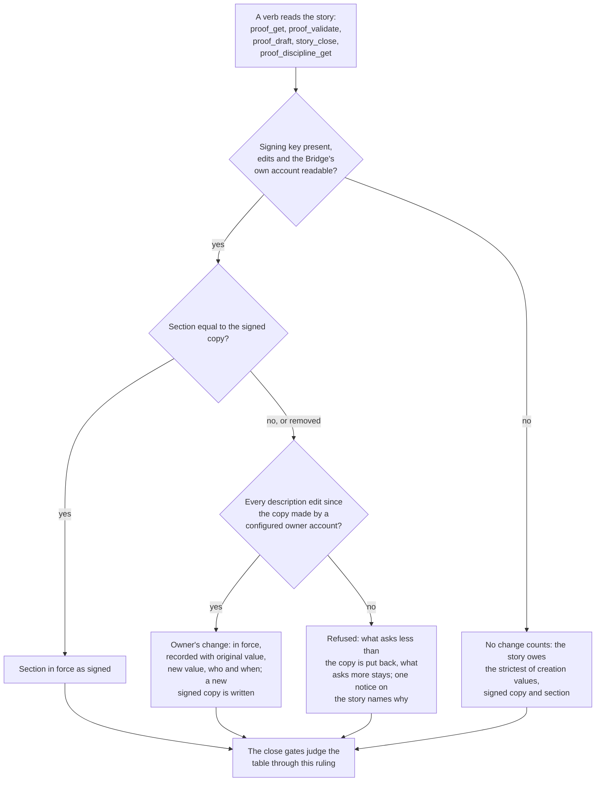
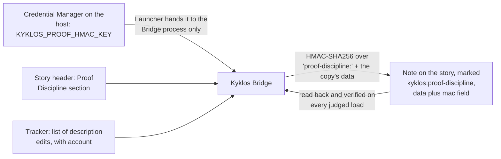

# The Proof Table

[← Back to the README](../README.md)

On this page: [The Proof Table](#the-proof-table-1) · [The owner's Proof Discipline](#the-owners-proof-discipline) ·
[The Bridge's signed copy of the section](#the-bridges-signed-copy-of-the-section) · [Example](#example)

The dimensions, one page each: [Completeness](PROOF_DIMENSION_COMPLETENESS.md) ·
[Feature Availability](PROOF_DIMENSION_FEATURE_AVAILABILITY.md) · [Input Validation](PROOF_DIMENSION_INPUT_VALIDATION.md) ·
[Robustness](PROOF_DIMENSION_ROBUSTNESS.md) · [Resilience](PROOF_DIMENSION_RESILIENCE.md) ·
[Security Posture](PROOF_DIMENSION_SECURITY_POSTURE.md) · [Defense in Depth](PROOF_DIMENSION_DEFENSE_IN_DEPTH.md) ·
[Observability](PROOF_DIMENSION_OBSERVABILITY.md) · [Thread Safety](PROOF_DIMENSION_THREAD_SAFETY.md) ·
[Configurability](PROOF_DIMENSION_CONFIGURABILITY.md) · [Test Discipline](PROOF_DIMENSION_TEST_DISCIPLINE.md) ·
[Non-Duplication](PROOF_DIMENSION_NON_DUPLICATION.md) · [Documentation](PROOF_DIMENSION_DOCUMENTATION.md) ·
[Poka-Yoke](PROOF_DIMENSION_POKA_YOKE.md) · [Risk Assessment](PROOF_DIMENSION_RISK_ASSESSMENT.md) ·
[i18n](PROOF_DIMENSION_I18N.md) · [Adversarial Review](PROOF_DIMENSION_ADVERSARIAL_REVIEW.md)

What the checks assume about the agent, and the optional hardening against a **deliberately hostile** one:
[What Kyklos assumes about the agent](PROOF_AGENT_ASSUMPTIONS.md).

Languages: the table's headings, dimension names and verdict words are fixed English words the tools read; the evidence
under them may be in any language. The rows backed by measuring tools (Test Discipline, the i18n scan, the test names that
cite specification items) read C# on .NET fully and bash scripts for coverage and test names; for other programming
languages those rows rest on the evidence the agent cites. Each dimension's page says what its own check supports, and
[Supported languages and tools](SUPPORT_MATRIX.md) has the full list.

## The Proof Table

Every story ends with a **Proof Table**: one row per quality dimension, in four columns: **Quality Dimension**, **Verdict** (PROVEN, NOT_PERTINENT with a reason, or UNPROVEN), **Evidence** (what was
checked, where, and how) and **Metrics**. The table lives on the story, where reviewers can read it. The agent cannot close a story while any required row is UNPROVEN; only a person can [override](WORKFLOW.md#overrides) that,
and the override is recorded.

**Every dimension carries metrics**: short, labelled figures, each naming the tool that produced it, for example `Story lines (ledger): covered or limited 42 of 42 story lines` or `Duplication (jscpd): 0 clones`. On the tool-gated rows
([Test Discipline](PROOF_DIMENSION_TEST_DISCIPLINE.md), [Non-Duplication](PROOF_DIMENSION_NON_DUPLICATION.md), [Documentation](PROOF_DIMENSION_DOCUMENTATION.md), [Risk Assessment](PROOF_DIMENSION_RISK_ASSESSMENT.md), [i18n](PROOF_DIMENSION_I18N.md), [Adversarial Review](PROOF_DIMENSION_ADVERSARIAL_REVIEW.md)) a PROVEN verdict without them is refused; on every row a verdict without evidence text is refused (a
NOT_PERTINENT row carries its reason instead). Every item of the story's specification (each requirement, use case, failure mode and acceptance criterion) must also appear as its own metric in the row
that proves it, so nothing in the specification can be left silently unproven. Each dimension's page says exactly what its row must carry and which program checks it.

**Four rows are drafted from the remote, merged state**: [Completeness](PROOF_DIMENSION_COMPLETENESS.md), Test Discipline, Non-Duplication and Documentation read the cited deliverable on the remote (its changed files, its commit,
its pipeline), so they cannot be proven while the change exists only on the agent's machine. The close then certifies the **merged result**: the deliverable merged into the trunk, every commit
naming the story on the trunk, the signed evidence judged where the story landed. See [The Kyklos Workflow](WORKFLOW.md).

**Which rows are mandatory depends on the story's kind**, its [`kind::`](STORAGES.md#gitlab-storage-the-ssot-for-team-projects) label (see [Storages](STORAGES.md)); the `type::` label is informational and plays no part. A row outside a kind's set is not required, and a lighter table can never be used for a development story. When the kind
cannot be read, the full development set applies (and a story adopted without a kind is given `development`, see [Storages](STORAGES.md#adoption-of-existing-issues)): an error can only raise the bar.

The table below lists, for every dimension, the **metrics** its row must carry, and for every story kind whether those metrics are **mandatory**:
✅ = the row and all its metrics are mandatory; 🟡 = the row is mandatory, the marked metrics are optional; – = the row is not required for that kind.

| Dimension                                                         | Metrics the row must carry                                                                                                | Development |                                                       Ops                                                       | Analysis | Documentation |
|-------------------------------------------------------------------|---------------------------------------------------------------------------------------------------------------------------|:-----------:|:---------------------------------------------------------------------------------------------------------------:|:--------:|:-------------:|
| [Completeness](PROOF_DIMENSION_COMPLETENESS.md)                   | one metric per requirement, use case, failure mode and acceptance criterion, naming the test (or document) that proves it |     ✅      |                                                       ✅                                                        |    ✅    |      ✅       |
| [Feature Availability](PROOF_DIMENSION_FEATURE_AVAILABILITY.md)   | one metric per requirement, naming the end-to-end test that reaches it through the public interface                       |     ✅      |                                                       ✅                                                        |    –     |       –       |
| [Input Validation](PROOF_DIMENSION_INPUT_VALIDATION.md)           | the rejection tests of each entry point                                                                                   |     ✅      |                                                       ✅                                                        |    –     |       –       |
| [Robustness](PROOF_DIMENSION_ROBUSTNESS.md)                       | one metric per failure mode, plus the boundary and edge-case tests                                                        |     ✅      |                                                       ✅                                                        |    –     |       –       |
| [Resilience](PROOF_DIMENSION_RESILIENCE.md)                       | the failure-injection tests and the retry or recovery settings they cover                                                 |     ✅      |                                                       ✅                                                        |    –     |       –       |
| [Security Posture](PROOF_DIMENSION_SECURITY_POSTURE.md)           | the controls added or touched, each with its formal reference ([CWE](KB.md#standards-catalogues-and-references), OWASP, IEC 62443, CAPEC)                              |     ✅      |                                                       ✅                                                        |    –     |       –       |
| [Defense in Depth](PROOF_DIMENSION_DEFENSE_IN_DEPTH.md)           | for each control, the fallback layer (or the reason there is none)                                                        |     ✅      |                                                       ✅                                                        |    –     |       –       |
| [Observability](PROOF_DIMENSION_OBSERVABILITY.md)                 | the failure paths added and the signal each one emits                                                                     |     ✅      |                                                       ✅                                                        |    –     |       –       |
| [Thread Safety](PROOF_DIMENSION_THREAD_SAFETY.md)                 | the concurrency tests, and the repeat-under-load count of each timing-dependent test file                                 |     ✅      |                                                       ✅                                                        |    –     |       –       |
| [Configurability](PROOF_DIMENSION_CONFIGURABILITY.md)             | the configuration tests, including the refusal of invalid configuration                                                   |     ✅      |                                                       ✅                                                        |    –     |       –       |
| [Test Discipline](PROOF_DIMENSION_TEST_DISCIPLINE.md)             | the share of changed lines a passing [Bridge](COMPONENTS.md#kyklos-bridge) run executed (`Story lines`: from the Bridge's signed [content ledger](PROOF_DIMENSION_TEST_DISCIPLINE.md#the-content-ledger-what-the-bridge-records-after-every-passing-run) for C#, from the [coverage receipt](PROOF_DIMENSION_TEST_DISCIPLINE.md#shell-scripts-the-token-and-the-coverage-receipt) for shell scripts, with **the attached receipt archive** linked), highest [CRAP score](WORKFLOW.md#glossary) when C# changed, the mutation statement (whether mutation testing ran, or why it was not required) |     ✅      | 🟡 coverage and CRAP figures optional when the deliverable cannot be tested, or testing it would be destructive |    –     |       –       |
| [Non-Duplication](PROOF_DIMENSION_NON_DUPLICATION.md)             | clones found and duplicated share, **the attached duplication report**                                                    |     ✅      |                                                       ✅                                                        |    –     |       –       |
| [Documentation](PROOF_DIMENSION_DOCUMENTATION.md)                 | the documents updated, the audience-lint findings                                                                         |     ✅      |                                                       ✅                                                        |    –     |      ✅       |
| [Poka-Yoke](PROOF_DIMENSION_POKA_YOKE.md)                         | each footgun introduced and the rung of its guard                                                                         |     ✅      |                                                       ✅                                                        |    –     |       –       |
| [Risk Assessment](PROOF_DIMENSION_RISK_ASSESSMENT.md)             | the register items (at least one for every story type except `docs` and `test`; a waiver line alone does not satisfy the close), and the mitigations marked in code against those claimed (a missing `[RiskMitigation RA-nn]` marker is reported as a warning) |     ✅      |                                                       ✅                                                        |    –     |       –       |
| [i18n](PROOF_DIMENSION_I18N.md)                                   | candidates, promoted and ignored texts (promoted + ignored = candidates)                                                  |     ✅      |                                                        –                                                        |    –     |       –       |
| [Adversarial Review](PROOF_DIMENSION_ADVERSARIAL_REVIEW.md)       | the rounds run, the open blocker and major findings (must be 0), the review note; the review is the control relied on against a deliberately hostile change ([what Kyklos assumes about the agent](PROOF_AGENT_ASSUMPTIONS.md)) |     ✅      |                                                       ✅                                                        |    ✅    |      ✅       |

Adversarial Review is in every kind's set and the agent can never waive it. As for every row, only a person can override it, and the override is recorded. Why the review, and not signing alone, is
what Kyklos relies on against an agent acting deliberately against you is explained in [What Kyklos assumes about the agent](PROOF_AGENT_ASSUMPTIONS.md).

**What makes the table trustworthy:** the mechanical rows cannot be filled by typing. Their evidence (the content ledger facts and the tokens of Test Discipline, the tool tokens, the
[review token](ADVERSARIAL_REVIEW.md#how-the-review-token-is-made-and-checked)) is signed by the `Kyklos Bridge` with a key the agent cannot read and bound to the exact content it judged, so a later change makes it stale and a forged one does not verify. Where a
row needs an **attached file** (the coverage receipt archive of a shell-script Test Discipline row, the duplication report for Non-Duplication), the row must link exactly that attachment. How
the Test Discipline evidence is recorded and checked, for C# and for shell scripts, is on its [page](PROOF_DIMENSION_TEST_DISCIPLINE.md).


## How "proven, not asserted" works

 The agent never marks its own homework. Test coverage, duplication scans, documentation checks and reviews produce signed tokens and attached reports.  
 A claim without its token is refused.



Each token is a keyed hash (HMAC-SHA256) of what the tool measured, made with a key kept in the operating system's credential store and given only to the [Bridge](COMPONENTS.md#kyklos-bridge), so the agent cannot produce
one by hand, and a file changed after its measurement no longer matches. The rules of the close are in [the workflow](WORKFLOW.md), the rows in [the Proof Table](#the-proof-table), and the rare
exceptions a person may grant in [Overrides](WORKFLOW.md#overrides).

## The owner's Proof Discipline

Every story's header holds a **Proof Discipline** section, filled when the story is created or adopted, from its kind and the
values in force:

```markdown
# Proof Discipline

* [ ] **i18n**
* [x] **Test Discipline**
  * Max CRAP Score: 50
  * Min Coverage: 85%
* [x] **Documentation**
```

The section belongs to the owner of the project, and it applies to that one story. Unticking a dimension disables it, ticking one
requires it, and writing a number changes a threshold, relaxed or tightened. The [Bridge](COMPONENTS.md#kyklos-bridge) alone reads it. An agent can read it and
ask for a change, and cannot change it: an edit by the agent's own account is no change, and the section is restored.

A disabled dimension needs no evidence. A threshold relaxed past the last measured result satisfies the dimension at once, with
no new run, as long as the code is still the code that was measured. Every change is shown in the row it touches, with the
original value, the new value, who decided and when, so a reader never takes it for a measured pass. A change that cannot be
verified counts as no change.

### How a change of the section is judged

The issue tracker records **who** edited a story's description, but not **which part** of it. So the [Bridge](COMPONENTS.md#kyklos-bridge) judges the section by
comparing it with its own signed copy (next section) and by reading the tracker's list of description edits:



- **Who counts as the owner:** the accounts listed in the Bridge setting [`Agile:Acceptance:OwnerAccounts`](WORKFLOW.md#bridge-owner-settings). With the list empty,
  no change of the section is the owner's, and every change is refused.
- **What the agent can do:** read the section with `proof_discipline_get` (it says whether the reading is verified and lists the
  owner's decisions), and ask with `proof_discipline_ask`, which posts one tickable comment on the story naming what is asked,
  the measured value, the value wanted and why. A tick changes nothing by itself: only the owner's edit of the section decides.
  No verb writes the section, and a specification text that carries it is refused.
- **When it is judged:** every time a verb that judges or shows the proof loads the story, and again before every save of the
  story, which puts the section back exactly as the ruling says, so no write of the story can change it.
- **A refusal never loosens anything.** When the change cannot be told to be the owner's, the Bridge keeps whatever asks more:
  a tightening that sits in the section stays in force, and only what asks less than the copy is undone.
- **What the user does.** Nothing, in the normal case. To relax or tighten one story, the owner edits the section in the story's
  header from an account listed in `Agile:Acceptance:OwnerAccounts`. When the Bridge says an owner's last word cannot be read
  (an owner edited, then the agent's account edited after the copy was made), the close is refused until an owner edits the
  section again.

The logic lives in the Bridge, in `ProofDisciplineJudge` (the ruling) and `ProofDisciplineDesk` (reading, keeping and signing it).

### The Bridge's signed copy of the section

Next to each story, the [Bridge](COMPONENTS.md#kyklos-bridge) keeps one **note** that holds a signed copy of its Proof Discipline section. You will see it in the
story's notes: it opens with a sentence saying what it is, and the data it holds is folded away under a small
"Signed record" heading.

- **What it is:** the Bridge's own record of what the section said when it last accepted it. The Bridge needs it to tell a change
  made by the owner from any other change, because the issue tracker records who edited the story's description, and the
  Bridge compares that with the copy.
- **What it records:** who changed the story's proof requirements, to what, and when.
- **Nobody needs to act on it.** Do not edit it or delete it. To change the section, edit it in the story's header, as described
  above. A note that only looks like the copy, or an old copy posted again, is ignored: only a copy that carries the Bridge's
  signature for this story counts, and when several do, the newest one counts.

**How the signature works.**



- **Where the key lives.** The signing key is the [proof signing key](PROOF_DIMENSION_TEST_DISCIPLINE.md#signatures-the-key-and-when-they-are-checked), `KYKLOS_PROOF_HMAC_KEY`. The [`Kyklos Launcher`](COMPONENTS.md#kyklos-launcher) creates it on
  the first launch that needs it (32 random bytes), stores it in the **Windows Credential Manager** under that name, verifies it
  by reading it back, and hands it only to the Bridge process through its environment. It never reaches the agent's container,
  and the Bridge removes it from the environment of every build and test it starts. The Bridge reads it from the environment
  variable named by the setting `Agile:Proof:HmacKeyEnvironmentVariableName` (default `KYKLOS_PROOF_HMAC_KEY`). If the
  credential store cannot keep the key, the launch is refused, because a key that changes at every launch would make every
  ledger fact, token and copy signed before it unverifiable; the one way past is the project's explicit, logged launch parameter
  [`KYKLOS_ALLOW_UNPERSISTED_HMAC`](WORKFLOW.md#launcher-opt-outs). See [Secrets](SECRETS.md).
- **What is signed.** The copy's data is one JSON object: the story, the project, an **anchor** (the number of the newest
  description edit the copy accounts for), the section as it was at creation, the section last accepted, and the owner's
  decisions (each with subject, original value, new value, who and when). The Bridge computes HMAC-SHA256, keyed with the
  signing key, over the text `proof-discipline:` followed by that JSON, and stores the result as the object's `mac` field. The
  prefix makes sure a signed record of another kind (a proof draft record, a [review token](ADVERSARIAL_REVIEW.md#how-the-review-token-is-made-and-checked)) never verifies as a copy.
- **When it is checked.** Every time the Bridge judges the section (see the diagram above): the Bridge reads the story's notes,
  keeps only the copies whose `mac` verifies under its key **and** that name this story of this project, and takes the one
  with the highest anchor. The comparison of the signature is made in constant time.
- **What a failed check causes.** A copy that does not verify is no copy: it is ignored, never trusted. If no valid copy is left,
  the Bridge judges the section against the values the story had at creation and treats any difference as unverified, so it
  counts as no change: the story owes the strictest values it can find, and no dimension is relaxed. A replayed older copy
  loses to the current one, because its anchor is lower. Without a signing key, nothing verifies, and the same strict reading
  applies.
- **How it affects the workflow and the user.** An honest workflow never notices it. The only effect a person can see is that
  a change made from the wrong account, or a section an agent edited, is put back, with one notice on the story naming why. No
  override is needed or offered: the owner simply makes the change again from an owner account.

## Example

A realistic, complete [Proof Table](#the-proof-table-1) of a small development story ("Retry Export": a failed upload is retried with growing waits):

| Quality Dimension    | Verdict          | Evidence                                                                                                                                                                                                    | Metrics                                                                                                                                                                                                                        |
|----------------------|------------------|-------------------------------------------------------------------------------------------------------------------------------------------------------------------------------------------------------------|--------------------------------------------------------------------------------------------------------------------------------------------------------------------------------------------------------------------------------|
| Completeness         | ✅ PROVEN        | R1 by `A_failed_upload_is_retried_three_times_with_growing_waits` (positive) and `A_fourth_failure_stops_the_export_with_the_last_error` (negative); UC1, FM1 and AC1 by their named tests.                 | <kbd>R1 (named tests):</kbd> pass<br><kbd>UC1 (The_second_attempt_succeeds_and_both_attempts_are_logged):</kbd> pass<br><kbd>FM1 (Every_attempt_failing_writes_nothing_partial):</kbd> pass<br><kbd>AC1 (UC1 test):</kbd> pass |
| Feature Availability | ✅ PROVEN        | Reached through the public `export` command; the end-to-end test runs the command against a local test server that fails once.                                                                              | <kbd>R1 (The_export_command_retries_a_failed_upload):</kbd> pass                                                                                                                                                               |
| Input Validation     | ✅ PROVEN        | `RetryOptions` rejects attempts outside 0–10 and a negative wait at start-up (`RetryOptionsValidator.cs:18`).                                                                                               | <kbd>Rejection tests (RetryOptionsValidatorTests):</kbd> 4 pass                                                                                                                                                                |
| Robustness           | ✅ PROVEN        | Boundaries 0 and 10 attempts, a zero wait, a server that closes the connection in the middle of an upload.                                                                                                  | <kbd>FM1 (named test):</kbd> pass<br><kbd>Boundary tests:</kbd> 6 pass                                                                                                                                                         |
| Resilience           | ✅ PROVEN        | The retry itself is the recovery: attempts and back-off are settings; tests inject a timeout and a reset connection and assert recovery; a test setting disables waits.                                     | <kbd>Failure-injection tests:</kbd> 3 pass<br><kbd>Retry settings covered:</kbd> 2/2                                                                                                                                           |
| Security Posture     | ✅ PROVEN        | Attack surface: the upload URL and credentials. The URL is validated against the allowed scheme before the first attempt (`UploadTarget.cs:27`, `[CySec]` CWE-918); no secret is logged in a retry message. | <kbd>Controls (with reference):</kbd> 1 (CWE-918)<br><kbd>Secrets in log lines:</kbd> 0                                                                                                                                        |
| Defense in Depth     | ✅ PROVEN        | If the URL check were bypassed, the HTTP client's allow-list still refuses other hosts (`HttpSetup.cs:40`, `[CySec] Hardens`).                                                                              | <kbd>Controls with a fallback layer:</kbd> 1/1                                                                                                                                                                                 |
| Observability        | ✅ PROVEN        | Each failed attempt logs the attempt number, the wait and the cause; the final failure is surfaced with the export id.                                                                                      | <kbd>Failure paths with a signal:</kbd> 2/2                                                                                                                                                                                    |
| Thread Safety        | ⬜ NOT_PERTINENT | The retry runs inside one export; no shared state is added.                                                                                                                                                 | –                                                                                                                                                                                                                              |
| Configurability      | ✅ PROVEN        | `MaxAttempts` and `FirstWait` have defaults, are validated, and can be overridden per environment; an invalid value stops the start-up.                                                                     | <kbd>Configuration tests:</kbd> 5 pass (2 refusals)                                                                                                                                                                            |
| Test Discipline      | ✅ PROVEN        | Content ledger at the merged result: every changed C# line ran under a passing Bridge run. The timing-dependent test file ran 5 times under CPU load (`run_tests` repeat 5, load 4). Mutation: not required (no security-sensitive code changed). | <kbd>Story lines (ledger):</kbd> covered or limited 42 of 42 story lines<br><kbd>CRAP (max, get_coverage):</kbd> 12.0<br><kbd>Repeat under load (UploadRetryTests):</kbd> 5/5<br><kbd>Mutation:</kbd> not required (no security-sensitive code changed) |
| Non-Duplication      | ✅ PROVEN        | jscpd over the 3 changed files: no clone; the existing back-off helper was reused instead of a new one.                                                                                                     | <kbd>Duplication (jscpd):</kbd> 0 clones, 0%<br><kbd>Report:</kbd> `jscpd-report.json` (attached)                                                                                                                              |
| Documentation        | ✅ PROVEN        | The README's export section documents the two new settings; the audience lint is clean.                                                                                                                     | <kbd>Docs updated (update-docs):</kbd> 1<br><kbd>Audience lint:</kbd> 0 findings                                                                                                                                               |
| Poka-Yoke            | ✅ PROVEN        | Footgun: a retry loop with no limit. Guard: the attempts are a validated range, so an unbounded loop cannot be configured (rung: refused at the boundary).                                                  | <kbd>Footguns introduced:</kbd> 1<br><kbd>Guard rung:</kbd> refused at the boundary                                                                                                                                            |
| Risk Assessment      | ✅ PROVEN        | RA-01 (a retry storm against the server) mitigated by the capped attempts and growing waits, marked `[RiskMitigation RA-01]` in `UploadRetry.cs:22`; RA-02 (no new public exposure) process-only.           | <kbd>Register items:</kbd> 2<br><kbd>Mitigations marked:</kbd> 1/1                                                                                                                                                             |
| i18n                 | ✅ PROVEN        | The new user-facing error message is in the resources (English and Italian); the two log lines are excluded by rule.                                                                                        | <kbd>Candidates (scanner):</kbd> 3<br><kbd>Promoted (scanner):</kbd> 1<br><kbd>Ignored (scanner):</kbd> 2                                                                                                                      |
| Adversarial Review   | ✅ PROVEN        | Round 1 found one major (the wait was not cancelled on shutdown), fixed; round 2 clean. Token verified by the Bridge.                                                                                       | <kbd>Rounds:</kbd> 2<br><kbd>Open blockers or majors:</kbd> 0<br><kbd>Review note:</kbd> round 2, clean                                                                                                                        |

**Tally: 16 PROVEN · 1 NOT_PERTINENT**

## Related pages

[What Kyklos assumes about the agent](PROOF_AGENT_ASSUMPTIONS.md), [Adversarial reviews](ADVERSARIAL_REVIEW.md), [The Kyklos workflow](WORKFLOW.md), [Hooks and skills](HOOKS_AND_SKILLS.md),
[Stories and epics](AGILE.md), [Secrets](SECRETS.md), and [the README](../README.md) for the full list.
