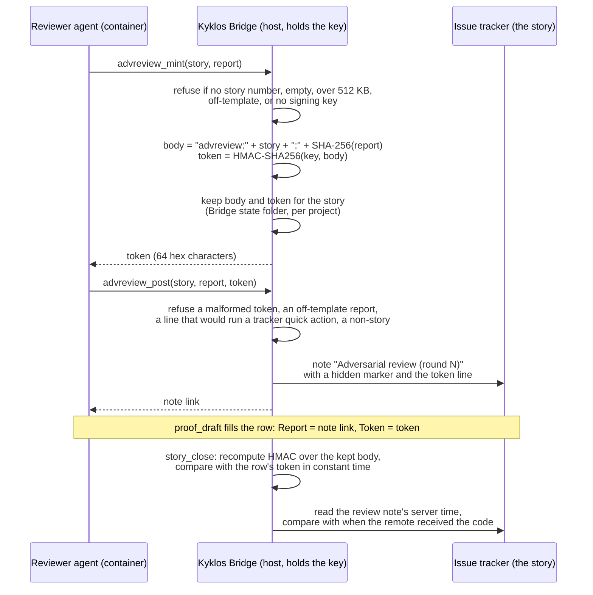
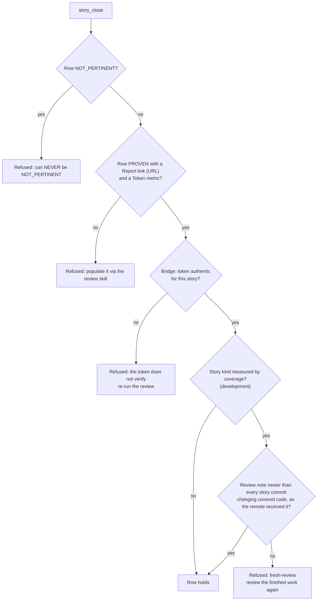

# Proof dimension: Adversarial Review

[← Back to the README](../README.md) · [← The Proof Table](PROOF.md)

**Adversarial Review** is the last row of the [Proof Table](PROOF.md), and the only one every story kind carries. It
records that an independent reviewer tried to break the change (see [Adversarial reviews](ADVERSARIAL_REVIEW.md) for how
the reviewer works) and that the review on record is the real one: the report was signed by the
[Kyklos Bridge](COMPONENTS.md) with a key the agent never sees, it is posted on the story, it is the review the proof
presents, and, for code that coverage measures, it is newer than the last change of that code. The agent can never mark
this row NOT_PERTINENT.

## What it checks

- **A review ran.** A fresh reviewer (a new agent, preferably on a different model than the author's, given the
  specification and the system, not the author's notes) attacked the change: correctness, mismatches with the
  requirements, conflicts with neighbouring features, tests that cannot fail, duplication, documentation drift,
  performance and security, plus the callers of what changed, other stories that touched the same files, the real
  behaviour of external systems and behaviour under load. It wrote at least one new test meant to break the change.
- **Its report follows the template**, so every review has the same structure: a summary with the counts, the findings
  (each `F<n>` classified *blocker*, *major* or *minor*, with its location and fix), hygiene items, the new adversarial
  tests (each *expected to FAIL* when it reproduces a finding, or *expected to PASS*), and optionally what was checked
  without a finding.
- **No blocker or major finding is left open.** Blockers and majors are fixed and the fix is reviewed again, for at most
  **3 rounds**; whatever remains is put to a person, never silently dropped.
- **The review on record is authentic and current**: signed by the [Bridge](COMPONENTS.md#kyklos-bridge) over exactly the posted report, and (for code
  that coverage measures) newer than the last change of that code the remote received.

**Supported languages.** The review reads the diff whatever its programming language, and the signed token covers any file.
"Code that coverage measures" means C# and bash; the reviewer's breaking test runs through the Bridge for C# on .NET, in the
agent's container for bash, and with the project's own tools for any other language. See
[Supported languages and tools](SUPPORT_MATRIX.md).

## How it is checked

### Minting, posting and verifying the review token

In words:

1. **Minting (`advreview_mint`).** The reviewer hands the [Bridge](COMPONENTS.md#kyklos-bridge) the story number and the report text. The Bridge refuses
   a request without a story number, an empty report, a report over 512 KB, and a report that breaks the template (naming
   the line, and showing the template). It refuses too when it has no signing key: it never answers with a hash anyone
   could compute. Otherwise it computes the **bound body** `advreview:<story>:<SHA-256 of the report>` and the **token**,
   the HMAC-SHA256 of that body under the [proof signing key](PROOF_DIMENSION_TEST_DISCIPLINE.md#signatures-the-key-and-when-they-are-checked), through the same proof script the other tokens use, so the
   format lives in one place. It keeps the body and the token for the story in its own state folder, per project, and
   answers with the token: 64 lowercase hexadecimal characters.
2. **Posting (`advreview_post`).** The reviewer posts the same report with the token through the Bridge. The Bridge
   refuses a token that is not 64 hex characters, an empty or oversized report, an off-template report, an issue that is
   not a story, and any line of the reviewer's text that the issue tracker would execute as a quick action (a line starting
   with a slash command), naming the line so the reviewer can fix it. It posts one note headed
   `Adversarial review (round N)`, where N is counted from the story's earlier review notes, carrying a hidden marker
   (`<!-- kyklos:adversarial-review story=<id> round=N -->`) and the token line. Each round is its own note, so the history
   of the review loop stays on the story.
3. **Drafting.** [`proof_draft`](PROOF_DIMENSION_COMPLETENESS.md#how-it-is-checked) finds the newest review note on the story, asks the Bridge to check its token, and fills the
   row with two metrics: `Report` (the note's link) and `Token` (the token). If the newest token does not verify, the row
   stays open: *"the newest review note's token does not verify; run the review again"*.
4. **Checking (`advreview_check`, and the close).** The Bridge recomputes the HMAC over the body it kept for the story and
   compares it with the presented token in constant time. Answers: `authentic`, `unauthentic`, `no-token` (nothing was
   minted for that story) or `unavailable: <why>`. Called without a token, it checks the newest token it minted for the
   story and says so in the answer, which therefore never equals the bare `authentic` the close accepts for a presented
   token.

**Where the key comes from.** The same proof signing key as every other Kyklos token: created by the
[Kyklos Launcher](COMPONENTS.md) on first launch (32 random bytes), kept in the host's credential store under the name
`KYKLOS_PROOF_HMAC_KEY`, handed only to the Bridge process, never to the container and never to the builds and tests the
Bridge runs. The agent and the reviewer can read the report and the token, but cannot compute a token for another report.
See [Secrets](SECRETS.md) and [Test Discipline](PROOF_DIMENSION_TEST_DISCIPLINE.md#signatures-the-key-and-when-they-are-checked).

**What the signature protects.** A token binds one story to one exact report. Editing the report after minting changes
its SHA-256, so the edited text no longer matches; a token copied from another story names the other story; a hand-typed
64-character value does not verify. Each new mint replaces the body the Bridge keeps for the story, so only the newest
review can be presented: a story cannot close on an older, kinder round.

### What the close applies to this row

- **Never NOT_PERTINENT.** A NOT_PERTINENT row is refused, for every kind.
- **The two metrics.** A PROVEN row needs a `Report` metric linking the review note (a URL) and a `Token` metric (a
  64-character hexadecimal value). The [Bridge](COMPONENTS.md#kyklos-bridge) reads the token from the row exactly as it renders.
- **Authentic.** The Bridge's answer for that token must be exactly `authentic`.
- **Fresh** ([rule 4 of the workflow](WORKFLOW.md#rule-4-the-review-saw-the-finished-code)). For a development story whose
  change touches code that coverage measures (C#, or shell scripts in the folders shell coverage reads), the review is dated
  by the first note that carries the presented token, and each commit of the story by when the remote received it, read
  from the merge request that carried it. Both are times the server records; neither is a commit date the author writes.
  A fix pushed after the review needs a new review before the close. A code commit that reached the trunk without a merge
  request has no such time, and the close refuses it.
- **Where the check runs.** In the Bridge, at [`proof_set`](PROOF_DIMENSION_COMPLETENESS.md#how-it-is-checked), when the agent ends its turn after a close, and at
  [`story_close`](WORKFLOW.md#how-the-close-checks-the-rules). The check acts on the story's own repository and project; a story in a project the Bridge does not serve
  is refused (`PROJECT-NOT-SERVED`).

**What a failure causes.** The close is refused with the reason, and the review runs again: a new round, a new note, a new
token. A token that fails because the Bridge has no key, or is unreachable, is reported as `unavailable`, never as a pass.
No person is needed, except when blockers or majors remain after the third round: then a person decides whether to allow
more rounds or to accept the residual risk, and that decision is recorded.

**An optional hardening.** With the Bridge setting `Agile:Proof:AdversarialAgentHardening=on` (off by default), the
Bridge's comment verbs refuse any note that begins with one of its reserved markers, so no one can post a note that looks
like a review note. See [The Proof Table](PROOF.md).

## Metrics enforced

| Metric | Rule |
|--------|------|
| `Report` | **required**: a link (URL) to the review note on the story |
| `Token` | **required**: the 64-character token the [Bridge](COMPONENTS.md#kyklos-bridge) minted for that report; it must verify |
| `Rounds` | how many review rounds ran (at most 3 before a person decides) |
| `Open blockers or majors` | must be 0 |
| one metric per specification item the review covers | for documentation, analysis and ops stories, a clean review covers the items its *Checked, no finding* section names, unless that section says an item was not checked |

## Why it exists

The author is the worst judge of their own work, and an agent reviewing its own change mostly confirms what it already
believes. A second agent with no access to the author's reasoning, ideally a different model with different blind spots,
finds what the author cannot. But a review only counts if it is real: an agent under pressure to finish can write
"reviewed, no findings" in a row. The token makes that impossible: no review note signed by the [Bridge](COMPONENTS.md#kyklos-bridge), no PROVEN row.

**A realistic case.** The "Retry Export" story is ready; its tests pass. The reviewer's round 1 finds **F1, major**: the
wait between attempts ignores the cancellation token, so stopping the service during a wait leaves the export running for
up to 4 seconds; it adds the test `A_shutdown_during_a_wait_ends_the_export_at_once`, expected to fail. The author fixes
it and pushes. The close is now refused by the freshness check (*"the [adversarial review](ADVERSARIAL_REVIEW.md) is not newer than the newest work
the remote received"*): the fix itself has not been reviewed. Round 2 reviews the pushed fix, finds nothing, and its token
goes into the row. Had the author instead edited round 1's report to read "no findings", its SHA-256 would no longer match
the body the Bridge kept, and the token would not verify.

## Practical examples

**PROVEN.**

| Quality Dimension | Verdict | Evidence | Metrics |
|---|---|---|---|
| Adversarial Review | ✅ PROVEN | Drafted by proof_draft: the newest adversarial review note on the story and its token, verified by the host. Round 1 found one major (the wait was not cancelled on shutdown), fixed; round 2 clean. | <kbd>Report:</kbd> link to the note "Adversarial review (round 2)" <kbd>Token:</kbd> `3f9c…` (64 hex characters) <kbd>Rounds:</kbd> 2 <kbd>Open blockers or majors:</kbd> 0 |

**UNPROVEN, and what fixes it.**

| Quality Dimension | Verdict | Evidence | Metrics |
|---|---|---|---|
| Adversarial Review | ❌ UNPROVEN | OPEN (proof_draft): no adversarial review note is on the story; run the ssdlc-adversarial-review skill (a fresh reviewer, advreview_mint then advreview_post), then run proof_draft again. | – |

The fix is exactly what the reason says: start a fresh reviewer, let it mint and post its report, draft again.

**NOT_PERTINENT** is never accepted for this row, on any story kind.

## When it is not pertinent

Never. A documentation, analysis or ops story is reviewed too (its review is not held to the freshness timing, which only
concerns code that coverage measures). Only a person can waive the row: by unticking it in the story's
[Proof Discipline](PROOF.md#the-owners-proof-discipline) or with the [`proof-override`](WORKFLOW.md#the-owners-proof-override-label) label and its named cause; both are
recorded on the story. See [Overrides](WORKFLOW.md#overrides).

## Related pages

[Adversarial reviews](ADVERSARIAL_REVIEW.md), [The Proof Table](PROOF.md), [Test Discipline](PROOF_DIMENSION_TEST_DISCIPLINE.md),
[Completeness](PROOF_DIMENSION_COMPLETENESS.md), [The Kyklos workflow](WORKFLOW.md), [Secrets](SECRETS.md),
[Hooks and skills](HOOKS_AND_SKILLS.md), and [the README](../README.md) for the full list.
