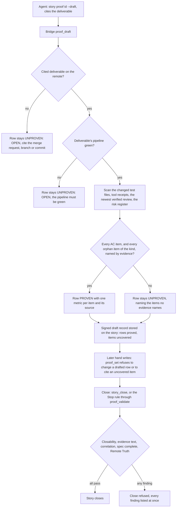

# Completeness

[← Back to the README](../README.md) · [← The Proof Table](PROOF.md)

**Completeness** asks one question: *is everything the story promised actually shown working?* A story's specification
declares numbered items: requirements (`R1`), use cases (`UC1`), failure modes (`FM1`), fail-open and fail-hard choices
(`FAIL-OPEN`, `FAIL-HARD`), risk items (`RA-01`) and acceptance criteria (`AC1`). The Completeness row proves that each of
them is backed by evidence the Bridge can find on its own: a named automated test that would fail if the item broke, a
tool receipt, a verified adversarial review, or the risk register. It is the one row every story kind carries, and the row
the `Kyklos Bridge` drafts itself from the remote, merged state of the work.

## What it checks

- **Every acceptance criterion is shown.** Each `AC<n>` of the section `## Acceptance criteria` must be cited in the
  Completeness row's metrics.
- **Every declared item is accounted for somewhere.** Whatever row is meant to prove it (requirements in
  [Feature Availability](PROOF_DIMENSION_FEATURE_AVAILABILITY.md), use cases in [Test Discipline](PROOF_DIMENSION_TEST_DISCIPLINE.md),
  failure modes in [Robustness](PROOF_DIMENSION_ROBUSTNESS.md), fail-open and fail-hard choices in
  [Resilience](PROOF_DIMENSION_RESILIENCE.md), risk items in [Risk Assessment](PROOF_DIMENSION_RISK_ASSESSMENT.md)), each item
  must be cited as a metric key in **some** PROVEN row. When the story's kind has no row for an item family (an analysis
  story has no Feature Availability row, for example), Completeness answers for those items too.
- **The deliverable is real.** The work the story cites (a merge request, a pushed branch or commits) is on the remote, and its
  pipeline is green.
- **Behaviour is shown both ways.** For a development story, each behaviour has a test that shows it working and one that shows
  it refusing what it should refuse. This is the judgement half of the row: no program can tell a positive test from a negative
  one, so the reviewer and the [adversarial review](PROOF_DIMENSION_ADVERSARIAL_REVIEW.md) judge it.

## How it is checked

Completeness is an **evidence row**: the Bridge fills it with `proof_draft` (the story tool's `story proof <id> --draft`), and
the agent never types it by hand.

**Step by step.**

1. **Where the evidence comes from.** `proof_draft` reads the story's specification (the issue description), the deliverable the
   agent cites (`group/project!<n>` for a merge request, `group/project@<commit>`, `group/project@<branch>`, or the bare project
   path, which takes every trunk commit carrying the story's `Refs: #<id>` trailer), the files that deliverable changes, its
   pipeline, the host tool receipts of the story (from a `doc_build` or `host_app_screenshot` run made for it), the newest
   adversarial review note and the story's risk register. It reads them through the Bridge's one GitLab reader, which tells an
   answer it could not read from a real "no": a deliverable whose state is unknown is reported as unknown and never guessed.
   The Bridge reads them in the story's **own** repository, whatever repository the agent's session sits in.
2. **What counts as a test naming an item.** Only the changed test files count (files under a `test` or `tests` folder or a
   folder ending in `.Tests`, files named `*Test.cs`, `*Tests.cs` or a partial `*Tests.<Part>.cs`, and `test-*.sh` shell suites).
   In C# only a test that runs counts (a method marked `[Test]`, `[TestCase]`, `[Fact]`, `[Theory]`, `[TestMethod]` and similar,
   not skipped): its method name, or a string in `[Category]`, `[Trait]` or `[Property]` on the method or its class. In a shell
   suite, the label of a check it calls. The item must appear as an exact upper-case token with no letter or digit touching it:
   `AC1_band_starts_at_edge` and `[Property("Spec", "FAIL-OPEN")]` name their items; `SampleAC3Strips`, `ac4` and `AC_1` do
   not. Comments, descriptions and test-case arguments never count. The scanner lives in the Bridge
   (`TestSourceScanner`, `SpecItemCoverage`).
3. **What else can cover an item.** A host tool receipt whose inputs name it; the newest adversarial review whose token the
   Bridge verifies, for `AC`, `R` and `FAIL-` items it states as checked with no negative wording (use cases and failure
   modes need a test); the risk register, for `RA-` items. A kind with no tests (documentation, analysis, operations) is the
   exception: there, a review with no finding covers every item its `Checked, no finding` section names, unless the item is
   marked `(not checked)` or listed on a `Not checked:` line.
4. **The signed draft record.** Next to the proof, the Bridge stores a record of the rows it proved and of the items no evidence
   covers. It signs that record with the proof signing key: HMAC-SHA256 over `proof-draft:` + story + project + a generation
   number + the record. Each new draft gets the next generation, and only the signed record with the highest generation counts,
   so an older record posted again changes nothing.
5. **Hand writes.** The agent writes the open rows with `story proof <id> --set 'Dimension=VERDICT|evidence|metrics'` (the
   Bridge verb `proof_set`). The Bridge refuses, with nothing written: a change to a row the draft proved; a row citing an item
   the signed record lists as uncovered; a PROVEN or NOT_PERTINENT row whose evidence cell is empty, a dash, a placeholder or a
   bare `n/a`, `TBD`, `todo` or `none`.
6. **The close.** `story close <id>` (the Bridge verb `story_close`) and the plugin's Stop rule (which reaches the Bridge's
   `proof_validate` through the `hook_event` verb) run the same gates: every required row present exactly once and none
   UNPROVEN; real evidence text in every row; every `AC` item cited inside a formal `<kbd>AC1 (tool):</kbd>` label of the
   Completeness row, prose not counting; every declared item cited as a metric key in some PROVEN row; the specification
   complete, with no template placeholder left; the cited deliverable merged on the remote (Remote Truth). Every finding is
   listed at once.

**Keys and secrets involved.** The draft record and the review token are signed with the proof signing key
`KYKLOS_PROOF_HMAC_KEY`, which the `Kyklos Launcher` keeps in the Windows Credential Manager and hands only to the Bridge process
(see [Secrets](SECRETS.md) and [the signed copy](PROOF.md#the-bridges-signed-copy-of-the-section)). The GitLab token the Bridge
uses to read the remote and to write the proof note stays on the host; the agent's container has none that can call the API.

**What a failure causes.** A record or review token that does not verify counts as absent: its items are uncovered, and the row
stays UNPROVEN until a new draft is made from real evidence. Without a signing key, the record is stored unsigned, and every
unsigned record counts together, so a planted record can only add refusals, never remove one. When the Bridge does not answer at
a Stop, the Stop goes through with a message, a trace of the unjudged Stop is kept in the container, and the Stop rules run on
the next Stop the Bridge answers; a raw close of the issue or a raw write of a proof table is refused before it runs.

**Impact on the user.** None in the normal case: the agent fills the missing evidence and drafts again. A person is needed only
to waive a gap on purpose (see [When it is not pertinent](#when-it-is-not-pertinent)).

## Metrics enforced

- One metric per acceptance criterion, its label naming the item and the evidence: `<kbd>AC1 (test):</kbd> tests/CsvExportTests.cs` (the changed test file whose running test names `AC1`).
- For an item family the kind has no row for, one metric per item in this row, with its source (`test`, `tool receipt`,
  `review`, `risk register`).
- When drafted: `<kbd>Deliverable (remote):</kbd>` the cited deliverables and their state, and `<kbd>Pipeline (ci):</kbd>` the
  pipeline address and its green status.

An item cited only in the evidence text, or only inside another row's prose, does not count: the close reads the `<kbd>` labels.

## Why it exists

A requirement nobody tested is a requirement nobody knows is met. An agent is very good at writing a convincing summary
("all acceptance criteria are covered") and much less reliable at noticing that the third criterion has no test at all. The
numbered items turn "is it complete?" into a lookup a program can make.

**A realistic use case.** A story adds a CSV export with three acceptance criteria. The agent writes tests for the header and
the row format, opens the merge request and drafts the proof. The draft answers: `Completeness: OPEN (proof_draft): no evidence
names AC3`. `AC3` was "an empty result writes only the header line". The agent had covered it in its head, never in a test.
It adds `AC3_empty_result_writes_only_the_header`, the test fails (the export wrote nothing at all), the agent fixes the code,
pushes, and the next draft proves the row. Without the gate, the bug would have shipped with a PROVEN table.

## Practical examples

**PROVEN** (drafted by the Bridge):

| Quality Dimension | Verdict   | Evidence                                                                                                         | Metrics |
|-------------------|-----------|------------------------------------------------------------------------------------------------------------------|---------|
| Completeness      | ✅ PROVEN | Drafted by proof_draft: the deliverable is on the remote, its pipeline is green, and evidence names every declared spec item of the kinds this story's proof set cannot hold in their own rows, and every acceptance criterion. | <kbd>Deliverable (remote):</kbd> group/project!42 (Shipped) <kbd>Pipeline (ci):</kbd> &lt;pipeline address&gt; (success) <kbd>AC1 (test):</kbd> CsvExportTests.cs <kbd>AC2 (test):</kbd> CsvExportTests.cs <kbd>AC3 (test):</kbd> CsvExportTests.cs |

**UNPROVEN, and what fixes it:**

| Quality Dimension | Verdict     | Evidence                                                                                 | Metrics |
|-------------------|-------------|------------------------------------------------------------------------------------------|---------|
| Completeness      | ❌ UNPROVEN | OPEN (proof_draft): the deliverable's pipeline is failed (&lt;pipeline address&gt;); it must be green. | – |

Fix the failing job, push, and draft again. Other open texts name their own fix: a deliverable that is not on the remote
(push it and cite it), or items no evidence names (add a test whose name carries the item, then draft again). Typing PROVEN
into the row does not work: `proof_set` refuses to change a drafted row.

**NOT_PERTINENT:** in practice never. A story with a specification declares acceptance criteria, and the close demands each of
them cited in a PROVEN row; a NOT_PERTINENT Completeness row leaves them uncited and the close refuses it.

## When it is not pertinent

Completeness is required for every kind: development, operations, analysis and documentation. It cannot be waived by the agent.
Only the owner can lift it, in two ways, both recorded on the story:

- **Per story, in advance:** untick it in the story's [Proof Discipline](PROOF.md#the-owners-proof-discipline). The row is then
  not judged, and neither are the specification items only this row had to cite.
- **At the close, as an exception:** apply the `proof-override` label from an owner account. The label waives nothing unless
  the story also names the cause of the gap, on a line `Override cause: <reference>` pointing to an open story or triage item
  that removes it. See the overrides section of [the workflow](WORKFLOW.md).

## Related pages

[The Proof Table](PROOF.md), [Feature Availability](PROOF_DIMENSION_FEATURE_AVAILABILITY.md),
[Robustness](PROOF_DIMENSION_ROBUSTNESS.md), [Resilience](PROOF_DIMENSION_RESILIENCE.md),
[Test Discipline](PROOF_DIMENSION_TEST_DISCIPLINE.md), [Adversarial Review](PROOF_DIMENSION_ADVERSARIAL_REVIEW.md),
[What Kyklos assumes about the agent](PROOF_AGENT_ASSUMPTIONS.md), [The Kyklos workflow](WORKFLOW.md),
[Storages](STORAGES.md), and [the README](../README.md) for the full list.
