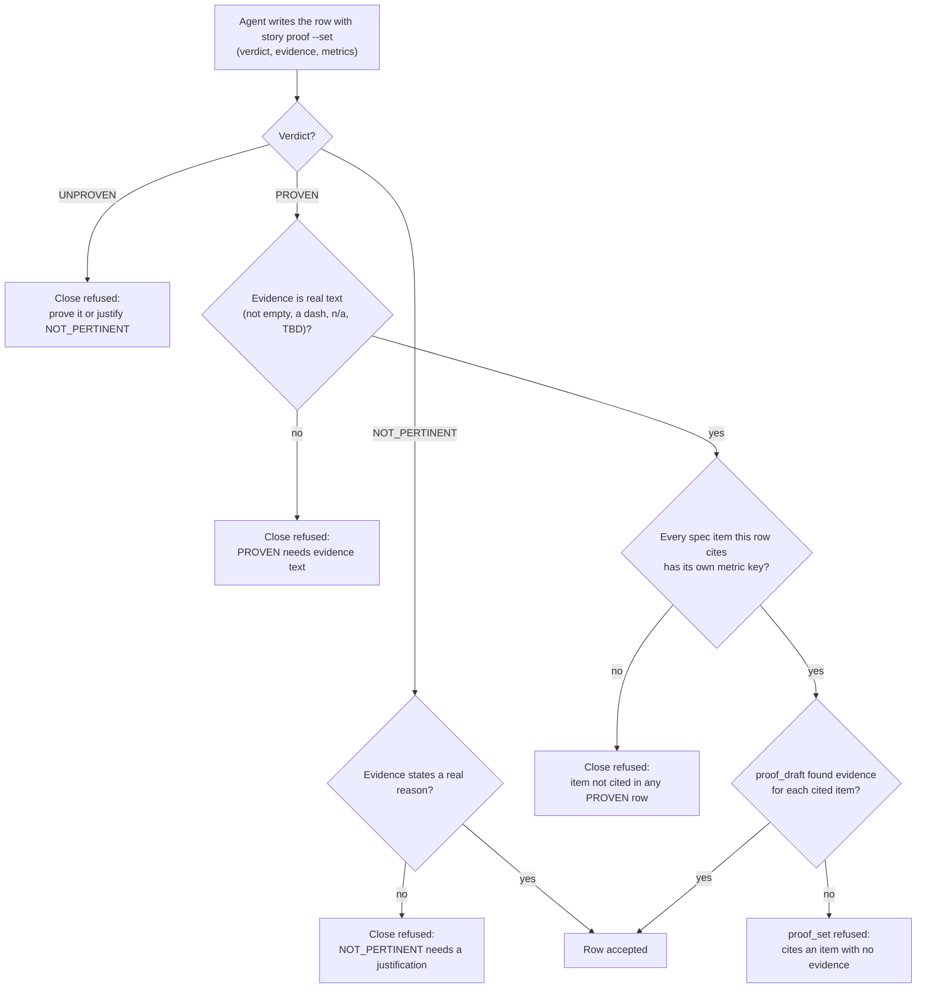

# Proof dimension: Configurability

[← Back to the README](../README.md) · [← The Proof Table](PROOF.md)

**Configurability** is the row of the [Proof Table](PROOF.md) that asks whether every setting the story adds or changes
behaves like a well-made setting: it has a sensible default, it is loaded through the framework's standard mechanism, it
is validated, it can be overridden per environment, and a wrong value stops the program loudly at start-up instead of
making it misbehave later. The row is proven by named tests, one for each of those properties, including at least one
test that shows an invalid value being refused.

It is mandatory for development and ops stories. Analysis and documentation stories do not carry it (see the kind table
in [The Proof Table](PROOF.md)).

## What it checks

For each setting the story introduces or touches (a retry count, a time limit, a folder, a switch, a connection string,
an address), the row must show five things:

1. **Defaulted.** A program started with no value for the setting gets a deliberate, documented default, or refuses to
   start because the setting has no safe default. "Whatever the type's zero value happens to be" is not a default.
2. **Loaded in the standard way.** The value comes from the framework's own configuration mechanism (for .NET: the
   `appsettings.json` file and environment overlays read through `IConfiguration` and bound options), not from a hand-made
   reader, a literal in the code or a private file format.
3. **Validated.** The value is checked against its allowed range or set (a number within limits, an existing folder, a
   value from a closed list) before any work starts.
4. **Overridable.** An operator can change it per environment (a development machine, a CI runner, production) without
   editing code: an environment variable, an environment-specific settings file, a command-line switch.
5. **Refused when invalid.** A value outside the allowed set stops the start-up with a message that names the setting and
   the allowed values. It never falls back silently to a default, and it never lets the program run with a value that
   only fails hours later.

A retry mechanism has an extra duty, shared with the [Resilience](PROOF_DIMENSION_RESILIENCE.md) row: its attempts and
waits are settings, and tests can switch the waits off so they run fast.

## How it is checked

Configurability is a **named-test** dimension: the evidence is a set of automated tests, each named after the property it
proves, that would fail if the property broke. Kyklos does not compute this row for the agent; the agent writes it, and
the close judges what it wrote.

The checks that apply to the row, in the order they run:

In words:

- **Where the row lives.** In the story's proof note on the issue tracker, written by the Bridge's `proof_set` verb (the
  story tool's `story proof <id> --set` calls it). The agent never edits the note by hand; the Bridge keeps it.
- **Real evidence.** A PROVEN or NOT_PERTINENT row with an empty evidence cell, a dash, an ellipsis, a bare "n/a", "TBD",
  "todo" or "none", or an unfilled template placeholder is refused, both when it is written and again at the close. The
  same rule covers every row of the table.
- **Correlation with the specification.** Each requirement, use case, failure mode and acceptance criterion of the story
  (the `R1`, `UC1`, `FM1`, `AC1` items of its specification, see [Storages](STORAGES.md)) must appear as a metric key in a
  PROVEN row. A story whose requirement is "the retry count is a setting" (say `R2`) must therefore cite `R2` in the row
  that proves it, very often this one.
- **No citation without evidence.** `proof_draft` scans the changed test files for the items their names or tags carry.
  `proof_set` refuses a row that cites an item the draft found no evidence for: write the test that names it first. With
  the owner's optional hardening switched on, the close repeats that check on the stored rows (see
  [The Proof Table](PROOF.md)).
- **When the checks run.** At `proof_set` (the row is refused before it is stored) and at the close (`story_close`), where
  the Bridge judges the whole table at once and reports every problem in one answer.
- **No signature.** This row carries no token: it is a judgement backed by named tests, and the [Adversarial
  Review](PROOF_DIMENSION_ADVERSARIAL_REVIEW.md) is where a second agent checks that those tests really prove what the
  row claims.

Two hooks of the [Kyklos Plugin](HOOKS_AND_SKILLS.md) push the code itself toward good configuration before the proof is
ever written:

- **The standard-configuration guard** (`kyklos-standard-config-guard`) refuses an edit that writes a whole,
  credential-bearing database connection string into C# code, or a password into a settings file such as
  `appsettings.json` (environment overlays and local overlays included). The skeleton of a connection string belongs in
  the settings file; the password is supplied at run time from a secrets manager. A key path that holds no secret
  despite its name can be declared in the project setting `KYKLOS_CONFIG_SECRET_ALLOW_KEYS`, and every use of that
  opt-out is recorded.
- **The [Poka-Yoke](PROOF_DIMENSION_POKA_YOKE.md) skill** asks, for every new setting, whether a default-constructed
  settings object fails validation, and whether factory defaults live in the settings file rather than in the property.

## Metrics enforced

| Metric | Meaning |
|--------|---------|
| `Configuration tests (<test class>): N pass (K refusals)` | the named tests that prove the five properties, and how many of them prove a refusal |
| one metric per specification item the row proves | for example `R2 (RetryOptionsTests.An_attempt_count_of_11_stops_the_start_up): pass` |

The Bridge does not parse the figures of this row: it requires real evidence text, at least the specification items
the row is responsible for, and no citation without evidence. A row that claims "PROVEN" with no refusal test is a
finding for the [Adversarial Review](PROOF_DIMENSION_ADVERSARIAL_REVIEW.md).

## Why it exists

A setting is a promise to an operator: "you can change this without touching the code". A setting that is not validated
breaks that promise in the most expensive way, because the wrong value is accepted and fails far away from where it was
typed.

**A realistic case.** A team adds a `MaxAttempts` setting to an export job. Nobody validates it. In production an
operator, meaning "no retries", writes `0`; the loop `for (i = 1; i <= MaxAttempts; i++)` then never runs, and every
export is silently skipped. Nothing fails, nothing is logged, and the problem surfaces a week later as missing reports.
With this row, the story must prove that `0` is either a documented meaning ("one attempt, no retry") or refused at
start-up with *"Export:MaxAttempts must be between 1 and 10 (was 0)"*. Both are acceptable; silence is not.

Kyklos applies the same rule to itself: every setting of the Bridge and the Launcher is declared once, with its allowed
values, and a wrong value stops the program at start-up naming the setting. For example the Bridge setting
`Agile:Proof:TestDisciplineSource` accepts only `ledger` or `token`; anything else stops the Bridge before it serves a
single request.

## Practical examples

**PROVEN.**

| Quality Dimension | Verdict | Evidence | Metrics |
|---|---|---|---|
| Configurability | ✅ PROVEN | `Export:MaxAttempts` (default 3) and `Export:FirstWait` (default 1 s) are bound options read from `appsettings.json`, validated at start-up by `RetryOptionsValidator`, and overridable with `Export__MaxAttempts`. An attempt count of 0 or 11 and a negative wait stop the start-up with the setting's name. | <kbd>Configuration tests (RetryOptionsTests):</kbd> 5 pass (2 refusals) <kbd>R2 (RetryOptionsTests.An_attempt_count_of_11_stops_the_start_up):</kbd> pass |

**UNPROVEN, and what fixes it.**

| Quality Dimension | Verdict | Evidence | Metrics |
|---|---|---|---|
| Configurability | ❌ UNPROVEN | The new `Export:MaxAttempts` setting has a default, but no test shows an invalid value being refused. | – |

The fix: add a validator for the option, a test that starts the host with `Export__MaxAttempts=11` and asserts the
start-up fails naming the setting, then set the row again. If the story's specification lists the setting as a
requirement, the row must also cite that item.

**NOT_PERTINENT.**

| Quality Dimension | Verdict | Evidence | Metrics |
|---|---|---|---|
| Configurability | ⬜ NOT_PERTINENT | The change fixes a rounding error inside `InvoiceTotal`; it adds, removes or reads no setting. | – |

## When it is not pertinent

When the change neither adds, removes, renames nor reads any setting, environment variable, command-line switch or
settings file. The evidence must say so concretely. A change that only *uses* an existing setting in a new place is still
pertinent when the new use depends on the value's validity (for example, a time limit now used as a divisor).

## Related pages

[The Proof Table](PROOF.md), [Resilience](PROOF_DIMENSION_RESILIENCE.md), [Input Validation](PROOF_DIMENSION_INPUT_VALIDATION.md),
[Poka-Yoke](PROOF_DIMENSION_POKA_YOKE.md), [Adversarial Review](PROOF_DIMENSION_ADVERSARIAL_REVIEW.md),
[Hooks and skills](HOOKS_AND_SKILLS.md), [Storages](STORAGES.md), and [the README](../README.md) for the full list.
