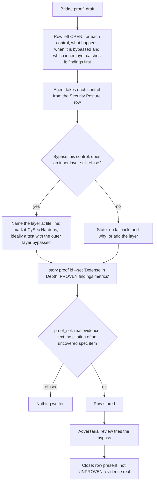

# Defense in Depth

[← Back to the README](../README.md) · [← The Proof Table](PROOF.md)

**Defense in Depth** asks, for each security control the change relies on: *if this control were bypassed, what would still stop
the attack?* A single control is a single point of failure: a refactor moves it, a new caller skips it, a configuration turns it
off. The row records, per control, the next layer that still holds (or states that there is none and why), and makes sure the
redundant layers are marked so that nobody removes them as "already validated upstream". It is required for development and
operations stories.

## What it checks

- **One answer per control.** Every control named in the [Security Posture](PROOF_DIMENSION_SECURITY_POSTURE.md) row gets a line:
  *bypass → fallback*. For example: "if the URL allow-list in the importer were bypassed, the HTTP client's own host allow-list
  still refuses the request".
- **An honest "none".** Where no second layer exists, the row says so and why (the cost, the threat model, a layer that would add
  nothing). A missing layer that should exist is a finding, not a pass.
- **Redundant layers are marked.** The inner check that would still refuse when the outer one is bypassed carries a
  `[CySec] Hardens ...` annotation. That is exactly the line a later reader would otherwise delete as duplicated validation.

**Supported languages and tools.** The row is argued by the agent and works for any programming language; the `[CySec]`
annotation uses the language's own comment syntax. The mutation run such an annotation can make due is run by the Bridge
for C# only (Stryker.NET); see [Security Posture](PROOF_DIMENSION_SECURITY_POSTURE.md) and
[Supported languages and tools](SUPPORT_MATRIX.md).

## How it is checked

Defense in Depth is a **judgement row** ("reasoning signal"), and its findings have a shape rather than a checklist: per control,
bypass, then fallback.

**Step by step.**

1. **The draft** leaves the row open with the prompt *for each control, what happens when it is bypassed and which inner layer
   catches it; findings first*. The [Bridge](COMPONENTS.md#kyklos-bridge) never proves this row by itself.
2. **The reasoning.** For each control the agent writes the bypass and the layer behind it. The strongest evidence is a test that
   bypasses the outer layer on purpose (calls the inner component directly with the bad value) and shows that the inner layer
   still refuses; such a test is not required, but it turns a claim into a fact.
3. **The marking.** The inner layer carries `// [CySec] Hardens <reference> "<title>": <why here>`, the defense-in-depth verb of
   the [`[CySec]`](PROOF_DIMENSION_SECURITY_POSTURE.md#how-it-is-checked) convention (defined in the plugin's `ssdlc-cysec` [skill](HOOKS_AND_SKILLS.md#how-the-agent-knows-what-to-do-skills)). The annotation is soft: missing, it is recorded as a
   missed opportunity, never as UNPROVEN. A changed line within ten lines of such a comment makes one mutation run due before the
   push or the close (see [Security Posture](PROOF_DIMENSION_SECURITY_POSTURE.md#how-it-is-checked)).
4. **The write.** [`proof_set`](PROOF_DIMENSION_COMPLETENESS.md#how-it-is-checked) refuses a row with no real evidence text and a row citing a specification item the signed draft
   record lists as uncovered.
5. **The review.** The [adversarial review](PROOF_DIMENSION_ADVERSARIAL_REVIEW.md) attacks the bypass itself: it looks for the
   second caller that skips the outer check, the configuration that disables it. A layer that does not hold is a finding that keeps
   the review row open.
6. **The close** refuses the story while the row is missing, UNPROVEN or without real evidence.

**Where things are, and the secrets.** The proof is the Bridge-written note marked `<!-- kyklos:story-proof -->`; the annotations
live in the source code itself, next to the layer they describe. The only key involved is the [proof signing key](PROOF_DIMENSION_TEST_DISCIPLINE.md#signatures-the-key-and-when-they-are-checked)
`KYKLOS_PROOF_HMAC_KEY` that signs the draft record and the [review token](ADVERSARIAL_REVIEW.md#how-the-review-token-is-made-and-checked), kept in the Windows Credential Manager and handed only
to the Bridge (see [Secrets](SECRETS.md)).

**What a failure causes, and the user's part.** A refused write or close keeps the story open; the agent adds the reasoning, the
layer or the test. A person decides only when a missing layer is accepted as a residual risk (it then belongs in the
[Risk Assessment](PROOF_DIMENSION_RISK_ASSESSMENT.md) register), or when the owner waives the row.

## Metrics enforced

- For each control, its fallback layer or the reason there is none: `<kbd>Controls with a fallback layer:</kbd> 2/2`, or
  `<kbd>Controls with a fallback layer:</kbd> 1/2 (archive path check: none, the extractor is the last component)`.
- Where a bypass test exists: `<kbd>Inner layer with the outer bypassed (Extractor_refuses_dotdot_entries_directly):</kbd> pass`.

These are the method's metrics; the [Bridge](COMPONENTS.md#kyklos-bridge) mechanically checks the evidence text, the citations and the closability rules.

## Why it exists

Controls erode quietly. The most common way a security check disappears is not an attack but a cleanup: someone sees the same
validation twice and removes the "redundant" inner one, and later someone adds a second entry point that skips the outer one. The
question *"if this were bypassed?"* is hard to measure and easy to skip, which is why it is a row of its own and not a sentence in
[Security Posture](PROOF_DIMENSION_SECURITY_POSTURE.md).

**A realistic use case.** A web endpoint checks that the caller owns the document before it calls `DocumentStore.Delete(id)`.
The row asks what happens if that check is bypassed; the honest answer is "nothing stops it": the store deletes any id. A month
later a batch job will call the store directly. The agent adds an owner check inside the store
(`// [CySec] Hardens CWE-639 "Authorization Bypass Through User-Controlled Key"`) and a test that calls the store with another
user's document and expects a refusal. When the batch job is written, the inner layer already holds.

## Practical examples

**PROVEN:**

| Quality Dimension | Verdict   | Evidence                                                                                                                       | Metrics |
|-------------------|-----------|--------------------------------------------------------------------------------------------------------------------------------|---------|
| Defense in Depth  | ✅ PROVEN | URL allow-list (`TemplateSource.cs:41`) bypassed: the HTTP client's host allow-list still refuses (`HttpSetup.cs:40`, `[CySec] Hardens CWE-918`). Archive `..` check (`TemplateArchive.cs:77`) bypassed: the extractor resolves each entry and refuses one outside the target folder (`SafeExtractor.cs:22`, `[CySec] Hardens CWE-22`), tested directly. | <kbd>Controls with a fallback layer:</kbd> 2/2 <kbd>Inner layer with the outer bypassed (SafeExtractor_refuses_an_entry_outside_the_target):</kbd> pass |

**UNPROVEN, and what fixes it:**

| Quality Dimension | Verdict     | Evidence                                                                                                                        | Metrics |
|-------------------|-------------|---------------------------------------------------------------------------------------------------------------------------------|---------|
| Defense in Depth  | ❌ UNPROVEN | OPEN (proof_draft): judgement row, for each control, what happens when it is bypassed and which inner layer catches it; findings first. | – |

Fix: take each control of the [Security Posture](PROOF_DIMENSION_SECURITY_POSTURE.md) row, write its bypass and fallback (or "none, because ..."), mark the inner
layers, and write the row.

**NOT_PERTINENT:**

| Quality Dimension | Verdict          | Evidence                                                                                                       | Metrics |
|-------------------|------------------|----------------------------------------------------------------------------------------------------------------|---------|
| Defense in Depth  | ⬜ NOT_PERTINENT | The change adds and touches no security control (Security Posture: searched the diff, no trust boundary crossed); there is no control to bypass. | – |

## When it is not pertinent

When the change adds and touches no security control, which the [Security Posture](PROOF_DIMENSION_SECURITY_POSTURE.md) row
should already show. Not required for analysis and documentation stories. The owner can untick the dimension in the story's
[Proof Discipline](PROOF.md#the-owners-proof-discipline), or waive a gap at the close with the [`proof-override`](WORKFLOW.md#the-owners-proof-override-label) label and a named
cause (see [the workflow](WORKFLOW.md)).

## Related pages

[The Proof Table](PROOF.md), [Security Posture](PROOF_DIMENSION_SECURITY_POSTURE.md), [Risk Assessment](PROOF_DIMENSION_RISK_ASSESSMENT.md),
[Poka-Yoke](PROOF_DIMENSION_POKA_YOKE.md), [Adversarial reviews](ADVERSARIAL_REVIEW.md), and [the README](../README.md) for the full list.
