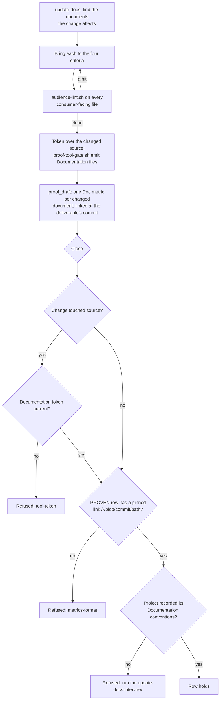

# Proof dimension: Documentation

[← Back to the README](../README.md) · [← The Proof Table](PROOF.md)

**Documentation** is the row of the [Proof Table](PROOF.md) that asks whether every document the change affects is
right after the change: it **exists**, it **agrees** with the behaviour that actually ships, it is **complete** to the level
the document promises, and it is written **for its audience** (a public document carries no internal hostnames, history
or scaffolding). The row is proven by a documentation pass, an audience lint that fails on internal content in a
public-facing file, and links to the changed documents pinned at the commit that shipped them.

It is mandatory for development, ops and documentation stories. Analysis stories do not carry it.

## What it checks

The four criteria, applied to every document that describes something the story touched (a README, a `docs/` page, a
runbook, a command's `--help`, a configuration reference, a changelog, a user manual):

1. **Exists.** A document the change requires is there. A new setting with no line in the configuration reference fails
   this criterion even if every other document is perfect.
2. **Coherent.** Every claim matches the shipped behaviour: names, switches, defaults, versions, commands. A document that
   contradicts the code is worse than no document, because readers trust it.
3. **Complete.** The document covers the change to the level it declares: a reference page lists every option, a how-to
   covers the whole task.
4. **Proper for its audience.** Internal details stay in internal documents. A consumer-facing file gets only what a
   consumer needs, and never internal hostnames, addresses, runner names, secret locations, tracker history or
   "do not edit" scaffolding.

Documents describing a change go in **the same commit** as the change, never in a later one.

## How it is checked

The doer is the `kyklos:update-docs` skill (see [Skills](HOOKS_AND_SKILLS.md#how-the-agent-knows-what-to-do-skills)); the row
audits what it did.

In words:

- **The conventions, once per project.** On its first use the skill interviews the developer (where documents live, who
  reads each kind, what counts as internal) and records the answers in the project's `CLAUDE.md` under
  `## Documentation conventions`. A PROVEN Documentation row is refused while that section is missing, so the pass is
  always judged against the project's own rules, not the agent's guess.
- **The audience lint.** `audience-lint.sh` (shipped with the plugin under `plugins/kyklos/skills/update-docs/`) searches
  the consumer-facing files for internal patterns and exits with an error on any hit. Its built-in patterns are generic;
  an organisation adds its own (its domain, secret-store paths, internal names) as configuration, through the variable
  `AUDIENCE_LINT_ORG_PATTERNS` or a pattern file (`AUDIENCE_LINT_ORG_PATTERNS_FILE`, by default the project's
  `.claude/audience-lint-org-patterns.txt`, kept in a repository that is never published). The Launcher can hand those names
  to the container only as salted hashes, so the container never holds them in clear text; a finding names the category and
  the line, never the pattern. A hit is fixed by moving the detail to an internal document, never suppressed. A reviewed
  allow-list entry (`AUDIENCE_LINT_ALLOW_FILE`) needs a written reason and is meant for test data and format examples only.
- **The token.** When the change touched source code, the skill records a **Documentation token** over the changed source
  files once the documents are settled: `proof-tool-gate.sh emit "Documentation" <files>`. Like the
  [Non-Duplication](PROOF_DIMENSION_NON_DUPLICATION.md) token it is a content binding made in the container (no
  signature, since the key never enters the container): it records a fingerprint of the story's own change to each file,
  and any later edit to that change makes it stale. Its purpose is to show the documentation pass ran over the code as it
  is now, not over an earlier draft of it.
- **The pinned links.** `proof_draft` lists the documents among the files the story's cited deliverables changed (a `.md`
  file, or any file under a `doc/` or `docs/` folder) and writes one `Doc` metric per document, linked at the deliverable's
  commit on the remote (`.../-/blob/<commit>/<path>`). A reviewer opening the link sees the document exactly as it shipped,
  not as it reads today.
- **When it is checked.** At `proof_set`, when the agent ends its turn after setting the row, and at the close
  (`story_close`), on the files the story's deliverables changed, read from the remote (see
  [which rows depend on the remote](WORKFLOW.md#which-proof-table-rows-depend-on-the-remote)).
- **What a failure causes.** The close is refused with the reason; the agent updates the documents, runs the lint and
  the pass again, and drafts the proof again. No person is needed, except for the one-time conventions interview.

### Manuals built by the Bridge: the `doc_build` receipt

A project whose user manual is a folder of Markdown pages can build it with the Bridge verb `doc_build`: one
self-contained HTML file and one print-ready PDF per language, printed offline on the host. The build **fails and writes
nothing** on any problem: a broken link or anchor, a missing image, a page listed but missing, a page on disk the manual
does not list, a diagram that does not draw.

When the build is made for a story (its `story` argument) and succeeds, the Bridge records a **tool receipt** on the host:
the verb, the run's id, the specification items (`R1`, `UC2`, `AC3`, `RA-01` and so on) the manual's pages name, and the
SHA-256 of each file it wrote. It is kept in the Bridge's state folder (`tool-receipts/<story>/`), which no container
mounts, so only a real run of the Bridge can add one; it is not signed. `proof_draft` then cites the receipt as evidence for
those items (`UC1 (tool receipt): doc_build run <id>`) in the [Completeness](PROOF_DIMENSION_COMPLETENESS.md) row: for a
documentation or analysis story, which has no tests to name its items, a successful manual build that names them plays the
same role. A failed build records no receipt.

## Metrics enforced

| Metric | Rule |
|--------|------|
| `Doc (blob)` | **required** for PROVEN: at least one link to a changed document pinned at a commit (`/-/blob/<commit>/`). |
| `Audience lint` | the lint's result on the consumer-facing files, for example `0 findings`. |
| `Docs updated (update-docs)` | how many documents were updated or created. |
| one metric per specification item the row proves | as for every row; for a documentation story, often every item. |

## Why it exists

Code and its documents drift apart one forgotten edit at a time, and the reader cannot tell which one is wrong. For a
public product there is a second risk: a document written in a hurry inside the company's context leaks that context.

**A realistic case.** A story renames the setting `Export:Retries` to `Export:MaxAttempts` and keeps the old name working
for one release. The code is right; the README still shows `Export:Retries=3`. New users copy it, it keeps working, and
when the old name is removed every one of them breaks at once. The Documentation row forces the pass that finds the README
line (criterion 2, coherent) and the release notes that must mention the rename (criterion 1, exists).

**And the audience case.** The same agent, explaining the setting, writes "on our build server" followed by that server's internal host name. The audience lint fails on the organisation's
host-name pattern before the change is committed, and the detail moves to the
internal runbook where it belongs.

## Practical examples

**PROVEN.**

| Quality Dimension | Verdict | Evidence | Metrics |
|---|---|---|---|
| Documentation | ✅ PROVEN | Drafted by proof_draft: the change updates 2 documentation files, linked at the deliverable's commit; the Documentation token is current. The README's export section documents `MaxAttempts` and `FirstWait`; the changelog records the rename. Audience lint clean. | <kbd>Doc (blob):</kbd> `README.md` at the deliverable's commit <kbd>Doc (blob):</kbd> `CHANGELOG.md` at the deliverable's commit <kbd>Audience lint:</kbd> 0 findings |

**UNPROVEN, and what fixes it.**

| Quality Dimension | Verdict | Evidence | Metrics |
|---|---|---|---|
| Documentation | ❌ UNPROVEN | OPEN (proof_draft): source changed but no documentation file did; judge whether a document is affected (update-docs) and prove it, or justify NOT_PERTINENT. | – |

The fix: run the update-docs pass. Either it finds an affected document (update it in the same change, run the lint, emit
the token, draft again), or it finds none and the row becomes NOT_PERTINENT with the reason.

**NOT_PERTINENT.**

| Quality Dimension | Verdict | Evidence | Metrics |
|---|---|---|---|
| Documentation | ⬜ NOT_PERTINENT | An internal refactor: `UploadRetry` moved its wait into a private method; no public interface, setting, command or output changed, so no document describes anything that changed. | – |

## When it is not pertinent

When the change alters no external contract (no public interface or command, no setting or default, no CI contract other
projects consume, no installation or usage step) and no user-facing behaviour, and creates no fact a future maintainer
would have to re-learn. The evidence must say why. A documentation story always carries the row.

## Overrides

The project setting `KYKLOS_TOOL_GATE_DOCUMENTATION=0` accepts a PROVEN verdict without the token (an explicit opt-out;
the check is on by default). The owner can untick the dimension in the story's
[Proof Discipline](PROOF.md#the-owners-proof-discipline), or apply the `proof-override` label naming the cause. See
[Overrides](WORKFLOW.md#overrides).

## Related pages

[The Proof Table](PROOF.md), [Completeness](PROOF_DIMENSION_COMPLETENESS.md), [Non-Duplication](PROOF_DIMENSION_NON_DUPLICATION.md),
[Adversarial Review](PROOF_DIMENSION_ADVERSARIAL_REVIEW.md), [The Kyklos workflow](WORKFLOW.md), [Hooks and skills](HOOKS_AND_SKILLS.md),
and [the README](../README.md) for the full list.
