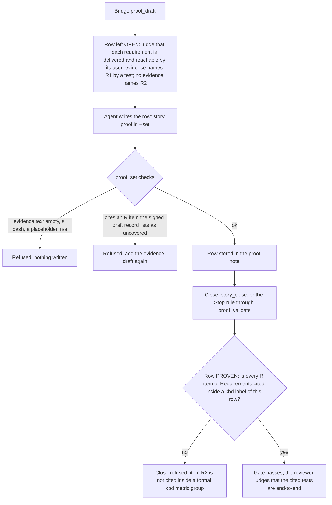

# Feature Availability

[← Back to the README](../README.md) · [← The Proof Table](PROOF.md)

**Feature Availability** asks: *can the person or program the story was written for actually reach the feature?* A feature
that works when a unit test calls an internal class, but that no command, endpoint, tool call or page exposes, is not delivered.
The row proves each requirement of the story (`R1`, `R2`, ...) through its **real public interface**, with an end-to-end test
that would fail if the path from the outside to the feature were broken. It is required for development and operations stories.

## What it checks

- **Every requirement is reachable.** Each `R<n>` of the section `## Requirements` is shown working through the interface its
  user really uses: the command line, the HTTP endpoint, the MCP tool, the page.
- **The path is the real one.** The test goes in where the user goes in. A unit test against a mock of the layer underneath shows
  the logic, not the delivery, and does not count for this row (it still counts for [Completeness](PROOF_DIMENSION_COMPLETENESS.md)).
- **Wiring is included.** Registration, routing, argument parsing, configuration binding and permissions are all on the path,
  and they are exactly what a mock skips.

## How it is checked

Feature Availability is a **judgement row with a mechanical spine**. [`proof_draft`](PROOF_DIMENSION_COMPLETENESS.md#how-it-is-checked) leaves it open for the agent, with a prompt
and the list of requirements evidence already names; the agent writes the row; the [Bridge](COMPONENTS.md#kyklos-bridge) checks the citations at the write and
at the close.

**Step by step.**

1. **The draft.** `proof_draft` reads the story's `## Requirements` section and looks for evidence naming each `R` item: a changed
   test whose running test method (or its `[Category]`, `[Trait]` or `[Property]` value) carries the item as an exact token
   (`R1_export_command_retries`), a host tool receipt, or the newest [adversarial review](ADVERSARIAL_REVIEW.md) whose token the Bridge verifies and whose
   "Checked" section states the item handled without negative wording. It leaves the row open with the prompt and with the lists
   of named and unnamed items, and records the unnamed ones in its signed draft record (see
   [Completeness](PROOF_DIMENSION_COMPLETENESS.md#how-it-is-checked) for the record and its signature).
2. **The write.** The agent writes the row with `story proof <id> --set 'Feature Availability=PROVEN|<evidence>|<metrics>'`.
   The Bridge (`proof_set`) refuses a row whose evidence is not real text, and a row that cites an item the signed record lists
   as uncovered. So an agent cannot cite `R3` until a test (or the review) really names it.
3. **The close.** For a PROVEN row, the Bridge's correlation gate (`ProofCorrelationGate`) reads the `<kbd>` labels of this row's
   metrics, and each `R` item of `## Requirements` must appear there as a whole token (`R1` never stands for `R10`). An item
   named in the evidence prose, or in another row, does not count. Every missing item is one finding, and all findings come in
   one answer.
4. **The judgement.** Whether a cited test really drives the public interface (and not a mock) is not something a program can
   read from a name. The [adversarial review](PROOF_DIMENSION_ADVERSARIAL_REVIEW.md) is told to check it, and a reviewer who
   finds a requirement shown only through a mock reports it as a finding, which keeps the review row open.

**Keys, files and secrets.** The specification is the story's issue description; the proof is a note on the story marked
`<!-- kyklos:story-proof -->`, written only by the Bridge with the GitLab token it keeps on the host. The signed draft record
is signed with the [proof signing key](PROOF_DIMENSION_TEST_DISCIPLINE.md#signatures-the-key-and-when-they-are-checked) `KYKLOS_PROOF_HMAC_KEY` (Windows Credential Manager, handed only to the Bridge process; see
[Secrets](SECRETS.md)). Nothing in this row is signed by the agent.

**What a failure causes.** A refusal at the write leaves the stored row as it was; a refusal at the close keeps the story open with
the list of uncited items. Neither needs a person: the agent adds the end-to-end test, names the item in it, drafts again and
cites it.

## Metrics enforced

- One metric per requirement, its label naming the item and the evidence: `<kbd>R1 (The_export_command_retries_a_failed_upload):</kbd> pass`.
- Every `R` item of `## Requirements` must be in a label of this row when the row is PROVEN (checked at the close).
- An item may only be cited when the draft found evidence naming it (checked at the write).

## Why it exists

The classic failure of a delivered feature is not wrong logic, it is a missing wire: the new class is correct, fully unit-tested,
and nobody registered it, or the command-line option was never mapped to it, or the endpoint needs a permission no user has. The
unit tests stay green because they call the class directly. An end-to-end test is the only test that fails in that case.

**A realistic use case.** A story adds `--since <date>` to an `export` command. The agent writes thorough tests of the date
filter class and cites them. The reviewer runs `export --since yesterday` and gets "unknown option": the parser was never
told about the new option. With Feature Availability, the row needed `R1` cited by a test that runs the command itself; writing
that test (`R1_export_since_filters_old_rows`, which invokes the command line) fails at once, and the missing wire is fixed before
the merge, not reported by the first user.

## Practical examples

**PROVEN:**

| Quality Dimension    | Verdict   | Evidence                                                                                                      | Metrics |
|----------------------|-----------|---------------------------------------------------------------------------------------------------------------|---------|
| Feature Availability | ✅ PROVEN | R1 and R2 reached through the public `export` command; the end-to-end tests run the built command against a local test server. | <kbd>R1 (R1_export_since_filters_old_rows):</kbd> pass <kbd>R2 (R2_export_since_rejects_a_future_date):</kbd> pass |

**UNPROVEN, and what fixes it:**

| Quality Dimension    | Verdict     | Evidence                                                                                                                       | Metrics |
|----------------------|-------------|--------------------------------------------------------------------------------------------------------------------------------|---------|
| Feature Availability | ❌ UNPROVEN | OPEN (proof_draft): judgement row, judge that each requirement is delivered and reachable by its user; cite only the items evidence names. Evidence names: R1 (test: tests/ExportCommandTests.cs); no evidence names R2, so they cannot be cited until a test, a tool receipt or the review covers them. | – |

Fix: add an end-to-end test that carries `R2` in its name, push, draft again, then write the row citing both items. Writing
`R2` into the row before that is refused by [`proof_set`](PROOF_DIMENSION_COMPLETENESS.md#how-it-is-checked).

**NOT_PERTINENT:**

| Quality Dimension    | Verdict          | Evidence                                                                                              | Metrics |
|----------------------|------------------|-------------------------------------------------------------------------------------------------------|---------|
| Feature Availability | ⬜ NOT_PERTINENT | The story changes only the internal retry back-off of an existing feature; no requirement adds or changes a way in, and the existing end-to-end test of the export still passes. | – |

## When it is not pertinent

When the story adds no new way in and changes none: an internal refactor, a performance change behind an unchanged interface.
The evidence cell must say why (an empty or filler reason is refused). It is not required at all for analysis and documentation
stories. A NOT_PERTINENT row cites no items, so if the story declares requirements, they must still be cited in some PROVEN row
(usually [Completeness](PROOF_DIMENSION_COMPLETENESS.md)), or the close refuses them as uncited. The owner can also untick the
dimension in the story's [Proof Discipline](PROOF.md#the-owners-proof-discipline), or waive a gap at the close with the
[`proof-override`](WORKFLOW.md#the-owners-proof-override-label) label and a named cause (see [the workflow](WORKFLOW.md)).

## Related pages

[The Proof Table](PROOF.md), [Completeness](PROOF_DIMENSION_COMPLETENESS.md), [Input Validation](PROOF_DIMENSION_INPUT_VALIDATION.md),
[Adversarial Review](PROOF_DIMENSION_ADVERSARIAL_REVIEW.md), [The Kyklos workflow](WORKFLOW.md), and [the README](../README.md) for the full list.
