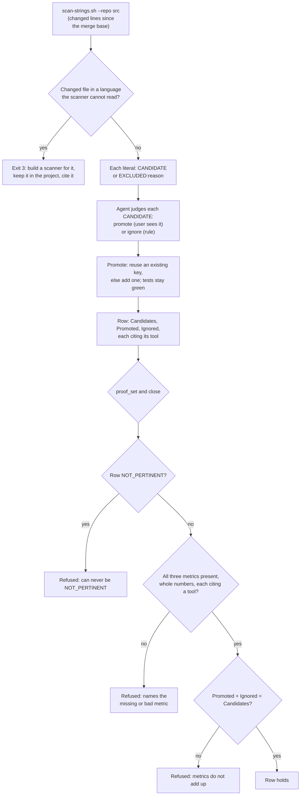

# Proof dimension: i18n

[← Back to the README](../README.md) · [← The Proof Table](PROOF.md)

**i18n** (short for *internationalisation*: the 18 letters between the "i" and the "n") is the row of the
[Proof Table](PROOF.md) that asks whether every user-facing text the story added or changed lives in the project's
localisation resources, without duplicates, instead of being written into the code. A scanner lists the candidate texts on
the lines the story changed; the agent promotes each text a user can see into the resources and ignores the others, each
with the rule that excludes it. The row carries three counts that must add up: **promoted + ignored = candidates**.

It applies only to development stories, and there it can **never** be NOT_PERTINENT: a change with no user-facing text
proves the row with all three counts at 0, citing the scanner.

## What it checks

- **Candidates** are texts that can reach a person: labels, captions, descriptions, tooltips, validation messages,
  exception messages, messages an API returns, notifications.
- **Excluded by rule** (never promoted, each with its rule as the reason):
  - log messages (anything passed to a logger or trace call);
  - strings that drive logic: values compared in a condition, switch labels, configuration or dictionary keys, attribute
    arguments, protocol tokens;
  - script files (shell, PowerShell, batch), which are out of scope;
  - **agent-facing messages**: text a tool, gate, [hook](HOOKS_AND_SKILLS.md#how-a-hook-decides-one-hook-per-event-every-rule-in-the-bridge) or server returns to an AI agent or to developer tooling, never to an
    end user. The test is *who reads it*: the same `throw new ArgumentException("...")` is agent-facing in a gate and
    user-facing in an application's dialog;
  - technical literals with no human text (separators, formats, addresses, file names).
- **Project exclusions.** A project may exclude a further category, decided by a person and recorded in its `CLAUDE.md`
  under `## i18n` as `- **i18n exclusions:** ...`. The agent never adds one to make a count come out.
- **Promoted without duplicates.** Before adding a resource, the agent looks for an existing one with the same text in the
  scope the project uses (one global resource file, or one per module) and reuses its key. New keys are named for their
  meaning, not their current wording.
- **One technique.** The project's existing technique is used (for .NET: RESX resources with a generated class, or
  `IStringLocalizer`). When none is recorded or both are present, the agent asks once and records the answer in
  `CLAUDE.md` (`- **i18n technique:** ...`).

**Supported languages and tools.** The scanner reads **C#** only, and the techniques it knows are RESX resources and
`IStringLocalizer`. A changed file in JavaScript, TypeScript, Python, Java, Kotlin, Go, Visual Basic, F#, Swift, Ruby, PHP,
Razor, `.cshtml` or XAML stops the scan: the agent first builds a scanner for that language, keeps it in the project's
tooling and cites it. Scripts are out of scope. The row checks where the texts live, not which human languages they are
translated into. See [Supported languages and tools](SUPPORT_MATRIX.md).

## How it is checked

In words:

- **The scanner.** `scan-strings.sh` ships with the plugin under `plugins/kyklos/skills/ssdlc-i18n/`. It reads only the
  lines the branch changed since its merge base with the trunk (plus new, untracked files), so the row judges the story's
  work, not the whole code base. It prints one line per literal (`<file>:<line>  CANDIDATE|EXCLUDED:<reason>  <literal>`)
  and the tally. For C# it already excludes logging calls, comparisons, keys, attributes and technical literals. When the
  change touches a language it cannot read (TypeScript, Razor, XAML, Python and others), it **stops with exit code 3**
  instead of passing silently: the agent builds a scanner for that language, keeps it in the project, and cites it. Two
  helper modes: `--detect` reports the technique in use, `--find "<text>"` finds an existing resource with exactly that
  text.
- **The judgement.** The scanner is a pre-filter. Each candidate is decided by meaning, and the evidence names why each
  ignored one was ignored.
- **The arithmetic.** The [Bridge](COMPONENTS.md#kyklos-bridge) checks the row itself, at [`proof_set`](PROOF_DIMENSION_COMPLETENESS.md#how-it-is-checked) and again at the close: the metrics `Candidates`,
  `Promoted` and `Ignored` must all be present, each must name the tool that produced it, each must be a whole number, and
  promoted plus ignored must equal candidates. A NOT_PERTINENT row is refused outright on a development story.
- **No signature.** The counts are not signed: the scanner runs in the container and its output is reproducible by anyone
  from the branch. The [Adversarial Review](PROOF_DIMENSION_ADVERSARIAL_REVIEW.md) is where a second agent checks that an
  "ignored" text is not, in fact, shown to users.
- **What a failure causes.** The row is refused with the exact reason (for example *"metrics do not add up: Promoted 4 +
  Ignored 2 = 6, but Candidates is 7"*). The agent recounts or finishes the promotion. No person is needed.

## Metrics enforced

| Metric | Rule |
|--------|------|
| `Candidates (<tool>)` | whole number, the scanner's candidate count on the changed lines |
| `Promoted (<tool>)` | whole number, the candidates moved into resources |
| `Ignored (<tool>)` | whole number, the candidates left in place, each with its exclusion rule in the evidence |
| the sum | `Promoted + Ignored = Candidates`, checked by the [Bridge](COMPONENTS.md#kyklos-bridge) |

## Why it exists

A text left in the code cannot be translated without a code change, and a text duplicated in two resources drifts: one copy
is corrected, the other keeps the typo. Agents write user-facing text constantly and, unless told otherwise, inline it.

**A realistic case.** A story adds a validation to an order form: *"The quantity must be positive."* The agent writes it
inline in the validator. The scanner lists it as a candidate; the agent searches the resources (`--find`) and finds
`Validation_QuantityMustBePositive` already used by the API, with the same text. The validator now uses that key: one
text, translated once, for both the form and the API. In the same change, the log line *"order {id} rejected"* is a
candidate the agent ignores (rule: log message), and the switch label `"express"` is excluded by the scanner (rule:
logic). Counts: 3 candidates, 1 promoted, 2 ignored.

## Practical examples

**PROVEN.**

| Quality Dimension | Verdict | Evidence | Metrics |
|---|---|---|---|
| i18n | ✅ PROVEN | The validation message reuses the existing resource `Validation_QuantityMustBePositive` (English and Italian); the log line is ignored (log message) and `"express"` is a switch label (logic). | <kbd>Candidates (scan-strings.sh):</kbd> 3 <kbd>Promoted (scan-strings.sh + review):</kbd> 1 <kbd>Ignored (scan-strings.sh + review):</kbd> 2 |

**PROVEN with nothing to promote** (the way a change without user-facing text proves the row).

| Quality Dimension | Verdict | Evidence | Metrics |
|---|---|---|---|
| i18n | ✅ PROVEN | The change adds a cache inside `PriceService`; the scanner finds no literal on the changed lines. | <kbd>Candidates (scan-strings.sh):</kbd> 0 <kbd>Promoted (scan-strings.sh):</kbd> 0 <kbd>Ignored (scan-strings.sh):</kbd> 0 |

**UNPROVEN, and what fixes it.**

| Quality Dimension | Verdict | Evidence | Metrics |
|---|---|---|---|
| i18n | ❌ UNPROVEN | Two error messages promoted. | <kbd>Candidates (scan-strings.sh):</kbd> 3 <kbd>Promoted (scan-strings.sh):</kbd> 2 |

Refused twice: the `Ignored` metric is missing, and the counts cannot add up. The fix: decide the third candidate (promote
it, or ignore it naming the rule), record all three counts, set the row again.

**NOT_PERTINENT** is not allowed on a development story; the row with three zeros above is the way to say "nothing to do".
Other story kinds do not carry the row.

## When it is not pertinent

Never, on a development story. Analysis, documentation and ops stories do not carry the row. Translating the resources
into other languages, and internationalising code the story did not touch, are outside the row.

## Related pages

[The Proof Table](PROOF.md), [Non-Duplication](PROOF_DIMENSION_NON_DUPLICATION.md), [Input Validation](PROOF_DIMENSION_INPUT_VALIDATION.md),
[Adversarial Review](PROOF_DIMENSION_ADVERSARIAL_REVIEW.md), [Hooks and skills](HOOKS_AND_SKILLS.md), and
[the README](../README.md) for the full list.
