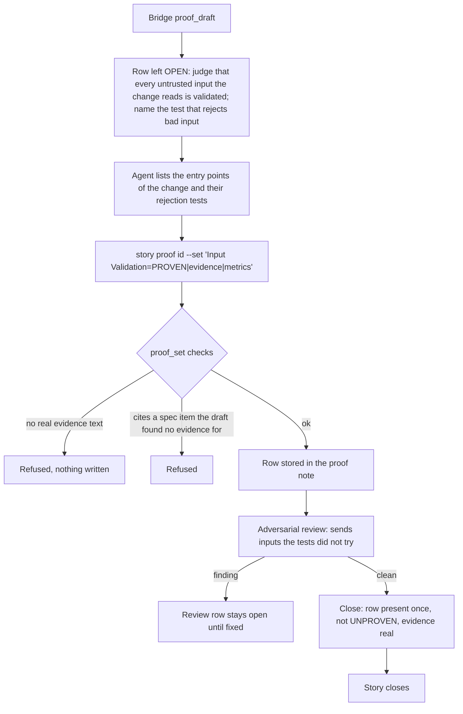

# Input Validation

[← Back to the README](../README.md) · [← The Proof Table](PROOF.md)

**Input Validation** asks: *does every way into the change refuse bad input at the door?* Each public entry point the story adds
or changes (a command-line argument, an HTTP request, an MCP tool argument, a configuration value, a file it parses, a message it
receives) must check what it receives and refuse what is malformed, **before** that input travels inward. The row proves it with
named tests that send the bad input and assert the refusal. It is required for development and operations stories.

## What it checks

- **Every untrusted input the change reads is validated** at the boundary where it enters: type, range, length, format,
  allowed values, required fields, encoding.
- **The refusal is explicit**: an error the caller can act on (a message naming the field and the rule), not a crash further in,
  not a silent default.
- **Malformed input never propagates.** Nothing behind the boundary has to guess whether the value is safe.
- **A test asserts each rejection**: it sends the bad value and checks that it is refused and that nothing else happened.

**Supported languages.** The row is argued by the agent and works for any programming language; the gate checks its
verdict and evidence. The tests it cites are run and measured by Kyklos only for C# (NUnit, xUnit, MSTest, through the
Bridge) and bash (in the agent's container). See [Supported languages and tools](SUPPORT_MATRIX.md).

## How it is checked

Input Validation is a **judgement row**. No program can list every input a change reads, so the agent judges the row, writes it
with named evidence, and the [Bridge](COMPONENTS.md#kyklos-bridge) and the [adversarial review](PROOF_DIMENSION_ADVERSARIAL_REVIEW.md) hold it to that evidence.

**Step by step.**

1. **The draft** leaves the row open with the prompt *judge that every untrusted input the change reads is validated; name the
   test that rejects bad input*. The row is never drafted as PROVEN: an input list cannot be read reliably from a diff.
2. **The write.** The agent walks the change's entry points and, for each, names the validation (file and line) and the test
   that rejects bad input. `story proof <id> --set` (the Bridge verb [`proof_set`](PROOF_DIMENSION_COMPLETENESS.md#how-it-is-checked)) refuses a PROVEN or NOT_PERTINENT row with no
   real evidence text (empty, a dash, a placeholder, or only `n/a`, `TBD`, `todo` or `none`), and a row that cites a
   specification item the signed draft record lists as uncovered.
3. **The tests cannot be quietly disabled.** The plugin refuses, at the moment the agent edits a test file, an unconditional
   `Assert.Ignore`, an `Assert.Pass`, an `Assert.Inconclusive` and a skip attribute such as `[Ignore]` or `[Fact(Skip=...)]`
   (the last three only with a written, inline reason), so a rejection test that "passes" by not running cannot be introduced.
4. **The review.** The adversarial reviewer is a fresh agent that tries to break the change. Feeding an entry point what its tests
   did not (an empty value, a huge value, a value with path separators or control characters) is part of its brief; what it finds
   is a finding, and the [Adversarial Review](PROOF_DIMENSION_ADVERSARIAL_REVIEW.md) row cannot be PROVEN with an open blocker or
   major finding.
5. **The close** ([`story close`](WORKFLOW.md#how-the-close-checks-the-rules), or the [Stop rule](HOOKS_AND_SKILLS.md#forced-productivity) that reaches `proof_validate` through [`hook_event`](HOOKS_AND_SKILLS.md#how-a-hook-decides-one-hook-per-event-every-rule-in-the-bridge)) refuses the story while
   the row is missing, appears twice, is UNPROVEN, or holds no real evidence text.

**Where things are.** The specification is the story's issue description, and the proof is the note marked
`<!-- kyklos:story-proof -->` that only the Bridge writes, with the GitLab token it keeps on the host. The test-file rule is one of
the rules the plugin's single hook sends to the Bridge (the `hook_event` verb) before every file edit, so it runs in the Bridge;
when the Bridge does not answer, the edit is refused rather than let through unjudged. Validation code that exists to stop an attack carries a [`[CySec]`](PROOF_DIMENSION_SECURITY_POSTURE.md#how-it-is-checked) annotation
(for example `// [CySec] Prevents CWE-20 "Improper Input Validation": ...`); the annotation is evidence for the reader, not a
condition of the verdict.

**What a failure causes, and the user's part.** A refused write or close leaves the story open with every reason listed; the agent
adds the missing check or test. No person is needed unless the owner decides to waive the row (see
[When it is not pertinent](#when-it-is-not-pertinent)).

## Metrics enforced

- The rejection tests of each entry point, for example `<kbd>Rejection tests (RetryOptionsValidatorTests):</kbd> 4 pass`, or
  one metric per entry point: `<kbd>--since (ExportCommandTests.Since_rejects_a_future_date):</kbd> pass`.
- If the story declares items this row proves, they are cited in `<kbd>` labels, and only items the draft found evidence for.

The metrics of this row are expected by the method and checked by the reviewer; the [Bridge](COMPONENTS.md#kyklos-bridge)'s mechanical checks on this row are
the evidence text, the citations and the closability rules above.

## Why it exists

Bad input that travels inward fails later, far from its cause: a negative count becomes an endless loop, a path with `..`
becomes a file written outside its folder, a string with a quote becomes a broken query. Most injection flaws are input
validation flaws. A check at the door turns each of them into one clear refusal, at the place where the caller can still fix
the value.

**A realistic use case.** A story adds a `--retries <n>` option. The agent proves the retry logic with three, five and zero
retries. The row asks for the rejection tests of each entry point, so the agent writes one for `--retries -1` and finds that a
negative value is accepted and makes the loop never end (the loop counts down to zero and skips past it). The validator now
refuses values outside 0 to 10 at start-up with "retries must be between 0 and 10", and the test locks it.

## Practical examples

**PROVEN:**

| Quality Dimension | Verdict   | Evidence                                                                                                                  | Metrics |
|-------------------|-----------|---------------------------------------------------------------------------------------------------------------------------|---------|
| Input Validation  | ✅ PROVEN | Two entry points: the `--retries` option is refused outside 0–10 and the `--target` URL is refused unless it is https (`ExportOptionsValidator.cs:18`, `:31`, `[CySec]` CWE-20). Both refusals stop start-up with a message naming the option. | <kbd>Rejection tests (ExportOptionsValidatorTests):</kbd> 5 pass <kbd>Entry points with a rejection test:</kbd> 2/2 |

**UNPROVEN, and what fixes it:**

| Quality Dimension | Verdict     | Evidence                                                                                                                                  | Metrics |
|-------------------|-------------|-------------------------------------------------------------------------------------------------------------------------------------------|---------|
| Input Validation  | ❌ UNPROVEN | OPEN (proof_draft): judgement row, judge that every untrusted input the change reads is validated; name the test that rejects bad input. | – |

Fix: list the entry points, add the missing validation and a test per refusal, then write the row as PROVEN with that evidence.
Writing `PROVEN|-|-` is refused: a dash is not evidence.

**NOT_PERTINENT:**

| Quality Dimension | Verdict          | Evidence                                                                                                              | Metrics |
|-------------------|------------------|-----------------------------------------------------------------------------------------------------------------------|---------|
| Input Validation  | ⬜ NOT_PERTINENT | The change renames an internal method and moves a constant; it adds and changes no entry point and reads no new input. | – |

## When it is not pertinent

When the change adds or changes no entry point and reads no new input: an internal refactor, a rename, a change confined to
code that only receives values already validated at its boundary (say where). The reason is required. It is not required for
analysis and documentation stories. The owner can untick it per story in the [Proof Discipline](PROOF.md#the-owners-proof-discipline),
or waive a gap at the close with the [`proof-override`](WORKFLOW.md#the-owners-proof-override-label) label and a named cause (see [the workflow](WORKFLOW.md)).

## Related pages

[The Proof Table](PROOF.md), [Robustness](PROOF_DIMENSION_ROBUSTNESS.md), [Security Posture](PROOF_DIMENSION_SECURITY_POSTURE.md),
[Defense in Depth](PROOF_DIMENSION_DEFENSE_IN_DEPTH.md), [Hooks and skills](HOOKS_AND_SKILLS.md), and [the README](../README.md) for the full list.
