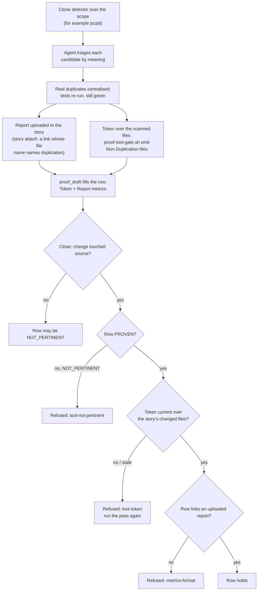

# Proof dimension: Non-Duplication

[← Back to the README](../README.md) · [← The Proof Table](PROOF.md)

**Non-Duplication** is the row of the [Proof Table](PROOF.md) that asks whether the story copied logic or constants that
already exist, and whether it cleaned up the duplication its own work exposed. It is proven by a deduplication pass: a
mechanical clone detector finds the candidates, the agent judges each one **by meaning** (two pieces of code that look
alike but change for different reasons are not duplicates), real duplicates are centralised, and the detector's report is
attached to the story. A token over the scanned files ties the row to the exact code the pass looked at.

It is mandatory for development and ops stories. Analysis and documentation stories do not carry it.

## What it checks

- **No new copy.** The story introduces no logic, constant, message or configuration value that already exists elsewhere
  with the same reason to change. It references the existing one instead.
- **Exposed duplication resolved.** When the story's work reveals two copies of the same thing (for example the new code
  needs a helper and two near-identical helpers already exist), the copies are merged as part of the story, at the right
  level: generic logic at the lowest shared level used across modules, specialised logic at the higher level where it
  belongs.
- **Nothing merged that merely looks alike.** Values or code that happen to be identical today but change for different
  reasons, or live in different parts of the system, stay separate. Forcing them into one shared symbol couples unrelated
  code, a defect of its own.
- **Behaviour preserved.** Deduplication is a refactor: the tests stay green before and after.

**Supported languages and tools.** A change that adds source in C#, PowerShell, bash, Python, JavaScript, TypeScript, Go,
Java or Ruby needs a fresh de-duplication pass; other languages do not make it required. Kyklos ships no clone detector:
the agent uses one that fits the stack (for example jscpd, PMD-CPD or a Roslyn analyzer) or a search it keeps in the
project's tooling, then judges each candidate by meaning. See [Supported languages and tools](SUPPORT_MATRIX.md).

## How it is checked

The doer is the `kyklos:ssdlc-deduplicate` skill (see [Skills](HOOKS_AND_SKILLS.md#how-the-agent-knows-what-to-do-skills)); the
row only audits what it did.

In words:

1. **The scan.** The agent runs a clone detector appropriate to the project's languages over the story's surface and
   wherever its constants and logic could already be duplicated: [jscpd](https://github.com/kucherenko/jscpd), PMD-CPD,
   the duplication view of a code-quality server, an analyzer rule. When nothing fits the stack, the agent builds a small
   detector and keeps it in the project's tooling, so the next story reuses it.
2. **The triage.** Each candidate is judged by meaning. The detector misses renamed or restructured clones; the agent adds
   those it finds by reading the code, and discards coincidental matches with a reason.
3. **The report.** The detector's output (for example `jscpd-report.json`) is uploaded to the story with the story tool's
   `story attach`, which calls the [Bridge](COMPONENTS.md#kyklos-bridge)'s `story_upload` verb and returns the link to cite. The Bridge recognises the
   newest note on the story that links an upload whose file name names duplication.
4. **The token.** After a clean pass the skill records a **Non-Duplication token** for the story over the exact source
   files it scanned: `proof-tool-gate.sh emit "Non-Duplication" <files>` (the script ships with the plugin under
   `plugins/kyklos/hooks/lib/`). For each file the token records a fingerprint of **the story's own change** to it: the
   git patch identity of the branch's diff for that file against its merge base with the trunk, taken with no context
   lines, so an unrelated trunk edit next to the story's lines does not disturb it. A file the branch did not change is
   recorded by its content hash. Any later edit to the story's change makes the token stale, so the pass must be the last
   thing before the row is set.
5. **The draft.** [`proof_draft`](PROOF_DIMENSION_COMPLETENESS.md#how-it-is-checked) fills the row as PROVEN, with a `Token` and a `Report` metric, when the token holds and a
   report is linked. When the change touches no source it drafts the row NOT_PERTINENT; otherwise it leaves the row open
   with what is missing (*"no duplication report is linked on the story"*).

**Where things are and how they are checked.**

- **Signature.** This token is **not** signed with the Bridge's key. The detector runs in the agent's container, where the
  key never is, so the token is a content binding only: the Bridge accepts it when it is current over the files (its answer
  reads *"the token has no hmac field"*, which for this dimension is the accepted answer). What it proves is that the pass
  ran over the code as it is now; what keeps the pass honest is the attached report, which anyone can open, and the
  [Adversarial Review](PROOF_DIMENSION_ADVERSARIAL_REVIEW.md), which looks for duplication too. The [Test
  Discipline](PROOF_DIMENSION_TEST_DISCIPLINE.md) evidence, in contrast, is produced by the Bridge itself and signed.
- **When the checks run.** When the row is written (`proof_set` refuses a row that breaks the metric rule), when the
  agent ends its turn after setting the row, and at the close ([`story_close`](WORKFLOW.md#how-the-close-checks-the-rules)), judged on the files the story's cited
  deliverables changed, read from the remote.
- **Which files count as source.** `.cs`, `.ps1`, `.psm1`, `.sh`, `.py`, `.ts`, `.tsx`, `.js`, `.jsx`, `.go`, `.java`
  and `.rb`. A change with none of them is not gated.
- **What a failed check causes.** A stale or missing token, a NOT_PERTINENT row on a change that touched source, or a
  PROVEN row without the report link refuses the close, with the reason. The agent runs the pass again (only the files
  changed since need a fresh look) and drafts again. No person is needed.

## Metrics enforced

| Metric | Rule |
|--------|------|
| `Report` | **required** for PROVEN: a link to the uploaded report (`/uploads/...`). A summary without the attachment is refused. |
| `Token` | the Non-Duplication token over the changed files; the close checks it is current. |
| `Duplication (<tool>)` | the clone count and the duplicated share, naming the detector, for example `0 clones, 0%`. |
| one metric per specification item the row proves | as for every row. |

## Why it exists

Duplicated logic is fixed in one copy and stays broken in the other. An agent is especially prone to it: asked to add a
feature, it writes what it needs where it is, without searching for the helper that already does it two folders away.

**A realistic case.** A story adds a retry with growing waits to the export job. The agent writes a new
`ComputeBackoff(attempt)` method. The clone detector flags it against an existing `RetryPolicy.Delay(attempt)` in the
shared library, 92 % similar. The triage finds the same reason to change (both implement the company's back-off rule), so
the new method is deleted and the export calls the shared one. Three months later the back-off rule changes once, in
one place. Without the row, the second copy would have kept the old rule, and the two jobs would have hammered the server
on different schedules.

**And the opposite case.** The detector also flags two constants `30` (a session time-out in seconds and a page size). The
triage keeps them apart: they change for unrelated reasons, and merging them would make one change silently alter the
other.

## Practical examples

**PROVEN.**

| Quality Dimension | Verdict | Evidence | Metrics |
|---|---|---|---|
| Non-Duplication | ✅ PROVEN | jscpd over the 3 changed files and the shared library: one candidate, `ComputeBackoff` against `RetryPolicy.Delay`, a real duplicate; the new method was removed and the export calls the shared one. Two equal constants kept apart (different reasons to change). | <kbd>Duplication (jscpd):</kbd> 0 clones, 0% <kbd>Token:</kbd> Non-Duplication token current over 3 files <kbd>Report:</kbd> `jscpd-report.json` (attached, linked to its upload) |

**UNPROVEN, and what fixes it.**

| Quality Dimension | Verdict | Evidence | Metrics |
|---|---|---|---|
| Non-Duplication | ❌ UNPROVEN | OPEN (proof_draft): the Non-Duplication token does not hold (the host answered: stale: `src/Export/UploadRetry.cs`); run the ssdlc-deduplicate pass for this story. | – |

The token went stale because the agent fixed a review finding in `UploadRetry.cs` after the pass. The fix: run the pass
again over the changed files, emit the token again, upload the new report and draft again.

**NOT_PERTINENT.**

| Quality Dimension | Verdict | Evidence | Metrics |
|---|---|---|---|
| Non-Duplication | ⬜ NOT_PERTINENT | The change touches no source file (2 files: `README.md`, `docs/export.md`), so it cannot duplicate logic or constants. | – |

## When it is not pertinent

Only when the change touches no source file of a supported language. A NOT_PERTINENT row on a change that touched source
is refused at the close.

## Overrides

The project setting `KYKLOS_TOOL_GATE_NON_DUPLICATION=0` accepts a PROVEN verdict without the token (an explicit opt-out;
the check is on by default). The owner can also untick the dimension in the story's
[Proof Discipline](PROOF.md#the-owners-proof-discipline), or apply the [`proof-override`](WORKFLOW.md#the-owners-proof-override-label) label naming the cause. All of them are
described in [Overrides](WORKFLOW.md#overrides).

## Related pages

[The Proof Table](PROOF.md), [Test Discipline](PROOF_DIMENSION_TEST_DISCIPLINE.md), [Documentation](PROOF_DIMENSION_DOCUMENTATION.md),
[i18n](PROOF_DIMENSION_I18N.md), [Adversarial Review](PROOF_DIMENSION_ADVERSARIAL_REVIEW.md), [Hooks and skills](HOOKS_AND_SKILLS.md),
and [the README](../README.md) for the full list.
