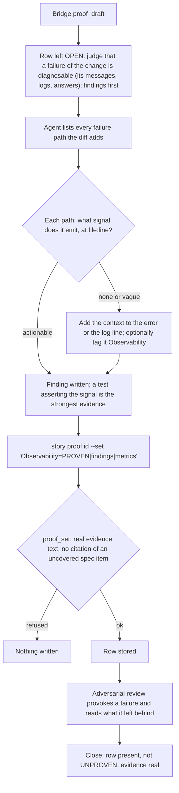

# Observability

[← Back to the README](../README.md) · [← The Proof Table](PROOF.md)

**Observability** asks the operator's question: *when this breaks in production, can someone tell why, from what it left
behind?* For each failure path the change adds, the row names the signal it emits: an error with actionable context (what
operation, a summary of the input, the cause), a log line, a health or metric value, an answer the caller can read. An exception
swallowed in silence is the opposite of observable. It is required for development and operations stories.

## What it checks

- **Every new failure path emits a signal.** Each `catch`, error return, refusal, time-out and fallback the change adds says
  what happened.
- **The signal is actionable.** It names the operation, a summary of the input (never a secret), and the cause; "an error
  occurred" is not a signal.
- **Nothing is swallowed.** A failure that is deliberately tolerated is still logged or counted, so a pattern of tolerated
  failures can be seen.
- **The right audience gets it.** An operator reads logs and health values; a caller reads the answer; an agent reads the tool's
  refusal text. A failure is surfaced where the person who must act will look.

## How it is checked

Observability is a **judgement row** ("reasoning signal"): the method asks for findings first, one per failure path, then the
verdict.

**Step by step.**

1. **The draft** leaves the row open with the prompt *judge that a failure of the change is diagnosable (its messages, logs,
   answers); findings first*. The Bridge never proves this row by itself.
2. **The findings.** For each failure path, the agent cites the line that emits the signal and what it contains, or writes "no new
   failure path, because ...". A test that provokes the failure and asserts the signal (the log line, the error text, the status)
   is the strongest finding, though not required.
3. **The optional tag.** A deliberate diagnostic point may carry an `[Observability]` comment, a soft marker like `[CySec]`: its
   absence is a missed opportunity, never UNPROVEN, and a search for it lists the diagnostic points of the code.
4. **The write.** `proof_set` refuses a row with no real evidence text and a row citing a specification item the signed draft
   record lists as uncovered.
5. **The review.** The [adversarial review](PROOF_DIMENSION_ADVERSARIAL_REVIEW.md) provokes failures and reads what is left
   behind; a silent failure is a finding.
6. **The close** refuses the story while the row is missing, UNPROVEN or without real evidence.

**Where things are, and the secrets.** The proof is the Bridge-written note marked `<!-- kyklos:story-proof -->`. A signal must
never carry a secret: log the name of a setting or a credential, never its value (the same rule Kyklos itself follows, see
[Secrets](SECRETS.md)). The only key the row's machinery uses is the proof signing key `KYKLOS_PROOF_HMAC_KEY`, which signs the
draft record and the review token inside the Bridge.

**What a failure causes, and the user's part.** A refused write or close keeps the story open; the agent adds the context or the
log line. No person is needed unless the owner waives the row.

## Metrics enforced

- The failure paths added and the signal each one emits: `<kbd>Failure paths with a signal:</kbd> 3/3`.
- Where a test asserts a signal: `<kbd>Signal asserted (Upload_failure_logs_attempt_wait_and_cause):</kbd> pass`.

These are the method's metrics; the Bridge mechanically checks the evidence text, the citations and the closability rules.

## Why it exists

An incident you cannot diagnose is an incident you cannot fix in time, or report in time: incident reporting duties such as those
of [NIS2](https://eur-lex.europa.eu/eli/dir/2022/2555/oj) assume you can tell what happened. Agents, like people under time
pressure, write `catch { }` to make a test pass, or return `false` without saying why. The row makes every new failure path
answer "what will the operator see?" while the code is still fresh.

**A realistic use case.** A story adds a nightly sync that falls back to the cached copy when the source is unreachable. It
works, and the tests pass. Writing the row, the agent lists the fallback as a failure path and finds that it emits nothing: the
sync would serve stale data for weeks and every log would say "sync completed". The fallback now logs a warning with the source
address, the error and the age of the cached copy, and a health value counts consecutive fallbacks. The next outage of the source
shows up on the first night.

## Practical examples

**PROVEN:**

| Quality Dimension | Verdict   | Evidence                                                                                                                                                                 | Metrics |
|-------------------|-----------|--------------------------------------------------------------------------------------------------------------------------------------------------------------------------|---------|
| Observability     | ✅ PROVEN | Three failure paths: an unreachable source logs a warning with the address, the error and the cache age (`NightlySync.cs:58`); a corrupt cache is refused with the file name and the parse error (`SyncCache.cs:31`); consecutive fallbacks are a health value (`SyncHealth.cs:14`). The warning is asserted by a test. | <kbd>Failure paths with a signal:</kbd> 3/3 <kbd>Signal asserted (Unreachable_source_logs_address_error_and_cache_age):</kbd> pass |

**UNPROVEN, and what fixes it:**

| Quality Dimension | Verdict     | Evidence                                                                                                         | Metrics |
|-------------------|-------------|------------------------------------------------------------------------------------------------------------------|---------|
| Observability     | ❌ UNPROVEN | OPEN (proof_draft): judgement row, judge that a failure of the change is diagnosable (its messages, logs, answers); findings first. | – |

Fix: list the failure paths of the diff, give each an actionable signal, and write the row with the findings. A row reading
`PROVEN|Errors are logged.|-` passes the text rule but names no path and no line; the reviewer is told to reject it.

**NOT_PERTINENT:**

| Quality Dimension | Verdict          | Evidence                                                                                                  | Metrics |
|-------------------|------------------|-----------------------------------------------------------------------------------------------------------|---------|
| Observability     | ⬜ NOT_PERTINENT | No new failure path: the change renames two private methods and reorders their arguments; every error path is unchanged and still logs as before. | – |

## When it is not pertinent

When the change adds no failure path and changes none: renames, pure calculations that cannot fail, text changes. The reason is
required. Not required for analysis and documentation stories. The owner can untick the dimension in the story's
[Proof Discipline](PROOF.md#the-owners-proof-discipline), or waive a gap at the close with the `proof-override` label and a named
cause (see [the workflow](WORKFLOW.md)).

## Related pages

[The Proof Table](PROOF.md), [Resilience](PROOF_DIMENSION_RESILIENCE.md), [Robustness](PROOF_DIMENSION_ROBUSTNESS.md),
[Security Posture](PROOF_DIMENSION_SECURITY_POSTURE.md), [Secrets](SECRETS.md), and [the README](../README.md) for the full list.
