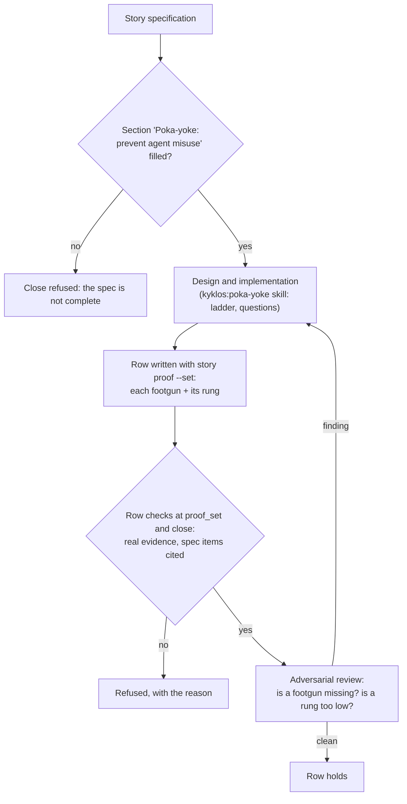

# Proof dimension: Poka-Yoke

[← Back to the README](../README.md) · [← The Proof Table](PROOF.md)

**Poka-Yoke** (Japanese for "mistake-proofing") is the row of the [Proof Table](PROOF.md) that asks: *did this change
create an easy, damaging mistake, and if so, is it guarded as high as possible?* A **footgun** is such a mistake: an API that
is easy to call in the wrong order, a setting that accepts a value that silently breaks things, a switch that fails open, an
identifier chosen by position that another tool numbers differently. The row lists each footgun the change introduced and
the **rung** of the guard that stops it, on a ladder whose top rung makes the mistake impossible and whose bottom rung only
writes it down.

It is mandatory for development and ops stories. Analysis and documentation stories do not carry it.

## What it checks

For every footgun the story's change introduces or touches, the guard sits on the **highest rung that is feasible**:

1. **Impossible by construction** (best). The wrong state cannot be represented or reached: a closed `enum` instead of a
   free string, a required, non-nullable property, a stable unique key instead of a position, one shared constant every
   site references.
2. **Fails loudly at build or start-up.** An analyzer error, a constructor that throws, settings that fail validation unless
   real values are set, a `default:` branch over a closed set that throws instead of dropping the case.
3. **Fails loudly in a test.** A guard or architecture test that stays green only while the invariant holds.
4. **Blocked by a hook.** A hook refuses the mistake in the agent's actions or changed files.
5. **Documented convention** (weakest). Only when rungs 1 to 4 are genuinely not feasible, and then with a note a reviewer
   will see. A guard on rung 5 when rung 1 or 2 was reachable is a latent bug.

Two further questions belong to the same review: **is this freedom necessary?** (every knob, flag or pass-through variable
is a new mistake surface, and the default answer is "no knob"), and **does every destructive action default to a dry
run**, with an explicit switch to apply it?

## How it is checked

Poka-Yoke is a **judgement** dimension: no tool can decide whether a design is sound, and a blanket "did you think about
it?" gate would be noise. Kyklos therefore enforces it in three places that each force the reasoning to happen, and leaves
the judgement itself to the agent and to the reviewer.

In words:

- **The specification asks first.** Every story's specification has a section *Poka-yoke: prevent agent misuse* (see the
  example in [Storages](STORAGES.md)). The close refuses a story whose specification still has a section empty or holding a
  template placeholder, so the question is answered before any code exists, when a higher rung is still cheap.
- **The skill guides the design.** The `kyklos:poka-yoke` skill (see [Skills](HOOKS_AND_SKILLS.md#how-the-agent-knows-what-to-do-skills))
  holds the ladder and a list of design questions per kind of change: identity and selection, values shared across files,
  closed sets, new settings, serialised contracts, destructive actions, resource lifetimes.
- **The row is checked like every row.** At `proof_set` and at the close, a PROVEN or NOT_PERTINENT row needs real evidence
  text, and every specification item the row cites must have evidence behind it (see
  [Configurability](PROOF_DIMENSION_CONFIGURABILITY.md#how-it-is-checked) for the shared checks). The row carries no token
  and no signature.
- **The review challenges it.** The [Adversarial Review](PROOF_DIMENSION_ADVERSARIAL_REVIEW.md) looks for footguns the row
  missed and for guards placed lower than they could be. A finding of class blocker or major sends the work back.
- **The ratchet.** Every time a mistake actually bites, the fix is not closed until the highest-rung guard for the whole
  class of that mistake exists, and the guard is recorded in the project's own **registry of enforced invariants** (a table
  `mistake class | guard | rung`, kept in the project's `CLAUDE.md` or a project document). The set only grows.

## Metrics enforced

| Metric | Meaning |
|--------|---------|
| `Footguns introduced` | how many easy, damaging mistakes the change created |
| `Guard rung` (one per footgun) | the rung of its guard: impossible by construction, fails at build or start-up, fails in a test, blocked by a hook, documented |
| one metric per specification item the row proves | as for every row; the items of the *Poka-yoke* section often land here |

## Why it exists

A rule people must remember will eventually be forgotten; a design that makes the mistake impossible will not. Agents
forget faster than people: each new session starts without the memory of the last mistake.

**A realistic case.** A story adds a command that deletes old export files. The first draft takes a folder argument and
deletes everything in it older than 30 days. The footgun is obvious once named: a wrong folder (the user's home, a
mounted share) is emptied. The Poka-Yoke row forces the guard up the ladder:

- rung 5 would be a warning in the README ("make sure the folder is right"): rejected, a reader skips it;
- rung 2 is chosen: the command is a **dry run by default** and only lists what it would delete; `--apply` deletes; the
  folder must contain the export marker file the job writes, or the command refuses to start;
- a test (rung 3) proves the refusal on a folder without the marker.

**How Kyklos applies it to itself.** Many of its own controls are poka-yoke guards: the story tool is the only writer of
the story header, so a hand edit cannot drift from the tracker; an unknown value of a Bridge setting stops the Bridge at
start-up; a proof row cannot be filled by typing where a token is required; the destructive `rm` patterns that would stall
an agent are refused by a hook before they run.

## Practical examples

**PROVEN.**

| Quality Dimension | Verdict | Evidence | Metrics |
|---|---|---|---|
| Poka-Yoke | ✅ PROVEN | Footgun: the clean-up command deletes a whole folder. Guard: dry run by default (`--apply` to delete) and a refusal unless the folder holds the export marker file (rung: fails at start-up), locked by `Cleanup_refuses_a_folder_without_the_marker`. Footgun: a retry loop with no limit. Guard: the attempts are a validated range, so an unbounded loop cannot be configured (rung: fails at start-up). | <kbd>Footguns introduced:</kbd> 2 <kbd>Guard rung (folder):</kbd> fails at start-up <kbd>Guard rung (retry):</kbd> fails at start-up |

**UNPROVEN, and what fixes it.**

| Quality Dimension | Verdict | Evidence | Metrics |
|---|---|---|---|
| Poka-Yoke | ❌ UNPROVEN | The README warns that the clean-up folder must be the export folder. | <kbd>Guard rung:</kbd> documented |

The guard sits on the lowest rung while rung 2 was reachable; the adversarial review flags it as a major finding. The fix:
make the command refuse a folder without the marker, add the test, set the row again.

**NOT_PERTINENT.**

| Quality Dimension | Verdict | Evidence | Metrics |
|---|---|---|---|
| Poka-Yoke | ⬜ NOT_PERTINENT | The change corrects the wording of two error messages; it adds no interface, setting, state or action that could be misused. | – |

## When it is not pertinent

When the change introduces no new way to make a mistake: no new or changed interface, setting, state, file format,
destructive action or cross-process contract. A blanket NOT_PERTINENT on a change that adds any of these is a smell the
reviewer will challenge.

## Related pages

[The Proof Table](PROOF.md), [Configurability](PROOF_DIMENSION_CONFIGURABILITY.md), [Input Validation](PROOF_DIMENSION_INPUT_VALIDATION.md),
[Defense in Depth](PROOF_DIMENSION_DEFENSE_IN_DEPTH.md), [Adversarial Review](PROOF_DIMENSION_ADVERSARIAL_REVIEW.md),
[Hooks and skills](HOOKS_AND_SKILLS.md), [Storages](STORAGES.md), and [the README](../README.md) for the full list.
