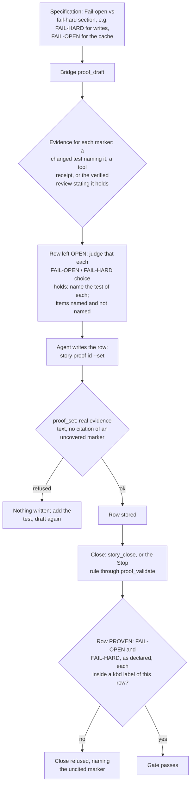

# Resilience

[← Back to the README](../README.md) · [← The Proof Table](PROOF.md)

**Resilience** asks: *when the world around the change fails, does the change recover, or fail the way it promised?* Networks
time out, disks fill up, a dependency answers with an error, a file is locked by another program. These are not bugs in the
change; they are normal weather. The row proves that each such failure is handled and recovered from, and that every
**fail-open** or **fail-hard** choice the story declares holds, each by a test that injects the failure. It is required for
development and operations stories.

## What it checks

- **Environmental failures are handled**: network errors and timeouts, I/O and file-system errors, a dependency that is down or
  slow, a lock held by someone else.
- **The declared choices hold.** The specification's section `## Fail-open vs fail-hard` states, for each failure, whether the
  change lets the work go on (**fail-open**) or stops it (**fail-hard**). Each `FAIL-OPEN` and `FAIL-HARD` marker declared there
  is shown holding.
- **A retry is under control.** Where the recovery is a retry, its attempts and back-off are settings, and tests can switch the
  waits off, so a test of the retry does not sleep in real time.

**Supported languages.** The row is argued by the agent and works for any programming language; the gate checks its
verdict, its evidence and the `FAIL-OPEN` / `FAIL-HARD` markers it must name. The tests it cites are run and measured by
Kyklos only for C# (NUnit, xUnit, MSTest, through the Bridge) and bash (in the agent's container). See
[Supported languages and tools](SUPPORT_MATRIX.md).

## How it is checked

Resilience is a **judgement row with a mechanical spine**: the fail-open and fail-hard choices are declared in the specification,
the [Bridge](COMPONENTS.md#kyklos-bridge) looks for evidence of each, and the close demands each one cited in this row.

**Step by step.**

1. **Declared markers.** In the fail-open section, an upper-case `FAIL-OPEN` or `FAIL-HARD` anywhere declares that item, and so
   does a line that opens with the label in any letter case (`Fail-hard: ...`). Lower-case prose that merely mentions the words
   ("no fail-open behaviour") declares nothing. A line such as `- **FAIL-OPEN:** none` **does** declare the marker: the row then
   proves that the change really has no fail-open path.
2. **The draft.** [`proof_draft`](PROOF_DIMENSION_COMPLETENESS.md#how-it-is-checked) accepts three kinds of evidence for a marker: a changed test whose running test name or
   `[Category]`, `[Trait]` or `[Property]` value carries it as a token (`[Property("Spec", "FAIL-HARD")]`), a host tool receipt,
   or the newest [adversarial review](ADVERSARIAL_REVIEW.md) whose token the Bridge verifies and whose "Checked" section states the marker holding, with
   no negative wording on that line. It leaves the row open with the prompt *judge that each FAIL-OPEN / FAIL-HARD choice holds;
   name the test of each*, and lists the markers named and not named; the latter go into the signed draft record.
3. **The write.** `proof_set` refuses a row with no real evidence text and a row that cites a marker the signed record lists as
   uncovered.
4. **The close.** For a PROVEN row the Bridge's correlation gate requires each declared marker inside a `<kbd>` label of this
   row (`<kbd>FAIL-HARD (Writes_stop_on_a_full_disk):</kbd> pass`).
5. **The judgement.** Whether the retry is configurable and can be switched off in tests, and whether each environmental failure
   was really injected (not simulated by calling the error handler directly), is judged by the agent and attacked by the
   [adversarial review](PROOF_DIMENSION_ADVERSARIAL_REVIEW.md).

**Where things are, and the key.** The markers are in the story's issue description; the proof is in the note marked
`<!-- kyklos:story-proof -->`, written by the Bridge with the GitLab token it keeps on the host. The draft record and the review
token are signed with the [proof signing key](PROOF_DIMENSION_TEST_DISCIPLINE.md#signatures-the-key-and-when-they-are-checked) `KYKLOS_PROOF_HMAC_KEY`, kept in the Windows Credential Manager and handed only to the
Bridge process (see [Secrets](SECRETS.md)); a review whose token does not verify covers nothing.

**What a failure causes, and the user's part.** The story stays open with the uncited markers named. The agent injects the failure
in a test, or asks for the review to check the marker, and drafts again. A person is needed only to waive the row.

## Metrics enforced

- The failure-injection tests: `<kbd>Failure-injection tests (UploadRetryTests):</kbd> 3 pass`.
- The retry or recovery settings they cover: `<kbd>Retry settings covered:</kbd> 2/2` (attempts, back-off).
- One metric per declared marker: `<kbd>FAIL-HARD (Writes_stop_on_a_full_disk):</kbd> pass`,
  `<kbd>FAIL-OPEN (A_down_cache_serves_from_the_source):</kbd> pass`. Required at the close for every declared marker.

## Why it exists

Transient failures are normal; an unhandled one becomes an outage. The fail-open or fail-hard choice is also a security
decision: a check that "fails open" when its dependency is down lets everything through exactly when nobody is watching. Writing
the choice down, and proving it with an injected failure, makes that decision visible and keeps it from changing silently.

**A realistic use case.** A story adds a licence check that calls a remote service. The specification says `FAIL-HARD`: if the
service cannot be reached, the feature stays locked. The agent's first version catches every exception and logs it, which means
the feature unlocks when the network is down. The test that injects a timeout (`[Property("Spec", "FAIL-HARD")]`
`Licence_check_timeout_keeps_the_feature_locked`) fails, the catch is narrowed, and the choice the specification made is the choice
the code makes.

## Practical examples

**PROVEN:**

| Quality Dimension | Verdict   | Evidence                                                                                                                           | Metrics |
|-------------------|-----------|------------------------------------------------------------------------------------------------------------------------------------|---------|
| Resilience        | ✅ PROVEN | The upload retries with growing waits; attempts and back-off are settings, and a test setting disables waits. Tests inject a timeout, a reset connection and a full disk. | <kbd>Failure-injection tests (UploadRetryTests):</kbd> 3 pass <kbd>Retry settings covered:</kbd> 2/2 <kbd>FAIL-HARD (Writes_stop_on_a_full_disk):</kbd> pass |

**UNPROVEN, and what fixes it:** the agent writes `<kbd>FAIL-OPEN (review):</kbd> holds` and [`proof_set`](PROOF_DIMENSION_COMPLETENESS.md#how-it-is-checked) answers
`proof_set refused for 'Resilience': it cites FAIL-OPEN, which proof_draft found no evidence for (no test names it, no review covered it)`.
The review's "Checked" section never mentioned the marker. Fix: add a test carrying `FAIL-OPEN` (or have the review state it as
checked), then draft again and write the row.

**NOT_PERTINENT:**

| Quality Dimension | Verdict          | Evidence                                                                                                             | Metrics |
|-------------------|------------------|----------------------------------------------------------------------------------------------------------------------|---------|
| Resilience        | ⬜ NOT_PERTINENT | The change is a pure calculation on values already in memory: no network, file, process or dependency call is added or changed, and the story declares no fail-open or fail-hard choice. | – |

## When it is not pertinent

When the change makes no call that can fail for environmental reasons and declares no fail-open or fail-hard choice. If markers
are declared, they still have to be cited in some PROVEN row, or the close refuses them. Not required for analysis and
documentation stories. The owner can untick the dimension in the story's [Proof Discipline](PROOF.md#the-owners-proof-discipline),
or waive a gap at the close with the [`proof-override`](WORKFLOW.md#the-owners-proof-override-label) label and a named cause (see [the workflow](WORKFLOW.md)).

## Related pages

[The Proof Table](PROOF.md), [Robustness](PROOF_DIMENSION_ROBUSTNESS.md), [Observability](PROOF_DIMENSION_OBSERVABILITY.md),
[Configurability](PROOF_DIMENSION_CONFIGURABILITY.md), [Completeness](PROOF_DIMENSION_COMPLETENESS.md),
and [the README](../README.md) for the full list.
