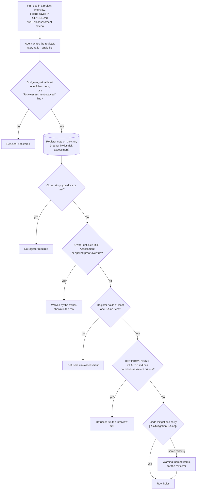

# Proof dimension: Risk Assessment

[← Back to the README](../README.md) · [← The Proof Table](PROOF.md)

**Risk Assessment** is the row of the [Proof Table](PROOF.md) that measures the story's change against its own **risk
register**: a short, numbered list of the security risks the change introduces, exposes or mitigates (`RA-01`, `RA-02`, ...),
each cited to the standards and regulations the project declared. The row proves two things: the change brings in no
higher or new risk that the register does not list, and every listed risk is mitigated, with the mitigating code marked
by a searchable `[RiskMitigation RA-nn]` comment, so the whole mitigation inventory of a product is one search away.

It is mandatory for development and ops stories. Analysis and documentation stories do not carry it. Within those kinds,
the story **type** decides whether a register is required: documentation-only (`docs`) and test-only (`test`) work has no
risk delta and is exempt.

## What it checks

1. **A register exists for the change.** It is pragmatic, not a formal assessment of the whole system: scoped to what the
   change adds or alters (new entry points, data flows, dependencies, privileges, trust boundaries), plus the risks the
   project said every story must consider.
2. **No unlisted risk.** The change does not introduce or raise a risk the register does not name. If it does, the register
   gains a new item, or the story stops.
3. **Each listed risk is mitigated**, or explicitly accepted as residual, and the code that mitigates it carries the marker.
4. **The citations are real.** Each item names the requirement of the declared regimes it answers (for example a part of
   [IEC 62443](https://www.isa.org/standards-and-publications/isa-standards/isa-iec-62443-series-of-standards), a
   [NIS2](https://eur-lex.europa.eu/eli/dir/2022/2555/oj) risk-management measure, an essential requirement of the
   [Cyber Resilience Act](https://eur-lex.europa.eu/eli/reg/2024/2847/oj)), and the weakness it addresses
   ([CWE](https://cwe.mitre.org/) or [CAPEC](https://capec.mitre.org/)).

A register item, as the [`kyklos:ssdlc-risk-assessment`](HOOKS_AND_SKILLS.md#how-the-agent-knows-what-to-do-skills) skill writes it:

| # | Asset / entry point | Threat | Vector | Impact × Likelihood | Mitigation (where) | Residual | Standard |
|---|---|---|---|---|---|---|---|
| RA-01 | the export upload | a retry storm overloads the server | CWE-770 | Med × Med | capped attempts with growing waits (`UploadRetry.cs`) | Low | IEC 62443-4-2 CR 7.1 |

And its mark in the code:

```csharp
// [RiskMitigation RA-01] Prevents CWE-770 "Allocation of Resources Without Limits": at most MaxAttempts uploads,
// each wait twice the previous one.
for (var attempt = 1; attempt <= options.MaxAttempts; attempt++)
```

**Supported languages.** The register works for a project in any programming language, and the `[RiskMitigation RA-##]`
comment uses the language's own comment syntax. The `## Risk assessment` heading and the `RA-` numbers are fixed English
that the tools read; the risks themselves may be written in any language. See [Supported languages and tools](SUPPORT_MATRIX.md).

## How it is checked



In words:

- **The criteria, once per project.** On first use the [skill](HOOKS_AND_SKILLS.md#how-the-agent-knows-what-to-do-skills) interviews the developer: which standards apply, which
  regulations (and in which countries), and which risks every story must consider regardless of the change (for example
  authentication and authorisation, input validation, secret handling, the supply chain, denial of service). The answers
  are saved in the project's `CLAUDE.md` under `## Risk assessment criteria`; the skill's `has-risk-criteria.sh` tells
  whether they exist. A PROVEN row is refused while the section is missing, so no register is judged against criteria
  nobody agreed to.
- **Where the register lives.** It is written only through the story tool, `story ra <id> --apply <file>`, which calls the
  [Bridge](COMPONENTS.md#kyklos-bridge) verb `ra_set`. On an issue-tracker storage the register is a note on the story that starts with the marker line
  `<!-- kyklos:risk-assessment -->`; on the [file-system storage](STORAGES.md#file-system-storage-for-standalone-and-offline-use) it is the story's `risk-assessment.md` (see
  [Storages](STORAGES.md)). A hand-edited mirror of the note is ignored by the gate, and a [hook](HOOKS_AND_SKILLS.md#how-a-hook-decides-one-hook-per-event-every-rule-in-the-bridge) forbids editing it.
- **What `ra_set` accepts.** A text with at least one numbered item (a bullet or a table row starting with `RA-nn`), or a
  `Risk-Assessment-Waived: <who/why>` line recording a person's waiver. Anything else is refused, so an empty or
  malformed register is never stored as if it were one.
- **The close.** For a story whose type is not `docs` or `test`, the Bridge's close reads the register (the register note,
  else the story's description) and refuses the story when it holds no numbered item. Only the owner can lift that: by
  unticking Risk Assessment in the story's [Proof Discipline](PROOF.md#the-owners-proof-discipline), or by applying the
  [`proof-override`](WORKFLOW.md#the-owners-proof-override-label) label with its named cause. The agent may never waive the row itself: a NOT_PERTINENT Risk
  Assessment on a story of another type needs a person's recorded waiver line.
- **Register items are specification items.** Items declared as bullets in the story's specification (`- **RA-01** ...`)
  must be cited as metric keys in a PROVEN row, like requirements and use cases. [`proof_draft`](PROOF_DIMENSION_COMPLETENESS.md#how-it-is-checked) counts a risk item as
  covered when the register states it handled, or when a clean [adversarial review](ADVERSARIAL_REVIEW.md) lists it as checked.
- **The markers.** When the row is PROVEN, every item whose register line claims a code mitigation is searched for in the
  repository (`[RiskMitigation RA-nn]`). A claimed mitigation with no marker is reported by name as a **warning**, not a
  refusal on its own, because some items are mitigated by process, not by code; the
  [Adversarial Review](PROOF_DIMENSION_ADVERSARIAL_REVIEW.md) checks that the register and the markers agree.
- **No signature.** The register is a judgement kept in the tracker, where its history is visible; it carries no token.
  The Bridge reads it at the close.

## Metrics enforced

| Metric | Meaning |
|--------|---------|
| `Register items` | how many numbered items the register holds (at least one for a story type that requires a register) |
| `Mitigations marked` | the code mitigations carrying their marker against those the register claims, for example `1/1` |
| one metric per register item declared in the specification | for example `RA-01 (risk register): mitigated, UploadRetry.cs` |

## Why it exists

Regulations such as [NIS2](KB.md#standards-catalogues-and-references) and the Cyber Resilience Act, and the IEC 62443 development practice, ask for evidence that risks
were identified and treated. A register written once a year for an auditor does not describe the code that shipped last
week. A register per story, scoped to the change and tied to the code by markers, does: an auditor can search
`[RiskMitigation` and land on every control, and every control points back to the story that introduced it.

**A realistic case.** A story adds a web hook that lets a partner trigger an export. The agent's first register has one
item, "RA-01 the endpoint is public", mitigated by "authentication". The interview criteria list denial of service as an
always-consider risk, so the review asks: what stops a partner from triggering ten thousand exports? The register gains
`RA-02` (resource exhaustion, CWE-770), mitigated by a per-partner rate limit marked `[RiskMitigation RA-02]` at the limiter.
Two years later the rate limiter is refactored; a search for `RA-02` finds the reason it exists before anyone deletes it.

## Practical examples

**PROVEN.**

| Quality Dimension | Verdict | Evidence | Metrics |
|---|---|---|---|
| Risk Assessment | ✅ PROVEN | RA-01 (a retry storm against the server) mitigated by the capped attempts and growing waits, marked `[RiskMitigation RA-01]` in `UploadRetry.cs:22`; RA-02 (no new public exposure) process-only. No higher risk introduced: the change adds no entry point. | <kbd>Register items:</kbd> 2<br><kbd>Mitigations marked:</kbd> 1/1<br><kbd>RA-01 (risk register):</kbd> mitigated<br><kbd>RA-02 (risk register):</kbd> process-only |

**UNPROVEN, and what fixes it.**

| Quality Dimension | Verdict | Evidence | Metrics |
|---|---|---|---|
| Risk Assessment | ❌ UNPROVEN | No register on the story yet. | – |

The close answers *"a numbered RA register is required for this story type and none was found"*. The fix: run the
`ssdlc-risk-assessment` [skill](HOOKS_AND_SKILLS.md#how-the-agent-knows-what-to-do-skills) over the story's change, write the register with `story ra <id> --apply <file>`, add the
markers at the mitigating code, then set the row.

**NOT_PERTINENT.**

| Quality Dimension | Verdict | Evidence | Metrics |
|---|---|---|---|
| Risk Assessment | ⬜ NOT_PERTINENT | A `test` story: it adds tests for the existing parser and changes no production code, so it has no risk delta. | – |

## When it is not pertinent

For `docs` and `test` story types, which change no production behaviour (if such a story does touch a risk surface, it
gets a register as usual). For any other type, only a person can decide the row does not apply, recorded as a waiver line
in the register or as the owner's decision in the story's [Proof Discipline](PROOF.md#the-owners-proof-discipline).

## Related pages

[The Proof Table](PROOF.md), [Security Posture](PROOF_DIMENSION_SECURITY_POSTURE.md), [Defense in Depth](PROOF_DIMENSION_DEFENSE_IN_DEPTH.md),
[Adversarial Review](PROOF_DIMENSION_ADVERSARIAL_REVIEW.md), [The Kyklos workflow](WORKFLOW.md#glossary), [Storages](STORAGES.md),
[Overrides](WORKFLOW.md#overrides), and [the README](../README.md) for the full list.
