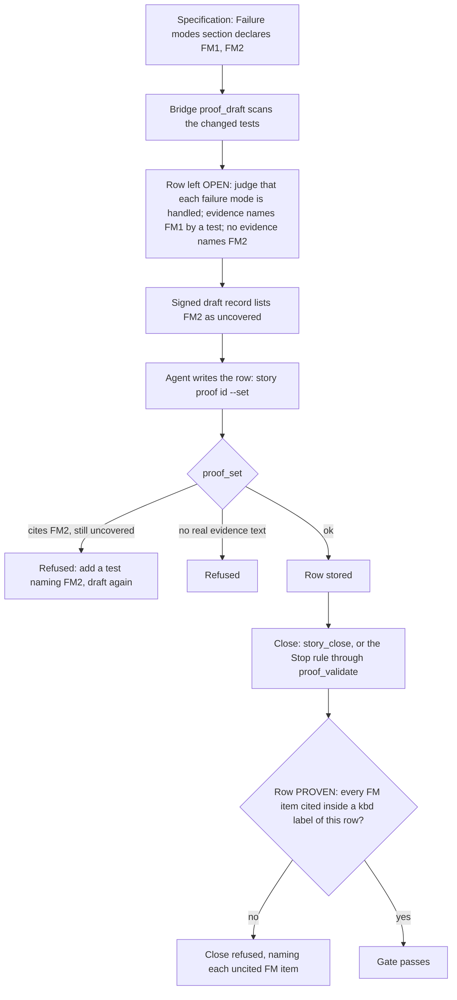

# Robustness

[← Back to the README](../README.md) · [← The Proof Table](PROOF.md)

**Robustness** asks: *does the change behave when the input or the state is not the happy one?* Boundary values, empty and
maximum sizes, duplicates, zero, an interruption half-way, a state that "cannot happen": production finds these corners long
before anyone writes a test for them. The row proves that every failure mode the story declares (`FM1`, `FM2`, ...) is handled,
each by a named test that would fail if it were not, plus the boundary and edge-case tests of the change. It is required for
development and operations stories.

## What it checks

- **Every declared failure mode is handled.** Each `FM<n>` of the section `## Failure modes handled — and how` has a test that
  provokes it and asserts the declared handling.
- **Boundaries and edges are tested**, not only the middle: empty, one, maximum, just over the maximum, zero, negative,
  duplicates, unexpected order, a stream that ends early.
- **Rare and improbable states are handled**, not assumed away: the file disappears between the check and the read, the
  answer arrives twice, the process is stopped in the middle.

Robustness is about wrong or unusual **inputs and states**. Failures of the **environment** (the network, the disk, a dependency)
belong to [Resilience](PROOF_DIMENSION_RESILIENCE.md); refusing malformed input at the door belongs to
[Input Validation](PROOF_DIMENSION_INPUT_VALIDATION.md).

**Supported languages.** The row is argued by the agent and works for any programming language; the gate checks its
verdict, its evidence and the failure-mode numbers (`FM1`, `FM2`, ...) it must name. The tests it cites are run and
measured by Kyklos only for C# (NUnit, xUnit, MSTest, through the Bridge) and bash (in the agent's container). See
[Supported languages and tools](SUPPORT_MATRIX.md).

## How it is checked

Robustness is a **judgement row with a mechanical spine**: the failure modes are numbered in the specification, the [Bridge](COMPONENTS.md#kyklos-bridge)
looks for tests that name them, and the close demands each one cited in this row.

**Step by step.**

1. **Declared items.** The specification's failure-mode section lists bullets such as `- **FM1** The upload is interrupted
   half-way -> nothing partial is written`. The Bridge reads the `FM` numbers from that section.
2. **The draft.** [`proof_draft`](PROOF_DIMENSION_COMPLETENESS.md#how-it-is-checked) looks for a changed test that names each `FM` item as an exact token in a running test's method
   name or in its `[Category]`, `[Trait]` or `[Property]` value (`FM1_interrupted_upload_writes_nothing`), or a host tool receipt
   naming it. For a development or operations story, a failure mode **needs a test**: the [adversarial review](ADVERSARIAL_REVIEW.md) never covers an `FM`
   item, because a handled failure is behaviour and behaviour is shown by running it. The row stays open with the prompt
   *judge that each failure mode is handled; name the test that would fail if it were not*, plus the items named and not named.
   The items not named go into the signed draft record.
3. **The write.** `proof_set` refuses a row citing an `FM` item the signed record lists as uncovered, and a row with no real
   evidence text.
4. **The close.** For a PROVEN row the Bridge's correlation gate requires every `FM` item of the section inside a `<kbd>` label of
   **this** row. Prose does not count, another row does not count, and `FM1` never stands for `FM10`.
5. **The judgement.** Which boundaries matter, and whether the declared list of failure modes is complete, is judged by the agent
   and attacked by the [adversarial review](PROOF_DIMENSION_ADVERSARIAL_REVIEW.md), whose reviewer is asked to find the corner no
   test visits.

**Where things are, and the key.** The failure modes live in the story's issue description, the proof in the note marked
`<!-- kyklos:story-proof -->`. The draft record that lists uncovered items is signed by the Bridge with the [proof signing key](PROOF_DIMENSION_TEST_DISCIPLINE.md#signatures-the-key-and-when-they-are-checked)
`KYKLOS_PROOF_HMAC_KEY` (HMAC-SHA256, prefix `proof-draft:`, bound to the story, the project and a generation number); the key
stays in the Windows Credential Manager and in the Bridge process (see [Secrets](SECRETS.md)). A record that does not verify is
ignored, and an older record posted again loses to the newest one.

**What a failure causes, and the user's part.** The story stays open with the uncited items named; the agent writes the missing
test and drafts again. A person is involved only to waive a gap on purpose.

## Metrics enforced

- One metric per failure mode, named by its test: `<kbd>FM1 (FM1_interrupted_upload_writes_nothing):</kbd> pass`.
- The boundary and edge-case tests: `<kbd>Boundary tests (RetryScheduleTests):</kbd> 6 pass`.
- Every `FM` item of the specification must be in a label of this row when it is PROVEN (close), and only items the draft found
  evidence for may be cited (write).

## Why it exists

A happy-path test proves that the code works on the day nothing goes wrong. Real traffic brings the empty file, the list with one
duplicate, the request that arrives while the previous one is still running. Writing the failure modes down at design time, and
demanding one test each, moves those corners from the incident report to the specification.

**A realistic use case.** A story imports contacts from a CSV file. Its specification declares `FM1` (a row with a missing
column is skipped and reported) and `FM2` (an empty file imports nothing and says so). The agent tests `FM1` and drafts; the
draft says no evidence names `FM2`. Writing `FM2_empty_file_imports_nothing` shows that an empty file throws "sequence contains
no elements" from the header reader. The fix is two lines; without the row, the first user who uploads an empty export from
another tool would have found it.

## Practical examples

**PROVEN:**

| Quality Dimension | Verdict   | Evidence                                                                                                         | Metrics |
|-------------------|-----------|------------------------------------------------------------------------------------------------------------------|---------|
| Robustness        | ✅ PROVEN | FM1 and FM2 provoked by their tests; boundaries 0, 1 and 10,000 rows, a duplicated header and a file without a final line break. | <kbd>FM1 (FM1_row_missing_a_column_is_skipped_and_reported):</kbd> pass <kbd>FM2 (FM2_empty_file_imports_nothing):</kbd> pass <kbd>Boundary tests (ContactImportBoundaryTests):</kbd> 5 pass |

**UNPROVEN, and what fixes it:** the close answers
`dimension "Robustness" is PROVEN but story item "FM2" (declared in "## Failure modes") is not cited inside a FORMAL <kbd>...</kbd> metric group`.
The agent had written "FM2 handled by the empty-file test" in the evidence text. Fix: cite it as a metric,
`<kbd>FM2 (FM2_empty_file_imports_nothing):</kbd> pass`, which [`proof_set`](PROOF_DIMENSION_COMPLETENESS.md#how-it-is-checked) accepts because the draft found that test.

**NOT_PERTINENT:**

| Quality Dimension | Verdict          | Evidence                                                                                                  | Metrics |
|-------------------|------------------|-----------------------------------------------------------------------------------------------------------|---------|
| Robustness        | ⬜ NOT_PERTINENT | The change only replaces a hard-coded label with a resource lookup; it adds no input, state or branch, and the story declares no failure mode. | – |

## When it is not pertinent

When the change adds no input, no state and no branch that could meet an unusual value, and the story declares no failure mode.
If the story declares `FM` items, they still have to be cited in some PROVEN row, or the close refuses them. Not required for
analysis and documentation stories. The owner can untick the dimension in the story's
[Proof Discipline](PROOF.md#the-owners-proof-discipline) (its items are then waived with it), or waive a gap at the close with the
[`proof-override`](WORKFLOW.md#the-owners-proof-override-label) label and a named cause (see [the workflow](WORKFLOW.md)).

## Related pages

[The Proof Table](PROOF.md), [Completeness](PROOF_DIMENSION_COMPLETENESS.md), [Resilience](PROOF_DIMENSION_RESILIENCE.md),
[Input Validation](PROOF_DIMENSION_INPUT_VALIDATION.md), [Adversarial Review](PROOF_DIMENSION_ADVERSARIAL_REVIEW.md),
and [the README](../README.md) for the full list.
