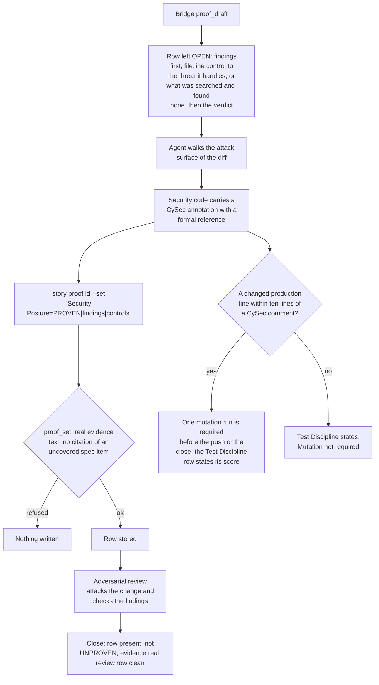

# Security Posture

[← Back to the README](../README.md) · [← The Proof Table](PROOF.md)

**Security Posture** asks: *what does this change expose, and where is each exposure controlled?* It walks the change's attack
surface (the inputs and trust boundaries it crosses, the secrets it touches, what it deserialises, the authentication paths, the
dependencies it adds, the privileges it needs) and, for each, names the control and the threat it handles, at its file and line.
It does not measure a single number: overall posture is not one figure. Its job is to keep security **in the reasoning** of every
story, so it is never silently skipped. It is required for development and operations stories.

## What it checks

For each part of the attack surface the change adds or touches, one **finding**:

- **Inputs and trust boundaries:** data that comes from a user, a file, the network, another process or another agent.
- **Secret handling:** where a token, password or key is read, held, passed and logged (it must never be logged).
- **Deserialisation and parsing** of data from outside.
- **Authentication and authorisation paths:** who may call this, and where that is checked.
- **Dependencies:** a new package, tool or service, and what it can reach.
- **Least privilege:** the change asks for no more access than it uses.

A finding is either *"control at `file:line` handles threat X"*, or *"searched `<the surface>`, found no new threat, because
..."*. Both are first-class results. Inventing a finding to fill the row is not.

**Supported languages and tools.** The row is argued by the agent and works for any programming language; a `[CySec]`
annotation uses the language's own comment syntax. A changed production line within ten lines of a `[CySec]` comment
(`//`, `/*`, `*` or `#`) makes mutation testing due for C#, JavaScript, TypeScript and Scala; the Bridge runs it for C# with
Stryker.NET, and the agent runs StrykerJS or Stryker4s itself for the others. See
[Supported languages and tools](SUPPORT_MATRIX.md).

## How it is checked

Security Posture is a **judgement row** ("reasoning signal"). The method asks for findings **first**, then the verdict, because
for a language model the writing is the reasoning: a row that accepts a bare "secure" lets the analysis be skipped, while a row
that demands a file, a line and a threat forces it to happen.

**Step by step.**

1. **The draft** never proves this row. It leaves it open with the prompt *findings first (file:line control -> the threat it
   handles, or what was searched and found none), then the verdict*.
2. **The annotation.** Code that exists to stop an attack carries a greppable comment in the format
   `// [CySec] <Prevents|Mitigates|Hardens|Detects|Enforces> <reference> "<title>": <why here>`, for example
   `// [CySec] Prevents CWE-22 "Path Traversal": reject '..' before resolving the path.` The reference is a real
   [CWE](https://cwe.mitre.org/), [OWASP](https://owasp.org/),
   [IEC 62443](https://www.isa.org/standards-and-publications/isa-standards/isa-iec-62443-series-of-standards) or
   [CAPEC](https://capec.mitre.org/) identifier, never an invented one. The convention is defined once, in the plugin's
   `ssdlc-cysec` [skill](HOOKS_AND_SKILLS.md#how-the-agent-knows-what-to-do-skills); the `ssdlc-cysec-comments` skill backfills it on older code. The annotation is **soft**: a missing one is
   recorded in the evidence as a missed opportunity, never turned into UNPROVEN. Its value is that `grep -rn "\[CySec\]"` gives a
   standards-mapped inventory of the controls, ready for an audit.
3. **The mutation link.** The annotation also marks code as security-sensitive for [mutation testing](WORKFLOW.md#glossary). The plugin's
   `mutation-due.sh check` answers whether a story needs a mutation run: it does when a production source line the branch changed
   (in C#, JavaScript or TypeScript, or Scala) lies within ten lines of a `[CySec]` comment. The run happens once, right before the
   push that opens or updates the merge request (or before the close), and stays valid until the measured code changes; its score
   is cited in the [Test Discipline](PROOF_DIMENSION_TEST_DISCIPLINE.md) row. A project that has suspended mutation testing sets
   `KYKLOS_MUTATION_SUSPENDED=1` in its [launcher](COMPONENTS.md#kyklos-launcher) configuration, and the row then says so.
4. **The write.** [`proof_set`](PROOF_DIMENSION_COMPLETENESS.md#how-it-is-checked) refuses a row with no real evidence text (empty, a dash, a placeholder, `n/a`, `TBD`, `todo`,
   `none`) and a row that cites a specification item the signed draft record lists as uncovered. Whether each finding is anchored
   to the change is judged by people and by the reviewer, not by a pattern.
5. **The review.** The [adversarial review](PROOF_DIMENSION_ADVERSARIAL_REVIEW.md) is the control that tests the findings: a
   fresh reviewer, preferably on another model, attacks the change. A finding it reports (an unchecked path, a secret in a log
   line) keeps the review row open until it is fixed.
6. **The close** refuses the story while the row is missing, UNPROVEN or without real evidence.

**Where things are, and the secrets.** The proof note (`<!-- kyklos:story-proof -->`) is written only by the [Bridge](COMPONENTS.md#kyklos-bridge), with the
GitLab token it keeps on the host; the agent's container holds no token that can call the GitLab API. The [review token](ADVERSARIAL_REVIEW.md#how-the-review-token-is-made-and-checked) and the
draft record are signed with the [proof signing key](PROOF_DIMENSION_TEST_DISCIPLINE.md#signatures-the-key-and-when-they-are-checked) `KYKLOS_PROOF_HMAC_KEY`, kept in the Windows Credential Manager and handed only
to the Bridge (see [Secrets](SECRETS.md)).

**What a failure causes, and the user's part.** A refused write or close keeps the story open with the reasons. A person is
needed only to waive the row, or to answer a security decision the agent cannot take alone (for example accepting a residual risk,
which belongs in the [Risk Assessment](PROOF_DIMENSION_RISK_ASSESSMENT.md) register).

## Metrics enforced

- The controls added or touched, each with its formal reference: `<kbd>Controls (with reference):</kbd> 2 (CWE-22, CWE-918)`.
- Where it applies, the absence of a classic leak: `<kbd>Secrets in log lines:</kbd> 0`.

These metrics are the method's; the [Bridge](COMPONENTS.md#kyklos-bridge)'s mechanical checks on this row are the evidence text, the citations and the
closability rules. The [`[CySec]`](#how-it-is-checked) annotations themselves are counted by a search, not by the close.

## Why it exists

Security reasoning that is not written down did not happen. In an agent's workflow it is the first thing to be dropped: the story
is about a feature, the tests are about the feature, and nobody asks what the feature lets an attacker do. A row that must hold a
file, a line and a threat makes the question unavoidable, and the annotations turn the answers into an inventory an auditor can
read (a [NIS2](KB.md#standards-catalogues-and-references) or IEC 62443 due-diligence question becomes a search).

**A realistic use case.** A story adds "import a project template from a URL". The feature works and is tested. Walking the
attack surface for the row, the agent asks where the URL is checked, and the honest answer is "nowhere": the importer fetches any
address, including the cloud metadata address and local services. The control is added (only `https` to an allow-listed host,
`// [CySec] Prevents CWE-918 "Server-Side Request Forgery (SSRF)"`), with a test that asks for `http://localhost/` and expects a
refusal. Because the changed lines sit next to a [`[CySec]`](#how-it-is-checked) comment, `mutation-due.sh` asks for one mutation run, which shows that
the test would catch a removed check.

## Practical examples

**PROVEN:**

| Quality Dimension | Verdict   | Evidence                                                                                                                                                                       | Metrics |
|-------------------|-----------|--------------------------------------------------------------------------------------------------------------------------------------------------------------------------------|---------|
| Security Posture  | ✅ PROVEN | Attack surface: the template URL and the downloaded archive. The URL is refused unless https to an allowed host (`TemplateSource.cs:41`, `[CySec] Prevents CWE-918`); archive entries with `..` are refused before extraction (`TemplateArchive.cs:77`, `[CySec] Prevents CWE-22`); no credential is read or logged. Searched the new settings: no secret among them. | <kbd>Controls (with reference):</kbd> 2 (CWE-918, CWE-22) <kbd>Secrets in log lines:</kbd> 0 |

**UNPROVEN, and what fixes it:**

| Quality Dimension | Verdict     | Evidence                                                                                                                           | Metrics |
|-------------------|-------------|------------------------------------------------------------------------------------------------------------------------------------|---------|
| Security Posture  | ❌ UNPROVEN | OPEN (proof_draft): judgement row, findings first (file:line control -> the threat it handles, or what was searched and found none), then the verdict. | – |

Fix: walk the surface and write the findings. A row of `PROVEN|Secure.|-` is accepted by the text rule (it is real text) but it is
exactly what the review is told to reject: no file, no line, no threat.

**NOT_PERTINENT:**

| Quality Dimension | Verdict          | Evidence                                                                                                                         | Metrics |
|-------------------|------------------|----------------------------------------------------------------------------------------------------------------------------------|---------|
| Security Posture  | ⬜ NOT_PERTINENT | Searched the diff: it changes the wording of two help texts and their resource keys; no input, secret, parser, permission or dependency is added or changed. | – |

## When it is not pertinent

Rarely, and with the search written down: a change of text, layout or naming that crosses no trust boundary. Even then, the
evidence says what was searched. Not required for analysis and documentation stories. The owner can untick the dimension in the
story's [Proof Discipline](PROOF.md#the-owners-proof-discipline), or waive a gap at the close with the [`proof-override`](WORKFLOW.md#the-owners-proof-override-label) label and a
named cause (see [the workflow](WORKFLOW.md)).

## Related pages

[The Proof Table](PROOF.md), [Defense in Depth](PROOF_DIMENSION_DEFENSE_IN_DEPTH.md), [Risk Assessment](PROOF_DIMENSION_RISK_ASSESSMENT.md),
[Input Validation](PROOF_DIMENSION_INPUT_VALIDATION.md), [Test Discipline](PROOF_DIMENSION_TEST_DISCIPLINE.md),
[Adversarial reviews](ADVERSARIAL_REVIEW.md), [Secrets](SECRETS.md), and [the README](../README.md) for the full list.
