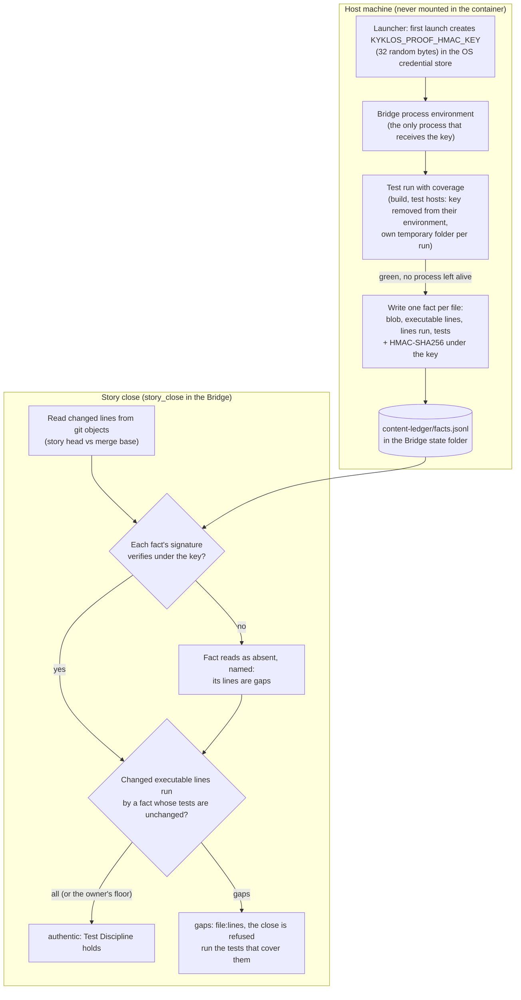
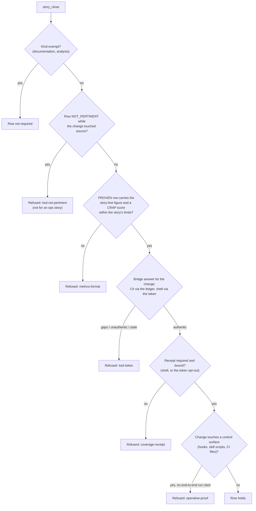

# Proof dimension: Test Discipline

[← Back to the README](../README.md) · [← The Proof Table](PROOF.md)

**Test Discipline** is the row of the [Proof Table](PROOF.md) that answers the question agents most often answer falsely:
*"did the tests really run the code this story changed, and do they pass?"*. Kyklos never takes the agent's word for it.
The [Kyklos Bridge](COMPONENTS.md) runs the tests itself on the host, records which changed lines a passing run executed,
signs that record with a key the agent never sees, and the close of the story asks the Bridge, not the agent. The row also
carries the highest [CRAP score](WORKFLOW.md#glossary) of the changed code, the mutation statement and, for tests that
depend on timing, how many times they passed in a row under CPU load.

The row is mandatory for development stories. For ops stories it is mandatory too, but its coverage and CRAP figures are
optional when the deliverable cannot be tested or testing it would be destructive. Analysis and documentation stories do
not carry it.

## What it checks

1. **The changed lines ran under a passing test run.** Every executable line the story changed (for C#: every statement;
   for shell scripts: every line that holds a command) was executed by a green test run of the [Bridge](COMPONENTS.md#kyklos-bridge), on the exact content
   the story ships. A line no passing run executed is a **gap**; a line whose covering test changed since it ran is
   **expired** and counts as a gap. By default no gap is allowed.
2. **The code is not too complex for its tests.** The highest [CRAP score](WORKFLOW.md#glossary) of the changed methods stays under the project's
   ceiling. CRAP combines complexity and coverage (`complexity² × (1 − coverage)³ + complexity`), so complex code has to be
   either simplified or tested more.
3. **The tests can fail.** Coverage is a floor, not the goal: a test that runs a line without checking anything proves
   nothing. Mutation testing, required for changes near security controls, measures exactly that (see
   [Metrics enforced](#metrics-enforced)).
4. **The tests do not depend on an idle machine.** Every changed test file that depends on timing, threads, child
   processes, the network, file locks or a browser runs several times in a row under CPU load before the close.

## How it is checked

### The content ledger: what the Bridge records after every passing run

The evidence for C# code is the **content ledger**: a host-side file in which the [Bridge](COMPONENTS.md#kyklos-bridge) writes, after each of its own
passing coverage runs, one fact per source file the run's coverage report names.

- **What a fact holds:** the file's content identity (its git blob hash, computed with the repository's own clean filters, so
  a Windows checkout with CRLF line ends and the committed LF file have one identity), the executable lines of that
  content, the lines the run executed, the test files the run used (each with its own content hash), the run's id and time,
  and a signature.
- **Keyed by content only.** No branch, commit, path or project is part of the key. A branch switch, a merge of the trunk, a
  rename or a documentation change never loses a fact: the same content keeps its facts.
- **Which runs record facts:** a passing `get_coverage` run (with any test filter) and a [`run_tests`](#how-tests-run-on-the-host) run given a `story`,
  which collects coverage in the same pass. A run that is not green records nothing, and so does a run that leaves one of
  the processes it started alive after a short grace (a leftover process could still write into the report).
- **Where it is:** `content-ledger/facts.jsonl` in the Bridge's state folder (setting `KYKLOS_BRIDGE_STATE_DIR`; on
  Windows by default under `%LOCALAPPDATA%\KyklosBridge`). That folder is on the host and is mounted in no agent container,
  so the agent has no write path to it.
- **Retention and size:** a fact whose content no branch of the repository has referenced for 30 days is dropped (setting
  `Agile:Proof:ContentLedgerRetentionDays`). A ledger file over 128 MiB is not read: every changed line then reads as a gap,
  named, and the next recorded run sets the file aside.

### The answer for a story: `test_facts`

The [Bridge](COMPONENTS.md#kyklos-bridge) verb `test_facts` reads the story's changed files and lines **from git objects** (the story branch head
against its merge base with the trunk), never from the working folder, computes each file's content hash and answers
from the ledger, line by line: **run** (with the tests that ran it), **not executable**, **GAP** or **EXPIRED**, with a
summary per file and for the story. The agent may call it at any time, so it knows exactly which tests to run next: only
the tests that cover the gap lines, never the whole suite again. The Bridge's GUI shows the same answer on its
*Coverage facts* page, so a person can see the situation at a glance.

Lines the coverage tool leaves out on purpose (code marked with an exclusion attribute, generated files, migrations,
files the repository excludes by pattern) are listed with their reason, never silently counted as covered. A C# file that
holds no executable code at all (only interfaces, enums, constants and the like) is decided by a syntax walk of its
content: its lines are not executable, not gaps.

### Signatures, the key, and when they are checked

In words:

- **The signing key.** On its first launch for a project the [Kyklos Launcher](COMPONENTS.md) creates the proof signing
  key: 32 random bytes, stored in the operating system's credential store (the Windows Credential Manager) under the name
  `KYKLOS_PROOF_HMAC_KEY`, and read back to make sure it was stored. If it cannot be stored, the Launcher refuses to start
  the project, because a key that is not kept would change on every launch and invalidate every record signed with it; the
  one explicit opt-out is `KYKLOS_ALLOW_UNPERSISTED_HMAC=1`. The Launcher hands the key only to the [Bridge](COMPONENTS.md#kyklos-bridge) process, in its
  environment; the Bridge reads it from the variable the setting `Agile:Proof:HmacKeyEnvironmentVariableName` names (by
  default `KYKLOS_PROOF_HMAC_KEY`). It never reaches the agent's container, and the builds and tests the Bridge runs start
  with it removed from their environment. See [Secrets](SECRETS.md).
- **How a fact is signed.** Each ledger line carries an HMAC-SHA256 (a keyed hash) over every field of the fact. Changing a
  single line number, or the content hash, breaks it.
- **When signatures are checked.** Every time the ledger is read: by [`test_facts`](#the-answer-for-a-story-test_facts), by the Stop check when the agent ends
  its turn after setting the row, when a merge request is armed (the arm needs zero gaps and zero expired lines for
  exactly the branch head, with a clean working tree; see [rule 5 of the workflow](WORKFLOW.md#rule-5-a-merge-request-merges-itself-and-only-on-the-merged-result)),
  and at the close.
- **What a failed check causes.** A line whose signature does not verify, that cannot be read, or that this Bridge
  process neither wrote nor found when it first opened the ledger, reads as **absent** and is named in the answer. Its
  changed lines become gaps. Downstream the close is refused with `gaps: <file>:<lines>`, and the arm of the merge request is
  refused the same way. Nothing else is lost: the agent runs the tests that cover those lines once more on this Bridge,
  which writes fresh, signed facts.
- **Without a key** nothing can be verified: every changed line is a gap, and the Bridge says why.
- **Impact on people.** None in the normal case: the agent re-runs the tests and the close passes. A person is needed only
  to *accept* a gap, never to repair a signature (see [Overrides](#overrides-who-can-accept-a-gap)).

The same signing key also signs the adversarial-review token (see [Adversarial Review](PROOF_DIMENSION_ADVERSARIAL_REVIEW.md))
and the Bridge's copy of the owner's [Proof Discipline](PROOF.md#the-owners-proof-discipline) section.

### Shell scripts: the token and the coverage receipt

Shell scripts are measured with bashcov, which runs inside the agent's container. Their evidence therefore travels a
different, equally sealed path:

1. The agent runs the suites with bashcov and calls `story attach-coverage`, which hands the coverage report to the [Bridge](COMPONENTS.md#kyklos-bridge)
   verb `coverage_receipt`.
2. The Bridge reads the story's changed scripts and their text itself, from the tree it serves (never from what the agent
   claims), builds the **coverage receipt** (a summary, the changed files' line-by-line coverage and the compressed report
   set), posts it as **one comment on the story**, and records the archive's SHA-256 fingerprint, the comment's id and the
   upload's address in the story's **Test Discipline token**.
3. The token is a small file in the Bridge's state folder, kept per project and per story. Its text holds the changed
   files with their change fingerprints and the receipt record, and an HMAC-SHA256 under the same signing key over all of
   it. Editing a recorded file afterwards makes the token stale; changing the receipt record breaks the signature.
4. At the close the Bridge checks the token's signature, that the row links **exactly** the upload the token records, and
   downloads the archive again to confirm its SHA-256 still matches. A row that links another archive, an archive that
   changed, or a comment that was deleted refuses the close (`coverage-receipt`).

The same token and receipt path exists for C# as an opt-out: with the Bridge setting
`Agile:Proof:TestDisciplineSource=token` a .NET coverage run posts a .NET receipt and mints the token instead of writing
ledger facts. The default is `ledger`. The setting `Agile:Proof:CoverageReceiptRequired=false` switches the receipt
requirement off (default on).

### What the close applies to this row

The checks are judged on the **merged result** (see [rule 3 of the workflow](WORKFLOW.md#rule-3-the-evidence-describes-the-merged-result)):
the story's own change as it landed on the trunk, read from the remote. Each check acts on the repository the story lives
in. In a repository the [Bridge](COMPONENTS.md#kyklos-bridge) does not serve, a story check reports *"not judgeable here"*, records the skip and passes no
judgement; a close of a story in a project the Bridge does not serve is refused (`PROJECT-NOT-SERVED`).

### How tests run on the host

- **Each run has its own temporary folder** under the [Bridge](COMPONENTS.md#kyklos-bridge)'s state folder (`run-temp/<run id>`). The build, the test
  hosts and the coverage collector see it as their `TEMP`/`TMP` (Windows) or `TMPDIR`, so no other run and no cleaner of the
  user's temp folder can delete a file a run is using. It is removed when the run ends.
- **Host-only values are removed** from the environment of everything the run starts: the signing key, the Bridge's own
  token and settings. A project can name the secrets its own tests need (`KYKLOS_BRIDGE_ENV_SECRETS`); the signing key
  is never among them.
- **Repeat under load.** `run_tests` takes `repeat` (up to 20) and `load` (up to 6 busy workers). The build runs once, then
  the repeats run without rebuilding. The busy workers start before the first repeat and live until the last ends; the
  answer says how many repeats ran under live load, and the run fails when the load ended early. Only one load run per
  machine is allowed at a time (a machine-wide lock, shared with the shell helper that loads a machine by hand); a second
  request is refused, naming the holder. The repeats times the run's time limit (`timeoutMinutes`) must fit in 120
  minutes, and `repeat` above 1 without a time limit is refused. The busy workers are stopped by their recorded process ids
  on every way the run can end, including a stop or a crash of the Bridge.
- **What a good test looks like.** Kyklos's own suites follow, and the [Adversarial Review](PROOF_DIMENSION_ADVERSARIAL_REVIEW.md)
  checks in a project's tests, the same shape: each test fixture works in its own empty folder, waits for a named state
  with a generous bound (or a fake clock) instead of sleeping a fixed time, and judges only the processes it started
  itself, never the machine's process list or "any free port". A test that passes only on an idle machine is a defect, in
  the test or in the code.

## Metrics enforced

| Metric | Rule |
|--------|------|
| `Story lines (ledger)` or `Story lines (receipt)` | the share of the changed executable lines that ran, written as `covered or limited N of M story lines` (a *limited* line is one the coverage tool cannot record, listed with its reason) or as a percentage. The close requires every changed line (100 %) unless the owner lowered the story's `Min Coverage` in its [Proof Discipline](PROOF.md#the-owners-proof-discipline); the row's own figure must reach that floor too. |
| `CRAP (max)` | required when the change touches C#; the highest [CRAP score](WORKFLOW.md#glossary) of the changed methods, at or under the project's `CRAP_THRESHOLD` (set in [`.claude/standards.env`](WORKFLOW.md#greppable-opt-out-switches) or the [Launcher](COMPONENTS.md#kyklos-launcher) configuration) and under the story's `Max CRAP Score` when the owner set one. A method the project accepted in its `crap-triage.txt` ledger, with a reason, does not fail the run's gate. |
| `Receipt` | for shell scripts (and for C# under the token opt-out): a link to the attached `coverage-receipt-*` archive, exactly the one the token records. |
| `Mutation` | the mutation statement: the score and level of the run when one was required, or `Mutation: not required (no security-sensitive code changed)`. A run is required only when a line the branch changed in production code lies within ten lines of a [`[CySec]`](PROOF_DIMENSION_SECURITY_POSTURE.md#how-it-is-checked) security annotation; `mutation-due.sh check` answers which case applies. A project that suspends mutation testing says so instead. |
| `Repeat under load (<file>)` | for each changed test file that depends on timing, threads, processes, the network, file locks or a browser: the pass count, for example `5/5`. A failing or near-limit repeat means 20 runs and a fix, never a retry. |
| one metric per specification item the row proves | as for every row: the item's key and the test that proves it. |

## Why it exists

"The tests pass" is the claim an agent fakes most easily, usually without meaning to: it ran a subset, it ran before its
last edit, it ran on a branch that was later rebased, or it read a green line from an older log. A signed fact keyed by
the exact content turns the claim into something the close can check.

**A realistic case.** An agent fixes a parsing bug, runs the unit tests (green), then, while tidying up, edits the parser
again and adds a branch for an empty input. It reports "all tests pass, coverage 96 %". The ledger knows better: the facts
it holds are for the parser's *earlier* content; the new content has none, so [`test_facts`](#the-answer-for-a-story-test_facts) answers
`GAP Parser.cs:41-44`. The agent runs the parser tests again, finds that the new branch is never reached by any test, writes
one, and the close passes. Without the ledger the empty-input branch would have shipped untested, and the 96 % would have
been a figure about different code.

**Why a key the agent never sees.** If the agent could compute the signature, nothing would stop a hand-written fact. Keeping
the key in the host's credential store and in the [Bridge](COMPONENTS.md#kyklos-bridge) process only means a fact exists only because the Bridge itself
watched a passing run. The limits of this protection are stated plainly in [The Proof Table](PROOF.md): code that runs as
the same user on the same machine could, deliberately, read the key; the control against a deliberately hostile test is
the [adversarial review](ADVERSARIAL_REVIEW.md).

### Where the evidence lives, and what a team shares

| What | Where | Shared? | What it is for |
|------|-------|---------|----------------|
| **Content ledger** | `content-ledger/facts.jsonl` in the [Bridge](COMPONENTS.md#kyklos-bridge)'s state folder (`KYKLOS_BRIDGE_STATE_DIR`) | No: each line is signed with the key of the machine whose Bridge wrote it | The C# evidence: which lines of which content passing runs executed. Read by [`test_facts`](#the-answer-for-a-story-test_facts), the arm and the close. |
| **[Coverage receipt](#shell-scripts-the-token-and-the-coverage-receipt)** | A comment on the story in the issue tracker, with the compressed report set attached; the comment records the archive's SHA-256 | Yes, by construction: everyone who can open the story sees it | The shell evidence (and C# under the token opt-out): figures, line-by-line coverage and full reports. The close downloads the archive again and checks its fingerprint. |
| **Test Discipline token** | A small file in the Bridge's state folder, kept per project and per story | No: it belongs to the machine whose Bridge signed it | The link between one run and one receipt, and the content of the changed files at that moment, signed. |
| **Trunk-base cache** | `base-coverage` in the Bridge's state folder | No, on purpose | Used by the receipt path only: coverage runs of the trunk commit a story started from, to compare each changed file with its coverage before the story and to tell which failing tests already failed there. Rebuilt when missing (at most 24 entries, each kept 14 days). Sharing it would let one machine's broken base run judge every developer's stories. |

**What this means for a team today.** The receipt is shared; the ledger and the tokens are not. A story measured on one
developer's machine closes from that machine. Closed from another machine, the close finds no facts or no token there, and
that developer runs the covering tests once, which costs time but loses nothing: facts are keyed by content, so only the
tests that cover the changed lines need to run.

**Could this evidence live in a shared place?** The folders are settings, so technically yes, but a shared folder alone does
not make the evidence portable. A signature verifies only with the key that made it, so sharing facts or tokens means every
developer's Bridge holds the **same** signing key, read from a shared secrets manager instead of each machine's credential
store. That keeps the guarantee that matters (the agent never sees the key) and adds an organisational one: everyone who
holds the key can sign. Committing tokens to a repository would add commits and merge conflicts on every measurement. The
cleaner direction is to carry the signature inside the receipt comment, so the issue tracker is the one shared store; it
needs the same team key.

## Practical examples

**PROVEN (C#, [content ledger](#the-content-ledger-what-the-bridge-records-after-every-passing-run)).**

| Quality Dimension | Verdict | Evidence | Metrics |
|---|---|---|---|
| Test Discipline | ✅ PROVEN | Content ledger at the merged result: every changed C# line of `UploadRetry.cs` and `RetryOptions.cs` ran under a passing Bridge run; the timing-dependent `UploadRetryTests` ran 5 times under load (`run_tests` repeat 5, load 4). Mutation: not required (no security-sensitive code changed). | <kbd>Story lines (ledger):</kbd> covered or limited 42 of 42 story lines <kbd>CRAP (max, get_coverage):</kbd> 12.0 <kbd>Repeat under load (UploadRetryTests):</kbd> 5/5 <kbd>Mutation:</kbd> not required (no security-sensitive code changed) |

**PROVEN (shell scripts, receipt).**

| Quality Dimension | Verdict | Evidence | Metrics |
|---|---|---|---|
| Test Discipline | ✅ PROVEN | bashcov over `test-export-hook.sh`; the Bridge posted the receipt and recorded it in the token. | <kbd>Story lines (receipt):</kbd> covered or limited 31 of 31 story lines <kbd>Receipt:</kbd> `coverage-receipt-shell.zip` (attached) <kbd>Mutation:</kbd> not required (no security-sensitive code changed) |

**UNPROVEN, and what fixes it.**

| Quality Dimension | Verdict | Evidence | Metrics |
|---|---|---|---|
| Test Discipline | ❌ UNPROVEN | OPEN (proof_draft): the Test Discipline check does not hold (the host answered: `gaps: Parser.cs:41-44`). | – |

The fix: run [`test_facts`](#the-answer-for-a-story-test_facts) to see the gap lines and the tests that cover the rest, add or run the test that reaches lines
41 to 44 ([`run_tests`](#how-tests-run-on-the-host) with the `story`, or `get_coverage` with a filter), then draft the proof again. If those lines
genuinely cannot run in a test (for example code for another operating system), the owner may accept the gap; the agent
cannot.

**NOT_PERTINENT.**

| Quality Dimension | Verdict | Evidence | Metrics |
|---|---|---|---|
| Test Discipline | ⬜ NOT_PERTINENT | The change touches only `README.md` and `docs/export.md`: no source file, so there is no testable surface. | – |

## When it is not pertinent

Only when the change touches no source file. A NOT_PERTINENT row on a change that touched source code is refused at the
close (`tool-not-pertinent`), except on an ops story. Documentation and analysis stories do not carry the row at all.

## Overrides: who can accept a gap

Only people can relax this row, and every relaxation is shown in the row with who decided it and when (see
[Overrides](WORKFLOW.md#overrides) for the full list):

- **The owner's [Proof Discipline](PROOF.md#the-owners-proof-discipline)** for this one story: lower `Min Coverage`, set a `Max CRAP Score`, or untick Test
  Discipline. A floor lowered below the last measured figure satisfies the row at once, as long as the code is still the
  code that was measured. See [The Proof Table](PROOF.md#the-owners-proof-discipline).
- **The owner's [`proof-override`](WORKFLOW.md#the-owners-proof-override-label) label** on the story waives the proof gates of the close; it must name the open item that
  removes the cause of the gap (setting [`Agile:Proof:NamedCauseRequired`](WORKFLOW.md#bridge-owner-settings), on by default).
- **Project settings** (opt-outs, never the default): `KYKLOS_TOOL_GATE_TEST_DISCIPLINE=0` accepts the verdict without
  the tool check, `Agile:Proof:TestDisciplineSource=token` uses the token and .NET receipt instead of the ledger, and
  `Agile:Proof:CoverageReceiptRequired=false` drops the receipt requirement.

## Related pages

[The Proof Table](PROOF.md), [Thread Safety](PROOF_DIMENSION_THREAD_SAFETY.md), [Completeness](PROOF_DIMENSION_COMPLETENESS.md),
[Non-Duplication](PROOF_DIMENSION_NON_DUPLICATION.md), [Adversarial Review](PROOF_DIMENSION_ADVERSARIAL_REVIEW.md),
[The Kyklos workflow](WORKFLOW.md), [Secrets](SECRETS.md), [The three components](COMPONENTS.md), and
[the README](../README.md) for the full list.
