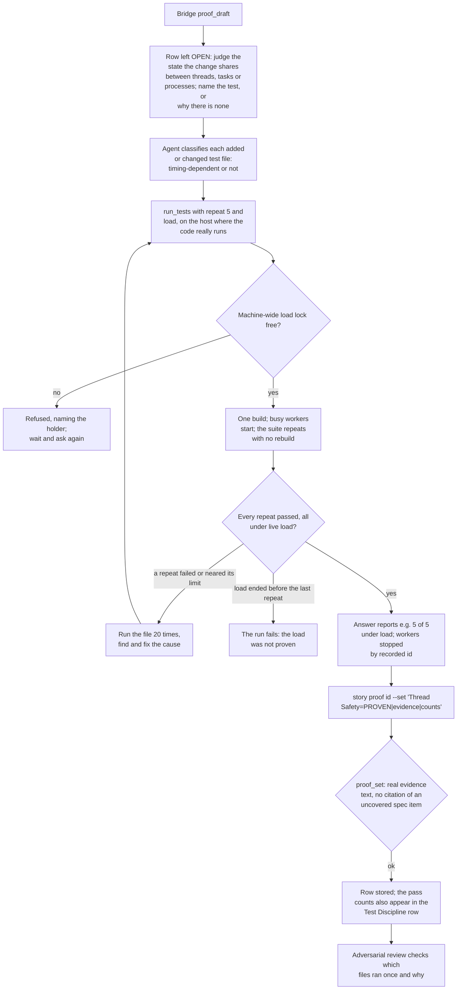

# Thread Safety

[← Back to the README](../README.md) · [← The Proof Table](PROOF.md)

**Thread Safety** asks: *does the change behave when things happen at the same time?* Parallel calls, two threads touching one
object, two processes writing one file, a timer firing while a request is half done, a test runner running tests side by side on
a busy machine. The row proves the change's behaviour under concurrency with concurrency tests, and proves that every test whose
result could depend on timing passes **repeatedly, under CPU load**, not once on an idle machine. It is required for development
and operations stories.

## What it checks

- **Shared state is safe.** Every piece of state the change shares between threads, tasks or processes (a cache, a counter, a
  file, a static field, a connection) is protected, and a test drives it concurrently.
- **Parallel calls are safe.** A public operation that can be called twice at once behaves: no lost update, no double work that
  matters, no deadlock.
- **Timing-dependent tests are stable.** A test file the story added or changed runs **5 times in a row under CPU load** before the
  close when it exercises any of: real or fake timers, sleeps or clocks; threads, tasks or async work; child processes, pipes or
  subshells; the network, sockets or HTTP (fake servers included); file locks or file watching; a browser or a simulated page.
  Every other test file (pure logic, text and data checks) runs once.
- **A failure is a defect, not bad luck.** If a repeated run fails, or comes close to its time limit, the file runs 20 times and
  the cause is fixed, never retried away. A test that passes only when the machine is idle is a defect, in the test or in the code.
  Tests wait for a specific state or use fake timers, never a fixed real-time sleep.

**Supported languages and tools.** The row is argued by the agent and works for any programming language. The repeated
runs under load go through the Bridge's `run_tests` for C# test projects (NUnit, xUnit, MSTest); a bash suite is repeated in
the agent's container under the shared load lock; tests in other languages run with the project's own tools, and Kyklos
does not check their runs. See [Supported languages and tools](SUPPORT_MATRIX.md).

## How it is checked

Thread Safety is a **judgement row** whose evidence comes from a mechanical tool: the [Bridge](COMPONENTS.md#kyklos-bridge)'s [`run_tests`](PROOF_DIMENSION_TEST_DISCIPLINE.md#how-tests-run-on-the-host) verb repeats a test
run under a controlled load and reports how many repeats passed under live load.

**Step by step.**

1. **The draft** leaves the row open with the prompt *judge the state the change shares between threads, tasks or processes; name
   the test, or why there is none*.
2. **The repeat-under-load run.** The agent asks the Bridge to run the suite with `run_tests`, giving `repeat` (up to 20) and
   `load` (up to 6 busy workers). The Bridge builds once, starts the busy workers before the first repeat, and runs every repeat
   without rebuilding. The limits are part of the verb's own description, so the agent sees them before it asks:
   - **Load for the whole batch.** The workers live until the last repeat ends, bounded by the batch's own time limit. The
     answer reports how many repeats ran under live load, and the run **fails** when the load ended before the last repeat, so a
     "5 of 5" really means five passes under load.
   - **One load run per machine.** The Bridge holds one machine-wide lock for the run: a named system lock on Windows, and the file
     `/tmp/kyklos-load-run.lock` taken with `flock` on Linux and in a container (the same file an agent's own load helper takes),
     so two load runs never stack. A second request is refused, naming who holds the lock.
   - **A total cap.** Repeats times the suite's time limit must fit in 120 minutes, and a request for more than one repeat without a
     suite time limit is refused.
   - **Nothing is left behind.** The workers are stopped by their recorded process id on every exit path: a normal end, a stop, a
     Bridge stop, a Bridge crash. At start-up the Bridge ends leftovers of an earlier Bridge only by their recorded id and start
     time, never by name.
   The Bridge does not judge other load on the machine; the runners' capacity stays the owner's to set.
3. **Where it runs.** The run is made where the code really runs (for a Windows product, on the Windows host through the Bridge),
   because a development container alone does not show the scheduling, file locking and path behaviour of the real target.
4. **The write.** The agent cites the concurrency tests and the pass count of each repeated file, and names the files that ran
   once and why. [`proof_set`](PROOF_DIMENSION_COMPLETENESS.md#how-it-is-checked) refuses a row with no real evidence text, or one citing a specification item the signed draft record
   lists as uncovered.
5. **The review.** Which test files count as timing-dependent is the agent's call. The
   [adversarial review](PROOF_DIMENSION_ADVERSARIAL_REVIEW.md) checks that call and the shared state of the change; a timing
   test that ran once without a reason is a finding.
6. **The close** refuses the story while the row is missing, UNPROVEN or without real evidence. The pass counts are read by
   people and by the reviewer; the close does not compare them with a number.

**Where things are, and the secrets.** The rule itself is part of the managed policy every agent loads (its Testing section, which
the plugin ships as `CLAUDE.kyklos.md`). The test runs happen in the Bridge on the host; the proof is the Bridge-written note marked
`<!-- kyklos:story-proof -->`. The test processes the Bridge starts never receive the [proof signing key](PROOF_DIMENSION_TEST_DISCIPLINE.md#signatures-the-key-and-when-they-are-checked) or the Bridge's own
token: the Bridge removes them from their environment (see [Secrets](SECRETS.md)).

**What a failure causes, and the user's part.** A failed repeat keeps the row UNPROVEN until the cause is found and fixed; a
refused load request waits for the lock. A person is needed only to change runner capacity, which is never the agent's decision,
or to waive the row.

## Metrics enforced

- The concurrency tests: `<kbd>Concurrency tests (CacheConcurrencyTests):</kbd> 4 pass`.
- The repeat-under-load count of each timing-dependent file: `<kbd>Repeat under load (UploadRetryTests):</kbd> 5/5`.
- The files that ran once, with the reason: `<kbd>Ran once (pure logic):</kbd> ExportFormatTests, CsvEscapingTests`.

These are the method's metrics, produced by [`run_tests`](PROOF_DIMENSION_TEST_DISCIPLINE.md#how-tests-run-on-the-host); the [Bridge](COMPONENTS.md#kyklos-bridge) mechanically checks the evidence text, the citations and the
closability rules of the row.

## Why it exists

Concurrency bugs and timing-dependent tests share one property: they pass on the developer's quiet machine and fail somewhere
else, later, at random. A suite that is green on an idle laptop and red on a loaded CI runner teaches everyone to press "retry",
and the day a real race slips in, it is retried away too. Running timing-dependent tests repeatedly under load before the close
turns "it passed once" into "it passes under pressure", and turns every flaky failure into a defect someone fixes.

**A realistic use case.** A story adds an in-memory cache with a background refresh. The unit tests pass. The test file uses a
timer, so it is timing-dependent: [`run_tests`](PROOF_DIMENSION_TEST_DISCIPLINE.md#how-tests-run-on-the-host) with `repeat` 5 and `load` 4 passes four times and fails the fifth with a stale value.
The agent runs it 20 times (three failures), and finds the cause: the refresh replaced the dictionary while a reader iterated it.
The cache now swaps an immutable snapshot, a new concurrency test runs a hundred readers against a refresh, and the file passes
20 of 20 under load. On an idle machine the bug would have reached production.

## Practical examples

**PROVEN:**

| Quality Dimension | Verdict   | Evidence                                                                                                                                        | Metrics |
|-------------------|-----------|-------------------------------------------------------------------------------------------------------------------------------------------------|---------|
| Thread Safety     | ✅ PROVEN | Shared state: the cache snapshot, replaced atomically (`QuoteCache.cs:44`); readers never lock. A test runs 100 readers against a refresh. The two timing-dependent files ran under load on the host with `run_tests`; the formatting tests are pure logic and ran once. | <kbd>Concurrency tests (QuoteCacheConcurrencyTests):</kbd> 3 pass <kbd>Repeat under load (QuoteCacheConcurrencyTests):</kbd> 5/5 <kbd>Repeat under load (QuoteRefreshTimerTests):</kbd> 5/5 <kbd>Ran once (pure logic):</kbd> QuoteFormatTests |

**UNPROVEN, and what fixes it:**

| Quality Dimension | Verdict     | Evidence                                                                                                                       | Metrics |
|-------------------|-------------|--------------------------------------------------------------------------------------------------------------------------------|---------|
| Thread Safety     | ❌ UNPROVEN | Repeat under load: QuoteRefreshTimerTests passed 4 of 5; the fifth run read a stale value. Running it 20 times to find the cause. | <kbd>Repeat under load (QuoteRefreshTimerTests):</kbd> 4/5 |

Fix: find and fix the race (not the retry count), run the file 20 times under load, then 5 for the record, and write the row as
PROVEN with the new counts.

**NOT_PERTINENT:**

| Quality Dimension | Verdict          | Evidence                                                                 | Metrics |
|-------------------|------------------|--------------------------------------------------------------------------|---------|
| Thread Safety     | ⬜ NOT_PERTINENT | The retry runs inside one export; no shared state is added, and the changed test files are pure logic (ran once). | – |

## When it is not pertinent

When the change shares no state between threads, tasks or processes, and adds or changes no timing-dependent test file. The
reason is required. Not required for analysis and documentation stories. The owner can untick the dimension in the story's
[Proof Discipline](PROOF.md#the-owners-proof-discipline), or waive a gap at the close with the [`proof-override`](WORKFLOW.md#the-owners-proof-override-label) label and a named
cause (see [the workflow](WORKFLOW.md)).

## Related pages

[The Proof Table](PROOF.md), [Test Discipline](PROOF_DIMENSION_TEST_DISCIPLINE.md), [Resilience](PROOF_DIMENSION_RESILIENCE.md),
[The three components](COMPONENTS.md), [Policy levels](POLICY_LEVELS.md), and [the README](../README.md) for the full list.
