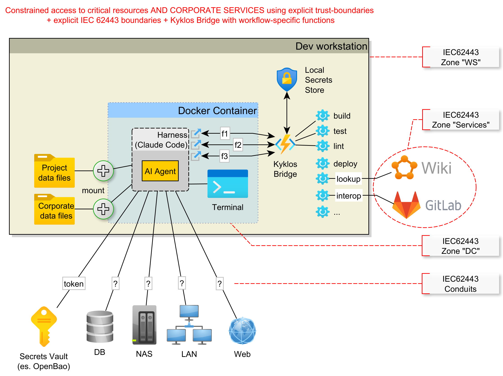
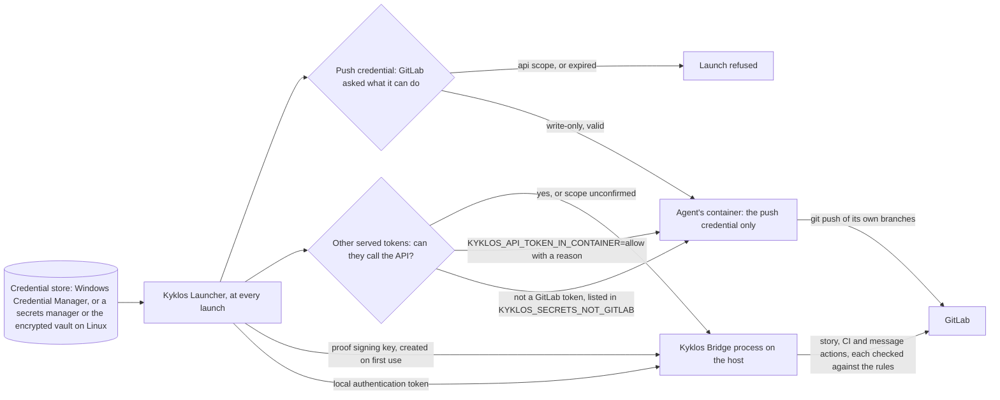

# Secrets: the agent uses them without knowing them

[← Back to the README](../README.md)

Both the [`Kyklos Launcher`](COMPONENTS.md#kyklos-launcher) and the [`Kyklos Bridge`](COMPONENTS.md#kyklos-bridge) (see [the components](COMPONENTS.md)) integrate with the [**Windows Credential Manager**](https://support.microsoft.com/windows/accessing-credential-manager-1b5c916a-6a16-889f-8581-fc16e8165ac0) to read and write secrets. A launch configuration names the secrets a project needs; the values
stay in the credential store. The agent reaches the outside world (the issue tracker, CI, a package registry) **through the Bridge**, which reads the secret at the moment it is needed and uses it on
the agent's behalf, so the agent never has to know a secret in advance, and never sees most of them at all.

The way the agent reaches secrets through the `Kyklos Bridge` is modelled on the [IEC 62443](https://www.isa.org/standards-and-publications/isa-standards/isa-iec-62443-series-of-standards) principles of "Zones" and "Conduits":

The agent is assumed to be a valid user inside the project it works on, but some operations cross project or infrastructure boundaries that the agent's own identity cannot easily be configured for. For those, the `Kyklos Launcher` hands the agent specific, purpose-built tokens (for example to push to Git, or to read and interact with CI) instead of broad permissions that would reach into other security boundaries. This is the [Principle of Least Privilege](https://en.wikipedia.org/wiki/Principle_of_least_privilege).

The credentials are deliberately **split by purpose**:

- **The Git push credential** lets the container push branches, and nothing else (see [Git](GIT.md)). The Launcher asks GitLab what each credential can do before every launch, and **refuses to start** a project whose
  dedicated push credential could also call the API.
- **GitLab API tokens stay on the host.** A token that can call the GitLab API is never forwarded into the agent's container: the Bridge keeps it and uses it for the story, CI and messaging actions it
  performs, each one checked against the rules first. So the agent cannot use a token of its own to edit a label, close a story, merge a request or skip a check behind the workflow's back.
- **The [proof signing key](PROOF_DIMENSION_TEST_DISCIPLINE.md#signatures-the-key-and-when-they-are-checked)** (see the [Proof Table](PROOF.md)) is created on first use, stored in the Credential Manager and handed only to the Bridge process. It never reaches the container, nor the builds and
  tests the Bridge runs: they start with a clean environment.
- **Secrets on demand.** When the agent needs a secret for its own work (for example a token for a third-party service named in the project's settings), it asks the Bridge, which returns the
  current value without ever saying where it is stored; a value changed in the credential store is picked up without restarting the container.

## How the secrets travel, and where they are checked

- **Where the values live.** Only in the credential store. A launch configuration and the [Bridge](COMPONENTS.md#kyklos-bridge) settings name a secret (for example `KYKLOS_PUSH_TOKEN_ENV` names the push credential),
  never hold it. The value is read at launch, used, and never written to a file, a log or a message.
- **When it is checked.** At every launch, before anything starts. For each GitLab token the [`Kyklos Launcher`](COMPONENTS.md#kyklos-launcher) asks GitLab what the token can do. A dedicated push credential with the `api` scope,
  or an expired one, stops the launch with the reason; a token about to expire gives a warning. A served token that can call the API, or whose scope GitLab does not confirm, is kept on the host
  for the Bridge; a served secret the launcher cannot classify as "not a GitLab token" stops the launch. The rules live in the launcher's `PushCredentialPolicy` and
  `ContainerApiTokenPolicy` (under `launcher/src/KyklosLauncher/`).
- **The [proof signing key](PROOF_DIMENSION_TEST_DISCIPLINE.md#signatures-the-key-and-when-they-are-checked).** `KYKLOS_PROOF_HMAC_KEY` signs every proof and [review token](ADVERSARIAL_REVIEW.md#how-the-review-token-is-made-and-checked) with HMAC-SHA256 (see [The Proof Table](PROOF.md)). It is created on first use, stored in the credential
  store, and set only in the Bridge process's environment; the builds and tests the Bridge runs start with a clean environment, so the code under test cannot read it. When the credential store
  cannot keep the key, the Bridge refuses to start, unless the person sets [`KYKLOS_ALLOW_UNPERSISTED_HMAC`](WORKFLOW.md#launcher-opt-outs), which runs it with a temporary key whose tokens do not survive a restart.
- **The Bridge's own authentication.** Every Bridge verb that acts is protected by a local token, `KYKLOS_BRIDGE_AUTH_TOKEN`, which the launcher stores in the credential store and gives to the
  Bridge and to the session's MCP settings; a missing one refuses the start (`KYKLOS_BRIDGE_REQUIRE_AUTH`, on by default).
- **What a failed check causes.** A refused launch starts nothing: no container, no Bridge, and the message names the token and what to fix (usually: create a new token with only
  `write_repository`, and store it under the same name). Nothing reaches the agent until the launch passes.
- **Impact on the user.** Creating and storing tokens is the person's job, once, and again when a token expires. The two opt-outs, `KYKLOS_API_TOKEN_IN_CONTAINER=allow|<reason>` and
  `KYKLOS_ALLOW_UNPERSISTED_HMAC`, are the person's decision and are shown at launch (see [Overrides](WORKFLOW.md#launcher-opt-outs)).

## Related pages

[The three components](COMPONENTS.md), [Installing and configuring Kyklos](INSTALL_AND_CONFIG.md), [Git: branching and authorisation](GIT.md), [CI](CI.md), and [the README](../README.md) for the full list.
