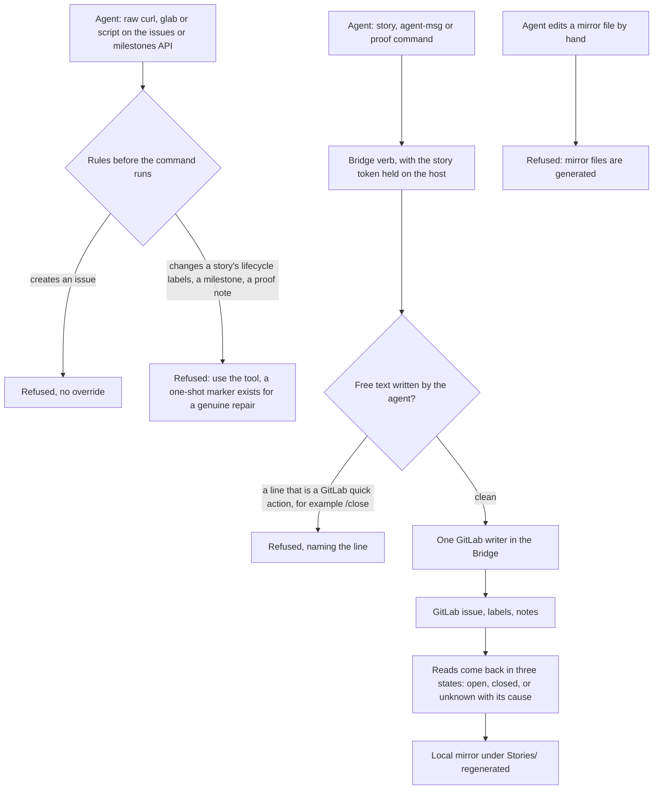

# Where stories and epics live: storages

[← Back to the README](../README.md)

The story stack of the [`Kyklos Bridge`](COMPONENTS.md) supports more than one **storage**. Whichever is configured is the **single source of truth (SSoT)** for the project: the agent's local copies are only
projections of it, regenerated from it, never edited by hand.

## GitLab storage (the SSoT for team projects)

A story is a [GitLab](https://about.gitlab.com/) [**issue**](https://docs.gitlab.com/ee/user/project/issues/), and an **[epic](AGILE.md)** is a GitLab [**milestone**](https://docs.gitlab.com/ee/user/project/milestones/). Milestones are used instead of native epics because Kyklos aims to run a full-fledged Agile SSDLC workflow even in personal and non-enterprise environments, including GitLab Community Edition, where Agile constructs such as epics do not exist and must be mapped to milestones. The agent's behaviour and the story's lifecycle are driven by [**scoped labels**](https://docs.gitlab.com/ee/user/project/labels.html#scoped-labels), which only the story tool (a tool of the [Bridge](COMPONENTS.md#kyklos-bridge)) may change (a hand edit
of a status or phase label is refused, because each scope must hold exactly one value):

| Label           | Values                                                                                  | What it drives                                                                                                               |
|---------------|---------------------------------------------------------------------------------------|----------------------------------------------------------------------------------------------------------------------------|
| `story`         | –                                                                                       | marks the issue as part of the SSDLC lifecycle (an issue without it is outside every story gate)                             |
| `kind::`        | `development`, `analysis`, `documentation`, `ops`                                       | which Proof Table rows the story must prove (see the [Proof Table](PROOF.md))                                                |
| `type::`        | for example `feat`, `fix`, `ci`, `docs`                                                 | what kind of change it is (informational only: it does not steer the workflow)                                               |
| `severity::`    | `critical`, `high`, `medium`, `low`                                                     | the order in which work is taken; a story cannot be created without one                                                      |
| `status::`      | `todo`, `doing`, `blocked-on-issue`, `blocked-on-user`, `blocked-on-external`, `parked` | whether the story is started, waiting (and on what), or set aside                                                            |
| `ssdlc:phase::` | `Requirements`, `Design`, `Implementation`, `Testing`, `Deployment`, `Review`           | where the story is in the SSDLC; moving backwards needs a recorded reason, and a story nobody has started cannot pass Design |

Phases advance on their own, by the Kyklos workflow rules, at lifecycle events: a commit on the story's branch moves the story to Implementation, a push to Testing, the close to Review. The story's specification lives in the issue
description; proofs, reviews, [coverage receipts](PROOF_DIMENSION_TEST_DISCIPLINE.md#shell-scripts-the-token-and-the-coverage-receipt) and the [risk register](PROOF_DIMENSION_RISK_ASSESSMENT.md) are posted as marked notes on the issue, where people can read them.

### Adoption of existing issues

Only issues carrying the `story` label are treated as SSDLC stories. When Kyklos finds one while looking for work, it *adopts* it: among other operations, it formats the content with the story templates and expectations of Kyklos, and ensures that a `kind::` label exists, assuming `development` when there is none.

An issue without the `story` label is not adopted: it is not treated as a story, it is not expected to have a `kind::` label, and Kyklos ignores it, unless a person triggers its adoption explicitly with the corresponding [skill](HOOKS_AND_SKILLS.md#how-the-agent-knows-what-to-do-skills) or by asking the agent.

### How writes to the GitLab storage are checked



- **One writer.** Every write to GitLab goes through one place in the [Bridge](COMPONENTS.md#kyklos-bridge), with typed operations, so a label, a state or a note is always written the same way. The agent's container has no
  token that can call the GitLab API.
- **Free text is checked per poster.** GitLab runs *quick actions*: a line that starts with `/` and a letter (for example `/close` or `/label`), outside a fenced code block, changes the issue when
  the note is posted. Text the agent wrote (a message, a reply, a review report, a block reason, a story description) is refused when such a line is in it, naming the line, so the agent rewrites
  it. Text the Bridge builds itself (receipts, proofs, signed records) is composed so that no line can start that way.
- **Three-state reads.** A fact the Bridge reads (an issue's state, a story's status, a blocker) is open, closed, or **unknown**, with the field or the error that made it unknown; an unknown
  fact is never read as "closed" or "done", and the gate that needs it refuses.
- **The mirror.** The files under `Stories/` are projections, regenerated from GitLab; a hand edit is refused, and a backlog that disagrees with the stories stops the agent's turn.
- **Impact on the user.** None: these refusals send the agent to the right tool. A genuine repair of a mirror file or a milestone uses the [one-shot markers](WORKFLOW.md#one-shot-override-markers) listed in
  [Overrides](WORKFLOW.md#one-shot-override-markers).

## File-system storage (for standalone and offline use)

Each story is a folder; its `requirements.md` starts with a **header** that plays the role of the labels: the story tool reads and writes it, and the guards act on it.

| Header field | What it regulates                                                                                                                                                          |
|------------|--------------------------------------------------------------------------------------------------------------------------------------------------------------------------|
| `Status`     | the lifecycle state (`Todo`, `In-progress`, `Blocked`, `Parked`, `Done`): a story that is not started cannot leave Design, and a blocked story is not offered as next work |
| `Story-Type` | a descriptive hint about the deliverable (library, service, CI, infrastructure, plugin, documentation, test); like [`type::`](#gitlab-storage-the-ssot-for-team-projects) on GitLab, it does not steer the workflow      |
| `Epic`       | the [epic](AGILE.md) the story belongs to; it groups the story in `BACKLOG.md`                                                                                             |
| `Branch`     | the story's own branch; the guards use it to tie commits, pushes and the close to the story                                                                                |
| `Summary`    | the one-line description shown in the backlog                                                                                                                              |

The two storages share one lifecycle, spelled differently: `todo` is `Todo`, `doing` is `In-progress`, any `blocked-on-*` is `Blocked`, `parked` is `Parked`, and a closed issue is `Done`.

The story tool is the only writer of this header: a hand edit of the backlog that disagrees with the stories is caught and refused when the agent tries to end its turn.

```markdown
# STORY-<id>-<slug>: Retry Export: the export retries a failed upload three times

- **Status:** In-progress
- **Story-Type:** service
- **Epic:** E03
- **Branch:** feature/story-<id>-retry-export
- **Summary:** Retry Export: the export retries a failed upload three times

## User story

As **an operator**, I want **a failed upload to be retried**, so that **a short network outage does not lose an export**.

## Requirements

- **R1** — A failed upload is retried up to three times, waiting 1, 2 and 4 seconds.

## Use cases to test

- **UC1** — The second attempt succeeds: one export, two attempts logged.

## Failure modes handled

- **FM1** — Every attempt fails: the export stops with the last error and writes nothing partial.

## Fail-open vs fail-hard

- FM1 fails hard: a partial export is worse than none.

## Poka-yoke

- The retry count is a named setting with a validated range; a value outside it stops the start-up.

## Acceptance criteria

- **AC1** — Given a server that fails once, when the export runs, then it succeeds on the second attempt.
```

Epics and the backlog are tracked as files beside the stories. `BACKLOG.md` is generated from the story folders (one row per story, the active one marked), so it can never drift from them:

```
Stories/
├── BACKLOG.md                      generated index: one row per story, per epic
├── _epics/
│   ├── E01-onboarding.md           an epic: title + "Goal:" line
│   └── E03-reliable-export.md
├── _TEMPLATE/                      the template every new story is created from
├── STORY-<id>-clean-logs/
│   ├── requirements.md             header + specification (the story's source of truth)
│   ├── tasks.md                    checklist and verification block
│   └── risk-assessment.md          the numbered risk register (RA-01, RA-02, …)
└── STORY-<id>-retry-export/
    └── …
```

Every story, in either storage (see also [Project topologies](TOPOLOGIES.md)), must contain seven items before it can progress: requirements, use cases to test, failure modes, fail-open versus fail-hard decisions, [poka-yoke](PROOF_DIMENSION_POKA_YOKE.md), acceptance criteria
(Given/When/Then) and a risk assessment. A tool checks them mechanically.
