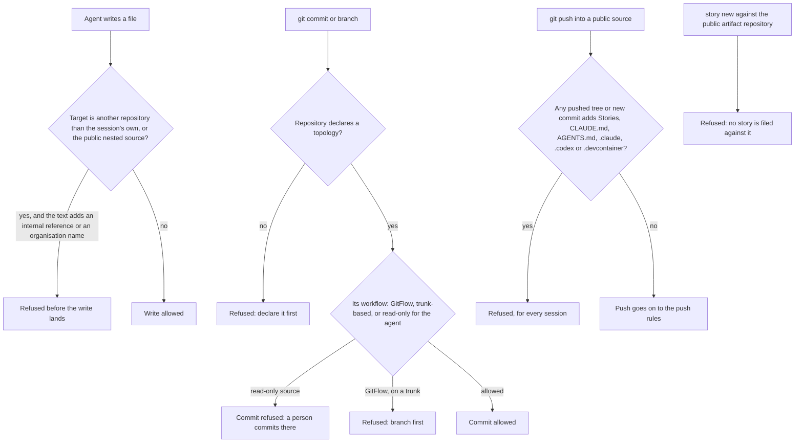

# Project topologies

[← Back to the README](../README.md)

A project declares **one** topology, once, with the `kyklos:ssdlc-repo-model` [skill](HOOKS_AND_SKILLS.md#how-the-agent-knows-what-to-do-skills), and every guard derives its behaviour (which repository is the source, which workflow applies, where stories may be created) from it:

| Topology                                | Purpose                                                                                                                                                 | Advantages                                                                                                          | Disadvantages                                                                                                                                                                          |
|---------------------------------------|-------------------------------------------------------------------------------------------------------------------------------------------------------|-------------------------------------------------------------------------------------------------------------------|--------------------------------------------------------------------------------------------------------------------------------------------------------------------------------------|
| **[Private Standalone](#private-standalone)**                  | one private repository holds everything: source, agent tooling, backlog                                                                                 | simplest set-up; one place to look                                                                                  | the repository can never be made public, because it contains the agent's tooling and history                                                                                           |
| **[Private Companion + Public Sources](#private-companion--public-sources)**  | a private *companion* repository holds the agent tooling, backlog and pipeline; the public source is cloned **nested** inside it, as its own repository | the public source stays free of any AI or agent artifact, by construction; the tooling and its history stay private | two repositories to keep in step; two workflows (the companion is trunk-based, the source uses [GitFlow](https://nvie.com/posts/a-successful-git-branching-model/); see [Git](GIT.md)) |
| **[Private Companion + Private Sources](#private-companion--private-sources)** | as above, but the nested sources are private and may be several (for example a customer's repositories)                                                 | the same separation, for code that is not published; several source repositories under one backlog                  | the same two-repository overhead                                                                                                                                                       |
| **[Private Sources + Public Artifacts](#private-sources--public-artifacts)**  | the source is private; only build artifacts (a package, a plugin catalogue) are published to a separate public repository that is never cloned          | no source exposure at all; the public side only ever receives built, checked output                                 | the public repository carries no history to inspect; a story can never be filed against it (the guards refuse)                                                                         |

In every topology, a public source repository must contain **zero** AI or agent artifacts: no agent instructions, settings, backlog or agent-facing documents. A push into a public source is
refused when anything it sends carries one.

In the companion topologies the story's change lives in the nested source, so the close checks the **source** repository: the deliverable must be merged on the source's trunk on the remote, and
no commit naming the story may be left in the source checkout. When the agent may not push the source (the source is declared read-only for the agent, or its push credential does not reach it), a
person pushes it, and the story cannot close before that push. See [The Kyklos Workflow](WORKFLOW.md).

## How the topology is enforced

The topology is declared once, in the project's [`.claude/standards.env`](WORKFLOW.md#greppable-opt-out-switches) (written by the [`kyklos:ssdlc-repo-model`](HOOKS_AND_SKILLS.md#how-the-agent-knows-what-to-do-skills) skill). Every rule reads it from the repository a command acts on.



- **What is read.** The topology and workflow keys of the repository's own `.claude/standards.env` (in a companion, the nested source's keys live in the companion's file), the git facts of the
  target repository, and, for a push, every tree and commit it sends that the remote does not have yet: a file added in one commit and removed in a later one is still refused, because the history
  would publish it.
- **When.** Before each write, commit or push. Nothing reaches the public remote before these checks pass.
- **What a failure causes.** The write, commit or push does not happen; the agent removes the artifact (from the history too), or moves the work to the right repository.
- **Impact on the user.** None in normal work. Pushing a public source the agent may not push stays the person's job (see [Scenario 4 of the workflow](WORKFLOW_SCENARIO_4.md)). A project whose public
  source must carry its own product names lists them in the [launcher](COMPONENTS.md#kyklos-launcher) setting [`KYKLOS_OWN_NAMES`](WORKFLOW.md#launcher-opt-outs); the opt-out switches are listed in [Overrides](WORKFLOW.md#greppable-opt-out-switches).

## Private Standalone
Everything is in one private repository.

```
my-tool/                          the only repository (private, GitFlow)
├── .claude/                      agent settings, including the declared topology
├── CLAUDE.md                     agent instructions and the index of the documents
├── Stories/                      the backlog (file storage), or a mirror of GitLab
├── docs/
├── src/
└── tests/
```

## Private Companion + Public Sources
The agent works in the "companion"; the public source is a separate repository, cloned inside it.

```
my-library-companion/             private companion repository (trunk-based)
├── .claude/                      agent settings, including the declared topology
├── CLAUDE.md
├── Stories/                      the backlog
├── docs/                         internal documents
├── .gitignore                    lists /Repo/, so the source is never committed here
└── Repo/                         the PUBLIC source: its own Git repository (GitFlow)
    ├── src/
    ├── tests/
    └── README.md                 no agent files at all, by construction
```

## Private Companion + Private Sources
The same "companion", with one or more private source repositories inside it.

```
customer-companion/               private companion repository (trunk-based)
├── .claude/
├── CLAUDE.md
├── Stories/
└── Repo/
    ├── service-a/                private source repository (GitFlow)
    └── service-b/                private source repository (GitFlow)
```

## Private Sources + Public Artifacts
The source stays private.  
A pipeline publishes only built output to a public repository that nobody clones.

```
my-plugin/                        private source repository (GitFlow)
├── .claude/
├── CLAUDE.md
├── Stories/
├── src/
└── .gitlab-ci.yml                builds, checks and publishes the artifact
        │
        ▼  published by CI only
my-plugin-public/                 public repository: built artifacts only, never cloned, no stories filed against it
```

## Related pages

[Git: branching and authorisation](GIT.md), [Storages](STORAGES.md), [Installing and configuring Kyklos](INSTALL_AND_CONFIG.md), and [the README](../README.md) for the full list.
