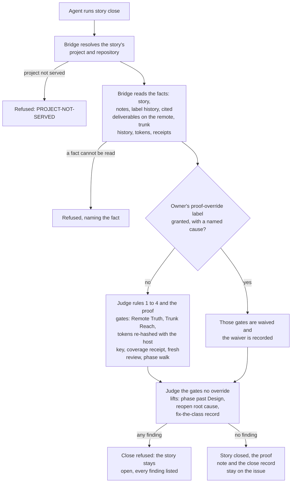
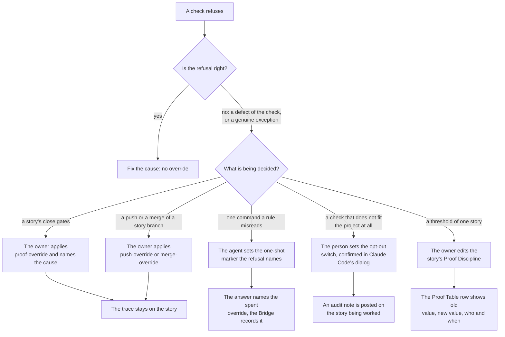
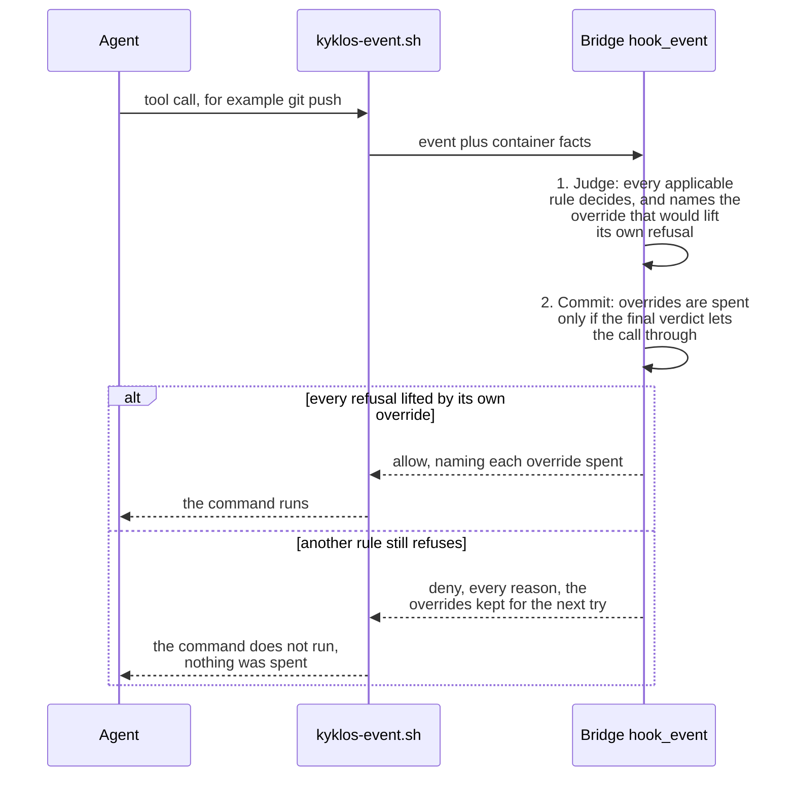

# The complete Kyklos (Agile SSDLC-based) workflow

[← Back to the README](../README.md)

From an idea to a merged, proven change, every step below is either done by a tool or checked by one.

> **[✨ Start]** → (1) Requirements & (2) Design → (3) Implementation → (4) Testing → (5) Deployment & (6) Review → **[🎉 Close]**


**Kyklos behaviour and underlying rules change to fit the needs of the story kind, the project topolology, and many other parameters**.

While the phases *(1) Requirements*, *(2) Design* and *(3) Implementation* are almost identical for all scenarios, the phases *(4) Testing*, *(5) Deployment* and *(6) Review* are handled differently to
guarantee the maximum level of trust in the final result for that specific scenario.

> In the charts below, you will realize how in *Kyklos* the workflow is more focused on the **Quality Assurance** area.  
> The *(4) Testing*, *(5) Deployment* and *(6) Review* phases are more decision-driven and contain many more steps than *(1) Requirements*, *(2) Design* and *(3) Implementation*.  
> **This is by design, and it's exactly what an Agile SSDLC workflow entails.**

**Languages.** The workflow itself (stories, phases, branches, merge requests, reviews, the close) works for a project in any programming language. The checks that measure code do not: the host builds and test runs, line coverage, the CRAP score and mutation testing are complete for C# on .NET (NUnit, xUnit or MSTest; coverlet; Stryker.NET), line coverage also covers bash scripts (bashcov), and code in other languages is not measured. Stories and the Proof Table use fixed English headings and words, and the agent's instructions and every message are in English. See [Supported languages and tools](SUPPORT_MATRIX.md).

## Glossary

Before we start, let's clarify some terms used in the diagrams below:

- [**Code coverage**](https://en.wikipedia.org/wiki/Code_coverage) counts which lines the tests executed. Kyklos judges the lines the story itself changed, measured on the real host, and also refuses
  a change that lowers the coverage of a file it
  touches. Coverage is treated as a floor; whether the tests can actually fail is checked separately.
- [**CRAP score**](https://testing.googleblog.com/2011/02/this-code-is-crap.html) (Change Risk Anti-Patterns) combines a method's complexity with how well it is tested:
  `CRAP = complexity² × (1 − coverage)³ + complexity`, with coverage expressed as a fraction between 0 and 1. A simple, well-tested method scores low; a
  complex, untested one scores very high. Any method above the project's ceiling (for example 35) fails the gate, so complex code has to be either simplified or tested.
- [**Mutation testing**](https://en.wikipedia.org/wiki/Mutation_testing) deliberately introduces small faults into the code (flip a comparison, drop a line) and checks that at least one test fails for
  each. It measures whether the tests really check
  behaviour, not just run it. Because it is expensive, Kyklos requires it only for changes to security-sensitive code (code annotated as a security control), once per story before the merge; a
  project's policy can suspend it.
- **Risk assessment**: each story keeps a numbered [risk register](PROOF_DIMENSION_RISK_ASSESSMENT.md) (see [Storages](STORAGES.md)), judged against the regulations the project declared (for
  example [IEC 62443-4-1](https://www.isa.org/standards-and-publications/isa-standards/isa-iec-62443-series-of-standards) secure development
  practice, [NIS2](https://eur-lex.europa.eu/eli/dir/2022/2555/oj) risk management, the
  [EU Cyber Resilience Act](https://eur-lex.europa.eu/eli/reg/2024/2847/oj)). Each mitigating piece of code carries a marker naming its risk item, and security controls are annotated with a formal
  reference ([CWE](https://cwe.mitre.org/), [OWASP Top 10](https://owasp.org/www-project-top-ten/), IEC 62443, [CAPEC](https://capec.mitre.org/)), so
  the control inventory can be listed with a single search.
- **Commits and merge requests**: all the work of a story happens on its own `feature/story-<id>-<slug>` branch, in commits that follow [Conventional Commits](https://www.conventionalcommits.org/) and
  name the story. The trunk is never
  edited directly: the branch is pushed with a merge request that is created already *armed* (set to merge automatically as soon as the pipeline is green), and CI merges it into the trunk only when the pipeline is green. Arming is refused unless the branch
  already contains the trunk's current head (or the trunk's new commits touch none of the branch's files), so what the pipeline tested is what lands. A repository with no pipeline merges the
  request through the [Bridge](COMPONENTS.md#kyklos-bridge) once it is mergeable; a project where the agent may not push has a person push it (see the diagrams below).
- **Documentation generation**: before the review, a documentation pass finds every document the change affects (README, user manual, API and configuration references) and brings it up to date; a
  lint then checks that each document suits its audience, so a public document never carries internal details.
- **[Adversarial review](ADVERSARIAL_REVIEW.md)**: a fresh reviewer, preferably on a different model, tries to break the change. Findings send the work back to development; the loop runs at most **3 rounds** (see [Adversarial
  reviews](ADVERSARIAL_REVIEW.md)). For code that coverage measures, the review on record must be newer than the last change of that code the remote received, so it runs on the pushed change.
- **Proof generation**: at the end, the [Bridge](COMPONENTS.md) assembles the story's [*Proof Table*](PROOF.md) from the evidence it holds (receipts, tool tokens, the [review token](ADVERSARIAL_REVIEW.md#how-the-review-token-is-made-and-checked), the pipeline) and
  leaves only the judgement
  rows to the agent; the close verifies every token before the story can be closed. The proof is drafted from the **remote, merged** state: the deliverable must be merged into the trunk on the
  remote, every commit naming the story must be on the trunk, and the tokens are judged on the merged result (see the diagrams below).
- **Legal frameworks**: the risk assessment and the security annotations are judged against the frameworks the project declares. Kyklos supports [**IEC
  62443-4-1**](https://www.isa.org/standards-and-publications/isa-standards/isa-iec-62443-series-of-standards) (secure product development
  lifecycle), the [**NIS2 Directive**](https://eur-lex.europa.eu/eli/dir/2022/2555/oj) (cybersecurity risk management and incident handling) and the [**EU Cyber Resilience
  Act**](https://eur-lex.europa.eu/eli/reg/2024/2847/oj) (security requirements for products with digital elements), with controls
  referenced to [**CWE**](https://cwe.mitre.org/), [**OWASP Top 10**](https://owasp.org/www-project-top-ten/), **IEC 62443** and [**CAPEC**](https://capec.mitre.org/).

# Agile story SSDLC workflow

A story is not done when its code works on the agent's machine, and not even when its branch is pushed.  
In *Kyklos* a story closes only when its change is **merged into the trunk on the remote** (the shared Git server, for example [GitLab](https://about.gitlab.com/)), and the evidence for the close is
taken from that merged state.  
This page explains the rules the close applies, which rows of the [Proof Table](PROOF.md) depend on them, and how the flow works in each kind of project.

## The cardinal rules the workflow applies

The workflow is enforced by [hooks](HOOKS_AND_SKILLS.md#how-a-hook-decides-one-hook-per-event-every-rule-in-the-bridge), [skills](HOOKS_AND_SKILLS.md#how-the-agent-knows-what-to-do-skills) and driven through the [`Kyklos Bridge`](COMPONENTS.md), which **checks every rule below mechanically**. A fact the Bridge cannot read (the remote does not answer, a history cannot be read)
refuses the close: it is never read as "fine". The only way past rules 1 to 4 (below) is an [*override label*](#the-owners-proof-override-label) that a **person** applies on the story (see [Overrides](#overrides) for every kind of override), and that override is recorded; the conditions
listed under *Other close conditions* cannot be overridden at all.

### Rule 1: The deliverable is on the remote, and merged

The workflow names the story's **deliverable**: the merge request, the commit or the branch that carries the change. It may live in the story's own project or in another one (written
`group/project!<number>` for a merge request, `group/project@<commit>` for a commit). Every item named must be **merged into a trunk on the remote**:

- a commit that exists only in a local checkout is refused ("push it");
- a branch or commit that is pushed but whose merge request has not merged yet is refused ("wait until it merges");
- a merge request that is still open is refused, and when it is stuck the refusal says why.

Being pushed is not enough: a story closed while its merge request was still open would record "done" for work that never shipped.

### Rule 2: No commit of the story is left behind

Every commit whose message names the story in its `Refs:` line must be reachable from the trunk: `develop` or `main` in a [GitFlow](https://nvie.com/posts/a-successful-git-branching-model/)
repository (a hotfix lands on `main` first), `main` in a [trunk-based](https://trunkbaseddevelopment.com/) one. The check fetches from the remote first, then looks at every local branch, every remote
branch and every worktree, and in a companion topology (see [Project topologies](TOPOLOGIES.md)) it checks the nested source repository too.  
A change that reached the trunk through a rebase, a cherry-pick or a squash merge counts as reached. A commit that was abandoned on purpose is settled by deleting its branch.

This catches the fix that was committed, named after the story, and then forgotten on a branch nobody merged.

### Rule 3: The evidence describes the merged result

What the close certifies is the **trunk with the story merged**, not the story branch on its own:

- **[Test Discipline](PROOF_DIMENSION_TEST_DISCIPLINE.md)** is judged where the story landed on the trunk. A coverage token measured on the story branch still holds after the merge, as long as no conflict resolution and no later
  commit (another story's merge included) changed a line it measured; otherwise the coverage must be measured again on the trunk.
- **The tool tokens** (Test Discipline, [Non-Duplication](PROOF_DIMENSION_NON_DUPLICATION.md), [Documentation](PROOF_DIMENSION_DOCUMENTATION.md)) are judged over the files the cited deliverable changes, as the remote reports them, and are checked against the host's copy
  of the project at the moment of the close. That copy must hold the story's files as merged (for example, the trunk after the merge): a copy on another commit makes the tokens stale, and the
  close waits until it is put back.
- When another story changed the same files in the meantime, the merge is reviewed for the interaction (both behaviours kept, no conflict hidden by a clean textual merge) and the test suites of
  both stories run on the combined result.

### Rule 4: The review saw the finished code

For a development story whose change touches code that the coverage run measures, the [adversarial review](ADVERSARIAL_REVIEW.md) on record must be **newer than the moment the remote received the
last change to that code**. That moment is taken from the merge request that carried the commit, a time the server records and the author cannot set.

Two consequences:

- a fix pushed after the review needs a new review before the close;
- such code must reach the trunk **through a merge request**: a code commit that arrived on the trunk without one has no recorded arrival time, and the close refuses it.

### Rule 5: A merge request merges itself, and only on the merged result

Where the repository has a pipeline, the agent never merges by hand:

- the merge request is created **armed** ("merge when the pipeline succeeds"), and the server merges it once the pipeline is green; a hand merge of an armed, merged or closed request is refused;
- arming is refused unless the branch already contains the trunk's current head, or the trunk's new commits touch none of the branch's files and no build-wide file (the CI definition, build and
  package configuration, project and solution files, tool versions) changed on either side. A merge request pipeline tests the branch, not the branch merged into today's trunk, so this rule makes
  sure that what the pipeline tested is what lands;
- arming is also refused when the change touches production C# code that no fresh [Test Discipline](PROOF_DIMENSION_TEST_DISCIPLINE.md) token covers. When arming is refused for one of these reasons, the merge request is created
  unarmed, and the agent arms it once the reason is fixed.

### Other story close conditions

The story close also refuses a story that never left the Requirements or Design phase, a reopened story with no note explaining why the earlier proof passed, and a fix story that does not record the
rule it violated and where else the same mistake was looked for.

### How the close checks the rules

The agent closes a story with the story tool (`story close <id>`), which hands the request to the [Bridge](COMPONENTS.md)'s close verb. The Bridge gathers every fact first, then judges every gate, and answers with one list of findings: an empty list is the only green light.



- **Where the facts come from.** The deliverable, its merge request, its pipeline and the story's notes and label history are read from the tracker (for example GitLab) with the story token the Bridge holds on the host (see [Secrets](SECRETS.md)); the agent's container never holds that token. The trunk history is read from the repository after a `git fetch` (a failed fetch refuses). The tool tokens are re-computed from the files in the host's copy of the project.
- **How the tokens are checked.** Every token is an HMAC-SHA256 (a keyed hash) of a text the Bridge builds: for the file tokens, the sorted list of `path:hash` lines of the files the token covers; for the [review token](ADVERSARIAL_REVIEW.md#how-the-review-token-is-made-and-checked), `advreview:<story>:<hash of the report>`. The key, [`KYKLOS_PROOF_HMAC_KEY`](PROOF_DIMENSION_TEST_DISCIPLINE.md#signatures-the-key-and-when-they-are-checked), lives in the operating system's credential store and reaches only the Bridge process, so a token cannot be made by hand. At the close the Bridge re-computes each token over the current files and compares the two in constant time. The computation lives in `bridge/src/DogmaSolutions.ProjectManagement.Agile.Ssdlc/ProofTokenBinding.cs`; the close decision in `StoryCloseEvaluator.cs` beside it.
- **What a failure causes.** A refused close changes nothing: the story stays open in its phase, the refusal names every finding, and the [Stop rules](HOOKS_AND_SKILLS.md#forced-productivity) keep the agent working on it (an open story is open work). A token that no longer matches (a file changed after it was measured) needs a new measurement; a deliverable not yet merged needs the merge; a missing review needs a review.
- **What the user does.** Usually nothing: the agent fixes what the findings name. A person is needed only for a genuine exception, through the owner's [override label](#the-owners-proof-override-label), never through a switch the agent sets.

The repository the rules judge is always the **item's own** repository: the Bridge maps the repository's origin address to one of the projects it serves (a renamed project's old address is accepted with a warning that names the command to repoint it). A command run in a repository the Bridge does not serve (a scratch clone, another team's repository) is **not judgeable**: the story rules are skipped for it with a named notice ("not judgeable here: story rules not checked"), recorded in the audit log, and never reported as passed.

## Which Proof Table rows depend on the remote

The [Bridge](COMPONENTS.md#kyklos-bridge) drafts part of the [Proof Table](PROOF.md) itself, from the evidence it holds ([`proof_draft`](PROOF_DIMENSION_COMPLETENESS.md#how-it-is-checked)). Four of the drafted rows read the cited deliverable **on the remote**, so they cannot be
proven while the change exists only on the agent's machine:

| Row                                                         | What it needs from the remote                                                                                                                                               |
|-------------------------------------------------------------|-----------------------------------------------------------------------------------------------------------------------------------------------------------------------------|
| [**Completeness**](PROOF_DIMENSION_COMPLETENESS.md)         | the cited deliverable is on the remote; when it has a pipeline, that pipeline is green; the tests (or the review) name every item of the specification                      |
| [**Test Discipline**](PROOF_DIMENSION_TEST_DISCIPLINE.md)   | the files the deliverable changes, read from the remote; the Test Discipline token and the attached [coverage receipt](PROOF_DIMENSION_TEST_DISCIPLINE.md#shell-scripts-the-token-and-the-coverage-receipt) over those files; judged at the merged result (rule 3) |
| [**Non-Duplication**](PROOF_DIMENSION_NON_DUPLICATION.md)   | the Non-Duplication token over the files the deliverable changes, and the attached duplication report                                                                       |
| [**Documentation**](PROOF_DIMENSION_DOCUMENTATION.md)       | the changed documents, linked at the deliverable's commit on the remote; the Documentation token when source code changed too                                               |

The [**Adversarial Review**](PROOF_DIMENSION_ADVERSARIAL_REVIEW.md) row depends on the remote too, through rule 4. The other rows are judgements the agent writes with its evidence; the close still applies rules 1 to 5 to the whole story.

A row the Bridge cannot prove stays open, with the reason: for example *"no cited deliverable is on the remote"*. So an agent that says "these rows can only be proven once the code is on the
remote" is right.

## Overrides

Every check in Kyklos is **on by default**, and a check that cannot run refuses instead of passing. That is what makes the evidence trustworthy, but real projects meet real exceptions: a
release merge that must touch a trunk, a coverage tool that cannot measure one line, a repository with no issue tracker. For those moments Kyklos offers **overrides**. Each kind is built
around the same three promises:

- **Someone accountable decides.** The strongest overrides can only be granted by a person (the project's owner), through an act the agent cannot imitate. The weaker ones can be set by the agent, but only for one command, and the use is recorded.
- **It is visible.** Every override names itself in the answer that it lifted, and leaves a trace that can be listed later.
- **It is bounded.** It lifts one named check, for one story, one command or one project, and never the checks that protect against losing work or leaking secrets.

This section lists **every** kind of override the product offers, from the strongest to the weakest. The table is the summary; each kind is explained below with its use case and an example.

| Kind | What it lifts | Who may grant it | How | How long it lasts | How it is audited |
|---|---|---|---|---|---|
| [Owner's `proof-override` label](#the-owners-proof-override-label) | most close gates of one story | a person other than the closing agent | a label on the story, plus an `Override cause:` line | while the label stays on the story | the tracker's label history, the cause line, `override_audit` |
| [`push-override` and `merge-override` labels](#the-push-override-and-merge-override-labels) | the push rule, or the merge-on-green rule, for one story's branch | a person other than the agent | a label on the story | while the label stays on the story | the tracker's label history; the answer names it |
| [`proof-grandfather` label](#the-proof-grandfather-label) | the format rules of a migrated, historical close | a person other than the agent | a label on the story | permanent for that story | the tracker's label history |
| [The owner's tick on a tool-limit note](#the-owners-tick-on-a-tool-limit-note) | the [Test Discipline](PROOF_DIMENSION_TEST_DISCIPLINE.md) evidence of one story, when the host cannot measure the trunk base | an owner account | ticking the note's accept box | while the story's files stay as measured | the note, its edit record, the named cause |
| [One-shot override markers](#one-shot-override-markers) | one refusal of one rule, for one command | the agent itself | `override-marker.sh set <name> <scope>` | one use, at most 10 minutes | the answer that spent it, the [Bridge](COMPONENTS.md#kyklos-bridge)'s override record |
| [Inline escapes](#inline-escapes-for-raw-api-writes) | the raw-write rules for an existing issue or a proof note | the agent itself | `AGENT_MSG_RAW_OK=1` or `PROOF_RAW_OK=1` on the command | one command | the escape audit log |
| [Greppable opt-out switches](#greppable-opt-out-switches) | a whole check, for one project | the person (the agent only after the person confirms) | a line in `.claude/standards.env`, or the [launcher](COMPONENTS.md#kyklos-launcher) configuration | until the line is changed back | Claude Code's confirmation dialog, an audit note on the story |
| [The owner's Proof Discipline](#the-owners-proof-discipline) | a dimension or a threshold of one story | the project owner | editing the story's [Proof Discipline](PROOF.md#the-owners-proof-discipline) section | that story | the Bridge's signed copy; the row shows the change |
| [Bridge owner settings](#bridge-owner-settings) | proof rules for every story the Bridge serves | the person who owns the host | the reviewed Bridge settings file, or the launcher configuration | until changed back | the reviewed settings file's history |
| [Launcher opt-outs](#launcher-opt-outs) | a launch or Bridge start check | the person at the launcher | the launcher configuration or its `appsettings.json` | until changed back | the launch output, the Bridge or launcher log |



### How an override reaches a rule

Every rule of the plugin runs inside the [Bridge](COMPONENTS.md#kyklos-bridge). Claude Code calls **one** small [hook](HOOKS_AND_SKILLS.md#how-a-hook-decides-one-hook-per-event-every-rule-in-the-bridge) per event (before a tool call, after it, when the agent wants to stop, when a session starts, when the person
sends a prompt); that hook, `plugins/kyklos/hooks/kyklos-event.sh`, sends the event and a few facts only the container can see (the repository's branch, status and remotes, the project's
[`.claude/standards.env`](#greppable-opt-out-switches), a fixed list of switch values, never a secret) to the Bridge's `hook_event` verb, and turns the answer into Claude Code's format. The Bridge reads the command once,
with one command parser, runs every rule that applies to it, and answers with one verdict that names every refusing rule (see [Hooks and skills](HOOKS_AND_SKILLS.md)).

An override is applied in **two phases**, so it is never wasted:



If the Bridge does not answer at all (it is stopped, unreachable, too old, or answers for another project), there is no rule to override: every tool call is refused with the message
"the bridge did not answer (cause)", a Stop is let through so the session can end, and that **unjudged Stop** is recorded and reported on the next answered event, when the [Stop rules](HOOKS_AND_SKILLS.md#forced-productivity) run once
more. There is no switch that turns the hook off; the only way to run without the Bridge is to uninstall the plugin.

### The owner's `proof-override` label

**What it overrides.** The close gates of one story: the [proof table](PROOF.md#the-proof-table-1) checks (an UNPROVEN row, the metrics and spec correlation, the [review token](ADVERSARIAL_REVIEW.md#how-the-review-token-is-made-and-checked)), the specification checks, the remote rules 1 to 4
([Remote Truth](#rule-1-the-deliverable-is-on-the-remote-and-merged), [Trunk Reach](#rule-2-no-commit-of-the-story-is-left-behind), the tool tokens, the [coverage receipt](PROOF_DIMENSION_TEST_DISCIPLINE.md#shell-scripts-the-token-and-the-coverage-receipt), the fresh review) and the [phase-walk](AGILE.md#how-the-phases-are-enforced) check. It **never** lifts three gates: a story still in Requirements or Design, a
reopened story with no note explaining why the earlier proof passed, and a fix story that does not record the rule it violated and where else the mistake was looked for. The
[Adversarial Review](PROOF_DIMENSION_ADVERSARIAL_REVIEW.md) row can be waived only this way, never by the agent.

**Who may apply it.** A person. The [Bridge](COMPONENTS.md#kyklos-bridge) reads the story's label history and honours the label only when its **latest** event is an *add* by a tracker user **other than** the account
that closes the story. An agent cannot write a label event under another user's name, so it cannot grant itself the exception. The label name is fixed in the code
(`OwnerOverride.Label` in the Bridge, `plugins/kyklos/hooks/lib/owner-labels.sh` in the plugin), so it cannot be pointed at a label someone applied for another reason. Do not let a second
agent account (for example a privileged [Infrastructure session](INFRASTRUCTURE_SESSION.md)) apply it: "another user" is not the same as "a person".

**How.** Two steps, both on the story's issue:

1. apply the `proof-override` label;
2. **name the cause** of the gap (the Named Cause rule), in a note or in the [Test Discipline](PROOF_DIMENSION_TEST_DISCIPLINE.md) row, with a line that starts with `Override cause:`. Either:
   - `Override cause: <reference>`, naming the **open** story or triage item that removes the cause of the gap. It must not be the story itself, it must be a story or a triage item, it must have been created by an account other than the closing one, and it must refer back to the story in text another account wrote; or the owner writes the line in an unedited note of their own, which vouches for the item; or
   - `Override cause: accepted <figure>%`, written by one of the owner accounts ([`Agile:Acceptance:OwnerAccounts`](#bridge-owner-settings)) in a note nobody edited afterwards, when the owner accepts a genuine gap at a figure no higher than the story measured.

A label with no valid cause waives nothing, and the refusal says why ("the owner's proof-override label is on the story, but it waives nothing yet: ..."). The rule lives in
`bridge/src/DogmaSolutions.ProjectManagement.Agile.Ssdlc/OverrideCause.cs`.

**How long it lasts.** As long as the label stays on the story; the close reads it at the moment of the close. Removing the label withdraws the exception.

**How it is audited.** The tracker keeps the label event (who, when). The cause line stays in the story's notes. The Bridge verb `override_audit` lists every use of the label across
the projects it serves, each with its named cause and that cause's state; a use whose cause item was closed is marked `CAUSE-CLOSED` (check that its fix really removed the gap), and a use with
no cause `NO-CAUSE`.

**Use case.** A story changed a method on a code path that only runs on an operating system the project's CI has no runner for. The Test Discipline evidence cannot reach those lines, the
team has an open story to add that runner, and the owner decides the story should not wait for it.

**Example.** The owner writes this note on the story, then applies the label:

```markdown
Override cause: https://gitlab.example.com/acme/shop/-/issues/212 (adds the macOS runner that measures the platform-only lines)
```

The agent runs [`story close <id>`](#how-the-close-checks-the-rules), and the close passes with the waiver recorded in its answer.

**Do not use it** to skip a review that found real defects, to close a story whose change never merged, or to make a red pipeline look green. Those are the failures the gates exist to catch:
a gate's real condition is fixed, not hidden. Setting `Agile:Proof:NamedCauseRequired` to `false` in the Bridge settings drops the named-cause requirement; it is an owner opt-out for a team that
tracks its gaps elsewhere, not a convenience.

### The `push-override` and `merge-override` labels

**What they override.** `push-override` lifts the push rule for the branch of one story: the agent may push that story's branch although the session is not allowed to push. `merge-override` lifts the merge-on-green rule: a local merge of that story's `feature/*` or `hotfix/*` branch into a trunk
without a successful pipeline.

**Who may apply them.** A person, exactly as for [`proof-override`](#the-owners-proof-override-label): the latest event of the label must be an add by a user other than the agent. The story is found from the branch name
(`feature/story-<id>-...` or `hotfix/story-<id>-...`); a branch that names no story cannot use them.

**How.** Apply the label on the story's issue, then the agent repeats the push or the merge.

**How long.** While the label stays on the story. Remove it once the exceptional push or merge is done.

**Audit.** The label history; the answer says "ALLOWED by a user-applied 'push-override' label".

**Use case.** A project session without push rights must publish a story branch today, the [push-authorised session](INFRASTRUCTURE_SESSION.md) is down, and the owner decides the agent may push this one branch.

**Do not use them** as a standing permission. A session that should push routinely is configured for it (`KYKLOS_CI_MONITOR=1` for its own branches, or `KYKLOS_ALLOW_PUSH=1` for the
push-authorised session, see [Git](GIT.md)).

**The deprecated self-set form.** The markers [`push-ok`](#one-shot-override-markers) and `merge-ok` (below) do the same for one command, but they count **only** when the project switched off the hardening with
`KYKLOS_HARDEN_OVERRIDE=off`. While the hardening is on (the default), they are ignored and the refusal says so.

### The `proof-grandfather` label

**What it overrides.** For a story migrated from an older tracker, whose close date is recent only because it was imported, the close is graded under the tolerant historical rules (older
table format, no "shown in the reply" check). An UNPROVEN row and a missing proof still refuse. **Who:** a person, with the same authorship check as above. **How:** apply the label. **How long:**
permanently, for that story. **Audit:** the label history. **Use case:** importing a backlog of finished stories from a previous system. **Do not use it** for new work.

### The owner's tick on a tool-limit note

**What it overrides.** The [Test Discipline](PROOF_DIMENSION_TEST_DISCIPLINE.md) evidence of one story when the host cannot measure the trunk base the story is judged against (for example because that base no longer builds). A
green test run of the story is then posted by the [Bridge](COMPONENTS.md#kyklos-bridge) as a **tool-limit note** on the story, with a box to tick.

**Who.** Only an account listed in [`Agile:Acceptance:OwnerAccounts`](#bridge-owner-settings) (empty by default, which accepts nothing). A tick by an agent account counts for nothing.

**How.** The owner ticks the note's accept box and changes nothing else. The Bridge reads the note back through the tracker's own edit record: the last edit must be by an owner account, after
the note was posted, with the body unchanged apart from the tick. The story's Test Discipline row then cites the note. Like every override, it also needs an [`Override cause:`](#the-owners-proof-override-label) line.

**How long.** While the story's files stay as the run measured them; a later change needs a new run.

**Audit.** The note, its edit record and the cause line stay on the story. The rule lives in `bridge/src/KyklosBridge/ToolLimitAcceptance.cs`.

**Do not use it** for a story whose tests simply fail or do not cover the change: a retry or a test is the fix, and the Bridge does not offer the note in those cases.

### One-shot override markers

**What they are.** A marker lifts **one refusal of one named rule, for one command**. It exists for the narrow case where a rule refuses something that is right: a release merge on a
trunk, a deliberate manual repair of the story mirror, a command shape a rule misreads.

**Who may set them.** The agent itself. That is why each is limited so tightly, and why the refusal text, not the agent, decides which marker applies: a rule that offers no marker cannot be
lifted this way.

**How.** In a **separate** command, before the command the rule would refuse:

```bash
bash plugins/kyklos/hooks/lib/override-marker.sh set <name> <scope>
```

`<scope>` is the repository the override is meant for (its top folder), or `global` for a rule that is not about one repository. The command is a front for the [Bridge](COMPONENTS.md#kyklos-bridge) verb
`override_set` (name, scope, reason), which binds the marker to **the agent that set it** (taken from the session, never from the command line) and to that scope. Then the agent repeats the
command.

**How long.** One use. It is spent only by the same agent, in the same scope, and only when the final verdict lets the command through (see [two phases](#how-an-override-reaches-a-rule)). An
unspent marker expires after `KYKLOS_OVERRIDE_TTL_SECONDS` (600 seconds, 10 minutes, by default). A marker set by another agent (a subagent sharing the container) is left alone and named.

**Audit.** The answer that spent it says so ("OVERRIDDEN once (`<name>` spent)"), it stays in the session transcript, and the Bridge records every spend.

| Marker | Rule it lifts | Realistic use | Not for |
|---|---|---|---|
| `gitflow-ok` | the GitFlow rule (no edit or commit on `main`, `master` or `develop`; branch name prefixes; inline commit subject form); the story-first rule (a `feature/*` commit not linked to a story); and the [Stop rule](HOOKS_AND_SKILLS.md#forced-productivity) that refuses an unclosed branch | finishing a release or hotfix merge on a trunk by hand, as GitFlow prescribes | everyday work on a trunk |
| `slnx-ok` | the push check that wants a green full-solution build recorded for the pushed commit | a push that only changes files no solution builds, which the rule cannot tell apart | skipping the build to save time |
| `story-start-ok` | the rule that refuses a feature-scale commit (`feat`, `fix`, `refactor`, `perf`) with no story in progress, or with an unreachable story tracker | a one-line fix the owner asked for while the tracker is down | building a feature outside a story |
| `build-without-story-ok` | the rule that refuses a Bridge build or test run with no ready story | a build to diagnose the environment before any story starts | coding without a story |
| `build-execution-ok` | the rule that refuses a local `dotnet build` or `dotnet test` when the project builds through the Bridge | checking the container's own SDK once | replacing host runs with container runs |
| `automerge-coverage-ok` | the coverage half of the arm rule: arming a merge request whose C# change no [Test Discipline](PROOF_DIMENSION_TEST_DISCIPLINE.md) evidence covers | a change to the coverage tooling itself, which cannot measure itself; **it also needs an [`Override cause:`](#the-owners-proof-override-label) line**, and the user's decision | arming untested code |
| `script-lint-ok` | the formal check of pushed scripts (encoding, line endings, quoting, parse errors) | a finding in a third-party script the project vendors unchanged | pushing a broken script; CI checks it again anyway |
| `mirror-edit-ok` | the rule against hand edits of the generated `Stories/` mirror | repairing a mirror file the story tool cannot regenerate | writing stories by hand |
| `source-readonly-ok` | the rule against commits in a nested source declared read-only for the agent | one commit the owner asked the agent to make there | routine work in that source |
| `tool-first-ok` | the rule against raw API calls that change a story issue's lifecycle labels | an operation on a plain issue that happens to carry a story-like label | changing a story's status or phase by hand |
| `epic-api-ok` | the rule against raw writes of the milestone ([epic](AGILE.md)) API | a one-time data repair of a milestone the epic commands cannot express | moving stories between epics (use `story set <id> epic=<E0N>`) |
| `inbound-ok` | the Stop rule that keeps the agent working while a message waits for its reply | the message was answered somewhere the rule cannot see | ignoring a message |
| `backlog-ok` | the Stop rule that checks the In-progress invariant, when the tracker cannot be reached | a tracker outage at the end of a session | an inconsistent backlog |
| `ask-user-ok` | the rule that refuses a question to the user when unblocked work exists | a question only the user can answer that the rule misjudged | handing routine decisions to the user |
| `push-ok`, `merge-ok` | the push rule, and the merge-on-green rule | **only** with `KYKLOS_HARDEN_OVERRIDE=off`; otherwise ignored (use the labels above) | everything, by default |

Example: a hotfix branch has merged into `main`, and the release manager asked the agent to merge `main` back into `develop` locally.

```bash
bash plugins/kyklos/hooks/lib/override-marker.sh set gitflow-ok /work/my-library
git -C /work/my-library merge --no-ff main
```

The second command passes once, and its answer names the spent `gitflow-ok`. The next commit on `develop` is refused again.

Some refusals offer **no** marker on purpose: creating an issue through a raw API call (issues are created only with `story new` or `agent-msg new`), the critical-path `rm` rule, and the
close gates of a story (only the owner's label lifts those).

### Inline escapes for raw API writes

Two rules accept a variable on the command itself instead of a marker, for deliberate administrative repairs:

- `AGENT_MSG_RAW_OK=1` lifts the rule against raw API writes to an **existing** issue (a note, a label) made with `curl`, `wget`, `glab` or a script. It never admits creating an issue.
- `PROOF_RAW_OK=1` lifts the rule against writing a proof note by a raw API call (for example bulk-repairing many stories' notes after a migration).

Both last for that one command, and every use is written to the escape audit log (the session transcript and a log in the Kyklos state folder). **Do not use them** to post a proof the
proof tool would refuse: the proof tool's own checks are the point.

### Greppable opt-out switches

**What they are.** Every check that can be switched off has exactly one named switch, read by one shared reader (`plugins/kyklos/hooks/lib/control-switch.sh`). The rule for every switch is the
same: an unset, empty, misspelled or unknown value keeps the check **on**; only `off`, `0`, `false` or `no` turns it off. So a typo can never disable a check, and a search for `=off` in
`.claude/` finds every check a project turned off.

**Who may set them.** The person. The agent can type the line, but the **Ask First** rule catches it: any edit, command or inline assignment that turns a control off (or switches on a grant such
as `KYKLOS_ALLOW_PUSH`) makes Claude Code show its own permission dialog, naming the switch, its old and new value. Only when the person confirms does the change stand, and the [Bridge](COMPONENTS.md#kyklos-bridge) then posts
one audit note on the story being worked, with the switch, both values and the reason the agent gave. A change that slipped past the question is put back at once. Ask First's own off-switch,
`KYKLOS_ASK_FIRST=off`, is read only from the environment the [launcher](COMPONENTS.md#kyklos-launcher) starts the session with, never from a file the agent can edit.

**How.** A line in the project's `.claude/standards.env` (the plugin's [`standards.env.sample`](../plugins/kyklos/standards.env.sample) lists them with their defaults), or a value in the
project's launcher configuration. Switches marked *launcher* below are read only from the session's environment, so only the launcher configuration sets them. Two switches,
`KYKLOS_TRUNK_REACH` and `KYKLOS_TRUNK_REACH_ABANDONED`, count only from the `.claude/standards.env` **committed on the trunk**, so an uncommitted edit does nothing.

**How long.** Until the line is changed back. They are read again at every event, so no restart is needed.

**Audit.** The confirmation dialog, the audit note on the story, the file's own history in git, and, for several switches, an escape audit line every time the disabled path is taken.

**Use case.** A small bootstrap repository with no issue tracker sets `KYKLOS_REQUIRE_REFS=0`, because no commit can cite an issue there.

**Do not use them** to get one command through (use the marker the refusal names), or to silence a check that is right.

The checks and their switches:

| Switch | Check it turns off | Default |
|---|---|---|
| **Source control** | | |
| `KYKLOS_REQUIRE_REFS` | the `Refs: #<id>` footer on every commit (only for a repository with no tracker) | on (`1`) |
| `KYKLOS_STORY_FIRST` | the refusal of a `feature/*` commit not linked to a story | on |
| `KYKLOS_REPO_MODEL_REQUIRED` | the refusal of a branch or commit in a repository that declares no [topology](TOPOLOGIES.md) | on |
| `KYKLOS_MR_AUTOMERGE` | the rule that a story merge request is created armed and never merged by hand | on |
| `KYKLOS_MERGE_GREEN` | the refusal of a local merge of a story branch into a trunk without a green pipeline | on |
| `KYKLOS_PUSH_QUEUE` | queuing a push while the person declared the remote unavailable | on |
| `KYKLOS_PUBLIC_PUSH_GUARD` | the refusal of a push that carries agent artifacts into a public source | on |
| `KYKLOS_SOURCE_READONLY_GUARD` | the refusal of commits in a nested source declared read-only | on |
| `KYKLOS_HARDEN_OVERRIDE` | the hardening that ignores the self-set [`push-ok`](#one-shot-override-markers) and `merge-ok` markers | on |
| `SCRIPT_LINT` | the formal check of pushed scripts | on |
| `KYKLOS_RIGHT_TREE` | the refusal of a Bridge run started from another working tree than the one the Bridge serves (it becomes a warning) | on |
| **Story discipline** | | |
| `KYKLOS_STORY_START_GUARD` | `block` (default), `nudge` (warn only) or `off`: work with no story in progress | `block` |
| `KYKLOS_STORY_BEFORE_CODING` | the refusal of a Bridge build or test with no ready story | on |
| `KYKLOS_STRUCTURE_GATE` | the refusal of work on a story missing its required sections | on |
| `KYKLOS_COMMIT_GATE` | the git `pre-commit` check that a ready story is in progress (it fires on every commit, whoever runs it) | on |
| `KYKLOS_STORY_CLOSE_GUARD` | the refusal of a raw API close of an unproven story | on |
| `KYKLOS_TRUNK_REACH` | [Trunk Reach](#rule-2-no-commit-of-the-story-is-left-behind) (rule 2); committed on the trunk only | on |
| `KYKLOS_ADOPTION_COHERENCE_CHECK` | the refusal of a story in progress with no phase | on |
| `KYKLOS_EPIC_GATE` (*launcher*) | the refusal of raw milestone writes | on |
| `STORY_OWN_LANE` | the refusal to write to another user's story | on |
| `STORY_MIRROR_GIT_HYGIENE`, `KYKLOS_MIRROR_AUTOCOMMIT` | keeping the committed `Stories/` mirror in step | on |
| **Proof** | | |
| `KYKLOS_TOOL_GATE_TEST_DISCIPLINE`, `KYKLOS_TOOL_GATE_NON_DUPLICATION`, `KYKLOS_TOOL_GATE_DOCUMENTATION` | the requirement that a PROVEN [Test Discipline](PROOF_DIMENSION_TEST_DISCIPLINE.md), [Non-Duplication](PROOF_DIMENSION_NON_DUPLICATION.md) or [Documentation](PROOF_DIMENSION_DOCUMENTATION.md) row carries a fresh tool token | on |
| `KYKLOS_ADVREVIEW_GATE` | the [Adversarial Review](PROOF_DIMENSION_ADVERSARIAL_REVIEW.md) token check | on |
| `PROOF_METRICS_GATE`, `PROOF_METRICS_CORRELATION` | the metrics every row must carry, and their correlation with the specification | on |
| `PROOF_NOTPERTINENT_VERIFY` | the check that a NOT_PERTINENT Test Discipline or Non-Duplication row really has nothing to measure | on |
| `PROOF_COVERAGE_FLOOR`, `PROOF_COVERAGE_RECEIPT` | the coverage floor and the attached receipt of a PROVEN Test Discipline row | on |
| `PROOF_TD_CRAP_APPLICABLE` | the CRAP figure in the Test Discipline row | on |
| `PROOF_OPERATIVE_GATE` | the pipeline citation a change to the workflow's own controls needs | on |
| `PROOF_REOPEN_ROOTCAUSE`, `PROOF_FIX_CLASS` | the reopen explanation and the fix-the-class record (the switch exists for a broken check, never for a story) | on |
| `KYKLOS_AUTOMERGE_COVERAGE`, `KYKLOS_AUTOMERGE_LEDGER` | the coverage evidence needed to arm a merge request, and its content-ledger path | on |
| **Momentum** | | |
| `CONTINUE_GUARD`, `CONTINUE_GUARD_DIRECTIVE`, `CONTINUE_GUARD_WATCH_HOLD` | the Stop rule that keeps the agent working while work is open (see [Forced productivity](HOOKS_AND_SKILLS.md#forced-productivity)) | on |
| `KYKLOS_BLOCKER_CHECK` | the re-check of a blocked story's recorded blocker at every Stop | on |
| `KYKLOS_ASK_USER_GUARD` | the refusal of a needless question to the user | on |
| `KYKLOS_AWAITING_CI_SLOT_FREE` | freeing the work slot of a story that only waits for CI | on |
| **Safety** | | |
| `KYKLOS_RM_CRITICAL_PATH_GUARD` | the immediate refusal of an `rm` on a critical path | on |
| `KYKLOS_PIPED_SCRIPT_GUARD` | the refusal of a download piped into an interpreter | on |
| `KYKLOS_BORDER_CONTROL` | the refusal of internal references written into another repository | on |
| `KYKLOS_ASK_FIRST` (*launcher*) | the Ask First confirmation itself | on |
| **Notices only** (they inform, never refuse) | | |
| `KYKLOS_BRIDGE_HEALTH_CHECK`, `KYKLOS_BRIDGE_FYI`, `KYKLOS_API_SCOPE_SURFACE`, `KYKLOS_OPERATING_MODE_SURFACE`, `KYKLOS_TOOL_CATALOG`, `KYKLOS_FETCH_LATEST`, `KYKLOS_FORK_ETIQUETTE`, `KYKLOS_MUTATION_TIMING`, `KYKLOS_SHARED_CHECKOUT_WARN`, `IDLE_WORK_NUDGE` | the matching start-up or progress notice | on |

**Grants** work the other way round: they are off by default and switching one on **widens** what the agent may do, so Ask First asks about switching them on. They are `KYKLOS_ALLOW_PUSH`
(the [push-authorised session](INFRASTRUCTURE_SESSION.md)), `KYKLOS_CI_MONITOR` (the closed loop: the agent pushes its own `feature/*` and `hotfix/*` branches), `KYKLOS_CI_SELF_DRIVE`, `KYKLOS_CI_DIRECT_TOKEN`,
`KYKLOS_AUTOMERGE_PROBE`, `KYKLOS_MUTATION_SUSPENDED` (with the CI variable `MUTATION_SUSPENDED=true`: no mutation run is due for the project), `PROOF_RAW_OK`, `PROOF_TOOL_HOST_CHECK`,
`KYKLOS_SOURCE_READONLY_ALLOW_BRANCH` and `KYKLOS_SOURCE_READONLY_ALLOW_VERBS` (one owner-sanctioned branch, and the verbs `commit`, `cherry-pick` and `rebase`, on which a read-only source may
be written) and `KYKLOS_TRUNK_REACH_ABANDONED` (commits deliberately abandoned, which Trunk Reach skips). `KYKLOS_CONFIG_SECRET_ALLOW_KEYS` is a list of the same kind: configuration keys whose
value is known to hold no secret although the key names one, each use audited. The list of grants is kept in `control-switch.sh`, and the inventory of controls is derived from the code that
reads them, so a new check is listed the moment it is written.

### The owner's Proof Discipline

Every story carries a **[Proof Discipline](PROOF.md#the-owners-proof-discipline)** section in its header: which dimensions it must prove and with which thresholds (for example *Max CRAP Score: 50*, *Min Coverage: 85%*). The project
owner may untick a dimension, tick one, or change a threshold, for that story only. The [Bridge](COMPONENTS.md#kyklos-bridge) alone reads the section; an edit by the agent's own account is no change, and the section is
restored. A relaxed threshold that the last measurement already meets satisfies the row at once, as long as the code is still the code that was measured, and the row shows the original value,
the new value, who decided and when, so nobody mistakes it for a measured pass. The Bridge keeps a signed copy of the section to tell the owner's edit from any other. See
[The owner's Proof Discipline](PROOF.md#the-owners-proof-discipline).

**Use case.** A story that only renames user-visible labels has no meaningful [CRAP score](#glossary); the owner unticks the CRAP threshold for it. **Do not use it** to lower a floor below what the code
reaches because tests are missing.

### Bridge owner settings

These settings decide proof rules for **every** story a [Bridge](COMPONENTS.md#kyklos-bridge) serves. They live in the project's reviewed Bridge settings file (committed and pushed, in a folder the agent's container cannot
write; see [Installing and configuring](INSTALL_AND_CONFIG.md)) or are set by the [launcher](COMPONENTS.md#kyklos-launcher), so changing them is a reviewed, recorded act of the person who owns the host.

| Setting | Default | What changing it does |
|---|---|---|
| `Agile:Proof:NamedCauseRequired` | `true` | `false`: an override no longer needs an [`Override cause:`](#the-owners-proof-override-label) line |
| `Agile:Proof:CoverageReceiptRequired` | `true` | `false`: a PROVEN [Test Discipline](PROOF_DIMENSION_TEST_DISCIPLINE.md) row need not link the [coverage receipt](PROOF_DIMENSION_TEST_DISCIPLINE.md#shell-scripts-the-token-and-the-coverage-receipt) |
| `Agile:Proof:FullSpecRequired` | `true` | `false`: a story may leave Requirements with spec sections empty |
| `Agile:Proof:CrapApplicable` | `true` | `false`: the project has no computable [CRAP score](#glossary) (the metric leaves the proof) |
| `Agile:Proof:CoverageFloorPercent` | `95` | the line coverage a PROVEN Test Discipline row must meet |
| `Agile:Proof:TestDisciplineSource` | `ledger` | `token`: C# Test Discipline is answered by the token and receipt instead of the [content ledger](PROOF_DIMENSION_TEST_DISCIPLINE.md#the-content-ledger-what-the-bridge-records-after-every-passing-run) |
| [`Agile:Proof:AdversarialAgentHardening`](PROOF_AGENT_ASSUMPTIONS.md#an-optional-hardening-agileproofadversarialagenthardening) | `off` | `on` adds checks against an agent acting deliberately against the process (reserved note markers, citations the last proof draft found no evidence for). Off by default because Kyklos guards against mistakes, and these checks add friction for an honest agent |
| `Agile:Acceptance:OwnerAccounts` | empty | the accounts whose tick accepts a [tool-limit note](#the-owners-tick-on-a-tool-limit-note) and whose note can vouch for an override cause; empty accepts nothing |

### Launcher opt-outs

These protect the launch and the [Bridge](COMPONENTS.md#kyklos-bridge) itself. They are set in the [launcher](COMPONENTS.md)'s configuration (per project) or its `appsettings.json` (for the whole launcher), outside the
agent's reach, and each use is shown at launch or logged.

| Setting | Default | What it relaxes | When it is acceptable |
|---|---|---|---|
| `KYKLOS_API_TOKEN_IN_CONTAINER` | unset | `allow\|<reason>` keeps GitLab tokens that can call the API inside the container instead of on the host; the launch shows the line | a session whose own work is administering GitLab, decided by the owner |
| `Launcher:Bridge:AllowUnverifiedBinary` | `false` | starts a Bridge whose release publishes no checksum (a published checksum that does not match is refused anyway); logged as a warning | an emergency with an older release |
| `Launcher:Bridge:RequireAuthenticode` | `false` | `true` *adds* a check: on Windows, the Bridge program must carry a valid code signature | when every release you run is signed |
| `KYKLOS_BRIDGE_REQUIRE_AUTH` | on | `0`: the Bridge starts without its local authentication token instead of refusing | never in a shared setup |
| `KYKLOS_ALLOW_UNPERSISTED_HMAC` | off | the Bridge runs with a temporary [proof signing key](PROOF_DIMENSION_TEST_DISCIPLINE.md#signatures-the-key-and-when-they-are-checked) when the credential store cannot keep one (tokens do not survive a restart) | a machine whose credential store is broken, briefly |
| `KYKLOS_SSDLC_MODE` | on for a GitLab story project | `off` runs no story stack at all | a project that does not use stories |
| [`KYKLOS_MUTATION_SUSPENDED`](#greppable-opt-out-switches) | `0` | `1` suspends [mutation testing](#glossary) for the project (set `MUTATION_SUSPENDED=true` in CI too); the proof states it | a project whose stack has no mutation tool yet |
| `KYKLOS_OWN_NAMES` | empty | lets the project's own product names into its own nested source, which the border check would otherwise refuse | a project whose public source must name its own product |
| [Corporate policy](POLICY_LEVELS.md#writing-a-corporate-policy) `kyklos:replace` / `kyklos:remove` | none | replaces or removes the **text** of a Kyklos rule; the rule that enforces it stays on (see [Policy levels](POLICY_LEVELS.md)) | an organisation whose process differs, with a written reason |

### What no override lifts

- The [Bridge](COMPONENTS.md#kyklos-bridge) being absent: every tool call is refused until it answers.
- Creating an issue by a raw API call.
- A story still in Requirements or Design, a reopened story without its explanation, a fix story without its fix-the-class record.
- For the [push-authorised session](INFRASTRUCTURE_SESSION.md) (`KYKLOS_ALLOW_PUSH=1`), a forced update or deletion of a trunk, a `release/*` or `support/*` branch, or a tag.
- A token that does not verify: the cure is a new measurement. The owner's label waives the *gate*; it never makes a forged token pass.
- A command in a repository the Bridge does not serve is not overridden either: its story rules are reported as **not judgeable** and skipped by name, which is neither a pass nor an override.

---  


# The scenarios

How the flow works depends on two things the project declares: whether the agent may **push**, and whether the repository has a **CI pipeline**. The [topology](TOPOLOGIES.md) adds a third (see [Project
topologies](TOPOLOGIES.md)).

The agent may push only its own `feature/` and `hotfix/` branches (and, in a trunk-based repository such as a companion, that repository's own trunk), and only where the project lets it watch its
own pipelines through the [Bridge](COMPONENTS.md#kyklos-bridge). Trunks, release and support branches, tags and force pushes are never pushed by the agent. See [Git](GIT.md).

| Scenario                                    | Where the work happens                                                | Who pushes                                                        | What merges it                                                                           | When the story closes                                                                   | Rows that need the remote, merged state                                           | What the project cannot prove                                                                       |
|---------------------------------------------|-----------------------------------------------------------------------|-------------------------------------------------------------------|------------------------------------------------------------------------------------------|-----------------------------------------------------------------------------------------|-----------------------------------------------------------------------------------|-----------------------------------------------------------------------------------------------------|
| [**1. CI, the agent pushes**](WORKFLOW_SCENARIO_1.md)                 | the story branch; builds, tests and coverage on the host              | the agent, its own story branch                                   | the server, through the armed merge request, on a green pipeline                         | after the merge request merged; the agent watches the pipeline and closes only on green | [Completeness](PROOF_DIMENSION_COMPLETENESS.md), [Test Discipline](PROOF_DIMENSION_TEST_DISCIPLINE.md), [Non-Duplication](PROOF_DIMENSION_NON_DUPLICATION.md), [Documentation](PROOF_DIMENSION_DOCUMENTATION.md), [Adversarial Review](PROOF_DIMENSION_ADVERSARIAL_REVIEW.md) | nothing is missing by design                                                                        |
| [**2. CI, a person pushes**](WORKFLOW_SCENARIO_2.md)                  | the story branch, committed locally; tests and coverage on the host   | a person                                                          | the server, through the armed merge request, on a green pipeline                         | only after the person's push and the merge; until then the story waits on the person    | the same                                                                          | nothing about the change can be proven before the push                                              |
| [**3. No CI pipeline**](WORKFLOW_SCENARIO_3.md)                       | the story branch; tests and coverage on the host                      | as in 1 or 2                                                      | the agent, through the Bridge, as soon as the server reports the merge request mergeable | after the merge                                                                         | the same, without pipeline evidence                                               | that the merged result builds and passes on a clean machine: the only test evidence is the host run |
| [**4. Companion, source pushed by a person**](WORKFLOW_SCENARIO_4.md) | backlog in the companion; code on a story branch in the nested source | the agent pushes the companion; a person pushes the nested source | the source repository's armed merge request, on its green pipeline                       | only after the source change is merged on the source's remote                           | the same, all read from the source repository                                     | nothing about the source change can be proven before the person's push                              |
| [**5. No testable code**](WORKFLOW_SCENARIO_5.md)                     | documents, or an analysis recorded on the story                       | as in 1 or 2, when there are documents to push                    | as in 1 to 4                                                                             | after the documents are merged; an analysis with no files closes on its own evidence    | Completeness and Documentation, when documents changed                            | no coverage or duplication evidence exists, so those rows are not part of these kinds               |

## Related pages

[Stories and epics](AGILE.md), [The Proof Table](PROOF.md), [Adversarial reviews](ADVERSARIAL_REVIEW.md), [Hooks and skills](HOOKS_AND_SKILLS.md), [CI](CI.md), and [the README](../README.md) for the full list.
