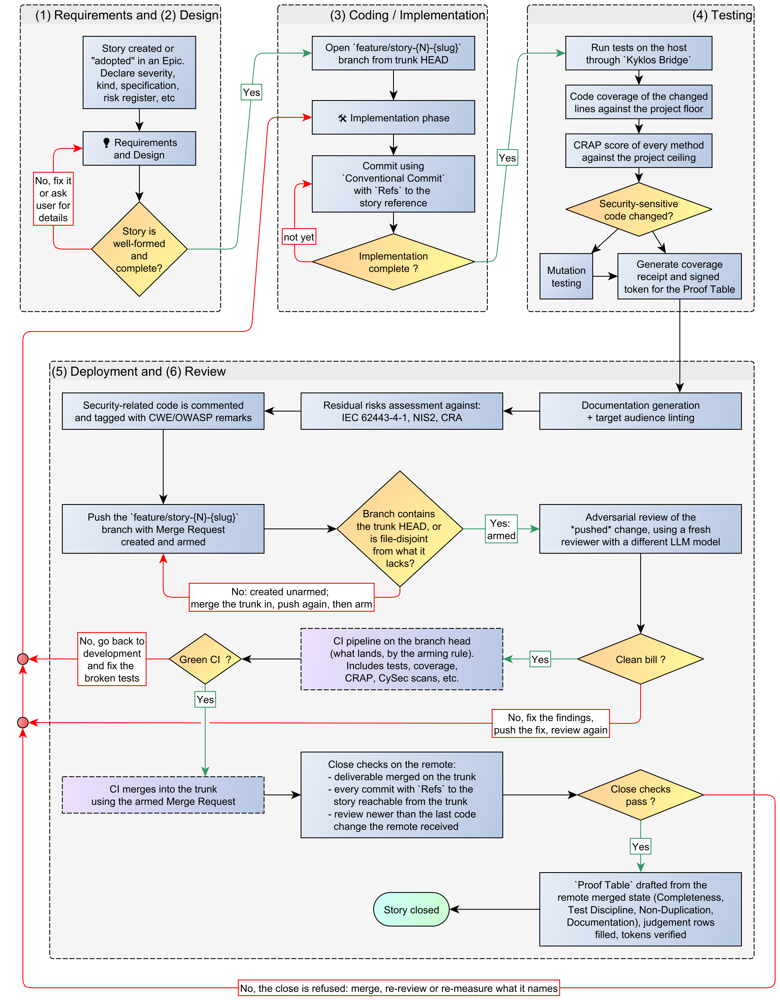
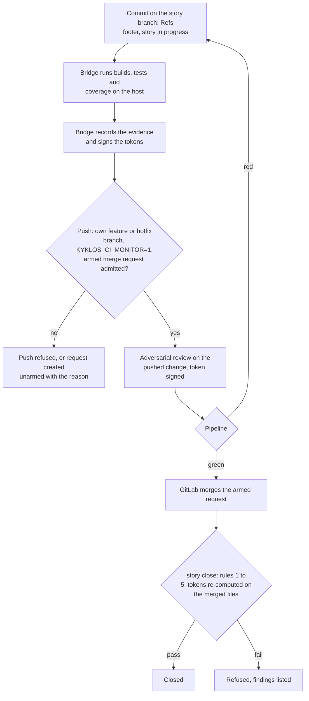

# Scenario 1: A project with CI, where the agent pushes (the closed loop)

[← Back to the WORKFLOW](WORKFLOW.md) · [README](../README.md)  

> Before we explore the workflow and rules of this specific scenario, this is a memento of [the cardinal rules of the Kyklos SSDLC workflow](WORKFLOW.md):  
> - Rule 1: The deliverable is on the remote, and merged
> - Rule 2: No commit of the story is left behind
> - Rule 3: The evidence describes the merged result
> - Rule 4: The review saw the finished code
> - Rule 5: A merge request merges itself, and only on the merged result

## Scenario 1 - High-level workflow

This is the ideal scenario; and complete and autonomous CI-driven workflow:

1. The agent commits on `feature/story-<id>-<slug>`, builds and tests on the host through the [Bridge](COMPONENTS.md#kyklos-bridge), and collects the [Test Discipline](PROOF_DIMENSION_TEST_DISCIPLINE.md) token and [coverage receipt](PROOF_DIMENSION_TEST_DISCIPLINE.md#shell-scripts-the-token-and-the-coverage-receipt), the duplication report and the
   documentation pass.
2. It pushes its own branch and creates the merge request in the same push, **armed**. If arming is refused (rule 5), the request is created unarmed and armed once the reason is fixed.
3. The [adversarial review](ADVERSARIAL_REVIEW.md) runs on the pushed change (rule 4). A finding sends the work back; the fix is pushed and reviewed again.
4. The agent watches the pipeline. Red: it fixes, commits, pushes and loops. Hung: the story stays open and the agent tells the people involved, instead of waiting in silence.
5. Green: the server merges the request. The agent deletes its local branch, has the Bridge draft the proof from the merged state, fills the judgement rows, and closes.  

The diagram below is also available in [Yed GRAPHML format](../assets/workflow/AI-Driven_development_013-1-ci-agent-push.graphml).  

## How the checks work in this scenario

- **Files and resources.** The story branch in the agent's repository; the host's copy of the project, where the [Bridge](COMPONENTS.md#kyklos-bridge) builds, tests and measures; the story, its notes and the merge request
  on GitLab; the pipeline of the merge request.
- **Secrets.** The container holds only the write-only push credential. The Bridge holds the story and CI tokens and the [proof signing key](PROOF_DIMENSION_TEST_DISCIPLINE.md#signatures-the-key-and-when-they-are-checked) on the host (see [Secrets](SECRETS.md)).
- **Signatures.** The [Test Discipline](PROOF_DIMENSION_TEST_DISCIPLINE.md) evidence, the [Non-Duplication](PROOF_DIMENSION_NON_DUPLICATION.md) and [Documentation](PROOF_DIMENSION_DOCUMENTATION.md) tokens and the [review token](ADVERSARIAL_REVIEW.md#how-the-review-token-is-made-and-checked) are keyed hashes (HMAC-SHA256) over what was measured; they are made by the Bridge
  and checked again at the close against the merged files (see [The Proof Table](PROOF.md)).
- **When the checks run.** At each commit and push (the [hook rules](HOOKS_AND_SKILLS.md)), at the arm, at the close, and at every Stop.
- **What a failure causes.** A refused push or arm, a red pipeline, or a refused close sends the agent back to the step that failed; the story stays open.
- **Impact on the user.** None in the normal flow: this is the scenario where the agent closes on its own. A hung pipeline is reported, and only a genuine exception needs a person
  (see [Overrides](WORKFLOW.md#overrides)).

## Related pages

The other scenarios: [Scenario 2](WORKFLOW_SCENARIO_2.md) · [Scenario 3](WORKFLOW_SCENARIO_3.md) · [Scenario 4](WORKFLOW_SCENARIO_4.md) · [Scenario 5](WORKFLOW_SCENARIO_5.md). See also [The Proof Table](PROOF.md) and [CI](CI.md).
