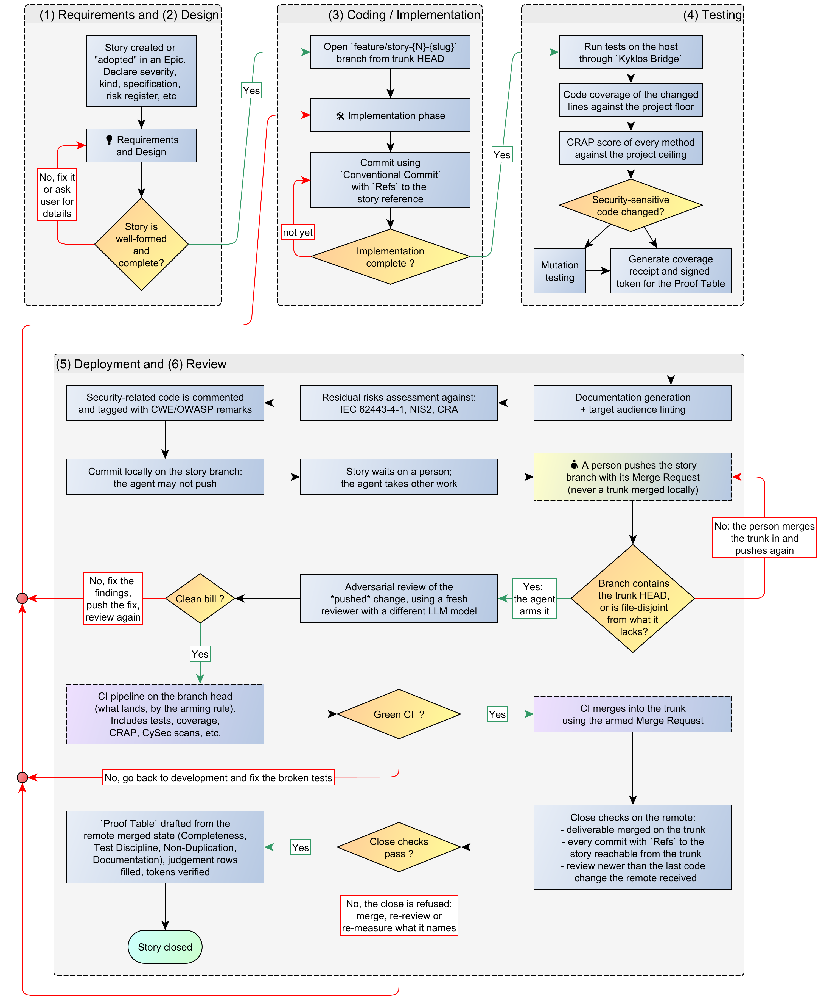

# Scenario 2: A project with CI, where a person pushes

[← Back to the WORKFLOW](WORKFLOW.md)

The agent works exactly as above but cannot push. A person pushes the story branch, and the merge request is created armed in that push (or the agent creates and arms it through the Bridge once
the branch is on the remote).  
Until that push the story **cannot close**: the deliverable is not on the remote (rule 1), the story's commits are not on the trunk (rule 2), and the four remote rows stay open. The agent marks the
story as waiting on a person and works on something else.

The push should carry the **story branch with its merge request**, not a trunk the agent merged locally: a code commit that reaches the trunk without a merge request has no recorded arrival time,
and the close refuses it (rule 4).  

The diagram below is also available in [Yed GRAPHML format](../assets/workflow/AI-Driven_development_013-2-ci-person-push.graphml).  

