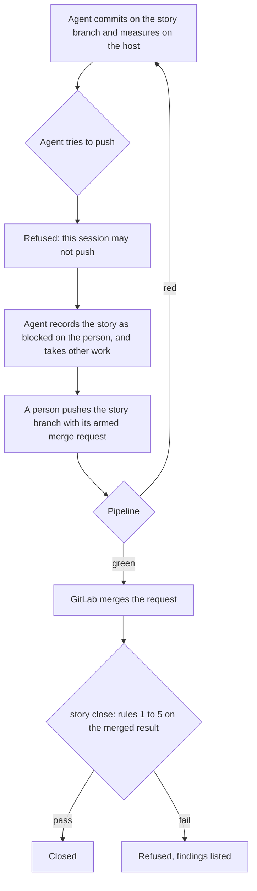

# Scenario 2: A project with CI, where a person pushes

[← Back to the WORKFLOW](WORKFLOW.md) · [README](../README.md)

> Before we explore the workflow and rules of this specific scenario, this is a memento of [the cardinal rules of the Kyklos SSDLC workflow](WORKFLOW.md):
> - Rule 1: The deliverable is on the remote, and merged
> - Rule 2: No commit of the story is left behind
> - Rule 3: The evidence describes the merged result
> - Rule 4: The review saw the finished code
> - Rule 5: A merge request merges itself, and only on the merged result

## Scenario 2 - High-level workflow
The agent works exactly as above but cannot push. A person pushes the story branch, and the merge request is created armed in that push (or the agent creates and arms it through the Bridge once
the branch is on the remote).  
Until that push the story **cannot close**: the deliverable is not on the remote (rule 1), the story's commits are not on the trunk (rule 2), and the four remote rows stay open. The agent marks the
story as waiting on a person and works on something else.

The push should carry the **story branch with its merge request**, not a trunk the agent merged locally: a code commit that reaches the trunk without a merge request has no recorded arrival time,
and the close refuses it (rule 4).  

The diagram below is also available in [Yed GRAPHML format](../assets/workflow/AI-Driven_development_013-2-ci-person-push.graphml).  

## How the checks work in this scenario

- **Files and resources.** As in [Scenario 1](WORKFLOW_SCENARIO_1.md); the push comes from the person's machine or from the push-authorised session.
- **Secrets.** The container holds a push credential only if one is configured; the push rule refuses the push anyway while `KYKLOS_CI_MONITOR` and `KYKLOS_ALLOW_PUSH` are unset. The person
  pushes with their own credential.
- **Signatures.** The tokens are made on the host before the push and checked at the close against the merged files; a person's push does not change them unless the files change.
- **When the checks run.** The push rule at the agent's attempt; the close only after the merge.
- **What a failure causes.** The story cannot close before the person's push and the merge (rules 1 and 2); the remote rows stay open. A blocked story does not stop the agent's turn: the blocker
  is recorded on the story and re-checked at every Stop.
- **Impact on the user.** The person pushes each finished story branch with its merge request (never a trunk merged locally). A one-time exception is the `push-override` label
  (see [Overrides](WORKFLOW.md#the-push-override-and-merge-override-labels)).

## Related pages

The other scenarios: [Scenario 1](WORKFLOW_SCENARIO_1.md) · [Scenario 3](WORKFLOW_SCENARIO_3.md) · [Scenario 4](WORKFLOW_SCENARIO_4.md) · [Scenario 5](WORKFLOW_SCENARIO_5.md). See also [The Proof Table](PROOF.md) and [CI](CI.md).
