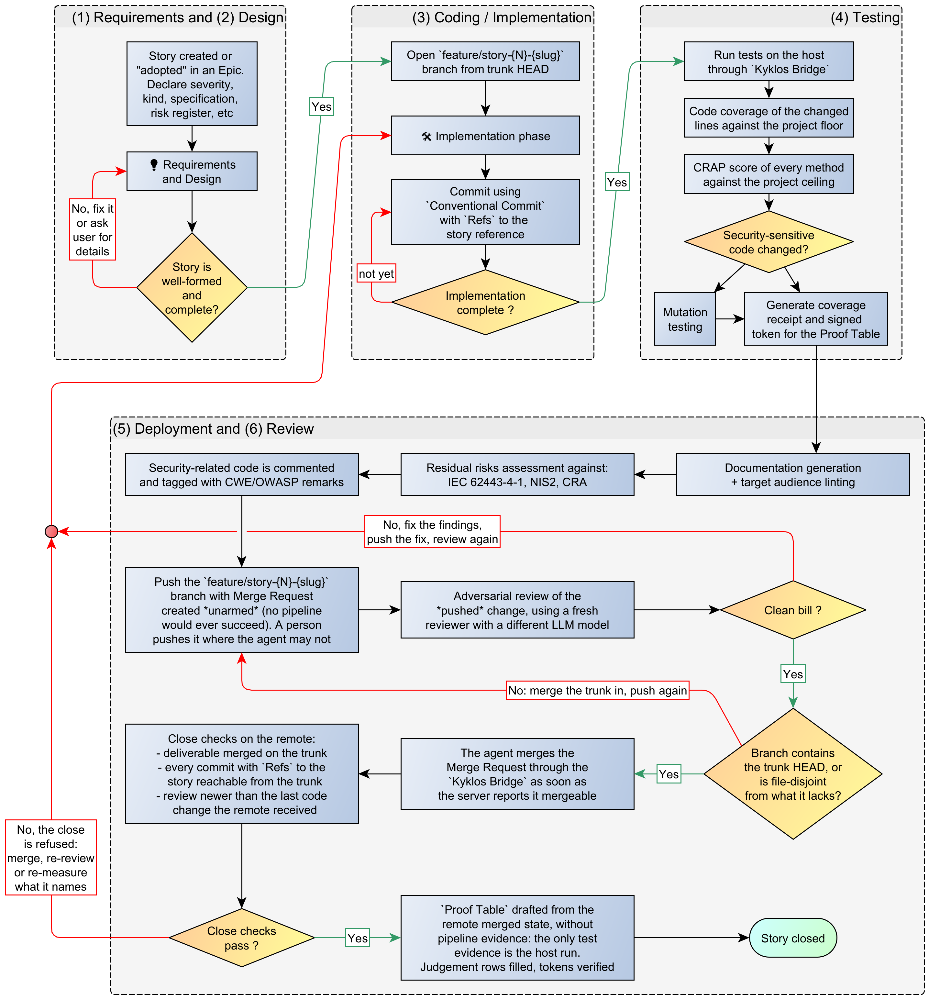
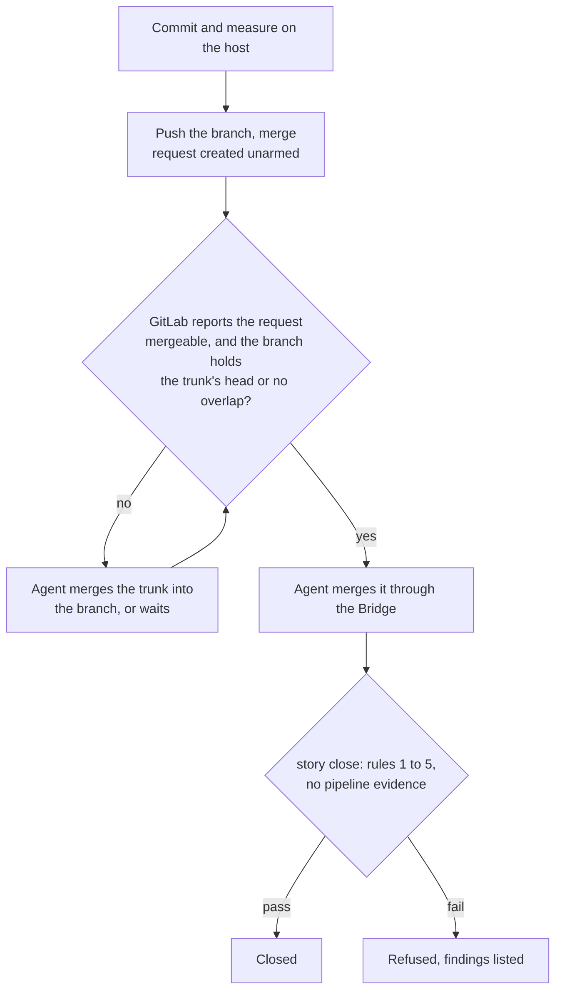

# Scenario 3: A project with no CI pipeline

[← Back to the WORKFLOW](WORKFLOW.md) · [README](../README.md)

> Before we explore the workflow and rules of this specific scenario, this is a memento of [the cardinal rules of the Kyklos SSDLC workflow](WORKFLOW.md):
> - Rule 1: The deliverable is on the remote, and merged
> - Rule 2: No commit of the story is left behind
> - Rule 3: The evidence describes the merged result
> - Rule 4: The review saw the finished code
> - Rule 5: A merge request merges itself, and only on the merged result

## Scenario 3 - High-level workflow

With no pipeline, an armed merge request would never merge, because no pipeline ever succeeds. So the merge request is created **unarmed**, and the agent merges it through the [Bridge](COMPONENTS.md#kyklos-bridge) as soon as the
server reports it mergeable. The merged-result rule (rule 5) still applies.

The close works as in scenarios 1 and 2: the merge request must be merged (rule 1), and the [Completeness](PROOF_DIMENSION_COMPLETENESS.md) row is drafted without a pipeline. What the project cannot prove is any **independent
build**: there is no run of the merged result on a clean machine, so all test evidence comes from the host run behind the [Test Discipline](PROOF_DIMENSION_TEST_DISCIPLINE.md) token.  

The diagram below is also available in [Yed GRAPHML format](../assets/workflow/AI-Driven_development_013-3-no-ci-pipeline.graphml).  

## How the checks work in this scenario

- **Files and resources.** The story branch, the host's copy where all tests run, and the merge request on GitLab. There is no pipeline to read.
- **Secrets.** The merge is made by the [Bridge](COMPONENTS.md#kyklos-bridge) with the token it holds on the host; the container never holds an API token.
- **Signatures.** The tokens made from the host runs are the only test evidence; the close re-computes them on the merged files.
- **When the checks run.** At the push, at the merge (the merged-result rule), and at the close.
- **What a failure causes.** A merge refused for a moved trunk needs the trunk merged into the branch and the tests run again on the result.
- **Impact on the user.** None in the normal flow. The project accepts that no independent build on a clean machine exists; adding a pipeline moves it to [Scenario 1](WORKFLOW_SCENARIO_1.md).

## Related pages

The other scenarios: [Scenario 1](WORKFLOW_SCENARIO_1.md) · [Scenario 2](WORKFLOW_SCENARIO_2.md) · [Scenario 4](WORKFLOW_SCENARIO_4.md) · [Scenario 5](WORKFLOW_SCENARIO_5.md). See also [The Proof Table](PROOF.md) and [CI](CI.md).
