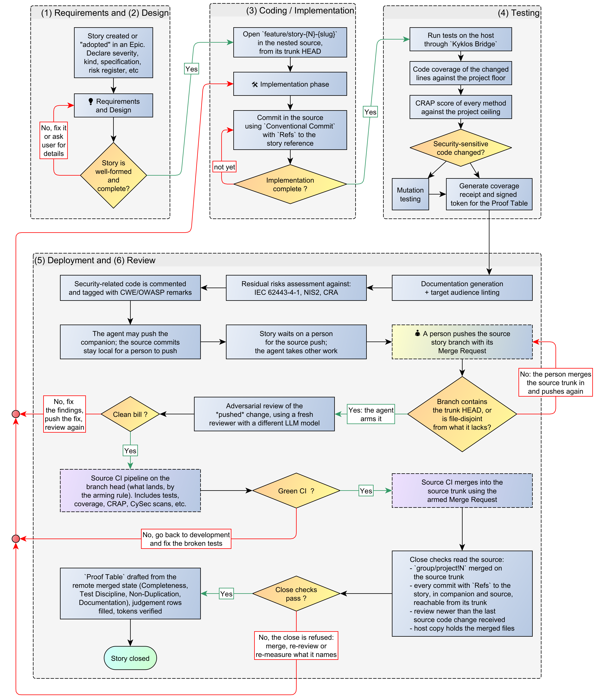

# Scenario 4: Companion topologies: the source is pushed by a person

[← Back to the WORKFLOW](WORKFLOW.md) · [README](../README.md)

> Before we explore the workflow and rules of this specific scenario, this is a memento of [the cardinal rules of the Kyklos SSDLC workflow](WORKFLOW.md):
> - Rule 1: The deliverable is on the remote, and merged
> - Rule 2: No commit of the story is left behind
> - Rule 3: The evidence describes the merged result
> - Rule 4: The review saw the finished code
> - Rule 5: A merge request merges itself, and only on the merged result

## Scenario 4 - High-level workflow

In the [*Private Companion + Public Sources* and *Private Companion + Private Sources* topologies](TOPOLOGIES.md), the backlog and the agent tooling live in the companion, while the code lives in the nested source
repository. Where the project lets it push, the agent may push the companion's own trunk (the companion is trunk-based), but often **not the nested source**: either the project declares the source
read-only for the agent (a person commits and pushes
there; the agent only reads, builds and tests it), or the agent's push credential does not reach the source repository.

So the source change goes through a person before the close:

1. The change is made on a story branch in the nested source; tests and coverage run on the host as usual.
2. A person pushes the source branch with its merge request; the source repository's pipeline runs, and the armed request merges on green.
3. The close names the deliverable in the source project (`group/project!<number>` or `group/project@<commit>`), which must be merged on **the source's** trunk (rule 1). Every commit naming the story,
   in the companion **and** in the nested source, must be on its trunk (rule 2): a commit left in the source checkout blocks the close.
4. The host's copy of the source must hold the merged files when the close runs (rule 3).

Until the person's push, the four remote rows of the source change stay open, and the agent records the story as waiting on that push instead of closing it. A push into a **public** source is
refused, for every session, when anything it sends carries an AI or agent artifact.

In the [*Private Sources + Public Artifacts* topology](TOPOLOGIES.md), the public repository is never pushed by hand and never holds stories: the private source follows scenario 1, 2 or 3, and the pipeline publishes
the artifact.  

The diagram below is also available in [Yed GRAPHML format](../assets/workflow/AI-Driven_development_013-4-companion-person-push.graphml).  

## Related pages

The other scenarios: [Scenario 1](WORKFLOW_SCENARIO_1.md) · [Scenario 2](WORKFLOW_SCENARIO_2.md) · [Scenario 3](WORKFLOW_SCENARIO_3.md) · [Scenario 5](WORKFLOW_SCENARIO_5.md). See also [The Proof Table](PROOF.md) and [CI](CI.md).
