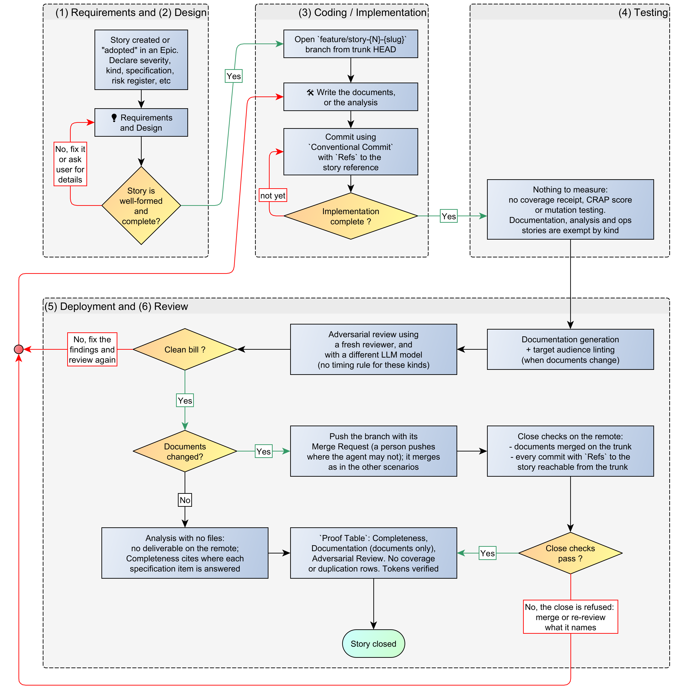
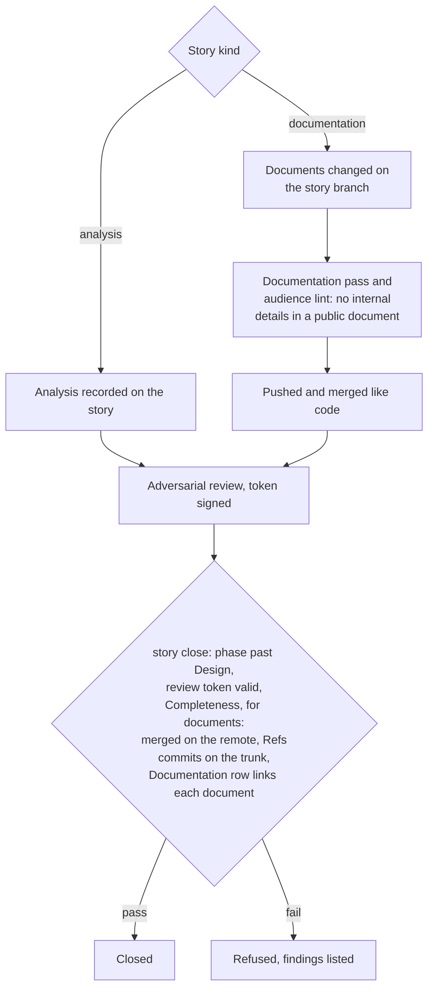

# Scenario 5: Stories without testable code: documentation and analysis

[← Back to the WORKFLOW](WORKFLOW.md) · [README](../README.md)

> Before we explore the workflow and rules of this specific scenario, this is a memento of [the cardinal rules of the Kyklos SSDLC workflow](WORKFLOW.md):
> - Rule 1: The deliverable is on the remote, and merged
> - Rule 2: No commit of the story is left behind
> - Rule 3: The evidence describes the merged result
> - Rule 4: The review saw the finished code
> - Rule 5: A merge request merges itself, and only on the merged result

## Scenario 5 - High-level workflow

The story's kind decides which rows it must prove (see the [Proof Table](PROOF.md)):

- A **documentation** story proves [Completeness](PROOF_DIMENSION_COMPLETENESS.md), [Documentation](PROOF_DIMENSION_DOCUMENTATION.md) and [Adversarial Review](PROOF_DIMENSION_ADVERSARIAL_REVIEW.md). The documents it changes are its deliverable: they are pushed and merged like code, the close checks that they
  are merged (rule 1) and that every commit naming the story is on the trunk (rule 2), and the Documentation row links each document at the deliverable's commit on the remote. A Documentation
  token is required only when source code changed too.
- An **analysis** story proves Completeness and Adversarial Review. When it changes no files, the close has no deliverable to check on the remote; the [Bridge](COMPONENTS.md#kyklos-bridge) leaves Completeness open, and the agent
  fills it with evidence of where each item of the specification is answered.

Both kinds (and *ops* stories) carry **no [coverage receipt](PROOF_DIMENSION_TEST_DISCIPLINE.md#shell-scripts-the-token-and-the-coverage-receipt)**, and the review timing of rule 4 does not apply to them.
They still need an [adversarial review](ADVERSARIAL_REVIEW.md), and they must have moved past the
Design phase before they can close.  

The diagram below is also available in [Yed GRAPHML format](../assets/workflow/AI-Driven_development_013-5-no-testable-code.graphml).  

## How the checks work in this scenario

- **Files and resources.** The documents in the repository, or the story's own notes for an analysis.
- **Secrets.** As in the other scenarios; nothing specific to these kinds.
- **Signatures.** The [review token](ADVERSARIAL_REVIEW.md#how-the-review-token-is-made-and-checked) is checked as for every story. A [Documentation](PROOF_DIMENSION_DOCUMENTATION.md) token is needed only when source code changed too; no [coverage receipt](PROOF_DIMENSION_TEST_DISCIPLINE.md#shell-scripts-the-token-and-the-coverage-receipt) exists for these kinds.
- **When the checks run.** At the push and merge of the documents, and at the close. Rule 4's review timing does not apply.
- **What a failure causes.** A public document that carries internal details is refused by the lint; the close is refused until the documents are merged.
- **Impact on the user.** None in the normal flow. See the [Documentation](PROOF_DIMENSION_DOCUMENTATION.md), [Completeness](PROOF_DIMENSION_COMPLETENESS.md) and
  [Adversarial Review](PROOF_DIMENSION_ADVERSARIAL_REVIEW.md) dimension pages for what each row needs.

## Related pages

The other scenarios: [Scenario 1](WORKFLOW_SCENARIO_1.md) · [Scenario 2](WORKFLOW_SCENARIO_2.md) · [Scenario 3](WORKFLOW_SCENARIO_3.md) · [Scenario 4](WORKFLOW_SCENARIO_4.md). See also [The Proof Table](PROOF.md) and [CI](CI.md).
