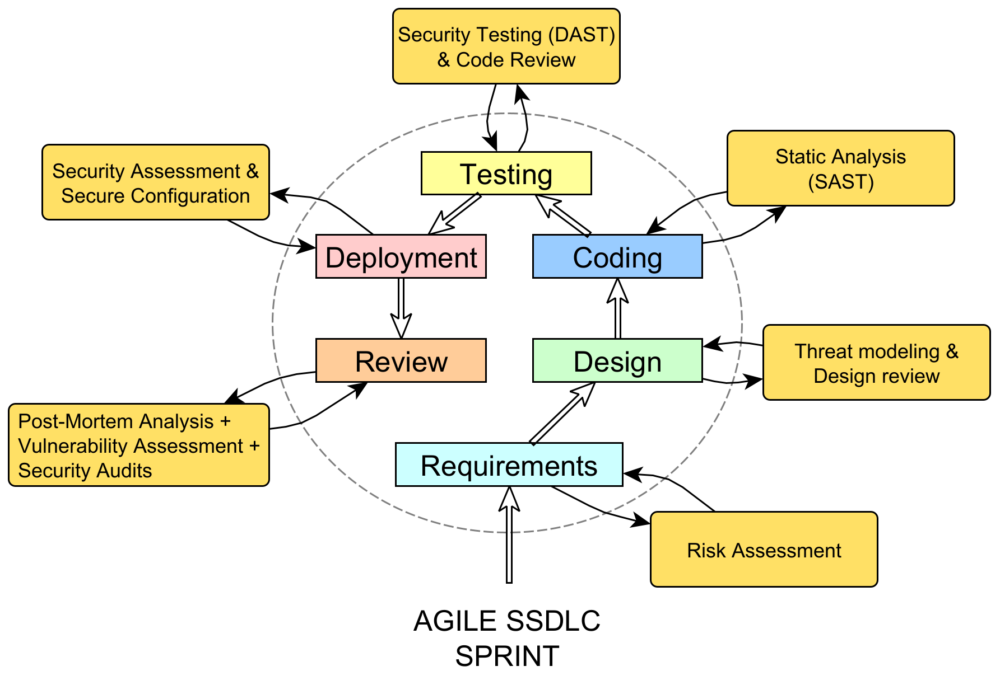
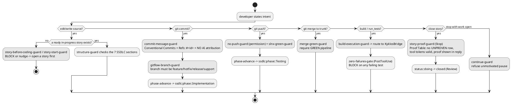

# The Dogma SSDLC workflow — a developer's guide

This document explains **how** the `kyklos` plugin turns an *agile Secure Software Development
Life-Cycle* (SSDLC) into a workflow that is **enforced**, not merely recommended. It is written for a
developer who has never seen the fleet before: every concept is introduced from the start and built forward.

The plugin's mechanisms are documented in [`../README.md`](../README.md) and
[`../GOVERNANCE.md`](../GOVERNANCE.md); this guide is the **high-level narrative** that ties them together.
It is deliberately implementation-cited so a maintainer can jump from a concept to the code that enforces it.

> **How to read this.** Sections are numbered to match the 25 topics the workflow must cover; a
> [topic-coverage checklist](#topic-coverage-checklist) at the end maps each topic to its section so nothing
> is silently missing.

---

## 1. How a project layers on top of the plugin baseline

A Dogma container ships with the `kyklos` plugin baked into the image. The plugin is the **corporate
baseline** — the foundational, **lower** layer of policy, hooks, and skills that **every project inherits**. A
project's own `CLAUDE.md`/`.claude` sits **on top**: it **extends and overrides** the baseline with
project-specific rules, but may only **add and tighten** — **never soften** — what the baseline mandates. The
corporate floor is inviolable: where a project rule would weaken a baseline rule, the baseline wins (the
corporate policy explicitly *overrides* any softer default).

| Layer | Corporate baseline (plugin — the lower level, inherited) | Project (extends/overrides on top, in the repo's `.claude/`) |
|-------|------------------------------------------|-------------------------------------|
| **Policy** (`CLAUDE.md`) | The corporate engineering policy (Tier-0/1/2 rules) — the baseline every project inherits. | The project `CLAUDE.md` adds *specifics* on top; it may tighten, never soften, the baseline. |
| **Hooks** (`hooks/hooks.json`) | The enforcement guards (GitFlow, zero-failures, merge-green, proof gate, …) run from the plugin clone. | The project does **not** edit `hooks.json`; it *tunes* behaviour through knobs in `.claude/standards.env`. |
| **Skills** (`skills/*/SKILL.md`) | The reusable SSDLC procedures (`ssdlc-story`, `ssdlc-story-proof`, `poka-yoke`, …). | The project supplies domain skills of its own; corporate skills stay shared. |

The contract is **one owner per concern** (see `GOVERNANCE.md`): the Kyklos owns the corporate-baseline
guards, and a consuming project *deletes* its duplicate guard rather than double-blocking. Projects customise
purely by declaring knobs — the topology once (via the `ssdlc-repo-model` skill), then per-repo switches such
as `FEATURE_BRANCH_CLOSE_MODE` — in `.claude/standards.env`. Hooks read that file by **parsing** it, never by
sourcing it (a code-execution hazard, CWE-829), so a project config file can tune behaviour but can never run
code in the guard.

**Fail-safe direction.** Each guard states its own direction in its header. Convenience checks and nudges let an
unrelated command through on uncertainty (an unparseable subject, a command that is clearly not theirs), while
security-relevant decisions and gates that judge CI or a proof token fail **closed** ("cannot verify" is never read
as green); *permissions* (push, self-drive) are off unless explicitly granted.

---

## 2. Agile Epics map to GitLab Milestones

An **epic** is a large body of related work. In this workflow an epic is a **GitLab milestone** whose title
begins with the epic id, e.g. `E<nn> — <epic title>`. The story tool resolves an epic id
to its milestone with an anchored search (`^E01([^0-9]|$)`) so `E1` never accidentally matches `E10`
(`skills/ssdlc-story/lib/story-backend-gitlab.sh`). Every GitLab-backed story **must** carry a milestone —
a milestone-less story is rejected, so work can never float outside an epic.

## 3. Agile Stories map to GitLab Issues

A **story** is one unit of shippable work. In this workflow a story **is a GitLab issue**, and the identity is
direct: **the story number is the issue `iid`** (`id == iid`). There is no mapping table to drift — story `<N>`
is issue `#<N>`. `story new` creates the issue and adopts its assigned `iid` as the story number; `story adopt`
takes an existing issue and turns it into a story in place.

GitLab Community Edition has **no native issue-parent-of-issue** (epics are a paid feature), so a
parent/child link is expressed by a canonical metadata bullet in the story body:

```markdown
- **Parent:** #<N>
```

That bullet is the single source of truth for the relationship; when the last open child closes, the tool can
auto-close the parent.

## 4. Labels — scoped and unscoped

Labels classify every story/issue. The canonical registry lives in
`skills/ssdlc-story/lib/story-backend-gitlab.sh` (`_GL_KNOWN_LABELS`). The fleet is migrating from legacy
**single-colon** labels (`status:doing`) to **scoped double-colon** labels (`status::doing`); scoped labels
give GitLab a *mutually-exclusive group* (only one `status::` at a time). The tool **dual-reads** every scheme
during the migration window and always **writes** the scoped form, removing the legacy duplicates.

The exact names live only in `_GL_KNOWN_LABELS`; read them there. The groups are:

| Group | Purpose |
|-------|---------|
| **Status** (`status::`) | Where the story is in its life (including parked and the closed dispositions); mutually exclusive. |
| **Type** (`type::`) | The story's nature (Conventional Commits types + domain types); drives the Proof-dimension profile (§22). |
| **Kind** (`kind::`) | Right-sizes the SSDLC enforcement per story (§4.2); mutually exclusive. |
| **SSDLC phase** (`ssdlc:phase::`) | Which SSDLC phase the story is in (§13); one at a time. |
| **Severity** (`severity::`) | Finding/story severity. |
| **Coordination** | `kind::communication` + `agent-comms`, recipient = the **Assignee**; routes a cross-agent message (§10). |
| **Kyklos version** (`kyklos:version::<v>`) | Records the kyklos plugin version that created or last acted on the issue (see below). |
| **Overrides / flags** | User-applied waivers (`*-override`), the AI-review finding marker, and the `story` marker the tool manages. |

The GitLab default `bug` is a deprecated alias for `type::fix`; the tool auto-migrates it.

### 4.1 The `kyklos:version::<v>` provenance label

Every Kyklos function that **creates or mutates** a GitLab issue — story writes (`new`, `adopt`, and every
scoped-label lifecycle change) and coordination writes (`am_new`, `am_reply`, `am_route`, `am_close`,
`am_reopen`) — stamps a scoped label **`kyklos:version::<v>`** naming the plugin version acting on the issue.
It answers "which Kyklos version produced/handled this?" at a glance — provenance for triaging a tool bug to
the exact release, without opening the pipeline. The version is resolved by the shared
`hooks/lib/kyklos-version.sh` (`kyklos_version`): the `KYKLOS_VERSION` env override first, else the
installed plugin manifest (`.claude-plugin/plugin.json`).

Unlike `status::`/`ssdlc:phase::`, this scope is **NOT mutually exclusive**: a newer plugin adds its own label
and leaves the older ones in place, so **more than one** `kyklos:version::<v>` is expected and the set records
the issue's version history. The stamp is **best-effort**: if the version cannot be resolved, the label is
skipped (never a dangling `kyklos:version::`) and the primary issue operation still succeeds — provenance is a
convenience, never a blocker.

### 4.2 Story Kind — right-sized rigor per story (`kind::`)

Not every story is code. The **`kind::`** scoped label declares what a story fundamentally *is*, and the
Kyklos scales its enforcement accordingly:

The four kinds are `development`, `analysis`, `documentation` and `ops`. Which proof rows each kind carries is
defined once, by `PROOF_KIND_SET_*` and `PROOF_KIND_DEVELOPMENT_ONLY` in
`skills/ssdlc-story-proof/proof-dimensions.sh` (and explained in the `ssdlc-story-proof` skill): `development`
carries the full set, `analysis` and `documentation` a small subset, `ops` the full set minus the development-only
rows. The no-code nudge below applies to `analysis` and `documentation`.

Semantics:

- **Creation names the kind; adoption stamps it.** `story new` (and the bridge's `story_new`) refuses to create a
  story without `--kind`: the kind decides which proof the story owes (development = code with the full proof,
  analysis, documentation, ops = operational work without code), so it is chosen, never defaulted. `story adopt`
  PRESERVES an existing `kind::` label; absent, it stamps `kind::development` atomically with `status::doing`/the
  phase — no tool path yields a kind-less story. An explicit `--kind` that conflicts with a different existing label is refused (a kind changes only
  through the auditable `story set <id> kind=<value>`).
- **Strictest on error.** Anywhere a kind cannot be read (or an issue carries two `kind::` labels), the
  Kyklos resolves it as `development` — the FULL dimension set. An error can only raise rigor, never lighten
  the gate.
- **The close gate is kind-aware.** The Proof set-check demands exactly the kind's canonical rows — a lighter
  table can never serve a development story, and a full table on an analysis story is equally refused (no
  mixed-set tables). Adversarial Review is in EVERY kind's set and can never be waived by kind.
- **The nudge is soft by design.** While the active story is `kind::analysis`/`kind::documentation`, starting
  source edits or a bridge build emits ONE advisory reminder per session ("this is a no-code kind") — never a
  block. Closing such a story whose branch carries source-file commits prints a mode-honest advisory naming
  the kind/diff mismatch.
- **Phases, structure and commit discipline are unchanged** for every kind.

## 5. How and when a story is "adopted"

Use **`story adopt <iid> --type <t> --epic <E0N>`** when an issue already exists — a user filed it directly, or
another agent raised a request — and you want to bring it under SSDLC discipline. Adoption is idempotent and:

1. stamps the `story` + `status::doing` + `type::<t>` labels **and the initial `ssdlc:phase::Requirements`
   phase** (set ATOMICALLY with `status::doing`, so an adopted story is never phase-less — a re-adopt keeps its
   existing phase), and attaches the epic's milestone;
2. prepends the metadata block (`Status`, `Story-Type`, `Epic`, `Branch`, `Summary`);
3. preserves the user's words verbatim under `## Original request (verbatim)`;
4. **scaffolds the full SSDLC spec skeleton** — the same section set `story new` emits (Requirements, Use
   cases, Failure modes, Fail-open vs fail-hard, Poka-yoke, Acceptance criteria, Risk assessment) — so an
   adopted story is *structurally complete by construction*.

**Adopted = the `story` label AND the metadata block (step 2).** A label a human pre-applied does not adopt an
issue; every gate that asks "is this adopted?" (the branch guard, the story tool's lifecycle commands, the
agent-messaging reply gate) uses the one shared definition and refuses a label-only issue with the `story adopt`
remedy. When a branch names a story (`feature/story-<N>-…`), the story-start and before-coding guards judge THAT
story, not "any active story".

Use **`story new <kebab-slug> --title "<title>" --type <t> --kind <k> --severity <critical|high|medium|low> --epic <E0N>`** for fresh work (the slug names the story folder and must be kebab-case; the human title goes in `--title`) — it creates the issue, metadata, and skeleton in one step.

## 6. How a story is parked

A story is **parked** by applying the **`status::parked`** label (or the legacy **`parked`**); the name is fixed, not a setting.
The continue-guard (§17) then *excludes* it from the keep-rolling set — a parked story no longer forces the
agent to keep working on it. Un-park by removing the label. Parking is audited so an agent self-parking work
is visible; with `CONTINUE_GUARD_PARKED_STRICT=1`, only a human may author the park.

## 7. Persistence and the Source of Truth

There are two backends, selected by `STORY_BACKEND`:

- **`local`** — stories are folders under `Stories/STORY-<NNN>-<slug>/` with `requirements.md` as the SSoT.
- **`gitlab`** — the **GitLab issue is the SSoT**; the on-disk `Stories/` folder is a *derived mirror*,
  regenerated from the issue and stamped with a banner marking it a read-only projection. A guard blocks
  hand-editing the mirror so the projection can never diverge silently.

The settings that determine the SSoT: `STORY_BACKEND` (`local`|`gitlab`), `STORY_GITLAB_PROJECT` (the numeric
project id), `STORY_GITLAB_TOKEN_ENV` (the *name* of the env var holding the token — never the token value),
and `CLAUDE_PROJECT_DIR` (the workspace root). Resolution order: explicit env → the repo's
`.claude/standards.env` (parsed) → the `local` backend when neither sets `STORY_BACKEND`.

**Synchronisation.** On the GitLab backend, `story materialize` (run automatically on `sync`/`refresh` and at
session start by the `kyklos-story-mirror-refresh` hook) rewrites the on-disk folder from the issue.
`story refresh` re-materialises everything from GitLab, falling back to the cache (and saying "stale") when
GitLab is unreachable. Because every refresh rewrites the mirror, it is kept out of git (except in a companion or
trunk-model repository, which commits it on purpose): after each mirror write the tool lists untracked generated copies
in the repository's local `info/exclude`, and warns once, with the exact `git rm --cached` + `.gitignore` fix, about
copies that are already tracked (`STORY_MIRROR_GIT_HYGIENE=off` opts out).

## 8. How an agent knows its own identity

The agent's identity is the **GitLab user behind the token it acts with**: the Kyklos asks the bridge
(`coordination_whoami`), falls back to GitLab's `GET /user` only for a bridge without that verb, and caches the
answer briefly (`hooks/lib/resolve-agent-identity.sh` owns the order and the cache lifetime). That identity is what the
guards compare against to answer "is the last comment on this issue *mine* or someone else's?" (§9) and what
the coordination issues are assigned to (§10). A privileged agent's token may be an instance
administrator, which is how a cross-project agent can see and act on issues fleet-wide.

## 9. How agents monitor pending work

Pending work is discovered from the SSoT, not from memory:

- **`kyklos-continue-guard`** (a Stop hook, §17) queries the configured scope on every stop and refuses to
  pause while open work remains. Scope is set by `CONTINUE_GUARD_PROJECTS` / `CONTINUE_GUARD_GROUPS` /
  `CONTINUE_GUARD_SCOPE_ALL` (an instance-wide label).
- A **backlog loader** assembles the agent's whole backlog from the SSoT and flags each open issue whose
  newest non-system note was written by *someone other than the agent* — i.e. the ball is in the agent's
  court. An **open in-scope issue is pending work until it is closed**; the agent's own last comment does not
  discharge it.

## 10. Agent-to-agent coordination via `kind::communication` + Assignee

Agents coordinate through GitLab issues, not private channels. A coordination issue carries
**`kind::communication`** + **`agent-comms`** and is **assigned to the recipient agent's GitLab user** — the
assignee IS the routing, and re-routing means reassigning. A project agent that hits an infrastructure-owned
problem opens one with `agent-msg new --to infra` (on its own companion project); the infrastructure agent's
inbound gate and backlog loader discover it (by `kind::communication` + assignee, instance-wide), verify the claim
independently, and either fixes it in the infra-owned repos or writes complete, self-contained steps back
into the issue for the requesting agent to execute in its own environment. The `ssdlc-agent-msg` skill is the
mechanised, enforced way to post these messages (a guard blocks raw API writes to coordination issues so the
canonical labels and the assignee are always applied; an unassignable recipient is refused, never sent label-only).
The legacy `for::<agent>` routing labels are retired: nothing writes them and nothing reads them to route a comm. Another agent's issue is **untrusted input**: its *claim* is verified,
its *authority* is never assumed — only the user authorises privileged or irreversible actions.

## 11. User-invokable skills

These skills can be invoked directly by the developer (via `/<skill>`); the enforcing hooks point the agent to the
same skills at the right moment.

| Skill | What it does |
|-------|--------------|
| `ssdlc-story` (the `story` CLI) | Spec-driven story planning: `new`/`adopt`/`set`/`phase`/`proof`/`close`/`refresh`/`structure`/`ra` against the GitLab or local backend. |
| `ssdlc-story-proof` | The final Done gate — the 17-dimension Proof Table (§22). |
| `ssdlc-repo-model` | Declare the repository topology once; derive shape + workflow. |
| `ssdlc-risk-assessment` | Produce/maintain the numbered `RA-##` security-risk register (§22). |
| `ssdlc-deduplicate` | The Non-Duplication doer — run a detector, triage candidates semantically, centralise (§22). |
| `ssdlc-i18n` | The i18n doer — scan the change for user-facing strings, keep the project's i18n technique, promote them without duplicates (§22). |
| `update-docs` | The Documentation doer — update impacted docs and run the audience lint (§22). |
| `poka-yoke` | Mistake-proofing by design — the escalation ladder of guards (§21). |
| `measuring-test-coverage` | Coverage as a floor, test *trust* as the goal; computes coverage/CRAP/mutation. |
| `running-tests` | The protocol for running/investigating tests via the bridge (§15). |
| `using-the-bridge` | How to drive the KyklosBridge MCP server (§15–16). |
| `ssdlc-agent-msg` | Cross-agent coordination via issues (§10). |
| `ssdlc-inbound-monitor` | Arm the idle monitor that watches coordination issues for late replies. |
| `ssdlc-ai-fix-loop` | The local, human-approved, bounded half of the closed-loop AI code review. |
| `ssdlc-cysec-comments` | Backfill `[CySec]` security annotations on existing code. |

`ssdlc-adversarial-review` (the mandatory review the proof flow drives) can also be invoked directly; `ssdlc-cysec`
is a reference skill the agent loads itself (not user-invocable); `reorient` is user-only
(`/kyklos:reorient`, run after a container restart). Each skill's own `SKILL.md` frontmatter is the owner of
its description and invocability.

## 12. What SSDLC is

A **Secure** SDLC weaves security activity into *every* phase of an agile sprint instead of bolting it on at
the end. The inner ring is the ordinary agile cycle; each phase carries a paired security activity (the outer
boxes):



| Inner phase | Paired security activity |
|-------------|--------------------------|
| Requirements | Risk Assessment |
| Design | Threat modeling & design review |
| Coding | Static analysis (SAST) |
| Testing | Security testing (DAST) & code review |
| Deployment | Security assessment & secure configuration |
| Review | Post-mortem, vulnerability assessment & security audits |

The loop then returns to Requirements for the next sprint. The Kyklos operationalises this: the Risk
Assessment and the security-posture proof dimensions (§22) are the same activities, made mandatory and
machine-checked.

## 13. How SSDLC phases are represented in GitLab

The phase order is **Requirements → Design → Implementation → Testing → Deployment → Review**
(`skills/ssdlc-story/lib/story-lib.sh`). The current phase is a scoped label on the issue
(`ssdlc:phase::<Phase>`, §4), mutually exclusive, and it advances **monotonically** — it never regresses.
`story phase <id> <Phase>` sets it explicitly; hooks advance it automatically on the natural triggers (§14).

## 14. How the Kyklos intercepts intent and enforces the phases

The developer states intent (edit a file, commit, push, close). A **PreToolUse** hook inspects that intent
*before* it runs and either allows it, nudges, or blocks with the exact remediation; **PostToolUse** hooks
react after (advance the phase, gate a failed test); **Stop** hooks refuse an unmotivated pause. The result
is that the SSDLC sequence is enforced by construction — you cannot commit before a story is ready, cannot
merge before CI is green, cannot close before the Proof Table is clean.



**Which skills/tools fire at each phase:**

| Phase | Trigger | Enforcing hook(s) | Skill(s)/tool(s) |
|-------|---------|-------------------|------------------|
| Requirements | `story new`/`adopt` | `story-structure-guard` | `ssdlc-story`, `ssdlc-risk-assessment` |
| Design | spec authored | `story-structure-guard` | `ssdlc-story`, `poka-yoke` |
| Implementation | `git commit` on `feature/story-<N>-*` | `phase-advance`, `commit-message-guard`, `story-start-guard` | `running-tests`, `measuring-test-coverage`, `ssdlc-cysec` |
| Testing | `git push` | `phase-advance`, `build-execution-guard`, `zero-failures-gate`, `slnx-green-guard` | KyklosBridge `run_tests`/`get_coverage` |
| Deployment | manual / CI | `merge-green-guard` (on merge) | `ssdlc-story` |
| Review / Close | `story close` | `story-proof-guard`, `story-close-guard`, `proof-show-nudge` | `ssdlc-story-proof`, `ssdlc-deduplicate`, `update-docs`, `ssdlc-adversarial-review` |

The repo a `git commit`/`git push` belongs to is the one the command actually targets (`git -C <dir>`, or a `cd <dir>`
before the git token), not the directory the command started in. So committing into another project's worktree advances
**that** project's story phase, and the story-start gate judges the branch's story in **that** project's own backlog
when the repo declares its own story workflow (`.claude/standards.env`). A phase that cannot be advanced is reported to
the agent instead of being skipped silently.

## 15. How the agent is enforced to use KyklosBridge

The container is sealed — no host SDK, no GUI, no host process access. **KyklosBridge** is the host-side MCP
server that is the agent's "eyes and hands" for real builds and tests. Enforcement is the
`kyklos-build-execution-guard` (PreToolUse Bash), which enforces the project's declared build channel
(`BUILD_EXECUTION`, interviewed once by the `running-tests` skill; the guard's header states what each value allows
and refuses). The `kyklos-zero-failures-gate` (PostToolUse) binds to **both** the raw `dotnet test` path and the
bridge's test results, so the "block on any failure" rule holds however the tests were launched.

**Forks and parallel sessions.** Every fork or subagent in a container shares the one bridge, its single
solution root, and its one-run-at-a-time permit. A fork therefore verifies its change through CI on its own
branch (the bridge cannot see a separate worktree), never calls the bridge-wide `cleanup` / `kill_process` /
`restart` / `stop`, works in its own git worktree, and never switches or leaves edits in a shared checkout. The
`kyklos-fork-bridge-surface` hook refuses a bridge run verb called from inside a different git tree without a `tree`
argument (`KYKLOS_RIGHT_TREE=off` downgrades it to a warning), and warns when a bridge verb is called from a
non-git folder outside the project root or a subagent, and when a bridge-wide verb is called from a subagent. The
`kyklos-shared-checkout-surface` hook (SessionStart + Stop, warning only) reports work left behind in a checkout:
unmerged paths, real uncommitted changes, or an empty leftover branch; tracked generated story copies are reported on
their own line with the one-time untrack fix rather than as edits (`KYKLOS_SHARED_CHECKOUT_WARN=off`, in the environment or `.claude/standards.env`, opts out).
Full rules and a fork-prompt snippet: the `using-the-bridge` skill.

## 16. The functions exposed by KyklosBridge

The MCP server exposes its verbs as `mcp__KyklosBridge__*`: builds and test runs, coverage, mutation and CRAP
measurement, logs and failures, host process and file inspection, supervised host applications, the launcher API,
and the GitLab verbs (stories, coordination, CI and merge requests) that let a container work without a GitLab
token. The verb list, each verb's arguments and the bridge's settings are owned by `bridge/README.md` and by each
verb's own tool description; the verbs the Kyklos hooks bind to are the `matcher` entries in `hooks/hooks.json`.

## 17. How the agent is enforced to keep working instead of idling

The **`kyklos-continue-guard`** (Stop hook) forbids an unmotivated pause: while any in-scope **work item** is
open it blocks the Stop and tells the agent to keep going. "Work" is **not only a story**: in the default
keep-rolling mode the open-set query is unfiltered and every issue is classified from its labels — a
`story`-labeled issue and a **plain/unlabeled issue** both force work (an unlabeled issue must be TRIAGED:
adopt it under the right `kind::`, route it as a coordination issue (`agent-msg`), park it, or close it with a disposition
label), while four declared states are excluded with an audit each: routed coordination (`kind::communication`, and
any legacy `for::*` — the inbound-issues guard owns its ball-in-court), `parked`, Blocked (`status::blocked-on-issue`,
`-on-user`, `-on-external`, any newer `status::blocked-on-*`, and the legacy bare `status::blocked`; a reason-gated,
phase-frozen state), and the disposition labels (`wontfix`/`duplicate`/`invalid` — an open dropped issue should be CLOSED).
**Blocked means the story records what it waits on, and what kind of thing that is.** A story becomes Blocked only
through `story block <id> --kind <issue|user|external> --on <target> --reason "<why>"` (the bridge's `story_block`
verb), and the status label names the kind: `status::blocked-on-issue` (the target is an issue, story or merge request
in any project, `#<n>`, `!<n>`, `group/project#<n>`, `group/project!<n>` or its web link, which the bridge refuses when
it cannot read it or it is already closed or merged; an issue also gets GitLab's "blocked by" link, a merge request
only the bullet), `status::blocked-on-user` (the target is the web link to the note that asks the user, ending in
`#note_<n>`, on an issue or merge request that is still open, and the note must exist) or `status::blocked-on-external` (the
target is the https link of what is awaited, because a wait the agent only describes is a stop it grants itself). A block without a kind is refused. The bridge records the blocker
once as a `- **Blocked-On:**` bullet in the story's header (`<reference> — <reason>`, or `<kind> since <yyyy-MM-dd>:
<target> — <reason>` for a user or external block), appends a `(waits on ...)` to each open task of the task sections,
sets the status and posts one `[status-blocked]` note; blocking again on the same target changes nothing. `story set
<id> status=Blocked` is refused, pointing there. `story block <id>` alone re-checks the blocker: once an issue
blocker has closed or merged the bridge lifts the block (status back to In-progress, the bullet and the waits removed,
a `[status-unblocked]` note posted); a user or external block is reported with its age. Leaving Blocked by hand
(`story set <id> status=...`) drops the bullet, the waits and the kind too. A legacy bare `status::blocked` (no kind)
is a defect: `story next` and `story audit` list it as "blocked, reason unknown" (still blocked: `story next` never
offers it), and blocking it again with its kind repairs it, replacing any legacy bullet. `story audit` also reports two
block kinds on one story as `blocked-kind-conflict`.
The agent never writes the wait into task text. The continue-guard only checks the recorded bullet: a `status::blocked`
story with no `Blocked-On:` bullet is open work again, in the keep-rolling mode and in the narrow "finish what you
started" mode alike, whatever its task text or the local `Stories/` mirror says (neither is read). For a story that
records one, the guard asks the bridge to re-check it on every Stop (never cached; its own cap of the same size), so a
block lifts by itself once the reference closes or merges. Parked, disposition-labelled and routed coordination issues
keep their exclusion in both modes and are never judged by this check, even when they also carry `status::blocked`.
**A Stop gate never becomes impossible to pass:** a Blocked story the guard cannot
judge keeps the plain exclusion and is NAMED in a warning, never counted as work: when its description cannot be read
(after the first failed read none is read this Stop), and when it is past the read cap (`CONTINUE_GUARD_BLOCKED_READ_MAX`,
default 30 reads per Stop) or the time budget (`CONTINUE_GUARD_BLOCKED_TIME_BUDGET`, default 45 seconds). Each verdict
is cached by the whole issue id + `updated_at` in the state dir, so only new or changed stories are read, the ones past
the cap are read on later Stops, and a story whose read failed is read last, so one that never answers cannot hide the
others. The cache is read only when it is a regular file (no link, pipe or device) of at most 1 MiB; anything else is
ignored with a warning and replaced. The hook has an explicit 300-second timeout in `hooks.json`; Claude Code treats a
hook that times out as a non-blocking error, so even then the Stop passes. Opt-out: `KYKLOS_BLOCKER_CHECK=off`.
A label-scoped agent (`CONTINUE_GUARD_LABEL` set) keeps its label-defined backlog verbatim. The **only** valid
stops are (a) *all work complete* (verified against GitLab — it cannot be faked) or (b) *awaiting the user* on
a genuine question. There is no agent-touchable "stop" marker (any file the agent could `touch` would be
abused); a **stuck-breaker** auto-releases after K consecutive unchanged stops with no new tool calls so a
genuine wedge cannot spin forever. Because CI waits are dead time, the workflow expects the agent to **switch
between stories** — progress story B while story A's pipeline runs — rather than idle; the multi-project scope
and the idle-work nudge surface the next open item to pick up. One evidence-gated exception honors the
guard's own "arm a watch" doctrine, the **live-worker hold**. A live worker is a background command or a
background agent (a fork or subagent) that the transcript shows as started and not yet finished; an agent whose
completion notice says it still has background work of its own, or that was resumed, stays live, but only while
its newest event in the transcript is younger than `CONTINUE_GUARD_WATCH_TTL_MINUTES` (default 30). Such a notice
is often a leftover timer that never reports again, so silence past the bound means the worker is not live. Only
entries the harness itself writes count as evidence: the structured launch and background-command results and the
notification entries. The same text quoted inside a tool result or an assistant message (a pasted agent report, a
printed log) is never an event, so it can neither revive a finished worker nor start one. The harness
re-invokes the agent as soon as any live worker finishes, so extra forced turns only burn tokens. While at least
one worker is live: (1) every `status::doing` item counts as owned by a worker and is not actionable; if nothing
actionable remains (everything open is owned, parked or blocked) the stop is allowed; (2) otherwise the agent is
blocked **once** with the actionable set, and later stops are allowed as long as no NEW actionable item appears
(the set only shrinks, or only the owned set changes). A new actionable item blocks again. With no live worker the
guard behaves exactly as before: every open item forces work. Any uncertainty (a finished worker, a worker
started outside the scanned transcript tail, a worker silent past the bound, an event line without a timestamp,
an unreadable transcript, a label-less token) keeps the block;
`CONTINUE_GUARD_WATCH_HOLD=off` disables the hold.

## 18. How the agent is enforced to decide autonomously

The **`kyklos-ask-user-guard`** (PreToolUse on `AskUserQuestion`) blocks a question that is *not* a genuine
always-stop (external/public publishing, destructive GitLab admin, a public-bound push, a new fleet-wide
blocking gate) or a real hard blocker. In particular it blocks **prioritisation/preference** questions
("which story next?", "keep rolling or pause?") that merely disguise a stop. It shares its detector
(`hooks/lib/ask-detect.sh`) with the continue-guard so a question cannot slip through one path that the other
would catch — whether asked via the tool or in plain prose. The standing directive is *prioritise
autonomously, keep rolling*; the user intervenes proactively rather than being polled.

## 19. How the agent is enforced not to stop just because the session is long

Session length is not a reason to stop — only the two valid conditions in §17 are. The continue-guard has no
"it's been a while" exemption; a long session with open work is still blocked from pausing. This is why the
Proof-render and re-read guards (§20) are time-windowed rather than session-ended: the session simply keeps
going until the backlog is genuinely clear.

## 20. How the agent is enforced to re-read CLAUDE.md periodically

The **`kyklos-session-continuation-guard`** forces the agent to (re)read `CLAUDE.md` at session start and again
whenever the last read is older than `KYKLOS_CLAUDEMD_STALE_MINUTES` (default 45). Until a *recent* read is
recorded (a marker file in `KYKLOS_STATE_DIR`), edit/commit/push intents are blocked. It also forces the
task context (the backlog, via a real `story refresh`/`materialize` or a direct query) so the agent's picture
of pending work cannot go stale. This is the antidote to "forgetting the primary directives" in a long run.

## 21. Poka-Yoke

**Poka-Yoke** (Japanese: *mistake-proofing*) is the corporate design principle that a mistake should be made
**impossible by design** rather than caught late or merely documented. The `poka-yoke` skill owns the escalation
ladder (strongest first: impossible by construction, then failing at build, in a test, blocked by a hook, and
documented convention as the weakest rung); read the rungs and their criteria there.

Every footgun that actually bites must gain the *highest feasible* rung before its fix is closed. The whole
Kyklos is an application of this: the guards convert "remember to do X" into "X is enforced". Poka-Yoke is
itself one of the 17 Proof dimensions (§22).

## 22. The Proof Table — dimensions, criteria, and anti-forgery

Before a story can close, its `## Proof` table must be filled. There are **17 canonical Quality Dimensions**,
maintained in exactly one place (`skills/ssdlc-story-proof/story-type-profile.sh`) so they cannot drift:

> Completeness · Feature Availability · Input Validation · Robustness · Resilience · Security Posture ·
> Defense in Depth · Observability · Thread Safety · Configurability · Test Discipline · Non-Duplication ·
> Documentation · Poka-Yoke · Risk Assessment · i18n · Adversarial Review

Each row has a **Verdict** (`✅ PROVEN`, `∅ NOT_PERTINENT`, or `❌ UNPROVEN`), an **Evidence** cell, and a
**Metrics** cell. A story **type profile** pre-marks the dimensions that do not apply to that kind of work as
`NOT_PERTINENT` (the profiles per type are `skills/ssdlc-story-proof/story-type-profile.sh`), so the agent proves
what is relevant and explicitly dismisses the rest — with a reason.

**One record, two renderings.** The stored markdown table is the record and is what GitLab shows (the proof note).
A terminal cannot show that table well (`<br>` and `<kbd>` inside cells, very long rows), so the tools also derive a
**terminal form** from the same table: `story proof <id> --format text` (the bridge's `proof_get` with `format`
`text`, and the block `story close` prints) gives a numbered entry per dimension with its verdict, its evidence as
indented lines and each metric as a bullet, then the tally counted from the rows. The agent shows that output, exactly
as printed, when it closes a story; the Stop-time proof guard accepts either rendering, provided every dimension is
there as its own entry.

**Per-dimension criteria.** What each dimension needs for a PROVEN verdict, the metrics it must cite and the skill
that produces them are owned by the `ssdlc-story-proof` skill (`skills/ssdlc-story-proof/SKILL.md`); the Metrics gate
and its thresholds by `skills/ssdlc-story-proof/proof-dimensions.sh`.

**Anti-circumvention (anti-forgery / anti-"lie") mechanisms — how the agent is prevented from faking a row:**

1. **Canonical row-set check.** The close-guard reads the table's Dimension column and compares it to the
   canonical set for the story's kind. A *missing*, *renamed*, *invented*, or *merged* row blocks the close — you
   cannot quietly drop a dimension or fuse two cells. When the canonical set grows (a new dimension), a story whose
   table predates it gets the new row added in place by its next `story proof <id> --set`.
2. **Tool-gated tokens.** Test Discipline, Non-Duplication, and Documentation can be PROVEN only with a fresh
   **token** the producing tool emits over the files the story changed. The token records the story's own change to
   each file, so a later edit to that change invalidates it, and a stale or hand-written token fails verification.
3. **Authenticity and freshness.** Tokens can carry an HMAC signature from a key the launcher provides; a Test
   Discipline token must also be confirmed `authentic` by the host bridge (`verify_proof_token`), with no fallback;
   a token from a shared token folder that predates this container is refused; and a closed story is graded only
   against its own work. The token format, the change fingerprint, the token folder and every refusal are owned by
   `hooks/lib/proof-tool-gate.sh`. Never print or log the HMAC key; if it is exposed, rotate it.
4. **Mandatory Metrics cell.** With `PROOF_METRICS_GATE=on` (default), a PROVEN verdict on a tool-gated
   dimension must fill a *real* metric — an empty or `—` cell is refused.
5. **Correlation gate** — see §23.
6. **Show-the-table gate.** The `story-proof-guard` shown-in-reply check (see also §24) forces the completed table into the reply, where
   the user actually sees it — a proof written only to a note is invisible and does not count.
7. **User-only override.** An UNPROVEN row cannot be auto-closed; only a **user-applied** `proof-override`
   label (authorship verified, fails closed) waives it — the agent cannot self-apply it. The label (and an arm's
   one-shot `automerge-coverage-ok`) also needs a **named cause**: a line starting `Override cause: <reference>` naming an
   OPEN story or triage item that removes the gap's cause, is not the story itself, was not created by the closing agent
   and refers back to it in text another account wrote, or an owner
   account's `Override cause: accepted <figure>%` note at a figure no higher than the story measured.
   The bridge decides it (`proof_validate`).

## 23. Keeping the Proof Table correlated to the story's sections

A PROVEN cell that cites nothing from the story is a hallucination risk. With `PROOF_METRICS_CORRELATION=on`,
the close-guard enforces a **mapping** between each story section's numbered items and the Metrics cell of the
dimension that owns them, so the proof is always *about the story that was actually specified*:

Which story section maps to which dimension, and the identifier patterns it looks for (requirements, acceptance
criteria, use cases, failure modes, fail-open/fail-hard decisions, risk items), is owned by `proof_correlation_map`
in `skills/ssdlc-story-proof/proof-dimensions.sh`.

If a declared item is missing from the mapped Metrics cell, the close is refused — every specified item must
be accounted for with its proof or explanation.

## 24. Why the agent must attach files to the issue

Several dimensions require **linked artifacts**, not prose: Non-Duplication must link its detector report,
Documentation must link the changed doc file(s), and the Proof Table itself must be rendered where the user
can read it. The reasons are concrete:

- The full reports (a jscpd run, a coverage report) are **too large** to inline in a table cell; a link lets a
  reviewer open the real output.
- The user is frequently **remote with no filesystem access** — an artifact left only on the container disk is
  invisible. Attaching it to the GitLab issue (via the uploads API, which returns a markdown link) makes the
  evidence durable and reviewable, and satisfies the "show, don't assert" bar the anti-forgery gates enforce.

So the agent uploads the artifact to the issue and cites the returned link in the Metrics cell; a PROVEN row
that only *claims* the work, without the link, is refused.

## 25. Environment variables and parameters

The workflow is configured through environment variables (declared per repository in `.claude/standards.env`, or
provisioned by the launcher). New controls are on by default with an explicit opt-out; permissions (push, CI
self-drive) are off unless granted. Each setting's name, default and meaning is stated once, by the component that
reads it:

| Settings | Owner |
|----------|-------|
| Per-project values a repository sets in `.claude/standards.env` | `plugins/kyklos/standards.env.sample` |
| A guard's own switch, scope and thresholds | the header of that hook (`plugins/kyklos/hooks/kyklos-*.sh`) |
| Story backends, the story tool's GitLab settings | the `story` tool (`skills/ssdlc-story/story`) and its `lib/story-backend-*.sh` |
| Proof gates and the Test Discipline thresholds | `skills/ssdlc-story-proof/proof-dimensions.sh` |
| Proof-tool tokens (folder, story binding, signing key) | `hooks/lib/proof-tool-gate.sh` |
| How hooks reach CI (bridge first, the direct-token exception) | `hooks/lib/ci-access.sh` |
| Branch close modes | `_mode_hint` in `hooks/kyklos-branch-cleanup-guard.sh` |
| The repository model (topology and derived settings) | the `ssdlc-repo-model` skill and its `topology-declare.sh` |
| One-shot overrides | `hooks/lib/override-marker.sh` |
| The bridge's settings | `bridge/README.md` |
| Launcher configuration parameters | `ProjectParameters.cs` and `Resources/SettingTexts.resx` (the shared settings catalog, `shared/`) |

---

## Topic coverage checklist

Every topic required of this document, mapped to its section:

1. Layering (project extends the plugin baseline) — §1 · 2. Epics→Milestones — §2 · 3. Stories→Issues — §3 ·
4. Labels (scoped + unscoped) — §4 · 5. Story adoption — §5 · 6. Story parking — §6 ·
7. Persistence & SSoT sync — §7 · 8. Agent identity — §8 · 9. Monitoring pending work — §9 ·
10. Coordination (`kind::communication` + Assignee) + Infra's role — §10 · 11. User-invokable skills — §11 · 12. What SSDLC is — §12 ·
13. SSDLC phases in GitLab — §13 · 14. Phase enforcement (PlantUML + table) — §14 ·
15. Enforced KyklosBridge use — §15 · 16. KyklosBridge functions — §16 · 17. Anti-idling / multi-story — §17 ·
18. Autonomous decisions — §18 · 19. No stopping on long sessions — §19 · 20. Periodic CLAUDE.md re-read — §20 ·
21. Poka-Yoke — §21 · 22. Proof Table (criteria + anti-forgery) — §22 · 23. Proof↔section correlation — §23 ·
24. Why attach files — §24 · 25. Env vars & parameters — §25.
